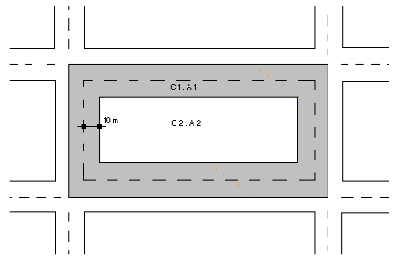

# Instrução Normativa IAT nº 21/2025 — ANEXO VIII {#instrucao-normativa-iat-21-2025-anexo8}

> Anexo de [[instrucao-normativa-iat-21-2025#anexo8|Instrução Normativa IAT nº 21/2025, ANEXO VIII]]. Exigido em [[instrucao-normativa-iat-21-2025#art13_cpt_inc18|art. 13, XVIII]] (LAS/LASA tipo 2), [[instrucao-normativa-iat-21-2025#art14_cpt_inc17|art. 14, XVII]] (LAS/LASA tipo 3) e [[instrucao-normativa-iat-21-2025#art19_cpt_inc15|art. 19, XV]] (LI/LIA). O cabeçalho original abaixo diz ANEXO VII; a divergência é preservada e explicada nas notas.

## Texto do anexo {#texto-anexo}

- **Anexo VIII, linha 1** {#anexo8_lin1} ANEXO VII

- **Anexo VIII, linha 2** {#anexo8_lin2} TERMO DE REFERÊNCIA

- **Anexo VIII, linha 3** {#anexo8_lin3} PROJETO DE DRENAGEM SUPERFICIAL

- **Anexo VIII, linha 4** {#anexo8_lin4} O Projeto de Drenagem Superficial deverá ser elaborado e executado por profissional habilitado, observando as normas brasileiras e legislação municipal vigentes, seguindo as diretrizes abaixo relacionadas.

- **Anexo VIII, linha 5** {#anexo8_lin5} 1. IDENTIFICAÇÃO DO EMPREENDEDOR

- **Anexo VIII, linha 6** {#anexo8_lin6} − Nome:

- **Anexo VIII, linha 7** {#anexo8_lin7} − Razão Social:

- **Anexo VIII, linha 8** {#anexo8_lin8} − Endereço completo:

- **Anexo VIII, linha 9** {#anexo8_lin9} − CNPJ e Inscrição Estadual:

- **Anexo VIII, linha 10** {#anexo8_lin10} 2. IDENTIFICAÇÃO DA EMPRESA OU PROFISSIONAL RESPONSÁVEL PELA ELABORAÇÃO DO PROJETO

- **Anexo VIII, linha 11** {#anexo8_lin11} − Razão social ou nome completo (caso profissional autônomo):

- **Anexo VIII, linha 12** {#anexo8_lin12} − Endereço completo:

- **Anexo VIII, linha 13** {#anexo8_lin13} − CNPJ e Inscrição Estadual (caso empresa), nome do responsável legal, nome da pessoa de contato, e-mail e número do telefone:

- **Anexo VIII, linha 14** {#anexo8_lin14} 3. IDENTIFICAÇÃO E LOCALIZAÇÃO DO EMPREENDIMENTO

- **Anexo VIII, linha 15** {#anexo8_lin15} − Nome do empreendimento:

- **Anexo VIII, linha 16** {#anexo8_lin16} − Quando aplicável, cópia da Licença Prévia (LP) emitida para o empreendimento:

- **Anexo VIII, linha 17** {#anexo8_lin17} − Modalidade do empreendimento quanto a:

- **Anexo VIII, linha 18** {#anexo8_lin18} o Parcelamento do solo para loteamento, desmembramento ou condomínio de lotes;

- **Anexo VIII, linha 19** {#anexo8_lin19} o Condomínios para fins habitacionais, industriais ou comerciais;

- **Anexo VIII, linha 20** {#anexo8_lin20} o Conjuntos Habitacionais de Interesse Social;

- **Anexo VIII, linha 21** {#anexo8_lin21} o Construções de Barracões.

- **Anexo VIII, linha 22** {#anexo8_lin22} 4. PLANTAS

- **Anexo VIII, linha 23** {#anexo8_lin23} 4.1. Os projetos que contemplarem instalações necessárias à drenagem de água pluvial em Área de Preservação Permanente, deverão seguir as diretrizes apresentadas na [[portaria-iat-276-2024|Portaria IAT n° 276/2024]].

- **Anexo VIII, linha 24** {#anexo8_lin24} 4.2. As plantas das redes de galerias de águas pluviais deverão ser apresentadas em escala até no máximo 1:2.000 e incluírem os seguintes elementos:

- **Anexo VIII, linha 25** {#anexo8_lin25} o Traçado da rede de galerias, poços de visita, bocas de lobo, caixa de ligação, dissipadores e lançamentos no corpo hídrico com indicação da coordenada UTM;

- **Anexo VIII, linha 26** {#anexo8_lin26} o Indicação em cada trecho de galerias do seu comprimento, diâmetro, declividade e vazão.

- **Anexo VIII, linha 27** {#anexo8_lin27} 4.3. Apresentar os perfis das ruas e das galerias com as cotas do terreno e da canalização junto a cada poço de visita, extensão, diâmetro, declividade e vazão em cada trecho. Todos os elementos supracitados devem estar identificados, com a mesma identificação apresentada na planta de traçado solicitada acima (por exemplo BL-01: Boca de Lobo de numeração um). A escala em perfil será de até no máximo 1:2.000 (horizontal) e 1:200 (vertical).

- **Anexo VIII, linha 28** {#anexo8_lin28} 4.4. Apresentar uma planta de conjunto da área urbana ou de parte dela, com os limites da bacia em estudo, preferencialmente em escala 1:5.000, com a localização do sistema proposto.

- **Anexo VIII, linha 29** {#anexo8_lin29} 4.5. Os detalhes dos dispositivos de drenagem pluvial (boca de lobo, caixa de ligação, poço de visita, etc.) deverão ser apresentados em escala adequada. Na falta de dispositivos de drenagem padrão do município, o mesmo poderá adotar os dispositivos de drenagem do Instituto Água e Terra.

- **Anexo VIII, linha 30** {#anexo8_lin30} 5. MEMORIAIS DESCRITIVO E DE CÁLCULO

- **Anexo VIII, linha 31** {#anexo8_lin31} 5.1. O Memorial Descritivo deverá esclarecer a situação geral da obra, definir os elementos constituintes, os materiais adotados e as especificações de execução dos serviços.

- **Anexo VIII, linha 32** {#anexo8_lin32} 5.2. O Memorial de Cálculo deverá elucidar os critérios adotados para o projeto. Para a adoção dos critérios, deve-se considerar as recomendações apresentadas em sequência neste termo de referência.

- **Anexo VIII, linha 33** {#anexo8_lin33} 5.3. A Planilha de Cálculo da Rede de Drenagem deverá trazer os dados, em cada trecho, que traduzam o dimensionamento do cálculo hidráulico das galerias. Contendo, no mínimo os seguintes valores adotados/calculados:

- **Anexo VIII, linha 34** {#anexo8_lin34} − Extensão do trecho;

- **Anexo VIII, linha 35** {#anexo8_lin35} − Coeficiente de runoff;

- **Anexo VIII, linha 36** {#anexo8_lin36} − Área de contribuição;

- **Anexo VIII, linha 37** {#anexo8_lin37} − Tempo de concentração;

- **Anexo VIII, linha 38** {#anexo8_lin38} − Intensidade pluviométrica;

- **Anexo VIII, linha 39** {#anexo8_lin39} − Vazão (na área de contribuição);

- **Anexo VIII, linha 40** {#anexo8_lin40} − Diâmetros das tubulações adotadas;

- **Anexo VIII, linha 41** {#anexo8_lin41} − Declividade da tubulação;

- **Anexo VIII, linha 42** {#anexo8_lin42} − Velocidade na tubulação e capacidade da tubulação (vazão).

- **Anexo VIII, linha 43** {#anexo8_lin43} Todo o dimensionamento deverá ser realizado considerando os dados e parâmetros básicos para projeto apresentados em sequência.

- **Anexo VIII, linha 44** {#anexo8_lin44} 6. DADOS E PARÂMETROS BÁSICOS PARA PROJETO

- **Anexo VIII, linha 45** {#anexo8_lin45} 6.1. Para a elaboração do projeto do sistema de galerias de águas pluviais do município deverão ser utilizados os dados e parâmetros básicos fixados pelas normas do Instituto das Águas do Paraná e que seguem as recomendações do Relatório de Estudo para o Controle da Erosão no Noroeste do Estado do Paraná-OEA/DNOS.

- **Anexo VIII, linha 46** {#anexo8_lin46} a) Posto Pluviométrico: Devem ser empregados os dados de intensidade das chuvas dos postos relacionados adiante, ou por aproximação de acordo com o mapa de isoietas anexo.

- **Anexo VIII, linha 47** {#anexo8_lin47} b) Topografia: Para o desenvolvimento do projeto deve-se utilizar levantamento topográfico ou aerofotogramétrico nas escalas até no máximo 1:2.000, com curvas de nível espaçadas de metro a metro.

- **Anexo VIII, linha 48** {#anexo8_lin48} c) Cálculo das Vazões a Escoar nas Galerias: As vazões de contribuição devem ser calculadas pelo Método Racional, para bacias contribuintes pequenas (menor que 2,5 km²), utilizando-se a equação representada abaixo.

- **Anexo VIII, linha 49** {#anexo8_lin49} Q = £ . C . i . A

- **Anexo VIII, linha 50** {#anexo8_lin50} Sendo que:

- **Anexo VIII, linha 51** {#anexo8_lin51} o Q = vazão do projeto (m3/s);

- **Anexo VIII, linha 52** {#anexo8_lin52} o £ = coeficiente de distribuição da precipitação (considerar igual a um, pois as bacias de contribuição são relativamente pequenas, podendo ser desprezado o efeito de dispersão das chuvas);

- **Anexo VIII, linha 53** {#anexo8_lin53} o C = coeficiente de escoamento superficial;

- **Anexo VIII, linha 54** {#anexo8_lin54} o i = intensidade de precipitação pluviométrica (m³/s.ha);

- **Anexo VIII, linha 55** {#anexo8_lin55} o A = área da bacia contribuinte (ha).

- **Anexo VIII, linha 56** {#anexo8_lin56} d) Tempo de Concentração: O tempo de concentração para sistemas de galerias de águas pluviais nas drenagens urbanas consiste no tempo requerido para a água percorrer a superfície até a boca de lobo mais próxima, acrescido do tempo de escoamento no interior do coletor, desde a abertura de engolimento, até a seção considerada. O tempo de concentração, numa determinada seção de galerias será calculado pela seguinte equação:

- **Anexo VIII, linha 57** {#anexo8_lin57} tC = tS + tE

- **Anexo VIII, linha 58** {#anexo8_lin58} Sendo que:

- **Anexo VIII, linha 59** {#anexo8_lin59} o tC = tempo de concentração;

- **Anexo VIII, linha 60** {#anexo8_lin60} o tS = tempo de escoamento superficial;

- **Anexo VIII, linha 61** {#anexo8_lin61} o tE= tempo de escoamento nas galerias até a seção considerada.

- **Anexo VIII, linha 62** {#anexo8_lin62} − OBS 1: Para a determinação do tempo de escoamento superficial inicial existem fórmulas, e recomendações para que este tempo fique este 5 e 20 minutos. Este valor não deverá ultrapassar dez (10) minutos segundo recomendações do Anexo Técnico do Relatório para Controle de Erosão no Noroeste do Estado do Paraná.

- **Anexo VIII, linha 63** {#anexo8_lin63} − OBS 2: O tempo de escoamento é calculado dividindo-se a velocidade média de escoamento na tubulação pela extensão do percurso.

- **Anexo VIII, linha 64** {#anexo8_lin64} e) Chuva crítica:

- **Anexo VIII, linha 65** {#anexo8_lin65} − Período de Recorrência: adotar o período de recorrência de chuva crítico, de acordo com a segurança que se quer dar ao sistema. Assim, quanto maior este tempo, maiores serão as intensidades das chuvas de projeto, e consequentemente maior a segurança do sistema, o que implica em custo mais elevado das obras. Recomendamos tempo de recorrência de 3 anos para a rede de galerias, 10 anos para emissários e canais, e de 50 a 500 anos para barragens, valores estes que permitem trabalhar com boa segurança sem elevar demais o custo de implantação das obras.

- **Anexo VIII, linha 66** {#anexo8_lin66} − Intensidade de precipitação: Adotar a equação de precipitação da chuva mais adequada, conforme a proximidade do posto ou semelhança pluviométrica - mapa de isoietas. Abaixo relacionamos as equações de chuvas intensas para vários postos pluviométricos do Estado do Paraná (em mm/h - multiplicar por 2,778 para resultados em l/s).

### Tabela 1 — Equações de chuvas intensas (sem título no original) {#anexo8_tab1}

- **Anexo VIII, Tabela 1, linha 1** {#anexo8_tab1_lin1} Município: Curitiba | Equação: i = (5950 . TR0,217) / (t + 26)1,15 | Observações: Obtida por Pedro V. Parigot de Souza

- **Anexo VIII, Tabela 1, linha 2** {#anexo8_tab1_lin2} Município: Jacarezinho | Equação: Para TR de 3 anos: i = 31200 / (t + 50)1,38; Para TR de 10 anos: i = 59820 / (t + 50)1.49 | Observações: Fonte: Projeto Noroeste

- **Anexo VIII, Tabela 1, linha 3** {#anexo8_tab1_lin3} Município: Cianorte | Equação: i = (2115,18 . TR0,145) / (t + 22)0,849 | Observações: Obtida por Waldir Moura Ayres e Luiz Henrique Lopes (DER-PR)

- **Anexo VIII, Tabela 1, linha 4** {#anexo8_tab1_lin4} Município: Cascavel | Equação: i = (1062,92 . TR0,141) / (t + 5)0,776 | Observações: Equações obtidas por Roberto Fendrich e Cínthia Obladen de Almendra ( ISAM/PUC-PR )

- **Anexo VIII, Tabela 1, linha 5** {#anexo8_tab1_lin5} Município: Umuarama | Equação: i = (1752,27 . TR0,148) / (t + 17)0,840 | Observações: Equações obtidas por Roberto Fendrich e Cínthia Obladen de Almendra ( ISAM/PUC-PR )

- **Anexo VIII, Tabela 1, linha 6** {#anexo8_tab1_lin6} Município: Telêmaco Borba | Equação: i = (3235,19 . TR0,163) / (t + 24)0,968 | Observações: Equações obtidas por Roberto Fendrich e Cínthia Obladen de Almendra ( ISAM/PUC-PR )

- **Anexo VIII, linha 67** {#anexo8_lin67} − Coeficiente de escoamento superficial: Para a determinação do coeficiente de escoamento superficial, existem valores determinados para cada tipo de cobertura do terreno, sendo adotados pelo Instituto Água e Terra os seguintes valores principais:

- **Anexo VIII, linha 68** {#anexo8_lin68} o C = 0,30 para áreas não pavimentadas;

- **Anexo VIII, linha 69** {#anexo8_lin69} o C = 0,90 para áreas pavimentadas ou cobertas.

- **Anexo VIII, linha 70** {#anexo8_lin70} Para simplificação do cálculo, pode-se determinar um coeficiente médio, representando as áreas cobertas; as ruas com pavimentação asfáltica, calçadas revestidas, e uma faixa lateral contínua com 10 metros de largura em ambos os lados da rua e, representando as áreas permeáveis; as áreas internas dos quarteirões.

- **Anexo VIII, linha 71** {#anexo8_lin71} Considerando as informações apresentadas acima, temos o coeficiente de escoamento superficial resultante:

- **Anexo VIII, linha 72** {#anexo8_lin72} − lotes 100% impermeabilizados: C = 0,90;

- **Anexo VIII, linha 73** {#anexo8_lin73} − lotes 90% impermeabilizados: C = 0,84;

- **Anexo VIII, linha 74** {#anexo8_lin74} − lotes 80% impermeabilizados: C = 0,78;

- **Anexo VIII, linha 75** {#anexo8_lin75} − lotes 70% impermeabilizados: C = 0,72.

- **Anexo VIII, linha 76** {#anexo8_lin76} 

- **Anexo VIII, linha 77** {#anexo8_lin77} CM = (C1 + A1 + C2 + A2) / AT

- **Anexo VIII, linha 78** {#anexo8_lin78} Sendo que:

- **Anexo VIII, linha 79** {#anexo8_lin79} − C1 . A1 = área contribuinte pavimentada;

- **Anexo VIII, linha 80** {#anexo8_lin80} − C2 . A2 = área contribuinte não pavimentada;

- **Anexo VIII, linha 81** {#anexo8_lin81} − AT = área total.

- **Anexo VIII, linha 82** {#anexo8_lin82} 6.2. Método de dimensionamento dos coletores

- **Anexo VIII, linha 83** {#anexo8_lin83} Para o dimensionamento dos coletores será utilizada a fórmula de Manning.

- **Anexo VIII, linha 84** {#anexo8_lin84} V = (1 / n) . Rh2/3 . I1/2

- **Anexo VIII, linha 85** {#anexo8_lin85} Sendo que:

- **Anexo VIII, linha 86** {#anexo8_lin86} − V = velocidade de escoamento em m/s;

- **Anexo VIII, linha 87** {#anexo8_lin87} − R = raio hidráulico da seção de vazão em um;

- **Anexo VIII, linha 88** {#anexo8_lin88} − I = declividade superficial de linha d'água;

- **Anexo VIII, linha 89** {#anexo8_lin89} − n = coeficiente de rugosidade (n = 0,015 p/ tubos de concreto).

- **Anexo VIII, linha 90** {#anexo8_lin90} Os tubos são dimensionados a seção plena e as velocidades limites adotadas são:

- **Anexo VIII, linha 91** {#anexo8_lin91} − Velocidade Mínima: 0,75 m/s (nos tubos de diâmetro de 0,40m e 0,60m, em regiões de solos facilmente carreáveis, adota-se declividade mínima de 1,5% e 1,2% respectivamente para impedir o assoreamento dos mesmos. O ideal seria usar uma velocidade sanitária mínima de 2,00 m/s, capaz de fazer a limpeza dos tubos);

- **Anexo VIII, linha 92** {#anexo8_lin92} − Velocidade Máxima: 5 m/s (pesquisa contratada junto a Universidade Católica do Paraná, concluiu que o limite pode ser aumentado para 7 m/s). O aumento deste limite máximo acarreta a redução do diâmetro e consequentemente dos acessórios das redes galerias de águas pluviais a serem implantadas, reduzindo seus custos;

- **Anexo VIII, linha 93** {#anexo8_lin93} − No Paraná, os diâmetros comerciais comumente adotados são os de 0,40m, 0,60m, 0,80m, 1,00m, 1,20m, 1,50m, 2,00m e 2,20m.

- **Anexo VIII, linha 94** {#anexo8_lin94} 7. Sarjetas

- **Anexo VIII, linha 95** {#anexo8_lin95} O cálculo de verificação de superfície das sarjetas consiste numa comparação entre a vazão de solicitação, determinada pelo método Racional, e a vazão correspondente à cota máxima de alagamento, definida como sendo aquela a partir da qual poderia ocorrer extravasamento, calculada com base em uma equação de canal, como a de Izzard, a seguir apresentada:

- **Anexo VIII, linha 96** {#anexo8_lin96} Q = 0,375 . (Z / n) . I1/2 . y8/3

- **Anexo VIII, linha 97** {#anexo8_lin97} Sendo que:

- **Anexo VIII, linha 98** {#anexo8_lin98} − y = altura da água na sarjeta em centímetros;

- **Anexo VIII, linha 99** {#anexo8_lin99} − Z = inverso da declividade transversal do fundo da sarjeta;

- **Anexo VIII, linha 100** {#anexo8_lin100} − n = coeficiente de rugosidade;

- **Anexo VIII, linha 101** {#anexo8_lin101} − I = declividade longitudinal da sarjeta em m/m.

- **Anexo VIII, linha 102** {#anexo8_lin102} 7.1. Elementos Construtivos

- **Anexo VIII, linha 103** {#anexo8_lin103} 7.1.1. Poços de Visita

- **Anexo VIII, linha 104** {#anexo8_lin104} Deverão ser utilizados poços de visita nos seguintes casos:

- **Anexo VIII, linha 105** {#anexo8_lin105} − extremidades de montante;

- **Anexo VIII, linha 106** {#anexo8_lin106} − cruzamentos de ruas;

- **Anexo VIII, linha 107** {#anexo8_lin107} − mudanças de diâmetro da galeria;

- **Anexo VIII, linha 108** {#anexo8_lin108} − mudanças de direção da galeria;

- **Anexo VIII, linha 109** {#anexo8_lin109} − junções de galerias;

- **Anexo VIII, linha 110** {#anexo8_lin110} − mudanças de declividade;

- **Anexo VIII, linha 111** {#anexo8_lin111} − trechos longos, de maneira que a distância entre dois poços consecutivos fique em torno de 120 metros, para efeitos de limpeza e inspeção das galerias.

- **Anexo VIII, linha 112** {#anexo8_lin112} Esses poços serão aproveitados como caixas de recepção das águas das bocas de lobo, suportando no máximo quatro junções. Para maior número de ligações ou quando duas conexões tiverem que ser feitas numa mesma parede, adotar-se-á uma caixa de coleta não visitável para receber estas conexões.

- **Anexo VIII, linha 113** {#anexo8_lin113} − OBS 3: A fim de evitar velocidades excessivas nas galerias, onde a declividade do terreno for muito alta, devem ser previstos poços de queda (PQ).

- **Anexo VIII, linha 114** {#anexo8_lin114} 7.1.2. Bocas de Lobo

- **Anexo VIII, linha 115** {#anexo8_lin115} As bocas-de-lobo são localizadas em ambos os lados das ruas, nas partes mais baixas das quadras, a montante das esquinas e, em situações intermediárias com a finalidade de se evitar o escoamento superficial em longas extensões de ruas.

- **Anexo VIII, linha 116** {#anexo8_lin116} As canalizações de ligação entre bocas-de-lobo e destas aos poços de visita terão um diâmetro de 0,40m e declividade mínima de 1,0%. Quando não existir possibilidade dessas ligações serem feitas diretamente, as bocas-de-lobo serão ligadas a caixas de ligações acopladas ao coletor.

- **Anexo VIII, linha 117** {#anexo8_lin117} A capacidade de engolimento da boca-de-lobo é função da inclinação longitudinal da rua, da forma de sua seção transversal, da depressão ou não junto à boca-de-lobo, das aberturas destinadas ao engolimento, tanto laterais com verticais, da existência de defletores, etc.

- **Anexo VIII, linha 118** {#anexo8_lin118} A verificação da vazão de solicitação, com a capacidade de engolimento, determinada através de ábacos, fornecidos, por laboratórios de pesquisa, como os apresentados pela John Hopkins University.

- **Anexo VIII, linha 119** {#anexo8_lin119} É conveniente notar que um excesso, que passe para a boca-de-lobo seguinte de 10% da vazão de engolimento, é considerado condição econômica.

- **Anexo VIII, linha 120** {#anexo8_lin120} Na prática, devido a falhas de execução e falta de manutenção adequada, recomenda-se um espaçamento entre as bocas de lobo, de maneira que a capacidade de engolimento de cada unidade não ultrapasse 60 l/s.

- **Anexo VIII, linha 121** {#anexo8_lin121} 7.1.3. Caixas de Ligação

- **Anexo VIII, linha 122** {#anexo8_lin122} Nos casos onde a ligação das bocas de lobo no coletor não puder ser feita através dos poços de visita/queda, foi especificada caixas de ligação.

- **Anexo VIII, linha 123** {#anexo8_lin123} Não devem ser utilizadas para mudança de direção da rede, mudança de diâmetro ou de declividade das galerias.

- **Anexo VIII, linha 124** {#anexo8_lin124} 8. BACIA DE ACUMULAÇÃO DE CHEIAS

- **Anexo VIII, linha 125** {#anexo8_lin125} Devido à complexidade para a solução exata do problema de abatimento de cheias, os pesquisadores estabelecem relação direta entre o Volume Detido e as principais variáveis hidrológicas, obtendo-se aproximações das vazões de entrada e de saída em função da vazão total e o tempo de concentração.

- **Anexo VIII, linha 126** {#anexo8_lin126} Existem diversos métodos propostos para simplificar os cálculos. Sugerimos o cálculo simplificado de Wilken, baseado no Método Müller-Neuhaus, sendo que para uma relação de 20% da Vazão de Saída em relação à Vazão de Entrada, temos:

- **Anexo VIII, linha 127** {#anexo8_lin127} Volume = 0,69897 . Qa . TC

- **Anexo VIII, linha 128** {#anexo8_lin128} Sendo que:

- **Anexo VIII, linha 129** {#anexo8_lin129} − Volume = Volume da Bacia de Acumulação de Cheias (m³);

- **Anexo VIII, linha 130** {#anexo8_lin130} − Qa = Vazão Afluente (máxima de entrada para TR = 10 anos) (m³/s);

- **Anexo VIII, linha 131** {#anexo8_lin131} − Tc = tempo de concentração (s).

- **Anexo VIII, linha 132** {#anexo8_lin132} Para segurança, sugerimos altura máxima de lâmina d’água de 1,20 m.

- **Anexo VIII, linha 133** {#anexo8_lin133} Para evitar problemas de entupimento de tubulação, o Emissário Reduzido deverá ter tubos com diâmetro mínimo de 0,60 m, sendo a Vazão controlada pela declividade dos tubos ou por dispositivos de saída (vertedores ou orifícios).

- **Anexo VIII, linha 134** {#anexo8_lin134} 8.1. Referências Bibliográficas

- **Anexo VIII, linha 135** {#anexo8_lin135} WIKEN, P. S. Engenharia de drenagem superficial. São Paulo, Companhia de Tecnologia de Saneamento Ambiental, 1978.

- **Anexo VIII, linha 136** {#anexo8_lin136} MITTELSTAEDT, CARLA. Enfoque Técnico das Experiências para o Controle da Erosão Urbana. Anais do III Simpósio Nacional de Controle da Erosão, 1985.

- **Anexo VIII, linha 137** {#anexo8_lin137} FENDRICH, ROBERTO. Pesquisas do Instituto de Saneamento Ambiental – ISAM. PUC Relacionadas ao Fenômeno da Erosão Urbana na Região Noroeste do Estado do Paraná.

- **Anexo VIII, linha 138** {#anexo8_lin138} COSTA, R. A. D. Relatório do estudo para o controle da erosão no noroeste do Paraná - OEA / DNOS - ANEXO TÉCNICO.

- **Anexo VIII, linha 139** {#anexo8_lin139} 9. ANOTAÇÃO DE RESPONSABILIDADE TÉCNICA

- **Anexo VIII, linha 140** {#anexo8_lin140} Anotação de Responsabilidade Técnica do profissional elaborador do projeto e do responsável pela implantação do mesmo, junto aos respectivos conselhos de classe.

- **Anexo VIII, linha 141** {#anexo8_lin141} 10. DEMAIS REFERÊNCIAS BIBLIOGRÁFICAS

- **Anexo VIII, linha 142** {#anexo8_lin142} Citar demais referências consultadas, incluindo as páginas eletrônicas com data e hora do acesso, segundo as normas de publicação de trabalhos científicos da Associação Brasileira de Normas Técnicas – ABNT.

- **Anexo VIII, linha 143** {#anexo8_lin143} OBS: Todos os estudos e plantas deverão ser apresentados em meio digital, em arquivos formato PDF.

## Síntese do conversor (não é texto normativo) {#sintese-conversor}

### Aplicação e enquadramento

O projeto se aplica aos empreendimentos imobiliários urbanos abrangidos pelo [[instrucao-normativa-iat-21-2025#art2|art. 2º]]: parcelamento do solo, condomínios habitacionais/industriais/comerciais, construção de barracões e parques urbanos. As exigências expressas do termo de referência estão nos arts. 13, XVIII (LAS/LASA tipo 2), 14, XVII (LAS/LASA tipo 3) e 19, XV (LI/LIA). Embora o item 3 do anexo não enumere parques, o art. 14 exige expressamente seu projeto de drenagem. Conjuntos habitacionais de interesse social aparecem na lista do anexo, mas o [[instrucao-normativa-iat-21-2025#art34|art. 34]] remete o licenciamento a instrução normativa específica.

O [[instrucao-normativa-iat-21-2025#art30_cpt_inc11|art. 30, XI]], exige projeto **as built** de drenagem superficial na LIR, sem remissão expressa a este anexo; essa obrigação não foi equiparada automaticamente às modalidades com exigência direta do termo. O corpo da IN também deve ser consultado para exigências adicionais, incluindo as caixas/bacias de contenção indicadas nos arts. 13, XIX, e 19, XVI, quando houver aumento de vazão por impermeabilização.

### Conteúdo que o projeto deve apresentar

- **Cadastro e responsabilidade:** identificação do empreendedor, responsável pelo projeto e empreendimento; LP quando aplicável; ART do elaborador e do responsável pela implantação, junto aos respectivos conselhos; execução por profissional habilitado, observância das normas brasileiras e legislação municipal.
- **Plantas e perfis:** traçado das galerias, bocas de lobo, caixas, poços, dissipadores e lançamentos com coordenadas UTM; comprimento, diâmetro, declividade e vazão por trecho. Planta da rede até a escala indicada de 1:2.000; perfis até 1:2.000 horizontal e 1:200 vertical, com cotas e identificação concordante; planta da bacia preferencialmente 1:5.000; detalhes em escala adequada. Instalações de drenagem em APP seguem a [[portaria-iat-276-2024|Portaria IAT nº 276/2024]], conforme item 4.1.
- **Memoriais e planilha por trecho:** situação geral da obra, elementos, materiais, execução e critérios; extensão, coeficiente de escoamento, área contribuinte, tempo de concentração, intensidade de chuva, vazão, diâmetro adotado, declividade, velocidade e capacidade do tubo.
- **Hidrologia:** identificar o posto/curva de chuva e justificar proximidade ou semelhança pluviométrica. A IN prevê Método Racional para bacias menores que 2,5 km²; coeficiente de distribuição igual a 1; tempo de concentração como soma do percurso superficial e na galeria. Recomenda recorrência de 3 anos na rede, 10 anos em emissários/canais e 50–500 anos em barragens. A tabela contém equações de seis municípios, com duas opções de recorrência para Jacarezinho. Topografia até 1:2.000 com curvas a cada metro.
- **Cobertura e coletores:** mapear áreas impermeáveis e permeáveis, justificando C = 0,90 e C = 0,30, respectivamente, e os coeficientes agregados. Dimensionamento por Manning, concreto com n = 0,015 e seção plena; velocidade mínima indicada de 0,75 m/s e máxima de 5 m/s. O texto discute 2 m/s para limpeza e pesquisa sobre aumento a 7 m/s; esses valores não foram convertidos em limites gerais obrigatórios. Para solos facilmente carreáveis, o anexo indica declividades de 1,5% e 1,2% nos diâmetros 0,40 m e 0,60 m, respectivamente.
- **Sarjetas e estruturas:** verificar a vazão solicitante frente à capacidade antes do extravasamento. Poços de visita nas extremidades de montante, cruzamentos, mudanças e junções; distância em torno de 120 m nos trechos longos; no máximo quatro junções por poço. Prever poços de queda em grandes declividades. Posicionar e conferir bocas de lobo; conexões de 0,40 m e declividade mínima de 1%; recomendação de capacidade por unidade até 60 L/s. A IN **proíbe caixas de ligação para mudar direção, diâmetro ou declividade**.
- **Amortecimento de cheias:** demonstrar a solução de armazenamento e controle de saída. A IN sugere Wilken/Müller-Neuhaus, saída/entrada de 20% e V = 0,69897·Qa·Tc, com Qa em m³/s para TR = 10 anos e Tc em segundos. Sugere lâmina máxima de 1,20 m; emissário reduzido com diâmetro mínimo de 0,60 m, controlado por declividade, vertedor ou orifício. A derivação do método não foi confirmada por fonte independente nesta conversão.
- **Entrega:** estudos e plantas em PDF digital; referências segundo ABNT, incluindo data e hora de acesso às páginas eletrônicas.

### Termos técnicos e fontes

**Runoff** é o coeficiente de escoamento superficial: fração da precipitação que contribui para o escoamento; intensidade–duração–frequência (IDF) relaciona intensidade de chuva, duração e recorrência. Esses termos e os dispositivos de microdrenagem já constam do glossário da base. Reaproveitado o [Manual de Microdrenagem de Campinas](https://portal-api.campinas.sp.gov.br/sites/default/files/servicos/MANUAL_DE_APRESENTACAO_DE_PROJETOS_MICRODRENAGEM.pdf), citado ali; não houve leitura integral desse manual para esta conversão.

**Isoieta** conecta pontos com iguais quantidades de precipitação, segundo o [glossário NOAA/NWS, verbete Isohyet](https://forecast.weather.gov/glossary.php?word=isohyet). Essa definição explica o mapa citado, sem certificar a intercambialidade de curvas IDF. O mapa mencionado no anexo e os ábacos de engolimento não foram reproduzidos no termo de referência fornecido.

**Manning e raio hidráulico:** para fluxo uniforme, V = R^(2/3)·I^(1/2)/n; R = área molhada/perímetro molhado, em metros no SI. **Sarjeta** conduz água até a captação; sua capacidade depende da geometria, declividade e rugosidade. Fonte efetivamente lida: [DNIT, Manual de Drenagem de Rodovias, IPR 724, 2ª ed., 2006](https://www.gov.br/dnit/pt-br/assuntos/planejamento-e-pesquisa/ipr/coletanea-de-manuais/vigentes/724_manual_drenagem_rodovias.pdf), p. 37 e seção 6.2, p. 280.

**Detenção** armazena temporariamente água para reduzir o pico de saída; não elimina, por si, o volume escoado. **Orifício** controla descarga por área e carga hidráulica; **vertedor** permite passagem sobre uma crista, com vazão dependente da largura e carga. Fonte efetivamente lida: [FHWA, HEC-22, 3ª ed., 2009/rev. 2013](https://www.fhwa.dot.gov/engineering/hydraulics/pubs/10009/10009.pdf), capítulo 8, pp. 8-1–8-2, 8-20–8-21 e 8-23. Essa edição está arquivada e substituída pela 4ª edição de 2024; foi usada somente para conceitos, sem importar critérios de dimensionamento externos à IN.

**Poço de queda** é um poço de visita com queda interna que permite controlar a declividade. A [DER/PR ES-D 12/18](https://www.der.pr.gov.br/sites/der/arquivos_restritos/files/documento/2019-10/esd1218dispositivosdedrenagempluvialurbana.pdf), seção 3.5, foi lida. Sua seção 3.4 admite caixas de ligação para alterar declividade ou dimensão; essa possibilidade, já mencionada no glossário, **não substitui a proibição específica da IN**, item 7.1.3, para o projeto aqui tratado.

### Pontos que o responsável técnico deve esclarecer no memorial

O original apresenta erros preservados na transcrição: a OBS 2 inverte a relação física do tempo de percurso (o tempo é extensão/velocidade); a expressão de CM soma coeficientes adimensionais com áreas, em vez de apresentar uma média ponderada dimensionalmente consistente; “raio hidráulico [...] em um” não fornece unidade válida. A conversão de mm/h por 2,778 corresponde a L/(s·ha), exigindo área para obter L/s; o próprio termo anuncia apenas L/s.

A comparação com o DNIT, p. 280, é particularmente relevante: a equação de Izzard com fator 0,375 utiliza **y em metros e Q em m³/s**, enquanto a IN imprime y em **centímetros** e omite a unidade de Q. Não se deve aplicar diretamente essa combinação de unidades sem esclarecimento técnico. O intervalo 5–20 minutos da OBS 1 aparece seguido de recomendação de teto de 10 minutos; documentar o critério adotado, sem apagar a divergência do texto.

A síntese explica as inconsistências; não altera a IN nem certifica a validade do cálculo ou a aprovação do projeto. Todas as fontes externas acima são interpretativas e estão separadas da transcrição.

## Notas de transcrição

- Fonte: PDF fornecido, páginas 75–86 de 108. Índice e arts. 13, XVIII; 14, XVII; 19, XV, denominam o projeto de drenagem **Anexo VIII**, mas a página 75 imprime **ANEXO VII**. O arquivo e os IDs seguem o índice/remissões; o título impresso permanece no texto.
- Transcrição gerada por script a partir dos blocos do PDF; cabeçalhos institucionais e rodapés repetidos removidos. Parágrafos e listas partidos entre linhas/páginas unidos. Restaurados os hífens de “recomenda-se” (página 85) e de “mm/h - multiplicar” (página 80), perdidos pelo `pdftotext` sem `-layout` e conferidos nas imagens.
- A única tabela, na página 80, foi lida na imagem: **6 linhas de municípios**, com duas equações na linha Jacarezinho. Recebeu o número 1 e título descritivo, inexistentes no original. A célula de observações mesclada de Cascavel, Umuarama e Telêmaco Borba foi repetida em cada linha. Preservado o ponto decimal “1.49” na equação de Jacarezinho para TR de 10 anos; os demais expoentes mantêm vírgula.
- As seis equações fora da tabela foram lidas nas imagens das páginas 78, 79, 82, 83 e 85 e representadas linearmente com parênteses, barras de divisão e ``/``. Conservados todos os operadores impressos, inclusive a soma de C e A no numerador de CM. Mantido o símbolo “£” usado como coeficiente de distribuição da precipitação.
- A figura sem título da página 81 foi conservada por recorte do PDF, sem redesenho. Os textos C1.A1, C2.A2 e 10 m pertencem à figura; a descrição no texto alternativo é do conversor.
- Erros e ambiguidades originais preservados: OBS 1 “fique este 5 e 20 minutos”, seguida do teto de 10 minutos; OBS 2 apresenta tempo como velocidade dividida pela extensão; CM soma coeficientes e áreas; raio hidráulico descrito “em um”; conversão de mm/h por 2,778 anunciada em “l/s” sem área; Izzard declara y em centímetros e não define unidade de Q; bibliografia escreve “WIKEN”, enquanto o corpo escreve “Wilken”; “tanto laterais com verticais”, “foi especificada caixas” e referência à “John Hopkins University”.
- O “mapa de isoietas anexo” mencionado não está apresentado neste termo de referência; não foi localizado mapa identificado como tal na extração textual do restante do PDF. Os ábacos de engolimento também são citados sem reprodução. Nenhuma imagem ou valor externo foi inserido para suprir essas ausências.
- Conferência textual: comparação `difflib` com o `pdftotext`, descontando somente marcadores de lista, numeração de cabeçalhos deslocada na extração, tabela e equações lidas visualmente. A comparação encontrou somente duas diferenças: inserção do hífen após “mm/h” e recomposição de “recomendase” como “recomenda-se”, ambas conferidas nas imagens. As palavras “diâmetro e”, extraídas depois do rodapé da página 82, foram reunidas ao parágrafo ao retirar o rodapé. Tabela, equações e figura têm conferência visual própria.
