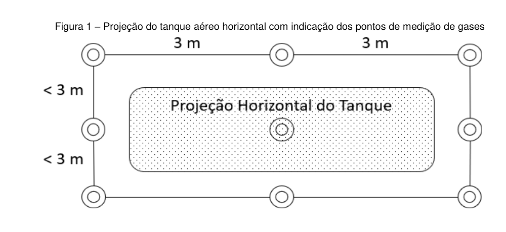
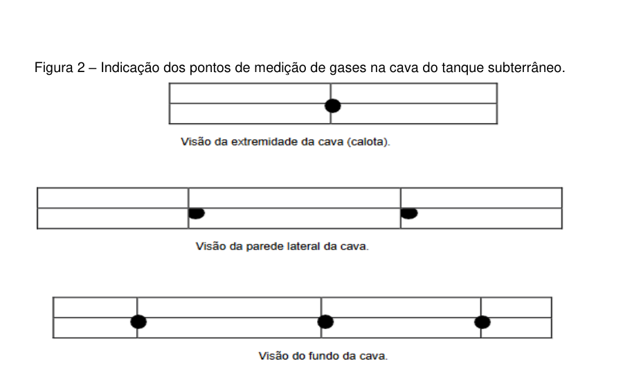

# ANEXO II — TERMO DE REFERÊNCIA PARA PROJETO EXECUTIVO DE REMOÇÃO DE COMPONENTES E DESMOBILIZAÇÃO DE SISTEMAS DE ARMAZENAMENTO SUBTERRÂNEO E AÉREO DE COMBUSTÍVEIS

## Texto do anexo

### 1. OBJETIVO

- **Anexo II, linha 1** {#anexo2_lin1} Orientar sobre o processo de remoção de componentes e desmobilização de Sistemas de Armazenamento Subterrâneo e Aéreo de Combustíveis e definir procedimentos para avaliação da integridade do meio físico (solo e água freática) local.

### 2. DEFINIÇÕES

- **Anexo II, linha 2** {#anexo2_lin2} A remoção é o processo de retirada de componentes de Sistemas de Armazenamento Subterrâneo e Aéreo de Combustíveis de um determinado empreendimento, não implicando no encerramento de suas atividades.
- **Anexo II, linha 3** {#anexo2_lin3} A desmobilização implica na retirada de todos os equipamentos componentes de sistemas de armazenamento de combustíveis, em razão do encerramento das atividades.

### 3. REMOÇÃO DE TANQUES

#### 3.1 Comunicação ao órgão ambiental

- **Anexo II, linha 4** {#anexo2_lin4} Antes do início dos trabalhos de remoção de tanques ou de desmobilização do sistema, o responsável pelo empreendimento deve se manifestar junto ao Instituto Água e Terra, requerendo autorização e fornecendo as informações que seguem:
- **Anexo II, linha 5** {#anexo2_lin5} Razão social da empresa contratada para efetuar a remoção (certificada pelo INMETRO), CNPJ, endereço, telefone, responsável técnico e e-mail.
- **Anexo II, linha 6** {#anexo2_lin6} Local de execução do trabalho: razão social do empreendimento, CNPJ, endereço, telefone e e-mail.
- **Anexo II, linha 7** {#anexo2_lin7} Descrição dos trabalhos a serem realizados. Em casos específicos, o órgão ambiental poderá estabelecer procedimentos complementares.
- **Anexo II, linha 8** {#anexo2_lin8} Data de início e previsão de término dos trabalhos.

#### 3.2 Coleta de dados básicos do local

- **Anexo II, linha 9** {#anexo2_lin9} Devem ser realizados levantamentos e entrevistas, visando obter informações relacionadas a seguir:
- **Anexo II, linha 10** {#anexo2_lin10} Características e situação (em uso ou desativados) dos equipamentos a serem removidos.
- **Anexo II, linha 11** {#anexo2_lin11} Movimentação média mensal (individual) de combustíveis dos tanques a serem removidos.
- **Anexo II, linha 12** {#anexo2_lin12} Eventos de vazamento, medidas tomadas e relatórios emitidos.
- **Anexo II, linha 13** {#anexo2_lin13} Layout do empreendimento com identificação dos locais do(s) antigo(s) tanque(s) e indicação da posição do(s) novo(s), em escala adequada.

#### 3.3 Procedimentos de Segurança

- **Anexo II, linha 14** {#anexo2_lin14} Checar as informações obtidas nas entrevistas.
- **Anexo II, linha 15** {#anexo2_lin15} Verificar as plantas de construção, reformas e/ou alterações realizadas.
- **Anexo II, linha 16** {#anexo2_lin16} Checar a localização dos equipamentos (ex: tanques, tubulações de combustível, pontos de descarga de produto, de energia elétrica e de telemetria).
- **Anexo II, linha 17** {#anexo2_lin17} Inspecionar a área quanto à presença de intervenções no subsolo e existência de utilidades subterrâneas, tais como: galerias, redes, etc., verificando a eventual presença de combustíveis através de medições da concentração de vapores e dos índices de explosividade.

#### 3.4 Locação dos pontos de medição de gases e de amostragem de solo

- **Anexo II, linha 18** {#anexo2_lin18} Para tanques aéreos:
- **Anexo II, linha 19** {#anexo2_lin19} Em área sob tanque aéreo vertical, desprovido de bacia de contenção impermeável, deve ser realizada medição de gases conforme indica a tabela que segue:

**Tabela 1 – Distribuição e número de pontos de medição de gases em área de tanque vertical a ser removido** {#anexo2_tab1}

| Diâmetro do tanque vertical (m) | Distribuídos igualmente no perímetro da circunferência do tanque com afastamento de 1m da parede vertical | No centro da circunferência | Total |
|---|---:|---:|---:|
| D ≤ 3 | 4 | 1 | 5 |
| 3 < D ≤ 6 | 8 | 1 | 9 |
| 6 < D ≤ 9 | 12 | 1 | 13 |
| D>9 | 20 | 1 | 21 |

- **Anexo II, linha 20** {#anexo2_lin20} Na remoção de tanque aéreo horizontal, desprovido de bacia de contenção impermeável, deverá ser realizada medição de gases na área de projeção do tanque e ao redor da mesma. O espaçamento entre os pontos deverá ser de no máximo 3 metros.
- **Anexo II, linha 21** {#anexo2_lin21} 
- **Anexo II, linha 22** {#anexo2_lin22} Em cada ponto de amostragem definido, deve ser realizada uma sondagem, até atingir o nível de água, ou até 5 metros, o que ocorrer primeiro.
- **Anexo II, linha 23** {#anexo2_lin23} O método de sondagem empregado deve ser compatível com a geologia e hidrogeologia locais, utilizando-se equipamentos que garantam a penetração até as profundidades requeridas. A sondagem poderá ser interrompida quando for atingido o topo rochoso. Nesse caso, nova sondagem próxima deverá ser realizada, para avaliação da continuidade do topo rochoso. A cada metro perfurado deve ser coletada uma amostra de solo, por meio da cravação do amostrador tipo liner, visando evitar perdas de compostos por volatilização.
- **Anexo II, linha 24** {#anexo2_lin24} Toda amostra coletada deverá ser dividida em duas alíquotas devidamente identificadas: uma delas será acondicionada em saco plástico de polietileno auto selante e a outra, mantida no próprio liner (totalmente preenchido) deve permanecer sob refrigeração à temperatura de 4º ± 2º C.
- **Anexo II, linha 25** {#anexo2_lin25} A primeira alíquota presta-se à leitura de gases, após agitação vagarosa por 15 segundos e repouso de 10 minutos, quando então se introduz o tubo de leitura do equipamento, em orifício feito no saco da amostra. A temperatura ambiente deverá ser anotada.
- **Anexo II, linha 26** {#anexo2_lin26} Os furos de sondagens destinados à coleta de amostras devem ser totalmente preenchidos com material inerte, após a conclusão da amostragem.
- **Anexo II, linha 27** {#anexo2_lin27} Não encaminhar para análise de laboratório, amostra na qual foram realizadas medições de gases.
- **Anexo II, linha 28** {#anexo2_lin28} Para os tanques aéreos providos de bacia de contenção, realizar amostragem nos pontos considerados sensíveis das instalações (conexões, piso avariado, sistema de separação de água e óleo).
- **Anexo II, linha 29** {#anexo2_lin29} Para tanques subterrâneos:
- **Anexo II, linha 30** {#anexo2_lin30} Para avaliação da integridade do solo, recomenda-se a realização de pelo menos 9 (nove) medições de gases para cada cava de tanque removido, de acordo com a seguinte distribuição:
- **Anexo II, linha 31** {#anexo2_lin31} 01 ponto de medição de gases a meia altura e meia largura da cava em cada extremidade do tanque (calota).
- **Anexo II, linha 32** {#anexo2_lin32} 04 pontos de medição de gases, sendo dois em cada parede lateral, a meia altura, alinhados com os pontos de carga (enchimento)e sucção (saída de produto).
- **Anexo II, linha 33** {#anexo2_lin33} 03 pontos de medição no fundo da cava sendo um na projeção do ponto de carga, outro na projeção do ponto de sucção e 1 no meio.
- **Anexo II, linha 34** {#anexo2_lin34} 
- **Anexo II, linha 35** {#anexo2_lin35} Realizada a medição de gases deve ser coletada uma amostra de solo para análise química, por tanque removido, correspondendo ao ponto no qual foi constatado o maior valor de concentração de gases. Caso todas as medições sejam nulas, deve ser coletada uma amostra no fundo da cava, na projeção do ponto de carga do tanque.
- **Anexo II, linha 36** {#anexo2_lin36} A amostra deve ser rapidamente transferida para frasco de vidro de boca larga e tampa com vedação em teflon, com preenchimento completo, de modo a evitar a formação de espaços vazios no interior do mesmo.
- **Anexo II, linha 37** {#anexo2_lin37} O frasco deve ser identificado e relacionado com o tanque (numerado e com coordenadas UTM/Datum), a posição do ponto de amostragem e a concentração de gases medida em campo.
- **Anexo II, linha 38** {#anexo2_lin38} A constatação da presença de produto (combustível ou óleo lubrificante) no solo ou sobrenadante em água, eventualmente presente no interior da cava, deve ser registrada e indicada no relatório, sendo esta situação suficiente para que a área seja declarada contaminada. Nessa situação, não é necessário coletar amostra de solo para análise química, devendo ser iniciada a recuperação do produto e, paralelamente, realizada a investigação detalhada da área.
- **Anexo II, linha 39** {#anexo2_lin39} Tanto em caso de tanques aéreos quanto subterrâneos, recomenda-se que a aplicação de procedimentos para investigação da presença de passivos ambientais seja iniciada após a remoção dos reservatórios, de modo a facilitar o acesso a áreas mais sensíveis à contaminação, onde devem ser adotados os procedimentos descritos nos itens relacionados a tanques aéreos e a tanques subterrâneos.

### 4. MEDIÇÃO DE GASES NA CAVA

- **Anexo II, linha 40** {#anexo2_lin40} Nas amostras de solo coletadas na cava, deve ser realizada a medição de gases, de acordo com o seguinte procedimento:
- **Anexo II, linha 41** {#anexo2_lin41} Preencha a metade de um saco plástico impermeável auto selante (preferencialmente de polietileno), com um litro de capacidade, com o solo amostrado e, imediatamente, feche o lacre. Quebre manualmente os torrões existentes (sem abrir o recipiente), agite vigorosamente a amostra por 15 segundos e mantenha-a em repouso por cerca de 10 minutos até a medição.
- **Anexo II, linha 42** {#anexo2_lin42} No momento da medição, registre a temperatura ambiente, agite novamente a amostra por 15 segundos e realize imediatamente a medição dos gases presentes no espaço vazio do recipiente, introduzindo o tubo de medição sonda do equipamento de medição no saco plástico por meio de um pequeno orifício a ser feito no mesmo, evitando tocar o solo ou as paredes do recipiente.
- **Anexo II, linha 43** {#anexo2_lin43} Registre o maior valor observado durante a medição, o qual normalmente ocorre a aproximadamente trinta segundos após o início da medição (verificar indicação contida no manual do fabricante). Medições erráticas podem ocorrer em função de altas concentrações de gases orgânicos ou de elevada umidade.
- **Anexo II, linha 44** {#anexo2_lin44} Utilize equipamentos com tecnologia atualizada.
- **Anexo II, linha 45** {#anexo2_lin45} Iniciada a medição com um determinado equipamento, o mesmo deve ser utilizado em todas as amostras da área investigada. Caso não seja possível, substitua o equipamento defeituoso por outro dotado do mesmo detector.
- **Anexo II, linha 46** {#anexo2_lin46} Realizada a medição de gases em todas as amostras coletadas, identifique a que apresentou a maior concentração, devendo ser coletada outra alíquota de amostra no mesmo ponto que apresentou as maiores concentrações. Essa amostra deve ser transferida, rapidamente, para frasco de vidro com boca larga e tampa com vedação em teflon, preenchendo todo o frasco, evitando-se espaços vazios no interior do mesmo. No caso de ser utilizado frasco do tipo heads-pace, preencher a metade do frasco e lacrá-lo imediatamente. Identifique cada frasco com a localização do ponto de medição, a profundidade de medição, a concentração de gases medida em campo e, posteriormente, encaminhe para o laboratório.

### 5. SEGREGAÇÃO E DESTINAÇÃO DE SOLO DE ESCAVAÇÃO

- **Anexo II, linha 47** {#anexo2_lin47} O solo proveniente do processo de escavação para remoção do SASC deverá ser segregado adequadamente pelo responsável técnico, considerando as seguintes premissas:
- **Anexo II, linha 48** {#anexo2_lin48} Avaliação táctil-visual da presença de contaminação no solo escavado.
- **Anexo II, linha 49** {#anexo2_lin49} Avaliação da ocorrência de vapores em alíquotas do solo escavado, considerando o limite de ocorrência de VOC até 200 ppm.
- **Anexo II, linha 50** {#anexo2_lin50} Caso o responsável técnico considere o limite supramencionado muito restritivo para a área em estudo, ele poderá coletar amostras de solo durante o processo de escavação e encaminhá-las para análise química, com o objetivo de auxiliar no processo de segregação. Deverá ser considerada uma amostra para TPH Total a cada 5 m³ de solo escavado.
- **Anexo II, linha 51** {#anexo2_lin51} Após a segregação, o solo considerado como contaminado a partir das premissas descritas acima, poderá ser acondicionado ou destinado, conforme abaixo definido:
- **Anexo II, linha 52** {#anexo2_lin52} Acondicionamento Temporário: o responsável técnico identificará o local (interno ou externo ao posto) adequado para o acondicionamento temporário, o qual deverá ser coberto e impermeabilizado, com o objetivo de mitigação de emanação de vapores, bem como, evitar a lixiviação de hidrocarbonetos de petróleo para o solo, água superficial e subterrânea.
- **Anexo II, linha 53** {#anexo2_lin53} Destinação: caso o solo seja considerado como contaminado, o gerador deverá obrigatoriamente, realizar a destinação final dos resíduos conforme requisitos da [[portaria-iap-212-2019|Portaria IAP nº 212, de 12 de setembro de 2019]], ou outra que vier a sucedê-la, observando a necessidade de solicitação de Autorização Ambiental.
- **Anexo II, linha 54** {#anexo2_lin54} Quando do envio do resíduo autorizado, o gerador deverá obrigatoriamente, registrar carga prevista na Autorização Ambiental, através do sistema de movimentação (www.sga-mr.pr.gov.br/sga-mr), sendo necessária a confirmação também pelos receptores dos resíduos. Os certificados de recebimento do resíduo e a Autorização Ambiental para destinação do mesmo deverão ser anexados ao relatório.
- **Anexo II, linha 55** {#anexo2_lin55} Caso o solo não seja identificado como contaminado, o mesmo poderá retornar para cava a critério do profissional técnico responsável.

### 6. ANÁLISES QUÍMICAS

- **Anexo II, linha 56** {#anexo2_lin56} As amostras de solo coletadas em fundo e paredes de cava de tanque de combustíveis e de reservatórios de resíduos oleosos devem ser analisadas para BTEX, PAH’s e TPH Total (Hidrocarbonetos Totais de Petróleo) fracionado.
- **Anexo II, linha 57** {#anexo2_lin57} Devem ser produzidas amostras para controle de qualidade, a saber: branco de campo, branco de lavagem de equipamento e amostra para controle da temperatura da caixa utilizada para o transporte das amostras.
- **Anexo II, linha 58** {#anexo2_lin58} O laboratório selecionado deverá possuir o CCL – Certificado de Cadastramento de Laboratório junto ao Instituto Água e Terra.
- **Anexo II, linha 59** {#anexo2_lin59} Devem ser rigorosamente observados os procedimentos de preservação das amostras de solo e os prazos para realização das análises.
- **Anexo II, linha 60** {#anexo2_lin60} As amostras encaminhadas ao laboratório deverão estar devidamente identificadas na Cadeia de Custódia.

### 7. EMISSÃO DE RELATÓRIO

- **Anexo II, linha 61** {#anexo2_lin61} Deve ser emitido relatório conciso, objetivo e conclusivo, com a identificação e ART do profissional responsável pelos trabalhos realizados na área. Os seguintes itens e informações devem, obrigatoriamente, estar contidos no relatório:
- **Anexo II, linha 62** {#anexo2_lin62} a) Razão social, endereço e coordenadas geográficas do centro geométrico do empreendimento investigado. As coordenadas devem ser fornecidas em UTM, obtidas no centro geométrico da área e indicado o Datum de referência correspondente. As coordenadas das cavas devem igualmente constar.
- **Anexo II, linha 63** {#anexo2_lin63} b) Descrição das características das instalações e operação do empreendimento.
- **Anexo II, linha 64** {#anexo2_lin64} c) Apresentação de planta ou croqui do empreendimento com a indicação dos pontos de sondagem e a localização das edificações, do(s) tanque(s) retirado(s) e remanescente(s), das tubulações, dos drenos e galerias subterrâneas.
- **Anexo II, linha 65** {#anexo2_lin65} d) Apresentação de planta ou croqui da área de estabelecimento, com a localização dos pontos de medição de gases e as respectivas concentrações.
- **Anexo II, linha 66** {#anexo2_lin66} e) Conjunto de imagens fotográficas datadas, com registros de todas as etapas da operação. Foco especial deve ser dado ao aspecto de conservação dos equipamentos removidos.
- **Anexo II, linha 67** {#anexo2_lin67} f) Descrição dos procedimentos adotados na amostragem de solo, especificando o equipamento empregado na sondagem e aquele utilizado na medição de gases. Resultados das análises químicas e a comparação dos mesmos com os valores de referência adotados pelo Instituto Água e Terra.
- **Anexo II, linha 68** {#anexo2_lin68} g) Registro da calibração do equipamento de medição de gases, indicando a data de calibração e o gás utilizado.
- **Anexo II, linha 69** {#anexo2_lin69} h) Laudos técnicos e Cadeia de Custódia.
- **Anexo II, linha 70** {#anexo2_lin70} i) Em caso de contaminação persistente em níveis mais profundos, nos locais das cavas, a área deverá ser objeto de Investigação Detalhada.

### 8. DOCUMENTOS COMPLEMENTARES

- **Anexo II, linha 71** {#anexo2_lin71} A empresa contratada para os trabalhos deverá gerar relatório informando a metodologia adotada para a remoção do SASC (tubulações para passagem de combustíveis e gases/respiros, tanques) e desgaseificação, com ART do técnico responsável.
- **Anexo II, linha 72** {#anexo2_lin72} Deverá ser comprovado, através de documentação, o destino final do(s) tanque(s), dos resíduos retirados e, eventualmente, do solo segregado considerado contaminado (informar o volume).
- **Anexo II, linha 73** {#anexo2_lin73} As empresas transportadoras e recebedoras dos itens acima mencionados deverão ser identificadas por sua razão social, CNPJ, endereço, telefone, e-mail, responsável legal e os respectivos certificados de transporte e de destinação final.

### 9. LAUDOS ANALÍTICOS

- **Anexo II, linha 74** {#anexo2_lin74} Os laudos devem estar devidamente assinados pelo profissional responsável pelas análises, conter a identificação do local investigado, do ponto de amostragem, a data em que a análise foi realizada, assim como a indicação dos métodos analíticos adotados.
- **Anexo II, linha 75** {#anexo2_lin75} Os originais de toda a documentação contida no relatório devem ser arquivados para apresentação ao órgão ambiental, quando solicitados.
- **Anexo II, linha 76** {#anexo2_lin76} Em ANEXO, deverão ser apresentados: a ficha emitida pelo laboratório no ato de recebimento das amostras, a cadeia de custódia e os laudos analíticos emitidos pelo laboratório.

## Síntese do conversor (não é texto normativo)

### Aplicação e modalidades

O Anexo II aplica-se às atividades definidas no art. 2º da norma-mãe (posto revendedor, ponto de abastecimento, instalação de sistema retalhista, posto flutuante e base de distribuição). O [[instrucao-normativa-iat-28-2026#art14_cpt_inc2|art. 14, II]] exige o projeto executivo conforme este TR para Autorização Ambiental (AA) de remoção/substituição de SASC; o [[instrucao-normativa-iat-28-2026#art14_par2|art. 14, § 2º]] exige estudo de fundo de cava conforme o mesmo TR após os trabalhos. O escopo inclui remoção e desmobilização de sistemas aéreos e subterrâneos ([[#anexo2_lin1|linha 1]] a [[#anexo2_lin3|linha 3]]).

### Requisitos centrais

- Antes do serviço, comunicar o IAT e pedir autorização, informando contratada, local, trabalho e cronograma ([[#anexo2_lin4|linha 4]] a [[#anexo2_lin8|linha 8]]).
- Levantar condição dos equipamentos, movimentação de combustível, vazamentos e configuração do empreendimento; conferir segurança, utilidades e vapores ([[#anexo2_lin9|linha 9]] a [[#anexo2_lin17|linha 17]]).
- Para tanques aéreos verticais sem bacia impermeável, a tabela determina 5, 9, 13 ou 21 pontos conforme diâmetro; para horizontais, espaçamento máximo de 3 m ([[#anexo2_tab1|Tabela 1]], [[#anexo2_lin20|linha 20]]). A figura 1 é um esquema de localização dos pontos; descrição textual preservada em [[#anexo2_lin21|linha 21]].
- A sondagem vai até o nível d'água ou 5 m, o que ocorrer primeiro; há requisitos para amostragem, acondicionamento e medição de gases. Não se envia ao laboratório amostra já usada para medição de gases ([[#anexo2_lin22|linha 22]] a [[#anexo2_lin28|linha 28]]).
- Para tanque subterrâneo, recomenda pelo menos nove leituras por cava, distribuídas em calotas, laterais e fundo. O ponto de maior concentração direciona a amostra química, salvo medições nulas ([[#anexo2_lin30|linha 30]] a [[#anexo2_lin38|linha 38]]). A linha 32 conserva a grafia publicada “enchimento)e”.
- O procedimento da cava especifica volume e tipo de saco, tempos de agitação e repouso, medição, consistência do detector e coleta posterior para laboratório ([[#anexo2_lin40|linha 40]] a [[#anexo2_lin46|linha 46]]).
- Solo escavado é segregado por avaliação tátil-visual e VOC até 200 ppm; pode haver amostragem adicional para TPH Total a cada 5 m³. Solo contaminado deve ser armazenado provisoriamente em local coberto e impermeabilizado e destinado conforme a Portaria IAP nº 212/2019 ou sucessora ([[#anexo2_lin47|linha 47]] a [[#anexo2_lin55|linha 55]]).
- Exige análises BTEX, PAH’s e TPH Total fracionado, controles de qualidade, laboratório cadastrado e cadeia de custódia ([[#anexo2_lin56|linha 56]] a [[#anexo2_lin60|linha 60]]). Relatório inclui dados, plantas, fotos, métodos, resultados, calibração e laudos; contaminação persistente profunda requer Investigação Detalhada ([[#anexo2_lin61|linha 61]] a [[#anexo2_lin70|linha 70]]).
- Requer prova de destinação, identificação das empresas envolvidas e guarda de documentos originais ([[#anexo2_lin71|linha 71]] a [[#anexo2_lin76|linha 76]]).

### Termos e fontes

SASC significa sistema de armazenamento subterrâneo de combustíveis e SAAC, sistema aéreo; os termos aparecem no próprio título e texto do anexo. BTEX designa benzeno, tolueno, etilbenzeno e xilenos; PAH’s são hidrocarbonetos policíclicos aromáticos; TPH é hidrocarboneto total de petróleo; VOC são compostos orgânicos voláteis. “Liner” e “head-space” são termos de amostragem usados na fonte; a norma não os define. “Cava” é a escavação deixada pela retirada do tanque. Não expandi essas siglas para não acrescentar conteúdo obrigatório além do texto publicado.

Fontes consultadas: PDF enviado pelo usuário, páginas 74–84; glossario.md e tags.md. A norma-mãe e remissões internas ainda aguardam transcrição; não foi necessária pesquisa externa nesta etapa.

## Notas de transcrição

- Conferidas as páginas impressas 74–84; texto dividido em 76 linhas pelo conversor, além de uma tabela. Cabeçalho institucional e endereço repetidos foram removidos. Tabela 1 foi conferida visualmente e tem quatro faixas de diâmetro e quatro colunas. Figuras 1 e 2 foram recortadas das páginas originais e preservadas como imagens PNG referenciadas no Markdown.
- Preservadas grafias e formas da fonte, inclusive “enchimento)e”, “D>9”, “1m”, “4º ± 2º C”, “táctil-visual”, “PAH’s” e “heads-pace”.
- Modalidades específicas e dispositivos da norma-mãe pendentes de vinculação.
