# NR 31 - SEGURANÇA E SAÚDE NO TRABALHO NA AGRICULTURA, PECUÁRIA, SILVICULTURA, EXPLORAÇÃO FLORESTAL E AQUICULTURA {#norma-regulamentadora-federal-31-2005}

> Segurança e saúde no trabalho na agricultura, pecuária, silvicultura, exploração florestal e aquicultura. Aprovada pela Portaria MTE n.º 86, de 03 de março de 2005, DOU de 04/03/05, e alterada pelas portarias listadas no histórico.

## 31.1 Objetivo {#ite31-1}
Tags: #seguranca-trabalho #agropecuaria

**Item 31.1.1** {#ite31-1-1} Esta Norma Regulamentadora - NR tem por objetivo estabelecer os preceitos a serem observados na organização e no ambiente de trabalho rural, de forma a tornar compatível o planejamento e o desenvolvimento das atividades do setor com a prevenção de acidentes e doenças relacionadas ao trabalho rural.

## 31.2 Campo de Aplicação - Obrigações e Competências - Das Responsabilidades {#ite31-2}
Tags: #ambito-aplicacao #agropecuaria #responsabilidade

**Item 31.2.1** {#ite31-2-1} Esta Norma se aplica a quaisquer atividades da agricultura, pecuária, silvicultura, exploração florestal e aquicultura, verificadas as formas de relações de trabalho e emprego e o local das atividades.

**Item 31.2.1.1** {#ite31-2-1-1} Nas atividades previstas no subitem 31.2.1, aplica-se somente o disposto nesta NR, salvo:
- **Item 31.2.1.1, alínea "a"** {#ite31-2-1-1_alia} quando houver remissão expressa à aplicação de outras NR na presente Norma;
- **Item 31.2.1.1, alínea "b"** {#ite31-2-1-1_alib} em caso de embargo e interdição (Norma Regulamentadora nº 3);
- **Item 31.2.1.1, alínea "c"** {#ite31-2-1-1_alic} em caso de caldeiras, vasos de pressão, tubulações e tanques metálicos de armazenamento (Norma Regulamentadora nº 13), quando aplicável;
- **Item 31.2.1.1, alínea "d"** {#ite31-2-1-1_alid} quanto aos aspectos de insalubridade (Norma Regulamentadora nº 15);
- **Item 31.2.1.1, alínea "e"** {#ite31-2-1-1_alie} quanto aos aspectos de periculosidade (Norma Regulamentadora nº 16);
- **Item 31.2.1.1, alínea "f"** {#ite31-2-1-1_alif} em caso de inflamáveis e combustíveis (Norma Regulamentadora nº 20), quando aplicável; e
- **Item 31.2.1.1, alínea "g"** {#ite31-2-1-1_alig} quanto aos aspectos de fiscalização e penalidades (Norma Regulamentadora nº 28).

**Item 31.2.2** {#ite31-2-2} Esta Norma também se aplica às atividades de exploração industrial desenvolvidas em estabelecimentos rurais.

**Item 31.2.2.1** {#ite31-2-2-1} São consideradas atividades de exploração industrial desenvolvidas em estabelecimento rural aquelas estabelecidas no Art. 2º, §§ 3º, 4º e 5º do Regulamento das Relações Individuais e Coletivas de Trabalho Rural, aprovado pelo Decreto nº 73.626, de 12 de fevereiro de 1974.

**Item 31.2.3** {#ite31-2-3} Cabe ao empregador rural ou equiparado:
- **Item 31.2.3, alínea "a"** {#ite31-2-3_alia} cumprir e fazer cumprir as disposições legais e regulamentares sobre segurança e saúde no trabalho rural, de forma a garantir adequadas condições de trabalho, higiene e conforto, e adotar medidas de prevenção e proteção para garantir que todas as atividades, locais de trabalho, máquinas, equipamentos e ferramentas sejam seguros;
- **Item 31.2.3, alínea "b"** {#ite31-2-3_alib} adotar os procedimentos necessários quando da ocorrência de acidentes e doenças do trabalho, incluindo a análise de suas causas;
- **Item 31.2.3, alínea "c"** {#ite31-2-3_alic} assegurar que se forneçam aos trabalhadores instruções compreensíveis em matéria de segurança e saúde, seus direitos, deveres e obrigações, bem como a orientação e supervisão necessárias ao trabalho seguro;
- **Item 31.2.3, alínea "d"** {#ite31-2-3_alid} informar aos trabalhadores:
  - **Item 31.2.3, alínea "d", inciso I** {#ite31-2-3_alid_inc1} os riscos decorrentes do trabalho e as medidas de prevenção implantadas, inclusive em relação a novas tecnologias adotadas pelo empregador;
  - **Item 31.2.3, alínea "d", inciso II** {#ite31-2-3_alid_inc2} os resultados dos exames médicos e complementares a que foram submetidos, quando realizados por serviço médico contratado pelo empregador;
  - **Item 31.2.3, alínea "d", inciso III** {#ite31-2-3_alid_inc3} os resultados das avaliações ambientais realizadas nos locais de trabalho;
- **Item 31.2.3, alínea "e"** {#ite31-2-3_alie} permitir que representante dos trabalhadores, legalmente constituído, acompanhe a fiscalização dos preceitos legais e regulamentares sobre segurança e saúde no trabalho; e
- **Item 31.2.3, alínea "f"** {#ite31-2-3_alif} disponibilizar à Inspeção do Trabalho todas as informações relativas à segurança e à saúde no trabalho.

**Item 31.2.4** {#ite31-2-4} Cabe ao trabalhador:
- **Item 31.2.4, alínea "a"** {#ite31-2-4_alia} cumprir as determinações sobre as formas seguras de desenvolver suas atividades, especialmente quanto às ordens de serviço emitidas para esse fim;
- **Item 31.2.4, alínea "b"** {#ite31-2-4_alib} adotar as medidas de prevenção determinadas pelo empregador, em conformidade com esta Norma Regulamentadora, sob pena de constituir ato faltoso a recusa injustificada;
- **Item 31.2.4, alínea "c"** {#ite31-2-4_alic} submeter-se aos exames médicos previstos nesta Norma Regulamentadora;
- **Item 31.2.4, alínea "d"** {#ite31-2-4_alid} colaborar com a empresa na aplicação desta Norma Regulamentadora;
- **Item 31.2.4, alínea "e"** {#ite31-2-4_alie} não danificar as áreas de vivência, de modo a preservar as condições oferecidas;
- **Item 31.2.4, alínea "f"** {#ite31-2-4_alif} cumprir todas as orientações relativas aos procedimentos seguros de operação, alimentação, abastecimento, limpeza, manutenção, inspeção, transporte, desativação, desmonte e descarte das ferramentas, máquinas e equipamentos;
- **Item 31.2.4, alínea "g"** {#ite31-2-4_alig} não realizar qualquer tipo de alteração nas ferramentas e nas proteções mecânicas ou dispositivos de segurança de máquinas e equipamentos, de maneira que possa colocar em risco a sua saúde e integridade física ou de terceiros;
- **Item 31.2.4, alínea "h"** {#ite31-2-4_alih} comunicar seu superior imediato se alguma ferramenta, máquina ou equipamento for danificado ou perder sua função.

**Item 31.2.4.1** {#ite31-2-4-1} As obrigações previstas no subitem 31.2.4 não desobrigam o empregador do cumprimento dos requisitos desta Norma.

**Item 31.2.5** {#ite31-2-5} São direitos dos trabalhadores:
- **Item 31.2.5, alínea "a"** {#ite31-2-5_alia} ambientes de trabalho seguros e saudáveis, em conformidade com o disposto nesta Norma Regulamentadora;
- **Item 31.2.5, alínea "b"** {#ite31-2-5_alib} #redacao-alterada ser consultados, por meio de seus representantes na Comissão Interna de Prevenção de Acidentes e de Assédio do Trabalho Rural - CIPATR, sobre as medidas de prevenção que serão adotadas pelo empregador; *(alterada pela [[portaria-mtp-4219-2022|Portaria MTP nº 4.219, de 20 de dezembro de 2022]])*
- **Item 31.2.5, alínea "c"** {#ite31-2-5_alic} escolher sua representação em matéria de segurança e saúde no trabalho;
- **Item 31.2.5, alínea "d"** {#ite31-2-5_alid} receber instruções em matéria de segurança e saúde, bem como orientação para atuar no processo de implementação das medidas de prevenção que serão adotadas pelo empregador.

**Item 31.2.5.1** {#ite31-2-5-1} #redacao-alterada O trabalhador pode interromper suas atividades quando constatar uma situação de trabalho onde, a seu ver, por motivos razoáveis, envolva um risco grave e iminente para a sua vida ou saúde, informando imediatamente ao seu superior hierárquico. *(alterado pela [[portaria-mte-342-2024|Portaria MTE nº 342, de 21 de março de 2024]])*

**Item 31.2.5.2** {#ite31-2-5-2} #redacao-alterada O empregador não pode exigir o retorno dos trabalhadores à atividade enquanto não sejam adotadas as medidas corretivas da situação de grave e iminente risco para sua vida ou saúde. *(alterado pela [[portaria-mte-342-2024|Portaria MTE nº 342, de 21 de março de 2024]])*

**Item 31.2.5.3** {#ite31-2-5-3} O trabalhador deve ser protegido de consequências injustificadas, em decorrência da interrupção prevista no subitem 31.2.5.1 desta NR. (inserido pela [[portaria-mte-342-2024|Portaria MTE nº 342, de 21 de março de 2024]])

**Item 31.2.5.4** {#ite31-2-5-4} O trabalhador deve comunicar, imediatamente, ao seu superior hierárquico as situações de trabalho que envolvam um risco grave e iminente para a sua vida ou saúde, bem como de terceiros. (inserido pela [[portaria-mte-342-2024|Portaria MTE nº 342, de 21 de março de 2024]])

**Item 31.2.6** {#ite31-2-6} As organizações obrigadas a constituir CIPA nos termos da [[norma-regulamentadora-federal-5-1978|NR 5]] devem adotar as seguintes medidas, além de outras que entenderem necessárias, com vistas à prevenção e ao combate ao assédio sexual e às demais formas de violência no âmbito do trabalho: (inserido pela [[portaria-mtp-4219-2022|Portaria MTP nº 4.219, de 20 de dezembro de 2022]])
- **Item 31.2.6, alínea "a"** {#ite31-2-6_alia} inclusão de regras de conduta a respeito do assédio sexual e de outras formas de violência nas normas internas da empresa, com ampla divulgação do seu conteúdo aos empregados e às empregadas; (Inserida pela [[portaria-mtp-4219-2022|Portaria MTP nº 4.219, de 20 de dezembro de 2022]])
- **Item 31.2.6, alínea "b"** {#ite31-2-6_alib} fixação de procedimentos para recebimento e acompanhamento de denúncias, para apuração dos fatos e, quando for o caso, para aplicação de sanções administrativas aos responsáveis diretos e indiretos pelos atos de assédio sexual e de violência, garantido o anonimato da pessoa denunciante, sem prejuízo dos procedimentos jurídicos cabíveis; e (Inserida pela [[portaria-mtp-4219-2022|Portaria MTP nº 4.219, de 20 de dezembro de 2022]])
- **Item 31.2.6, alínea "c"** {#ite31-2-6_alic} realização, no mínimo a cada 12 (doze) meses, de ações de capacitação, de orientação e de sensibilização dos empregados e das empregadas de todos os níveis hierárquicos da empresa sobre temas relacionados à violência, ao assédio, à igualdade e à diversidade no âmbito do trabalho, em formatos acessíveis, apropriados e que apresentem máxima efetividade de tais ações. (inserida pela [[portaria-mtp-4219-2022|Portaria MTP nº 4.219, de 20 de dezembro de 2022]])

**Item 31.2.6.1** {#ite31-2-6-1} O empregador rural ou equiparado deve promover capacitação e treinamento dos trabalhadores em conformidade com o disposto nesta NR.

**Item 31.2.6.1.1** {#ite31-2-6-1-1} Ao término dos treinamentos ou capacitações, deve ser emitido certificado contendo o nome do trabalhador, o conteúdo programático, a carga horária, a data, o local de realização do treinamento, o nome e a qualificação dos instrutores e a assinatura do responsável técnico, devendo a assinatura do trabalhador constar em lista de presença ou certificado.

**Item 31.2.6.2** {#ite31-2-6-2} O treinamento inicial deve ocorrer antes de o trabalhador iniciar suas funções.

**Item 31.2.6.2.1** {#ite31-2-6-2-1} Os treinamentos periódicos ou de reciclagem devem ocorrer de acordo com a periodicidade estabelecida nos itens específicos da presente NR ou, quando não estabelecida, em prazo determinado pelo Programa de Gerenciamento de Riscos no Trabalho Rural - PGRTR.

**Item 31.2.6.3** {#ite31-2-6-3} A capacitação pode incluir:
- **Item 31.2.6.3, alínea "a"** {#ite31-2-6-3_alia} estágio prático, prática profissional supervisionada ou orientação em serviço;
- **Item 31.2.6.3, alínea "b"** {#ite31-2-6-3_alib} exercícios simulados; ou
- **Item 31.2.6.3, alínea "c"** {#ite31-2-6-3_alic} habilitação para operação de veículos, embarcações, máquinas ou equipamentos.

**Item 31.2.6.4** {#ite31-2-6-4} O tempo despendido em treinamentos e capacitações previstos nesta NR é considerado como de trabalho efetivo.

**Item 31.2.6.5** {#ite31-2-6-5} O certificado deve ser disponibilizado ao trabalhador, e uma cópia deve ser arquivada pelo empregador ou equiparado em meio físico ou eletrônico.

**Item 31.2.6.6** {#ite31-2-6-6} É permitido o aproveitamento de conteúdos de treinamentos ministrados pelo mesmo empregador, desde que: *(retificado pela [[portaria-mtp-698-2022|Portaria MTP nº 698, de 04 de abril de 2022]])*
- **Item 31.2.6.6, alínea "a"** {#ite31-2-6-6_alia} o conteúdo e a carga horária requeridos no novo treinamento estejam compreendidos no treinamento anterior;
- **Item 31.2.6.6, alínea "b"** {#ite31-2-6-6_alib} o conteúdo do treinamento anterior tenha sido ministrado em prazo inferior ao estabelecido nesta NR, ou há menos de 2 (dois) anos quando não estabelecida esta periodicidade; e
- **Item 31.2.6.6, alínea "c"** {#ite31-2-6-6_alic} seja validado pelo responsável técnico do treinamento.

**Item 31.2.6.6.1** {#ite31-2-6-6-1} O aproveitamento dos conteúdos deve ser registrado no certificado, mencionando-se o conteúdo e a data de realização do treinamento aproveitado.

**Item 31.2.6.6.1.1** {#ite31-2-6-6-1-1} A validade do novo treinamento deve considerar a data do treinamento mais antigo aproveitado.

**Item 31.2.6.7** {#ite31-2-6-7} Os treinamentos realizados pelo trabalhador podem ser avaliados pelo empregador e convalidados ou complementados.

**Item 31.2.6.7.1** {#ite31-2-6-7-1} A convalidação ou complementação deve considerar:
- **Item 31.2.6.7.1, alínea "a"** {#ite31-2-6-7-1_alia} as atividades desenvolvidas pelo trabalhador no empregador anterior, quando for o caso;
- **Item 31.2.6.7.1, alínea "b"** {#ite31-2-6-7-1_alib} as atividades que desempenhará;
- **Item 31.2.6.7.1, alínea "c"** {#ite31-2-6-7-1_alic} o conteúdo e carga horária cumpridos;
- **Item 31.2.6.7.1, alínea "d"** {#ite31-2-6-7-1_alid} o conteúdo e carga horária exigidos; e
- **Item 31.2.6.7.1, alínea "e"** {#ite31-2-6-7-1_alie} que o último treinamento tenha sido realizado em período inferior ao estabelecido nesta NR, ou há menos de 2 (dois) anos, quando não estabelecida esta periodicidade.

**Item 31.2.6.8** {#ite31-2-6-8} O aproveitamento, total ou parcial, de treinamentos anteriores não exclui a responsabilidade do empregador rural ou equiparado de emitir o certificado de capacitação do trabalhador, devendo mencionar no certificado a data de realização dos treinamentos convalidados ou complementados.

**Item 31.2.6.8.1** {#ite31-2-6-8-1} Para efeito de periodicidade de realização de novo treinamento, deve ser considerada a data do treinamento mais antigo convalidado ou complementado.

**Item 31.2.6.9** {#ite31-2-6-9} Os treinamentos ou capacitações podem ser ministrados nas modalidades presencial, semipresencial ou de ensino a distância, desde que atendidos os requisitos operacionais, administrativos, tecnológicos e de estruturação pedagógica previstos no Anexo II da Norma Regulamentadora nº 1 - Disposições Gerais e Gerenciamento de Riscos Ocupacionais.

**Item 31.2.6.9.1** {#ite31-2-6-9-1} O conteúdo prático do treinamento ou capacitação deve ser ministrado na modalidade presencial.

## 31.3 Programa de Gerenciamento de Riscos no Trabalho Rural - PGRTR {#ite31-3}
Tags: #agropecuaria #seguranca-trabalho

**Item 31.3.1** {#ite31-3-1} O empregador rural ou equiparado deve elaborar, implementar e custear o PGRTR, por estabelecimento rural, por meio de ações de segurança e saúde que visem à prevenção de acidentes e doenças decorrentes do trabalho nas atividades rurais.

**Item 31.3.1.1** {#ite31-3-1-1} O empregador rural ou equiparado que possua, por estabelecimento rural, até 50 (cinquenta) empregados por prazo determinado e indeterminado pode optar pela utilização de ferramenta(s) de avaliação de risco a ser(em) disponibilizada(s) pela Secretaria Especial de Previdência e Trabalho - SEPRT, para estruturar o PGRTR e elaborar plano de ação, considerando o relatório produzido por esta(s) ferramenta(s).

**Item 31.3.1.2** {#ite31-3-1-2} O atendimento ao disposto no subitem 31.3.1.1 não desobriga o empregador rural ou equiparado do cumprimento das demais disposições previstas nesta NR.

**Item 31.3.1.3** {#ite31-3-1-3} O empregador deve comunicar aos trabalhadores sobre os riscos consolidados no inventário de riscos e as medidas de prevenção do plano de ação do PGRTR.

**Item 31.3.2** {#ite31-3-2} O PGRTR deve contemplar os riscos químicos, físicos, biológicos, de acidentes e os aspectos ergonômicos, sendo sua abrangência e complexidade dependentes das características dos riscos e das necessidades de controle.

**Item 31.3.3** {#ite31-3-3} O PGRTR deve incluir, no mínimo, as seguintes etapas:
- **Item 31.3.3, alínea "a"** {#ite31-3-3_alia} levantamento preliminar dos perigos e sua eliminação, quando possível;
- **Item 31.3.3, alínea "b"** {#ite31-3-3_alib} avaliação dos riscos ocupacionais que não puderem ser completamente eliminados;
- **Item 31.3.3, alínea "c"** {#ite31-3-3_alic} estabelecimento de medidas de prevenção, com prioridades e cronograma;
- **Item 31.3.3, alínea "d"** {#ite31-3-3_alid} implementação de medidas de prevenção, de acordo com a seguinte ordem de prioridade:
  - **Item 31.3.3, alínea "d", inciso I** {#ite31-3-3_alid_inc1} eliminação dos fatores de risco;
  - **Item 31.3.3, alínea "d", inciso II** {#ite31-3-3_alid_inc2} minimização e controle dos fatores de risco com a adoção de medidas de proteção coletiva;
  - **Item 31.3.3, alínea "d", inciso III** {#ite31-3-3_alid_inc3} minimização e controle dos fatores de risco com a adoção de medidas administrativas ou de organização do trabalho; e
  - **Item 31.3.3, alínea "d", inciso IV** {#ite31-3-3_alid_inc4} adoção de medidas de proteção individual;
- **Item 31.3.3, alínea "e"** {#ite31-3-3_alie} acompanhamento do controle dos riscos ocupacionais; e
- **Item 31.3.3, alínea "f"** {#ite31-3-3_alif} investigação e análise de acidentes e doenças ocupacionais.

**Item 31.3.3.1** {#ite31-3-3-1} Os parâmetros para avaliações dos riscos e da exposição dos trabalhadores aos agentes físicos, químicos e biológicos e os critérios para a prevenção dos riscos à saúde dos trabalhadores decorrentes das exposições ocupacionais devem ser realizados conforme os Anexos da Norma Regulamentadora nº 9 - Avaliação e Controle das Exposições Ocupacionais a Agentes Físicos, Químicos e Biológicos. *(retificado pela [[portaria-mtp-698-2022|Portaria MTP nº 698, de 04 de abril de 2022]])*

**Item 31.3.3.2** {#ite31-3-3-2} O PGRTR deve conter, no mínimo, os seguintes documentos:
- **Item 31.3.3.2, alínea "a"** {#ite31-3-3-2_alia} inventário de riscos ocupacionais; e
- **Item 31.3.3.2, alínea "b"** {#ite31-3-3-2_alib} plano de ação.

**Item 31.3.3.2.1** {#ite31-3-3-2-1} O Inventário de Riscos Ocupacionais deve contemplar, no mínimo, as seguintes informações:
- **Item 31.3.3.2.1, alínea "a"** {#ite31-3-3-2-1_alia} caracterização dos processos e ambientes de trabalho;
- **Item 31.3.3.2.1, alínea "b"** {#ite31-3-3-2-1_alib} caracterização das atividades;
- **Item 31.3.3.2.1, alínea "c"** {#ite31-3-3-2-1_alic} descrição de perigos e de possíveis lesões ou agravos à saúde dos trabalhadores, com a identificação das fontes ou circunstâncias, descrição de riscos gerados pelos perigos, com a indicação dos grupos de trabalhadores sujeitos a esses riscos, e descrição de medidas de prevenção implementadas;
- **Item 31.3.3.2.1, alínea "d"** {#ite31-3-3-2-1_alid} dados da análise preliminar ou do monitoramento das exposições a agentes físicos, químicos e biológicos, e os resultados da avaliação de ergonomia, nos termos do item 31.8 desta Norma;
- **Item 31.3.3.2.1, alínea "e"** {#ite31-3-3-2-1_alie} avaliação dos riscos, incluindo a classificação para fins de elaboração do plano de ação; e
- **Item 31.3.3.2.1, alínea "f"** {#ite31-3-3-2-1_alif} critérios adotados para avaliação dos riscos e tomada de decisão.

**Item 31.3.4** {#ite31-3-4} O PGRTR deve ser revisto a cada 3 (três) anos, ou quando ocorrerem inovações e modificações nas tecnologias, ambientes, processos, condições, procedimentos e organização do trabalho, ou quando identificadas inadequações ou insuficiência na avaliação dos perigos e na adoção das medidas de prevenção. *(retificado pela [[portaria-mtp-698-2022|Portaria MTP nº 698, de 04 de abril de 2022]])*

**Item 31.3.5** {#ite31-3-5} O PGRTR deve também estabelecer medidas para:
- **Item 31.3.5, alínea "a"** {#ite31-3-5_alia} trabalhos com animais, incluindo imunização dos trabalhadores, manipulação e eliminação de secreções, excreções e restos de animais, e as formas corretas e locais adequados de aproximação, contato e imobilização, e reconhecimento e precauções relativas a doenças transmissíveis;
- **Item 31.3.5, alínea "b"** {#ite31-3-5_alib} orientação aos trabalhadores quanto aos procedimentos a serem adotados na ocorrência de condições climáticas extremas e interrupção das atividades nessas situações, quando comprometerem a segurança dos trabalhadores; *(retificada pela [[portaria-mtp-698-2022|Portaria MTP nº 698, de 04 de abril de 2022]])*
- **Item 31.3.5, alínea "c"** {#ite31-3-5_alic} organização do trabalho, de forma que as atividades que exijam maior esforço físico, quando possível, sejam desenvolvidas no período da manhã ou no final da tarde, e para minimização dos impactos sobre a segurança e saúde do trabalhador nas atividades em terrenos acidentados;
- **Item 31.3.5, alínea "d"** {#ite31-3-5_alid} definição de condições seguras de trânsito de trabalhadores e veículos nas vias próprias internas de circulação do estabelecimento rural, com sinalização visível e proteções físicas onde houver risco de quedas dos veículos;
- **Item 31.3.5, alínea "e"** {#ite31-3-5_alie} eliminação, dos locais de trabalho, de resíduos provenientes dos processos produtivos que possam gerar riscos à segurança e à saúde dos trabalhadores; e
- **Item 31.3.5, alínea "f"** {#ite31-3-5_alif} realização de trabalhos em faixa de segurança de linhas de distribuição de energia elétrica, considerando os possíveis riscos de acidentes.

**Item 31.3.6** {#ite31-3-6} As ações de preservação da saúde ocupacional dos trabalhadores e de prevenção e controle dos agravos decorrentes do trabalho devem ser planejadas e executadas com base na identificação dos perigos e nas necessidades e peculiaridades das atividades rurais.

**Item 31.3.7** {#ite31-3-7} O empregador rural ou equiparado deve garantir a realização de exames médicos, obedecendo aos seguintes requisitos:
- **Item 31.3.7, alínea "a"** {#ite31-3-7_alia} exame admissional, que deve ser realizado antes que o trabalhador assuma suas atividades;
- **Item 31.3.7, alínea "b"** {#ite31-3-7_alib} exame periódico, que deve ser realizado anualmente ou em intervalos menores, quando disposto em acordo ou convenção coletiva de trabalho ou a critério médico;
- **Item 31.3.7, alínea "c"** {#ite31-3-7_alic} exame de retorno ao trabalho, que deve ser realizado no primeiro dia do retorno à atividade do trabalhador ausente por período igual ou superior a 30 (trinta) dias devido a qualquer doença ou acidente;
- **Item 31.3.7, alínea "d"** {#ite31-3-7_alid} exame de mudança de risco ocupacional, que deve, obrigatoriamente, ser realizado antes da data da mudança, adequando-se o controle médico aos novos riscos;
- **Item 31.3.7, alínea "e"** {#ite31-3-7_alie} no exame demissional, o exame clínico deve ser realizado em até 10 (dez) dias, contados do término do contrato, podendo ser dispensado caso o exame clínico mais recente tenha sido realizado há menos de 90 dias, salvo o disposto em acordo ou convenção coletiva de trabalho.

**Item 31.3.7.1** {#ite31-3-7-1} Os exames de que trata o subitem 31.3.7 compreendem o exame clínico e exames complementares, em função dos riscos a que o trabalhador estiver exposto e de acordo com os parâmetros definidos nos Anexos da Norma Regulamentadora nº 7 - Programa de Controle Médico de Saúde Ocupacional - PCMSO.

**Item 31.3.7.1.1** {#ite31-3-7-1-1} Os exames complementares devem ser executados por laboratório que tenha autorização legal para funcionamento e interpretados com base nos critérios constantes nos Anexos da [[norma-regulamentadora-federal-7-1978|NR-07]], sendo obrigatórios quando houver exposições ocupacionais acima dos níveis de ação determinados nos Anexos da [[norma-regulamentadora-federal-9-1978|NR-09]] ou se a classificação dos riscos do PGRTR assim indicar.

**Item 31.3.7.1.2** {#ite31-3-7-1-2} Os exames previstos nos Quadros 1 e 2 do Anexo I da [[norma-regulamentadora-federal-7-1978|NR-07]] devem ser realizados a cada seis meses, podendo ser antecipados ou postergados por até 45 (quarenta e cinco) dias, a critério do médico responsável, mediante justificativa técnica, com o objetivo de realizar os exames em situações mais representativas da exposição do empregado ao agente.

**Item 31.3.7.1.3** {#ite31-3-7-1-3} Podem ser realizados outros exames complementares, a critério do médico responsável, desde que relacionados aos riscos ocupacionais identificados e classificados no PGRTR.

**Item 31.3.8** {#ite31-3-8} Para cada exame clínico ocupacional, deve ser emitido um Atestado de Saúde Ocupacional - ASO, em duas vias, contendo, no mínimo:
- **Item 31.3.8, alínea "a"** {#ite31-3-8_alia} nome completo do trabalhador, o número de seu CPF e sua função;
- **Item 31.3.8, alínea "b"** {#ite31-3-8_alib} a descrição dos perigos ou fatores de riscos identificados e classificados no PGRTR que necessitem de controle médico, ou indicação de sua inexistência;
- **Item 31.3.8, alínea "c"** {#ite31-3-8_alic} indicação e data de realização dos exames clínicos ocupacionais e complementares a que foi submetido o trabalhador;
- **Item 31.3.8, alínea "d"** {#ite31-3-8_alid} definição de apto ou inapto para a função que o trabalhador vai exercer, exerce ou exerceu;
- **Item 31.3.8, alínea "e"** {#ite31-3-8_alie} data e assinatura do médico encarregado do exame, contendo seu número de inscrição no Conselho Regional de Medicina.

**Item 31.3.8.1** {#ite31-3-8-1} Quando forem realizados exames complementares sem que tenha ocorrido exame clínico, deve ser emitido recibo de entrega do resultado do exame, devendo este ser fornecido ao trabalhador em meio físico, mediante recibo, não sendo necessária a emissão do ASO.

**Item 31.3.8.2** {#ite31-3-8-2} A primeira via do ASO deve estar à disposição da fiscalização do trabalho, podendo ser em meio físico ou eletrônico, e a segunda via deve ser entregue ao trabalhador em meio físico, mediante recibo.

**Item 31.3.9** {#ite31-3-9} Todo estabelecimento rural deve estar equipado com material necessário à prestação de primeiros socorros, considerando-se as características da atividade desenvolvida, sob cuidados de pessoa treinada para este fim.

**Item 31.3.9.1** {#ite31-3-9-1} Nas frentes de trabalho com 10 (dez) ou mais trabalhadores, o material referido no subitem anterior ficará sob os cuidados da pessoa treinada para esse fim.

**Item 31.3.10** {#ite31-3-10} O empregador deve garantir a remoção do acidentado em caso de urgência, sem ônus para o trabalhador.

**Item 31.3.10.1** {#ite31-3-10-1} Em casos de acidentes com animais peçonhentos, após os procedimentos de primeiros socorros, o trabalhador acidentado deve ser encaminhado imediatamente à unidade de saúde mais próxima ou a local indicado no PGRTR.

**Item 31.3.11** {#ite31-3-11} Quando constatada a ocorrência ou agravamento de doenças ocupacionais, através dos exames complementares, ou sendo verificadas alterações em indicador biológico com significado clínico, mesmo sem sintomatologia, caberá ao empregador rural ou equiparado, mediante orientação formal, por meio de laudo ou atestado do médico encarregado dos exames:
- **Item 31.3.11, alínea "a"** {#ite31-3-11_alia} emitir a Comunicação de Acidentes do Trabalho - CAT;
- **Item 31.3.11, alínea "b"** {#ite31-3-11_alib} afastar o trabalhador da exposição ao risco, ou do trabalho; e
- **Item 31.3.11, alínea "c"** {#ite31-3-11_alic} encaminhar o trabalhador à Previdência Social para estabelecimento de nexo causal, avaliação de incapacidade e definição da conduta previdenciária em relação ao trabalho.

**Item 31.3.12** {#ite31-3-12} Deve ser possibilitado o acesso dos trabalhadores aos órgãos de saúde com a finalidade de:
- **Item 31.3.12, alínea "a"** {#ite31-3-12_alia} prevenção e profilaxia de doenças endêmicas; e
- **Item 31.3.12, alínea "b"** {#ite31-3-12_alib} aplicação de vacina antitetânica e outras.

## 31.4 Serviço Especializado em Segurança e Saúde no Trabalho Rural - SESTR {#ite31-4}
Tags: #agropecuaria #seguranca-trabalho

**Item 31.4.1** {#ite31-4-1} O SESTR, composto por profissionais especializados, consiste em um serviço destinado ao desenvolvimento de ações técnicas, integradas às práticas de gestão de segurança e saúde, para tornar o meio ambiente de trabalho compatível com a promoção da segurança e saúde e a preservação da integridade física do trabalhador rural.

### Competências {#ite31-4_sub1}

**Item 31.4.2** {#ite31-4-2} Compete ao SESTR:
- **Item 31.4.2, alínea "a"** {#ite31-4-2_alia} elaborar plano de trabalho e monitorar metas, indicadores e resultados de segurança e saúde no trabalho; *(retificada pela [[portaria-mtp-698-2022|Portaria MTP nº 698, de 04 de abril de 2022]])*
- **Item 31.4.2, alínea "b"** {#ite31-4-2_alib} responsabilizar-se tecnicamente pela orientação dos empregadores e trabalhadores quanto ao cumprimento do disposto nesta NR;
- **Item 31.4.2, alínea "c"** {#ite31-4-2_alic} promover a realização de atividades de orientação, informação e conscientização dos trabalhadores para a prevenção de acidentes e doenças relacionadas ao trabalho;
- **Item 31.4.2, alínea "d"** {#ite31-4-2_alid} estabelecer no PGRTR as medidas de prevenção em segurança e saúde no trabalho;
- **Item 31.4.2, alínea "e"** {#ite31-4-2_alie} manter permanente interação com a CIPATR, quando houver;
- **Item 31.4.2, alínea "f"** {#ite31-4-2_alif} propor imediatamente a interrupção das atividades e a adoção de medidas corretivas e/ou de controle quando constatadas condições ou situações de trabalho que estejam associadas a grave e iminente risco para a segurança ou saúde dos trabalhadores; e
- **Item 31.4.2, alínea "g"** {#ite31-4-2_alig} conduzir as investigações e análises dos acidentes e doenças relacionadas ao trabalho, com o objetivo de definir os fatores causais e as medidas preventivas a serem adotadas.

**Item 31.4.3** {#ite31-4-3} Cabe ao empregador rural ou equiparado proporcionar os meios e recursos necessários para o cumprimento dos objetivos e atribuições do SESTR.

### Modalidades {#ite31-4_sub2}

**Item 31.4.4** {#ite31-4-4} O SESTR pode ser constituído nas seguintes modalidades:
- **Item 31.4.4, alínea "a"** {#ite31-4-4_alia} individual: em caso de estabelecimento enquadrado no Quadro 1 desta NR; ou
- **Item 31.4.4, alínea "b"** {#ite31-4-4_alib} coletivo: nas situações previstas no subitem 31.4.5 desta NR.

**Item 31.4.5** {#ite31-4-5} Os empregadores rurais ou equiparados que sejam obrigados a constituir SESTR individual podem optar pelo SESTR coletivo, quando se configure uma das seguintes situações:
- **Item 31.4.5, alínea "a"** {#ite31-4-5_alia} vários empregadores rurais ou equiparados instalados em um mesmo estabelecimento;
- **Item 31.4.5, alínea "b"** {#ite31-4-5_alib} empregadores rurais ou equiparados cujos estabelecimentos distem entre si até 200 Km (duzentos quilômetros) por vias de acesso, contados a partir da sede de cada propriedade rural;
- **Item 31.4.5, alínea "c"** {#ite31-4-5_alic} vários estabelecimentos sob controle acionário de um mesmo grupo econômico que distem entre si até 200 km (duzentos quilômetros) por vias de acesso, contados a partir da sede de cada propriedade rural; ou
- **Item 31.4.5, alínea "d"** {#ite31-4-5_alid} consórcio de empregadores e cooperativas de produção.

### Dimensionamento {#ite31-4_sub3}

**Item 31.4.6** {#ite31-4-6} É obrigatória a constituição de SESTR, com profissionais registrados diretamente pelo empregador rural ou por meio de empresa especializada em serviços de segurança e saúde, para o estabelecimento que possuir 51 (cinquenta e um) ou mais trabalhadores contratados por prazo indeterminado, obedecendo ao dimensionamento previsto no Quadro 1 desta NR. *(retificado pela [[portaria-mtp-698-2022|Portaria MTP nº 698, de 04 de abril de 2022]])*

**Item 31.4.6.1** {#ite31-4-6-1} Sempre que o empregador rural ou equiparado proceder à contratação de trabalhadores por prazo determinado e/ou de empresa contratada e o somatório dos trabalhadores próprios e contratados alcançar o número mínimo exigido nesta Norma Regulamentadora para a constituição de SESTR, deve constituir o serviço durante o período de vigência da contratação.

**Item 31.4.6.2** {#ite31-4-6-2} No dimensionamento do SESTR, não devem ser considerados:
- **Item 31.4.6.2, alínea "a"** {#ite31-4-6-2_alia} os trabalhadores das empresas contratadas atendidos por SESTR individual ou Serviço Especializado em Engenharia de Segurança e em Medicina do Trabalho - SESMT, previsto na Norma Regulamentadora nº 4; e
- **Item 31.4.6.2, alínea "b"** {#ite31-4-6-2_alib} os trabalhadores eventuais, autônomos ou regidos por legislação específica.

**Item 31.4.6.3** {#ite31-4-6-3} Em caso de aumento no dimensionamento do SESTR decorrente da contratação de trabalhadores por prazo determinado, o SESTR, individual ou coletivo, constituído por profissionais registrados pelo empregador ou equiparado, pode ser complementado por meio de contratação de empresa especializada em serviços de segurança e saúde para atender ao Quadro 1 desta NR.

**Item 31.4.7** {#ite31-4-7} O SESTR coletivo pode ser estendido a empregadores rurais cujos estabelecimentos não se enquadrem no Quadro 1 desta NR, devendo o dimensionamento considerar o somatório dos trabalhadores assistidos.

**Item 31.4.8** {#ite31-4-8} O dimensionamento e a constituição do SESTR individual devem ser realizados por estabelecimento rural, considerando o número de trabalhadores, observado o Quadro 1 desta NR.

**Item 31.4.9** {#ite31-4-9} O dimensionamento do SESTR coletivo deve ser realizado pelo somatório de trabalhadores de todos os estabelecimentos assistidos, observado o Quadro 1 desta NR.

**Item 31.4.10** {#ite31-4-10} O estabelecimento que possuir entre 11 (onze) até 50 (cinquenta) empregados fica dispensado de constituir SESTR, desde que o empregador rural ou preposto tenha capacitação sobre prevenção de acidentes e doenças relacionadas ao trabalho necessária ao cumprimento dos objetivos desta Norma Regulamentadora.

**Item 31.4.10.1** {#ite31-4-10-1} O não enquadramento no subitem 31.4.10 obriga o empregador a constituir SESTR individual, composto, no mínimo, por um técnico em segurança do trabalho, com carga horária compatível com a necessidade de elaboração e implementação das ações de gestão em segurança, saúde e meio ambiente do trabalho rural, ou SESTR coletivo, observado o disposto no subitem 31.4.9 desta NR.

**Item 31.4.10.2** {#ite31-4-10-2} Caso opte pela capacitação prevista no subitem 31.4.10, a carga horária e o conteúdo programático devem atender ao disposto nos subitens 31.5.24 e 31.5.25 desta NR.

**Item 31.4.11** {#ite31-4-11} As empresas obrigadas a constituir SESTR e SESMT, previsto na [[norma-regulamentadora-federal-4-1978|NR-04]], podem constituir apenas um destes serviços, considerando o somatório de empregados de ambas as atividades.

### Composição, Competência e Funcionamento {#ite31-4_sub4}

**Item 31.4.12** {#ite31-4-12} O SESTR deve ser composto por médico do trabalho, engenheiro de segurança do trabalho, técnico em segurança do trabalho, enfermeiro do trabalho e auxiliar/técnico em enfermagem do trabalho, obedecido o dimensionamento previsto no Quadro 1 desta NR.

**Item 31.4.12.1** {#ite31-4-12-1} A inclusão de outros profissionais especializados deve ser estabelecida de acordo com as recomendações do SESTR e PGRTR.

**Item 31.4.13** {#ite31-4-13} Os profissionais integrantes do SESTR devem possuir formação e registro profissional em conformidade com o disposto na regulamentação da profissão e nos instrumentos normativos emitidos pelo respectivo Conselho Profissional, quando existente.

**Item 31.4.14** {#ite31-4-14} O SESTR deve ser coordenado por um dos profissionais integrantes deste serviço.

**Item 31.4.15** {#ite31-4-15} O técnico em segurança do trabalho deve dedicar, no mínimo, 20 (vinte) horas, quando contratado por tempo parcial, ou 36 (trinta e seis) horas, quando contratado por tempo integral, por semana, para as atividades do SESTR, de acordo com o estabelecido no Quadro 1 desta NR, respeitada a legislação pertinente em vigor, durante o horário de expediente do estabelecimento.

**Item 31.4.16** {#ite31-4-16} O auxiliar/técnico em enfermagem do trabalho deve dedicar 36 (trinta e seis) horas, por semana, para as atividades do SESTR, de acordo com o estabelecido no Quadro 1 desta NR, respeitada a legislação pertinente em vigor, durante o horário de expediente do estabelecimento.

**Item 31.4.17** {#ite31-4-17} O engenheiro de segurança do trabalho, o médico do trabalho e o enfermeiro do trabalho devem dedicar, no mínimo, 15 (quinze) horas (tempo parcial) ou 30 (trinta) horas (tempo integral), por semana, para as atividades do SESTR, de acordo com o estabelecido no Quadro 1 desta NR, respeitada a legislação pertinente em vigor, durante o horário de expediente do estabelecimento.

**Item 31.4.17.1** {#ite31-4-17-1} Relativamente aos profissionais referidos no subitem 31.4.17, para cumprimento das atividades dos SESTR em tempo integral, o empregador rural ou equiparado pode contratar mais de um profissional, desde que cada um dedique no mínimo a metade da carga horária semanal.

**Item 31.4.18** {#ite31-4-18} Aos profissionais integrantes do SESTR, é vedado o exercício de outras atividades durante o horário de sua atuação neste serviço.

### Registro {#ite31-4_sub5}

**Item 31.4.19** {#ite31-4-19} O SESTR individual e o coletivo devem ser registrados conforme estabelecido pela Secretaria de Trabalho - STRAB do Ministério da Economia.

**Item 31.4.20** {#ite31-4-20} O empregador rural ou equiparado que possuir SESTR individual ou coletivo constituído com profissionais diretamente por ele registrados como empregados deve informar e manter atualizados os seguintes dados:
- **Item 31.4.20, alínea "a"** {#ite31-4-20_alia} CPF dos profissionais do SESTR;
- **Item 31.4.20, alínea "b"** {#ite31-4-20_alib} qualificação e número de registro dos profissionais;
- **Item 31.4.20, alínea "c"** {#ite31-4-20_alic} número de trabalhadores da requerente no estabelecimento;
- **Item 31.4.20, alínea "d"** {#ite31-4-20_alid} especificação dos turnos de trabalho no estabelecimento; e
- **Item 31.4.20, alínea "e"** {#ite31-4-20_alie} carga horária dos profissionais dos SESTR.

**Item 31.4.20.1** {#ite31-4-20-1} Quando da constituição de SESTR coletivo, o registro do serviço deve conter as informações dos estabelecimentos atendidos.

**Item 31.4.21** {#ite31-4-21} Em caso de contratação de empresa especializada para atender o SESTR, o empregador rural ou equiparado deve informar o CNPJ da contratada.

**Item 31.4.21.1** {#ite31-4-21-1} Na situação prevista no subitem 31.4.21, cabe à empresa especializada em serviços de segurança e saúde contratada informar e manter atualizados os dados constantes no subitem 31.4.20 desta NR, para cada um dos estabelecimentos nos quais presta serviço. *(retificado pela [[portaria-mtp-698-2022|Portaria MTP nº 698, de 04 de abril de 2022]])*

### Prestação de Serviço por Empresa Especializada {#ite31-4_sub6}

**Item 31.4.22** {#ite31-4-22} O empregador rural ou equiparado pode contratar empresa especializada em serviços de segurança e saúde para atender integralmente o SESTR, em qualquer de suas modalidades.

**Item 31.4.22.1** {#ite31-4-22-1} O dimensionamento do SESTR atendido por empresa especializada em serviços de segurança e saúde deve obedecer ao estabelecido no Quadro 1 desta NR, para cada estabelecimento.

**Item 31.4.23** {#ite31-4-23} A empresa especializada deve exercer atividade de prestação de serviços em segurança e saúde no trabalho, conforme previsto no contrato social.

**Item 31.4.24** {#ite31-4-24} A empresa especializada deve registrar cada SESTR sob sua responsabilidade, informando e mantendo atualizados os dados previstos no subitem 31.4.20 desta NR e a forma de controle do cumprimento da carga horária dos profissionais no estabelecimento do contratante.

**Item 31.4.25** {#ite31-4-25} Os documentos relativos à prestação dos serviços especializados, por contratante, devem ser arquivados pela empresa especializada pelo prazo de 5 (cinco) anos.

**Item 31.4.26** {#ite31-4-26} A empresa especializada em prestação de serviços de segurança e saúde deve cumprir as atribuições do SESTR previstas nesta Norma Regulamentadora.

**Item 31.4.27** {#ite31-4-27} A contratação de empresa especializada em serviços de segurança e saúde não exime o empregador rural ou equiparado de sua responsabilidade no cumprimento das normas de segurança e saúde no trabalho.

**Item 31.4.27, Quadro 1** {#ite31-4-27_tab1} QUADRO 1

- **Item 31.4.27, Quadro 1, linha 1** {#ite31-4-27_tab1_lin1} Número de Trabalhadores: 51 a 100 | Profissionais Legalmente Habilitados – Eng. Seg.: - | Profissionais Legalmente Habilitados – Med. Trab.: - | Profissionais Legalmente Habilitados – Téc. Seg.: 1* | Profissionais Legalmente Habilitados – Enf. Trab.: - | Profissionais Legalmente Habilitados – Aux. ou Téc. Enf.: -
- **Item 31.4.27, Quadro 1, linha 2** {#ite31-4-27_tab1_lin2} Número de Trabalhadores: 101 a 150 | Profissionais Legalmente Habilitados – Eng. Seg.: - | Profissionais Legalmente Habilitados – Med. Trab.: - | Profissionais Legalmente Habilitados – Téc. Seg.: 1 | Profissionais Legalmente Habilitados – Enf. Trab.: - | Profissionais Legalmente Habilitados – Aux. ou Téc. Enf.: -
- **Item 31.4.27, Quadro 1, linha 3** {#ite31-4-27_tab1_lin3} Número de Trabalhadores: 151 a 300 | Profissionais Legalmente Habilitados – Eng. Seg.: - | Profissionais Legalmente Habilitados – Med. Trab.: - | Profissionais Legalmente Habilitados – Téc. Seg.: 1 | Profissionais Legalmente Habilitados – Enf. Trab.: - | Profissionais Legalmente Habilitados – Aux. ou Téc. Enf.: 1**
- **Item 31.4.27, Quadro 1, linha 4** {#ite31-4-27_tab1_lin4} Número de Trabalhadores: 301 a 500 | Profissionais Legalmente Habilitados – Eng. Seg.: - | Profissionais Legalmente Habilitados – Med. Trab.: 1*** | Profissionais Legalmente Habilitados – Téc. Seg.: 2 | Profissionais Legalmente Habilitados – Enf. Trab.: - | Profissionais Legalmente Habilitados – Aux. ou Téc. Enf.: 1****
- **Item 31.4.27, Quadro 1, linha 5** {#ite31-4-27_tab1_lin5} Número de Trabalhadores: 501 a 1000 | Profissionais Legalmente Habilitados – Eng. Seg.: 1 | Profissionais Legalmente Habilitados – Med. Trab.: 1 | Profissionais Legalmente Habilitados – Téc. Seg.: 2 | Profissionais Legalmente Habilitados – Enf. Trab.: 1 | Profissionais Legalmente Habilitados – Aux. ou Téc. Enf.: 1
- **Item 31.4.27, Quadro 1, linha 6** {#ite31-4-27_tab1_lin6} Número de Trabalhadores: 1001 a 3000 | Profissionais Legalmente Habilitados – Eng. Seg.: 1 | Profissionais Legalmente Habilitados – Med. Trab.: 1 | Profissionais Legalmente Habilitados – Téc. Seg.: 3 | Profissionais Legalmente Habilitados – Enf. Trab.: 1 | Profissionais Legalmente Habilitados – Aux. ou Téc. Enf.: 2
- **Item 31.4.27, Quadro 1, linha 7** {#ite31-4-27_tab1_lin7} Número de Trabalhadores: Acima de 3000 para cada grupo de 2000 ou fração | Profissionais Legalmente Habilitados – Eng. Seg.: 1 | Profissionais Legalmente Habilitados – Med. Trab.: 1 | Profissionais Legalmente Habilitados – Téc. Seg.: 3 | Profissionais Legalmente Habilitados – Enf. Trab.: 1 | Profissionais Legalmente Habilitados – Aux. ou Téc. Enf.: 2
- **Item 31.4.27, Quadro 1, notas** {#ite31-4-27_tab1_notas} * técnico em segurança do trabalho em tempo parcial (20 horas semanais) ** o empregador pode optar pela contratação de um enfermeiro do trabalho em tempo integral, em substitução ao auxiliar ou técnico de enfermagem do trabalho *** médico do trabalho em tempo parcial (15 horas semanais) **** o empregador pode optar pela contratação de um enfermeiro do trabalho em tempo parcial, em substituição ao auxiliar ou técnico de enfermagem do trabalho OBSERVAÇÕES: 1) A jornada de trabalho do auxiliar ou técnico de enfermagem sempre será em tempo integral; (retificado pela Portaria MTP nº 698, de 04 de abril de 2022) 2) A ausência de asterisco corresponde às cargas horárias de 30 (trinta) horas, para os profissionais de nível superior, e de 36 (trinta e seis) horas, para os profissionais de nível médio.

## 31.5 Comissão Interna de Prevenção de Acidentes e de Assédio do Trabalho Rural - CIPATR {#ite31-5}
Tags: #agropecuaria #seguranca-trabalho #redacao-alterada

*(alterado pela [[portaria-mtp-4219-2022|Portaria MTP nº 4.219, de 20 de dezembro de 2022]])*

**Item 31.5.1** {#ite31-5-1} A CIPATR tem como objetivo a promoção da saúde e prevenção de acidentes e doenças relacionados ao trabalho, de modo a compatibilizar, permanentemente, o trabalho com a preservação da vida do trabalhador.

### Constituição e Organização {#ite31-5_sub1}

**Item 31.5.2** {#ite31-5-2} O empregador rural ou equiparado que mantenha 20 (vinte) ou mais empregados contratados por prazo indeterminado fica obrigado a constituir e manter em funcionamento, por estabelecimento, uma CIPATR.

**Item 31.5.3** {#ite31-5-3} A CIPATR deve ser composta por representantes indicados pelo empregador e representantes eleitos pelos empregados, de forma paritária, de acordo com a proporção mínima estabelecida no Quadro 2 desta Norma.

**Item 31.5.3, Quadro 2** {#ite31-5-3_tab2} QUADRO 2

- **Item 31.5.3, Quadro 2, linha 1** {#ite31-5-3_tab2_lin1} Nº de Trabalhadores Nº Membros: Representantes dos Trabalhadores | 20 a 35: 1 | 36 a 70: 2 | 71 a 100: 3 | 101 a 500: 4 | 501 a 1000: 5 | Acima de 1000: 6
- **Item 31.5.3, Quadro 2, linha 2** {#ite31-5-3_tab2_lin2} Nº de Trabalhadores Nº Membros: Representantes do Empregador | 20 a 35: 1 | 36 a 70: 2 | 71 a 100: 3 | 101 a 500: 4 | 501 a 1000: 5 | Acima de 1000: 6

*(retificado pela [[portaria-mtp-698-2022|Portaria MTP nº 698, de 04 de abril de 2022]])*

**Item 31.5.4** {#ite31-5-4} Os representantes dos empregados na CIPATR serão eleitos em escrutínio secreto.

**Item 31.5.5** {#ite31-5-5} Os candidatos votados e não eleitos devem ser relacionados na ata de eleição, em ordem decrescente de votos, possibilitando a posse como membros da CIPATR em caso de vacância.

**Item 31.5.6** {#ite31-5-6} O mandato dos membros eleitos da CIPATR terá duração de 2 (dois) anos, permitida uma reeleição.

**Item 31.5.7** {#ite31-5-7} O coordenador da CIPATR deve ser escolhido dentre seus membros pela representação do empregador, no primeiro ano do mandato, e pela representação dos trabalhadores, no segundo ano do mandato.

**Item 31.5.8** {#ite31-5-8} Organizada a CIPATR, as atas de eleição e posse e o calendário das reuniões devem ser mantidos no estabelecimento à disposição da fiscalização do trabalho.

**Item 31.5.9** {#ite31-5-9} A CIPATR não pode ter seu número de representantes reduzido, tampouco pode ser desativada pelo empregador antes do término do mandato de seus membros, ainda que haja redução do número de empregados, exceto no caso de encerramento das atividades do estabelecimento.

### Atribuições {#ite31-5_sub2}

**Item 31.5.10** {#ite31-5-10} A CIPATR terá por atribuição:
- **Item 31.5.10, alínea "a"** {#ite31-5-10_alia} acompanhar o processo de avaliação de riscos e a adoção de medidas de controle desenvolvidos pelo empregador rural ou equiparado e/ou SESTR, quando houver;
- **Item 31.5.10, alínea "b"** {#ite31-5-10_alib} realizar, periodicamente, verificações nos ambientes e condições de trabalho visando à identificação de situações que possam trazer riscos para a segurança e a saúde dos trabalhadores;
- **Item 31.5.10, alínea "c"** {#ite31-5-10_alic} elaborar plano de trabalho que possibilite a ação preventiva em segurança e saúde no trabalho;
- **Item 31.5.10, alínea "d"** {#ite31-5-10_alid} colaborar no desenvolvimento e implementação do PGRTR;
- **Item 31.5.10, alínea "e"** {#ite31-5-10_alie} participar da análise das causas dos acidentes e doenças relacionadas ao trabalho e propor medidas de solução para os problemas identificados;
- **Item 31.5.10, alínea "f"** {#ite31-5-10_alif} promover, anualmente, em conjunto com o SESTR, onde houver, a Semana Interna de Prevenção de Acidentes do Trabalho Rural - SIPATR, em dias e turnos definidos conforme cronograma;
- **Item 31.5.10, alínea "g"** {#ite31-5-10_alig} propor ao empregador a realização de cursos e treinamentos que julgar necessários para os trabalhadores, visando à melhoria das condições de segurança e saúde no trabalho;
- **Item 31.5.10, alínea "h"** {#ite31-5-10_alih} elaborar o calendário bianual de suas reuniões ordinárias; e
- **Item 31.5.10, alínea "i"** {#ite31-5-10_alii} incluir temas referentes à prevenção e ao combate ao assédio sexual e a outras formas de violência no trabalho nas suas atividades e práticas. (inserida pela [[portaria-mtp-4219-2022|Portaria MTP nº 4.219, de 20 de dezembro de 2022]])

**Item 31.5.11** {#ite31-5-11} Cabe ao empregador rural ou equiparado:
- **Item 31.5.11, alínea "a"** {#ite31-5-11_alia} proporcionar aos membros da CIPATR tempo suficiente e os meios necessários ao desempenho de suas atribuições;
- **Item 31.5.11, alínea "b"** {#ite31-5-11_alib} permitir a colaboração dos trabalhadores na gestão da CIPATR;
- **Item 31.5.11, alínea "c"** {#ite31-5-11_alic} fornecer à CIPATR, quando requisitadas, as informações necessárias ao desempenho das suas atribuições;
- **Item 31.5.11, alínea "d"** {#ite31-5-11_alid} convocar as reuniões ordinárias e extraordinárias da CIPATR; e
- **Item 31.5.11, alínea "e"** {#ite31-5-11_alie} analisar as recomendações e determinar a adoção das medidas necessárias, mantendo a CIPATR informada.

**Item 31.5.12** {#ite31-5-12} Cabe aos trabalhadores indicar à CIPATR e ao SESTR, quando existentes, situações de risco e apresentar sugestões para a melhoria das condições de trabalho.

**Item 31.5.13** {#ite31-5-13} Cabe ao coordenador da CIPATR as seguintes atribuições:
- **Item 31.5.13, alínea "a"** {#ite31-5-13_alia} coordenar e supervisionar as atividades da CIPATR, zelando para que os objetivos propostos sejam alcançados;
- **Item 31.5.13, alínea "b"** {#ite31-5-13_alib} divulgar as decisões da CIPATR a todos os trabalhadores do estabelecimento; e
- **Item 31.5.13, alínea "c"** {#ite31-5-13_alic} encaminhar ao empregador rural ou equiparado e ao SESTR, quando houver, as decisões da CIPATR.

### Processo eleitoral {#ite31-5_sub3}

**Item 31.5.14** {#ite31-5-14} Compete ao empregador rural ou equiparado convocar eleições para escolha dos representantes dos trabalhadores na CIPATR, no prazo mínimo de 60 (sessenta) dias antes do término do mandato em curso.

**Item 31.5.14.1** {#ite31-5-14-1} O início do processo eleitoral deve ser comunicado ao sindicato da categoria profissional por meio do envio do edital de convocação da eleição, em até 5 (cinco) dias após sua divulgação, podendo o envio ser realizado por meio eletrônico, com confirmação de entrega.

**Item 31.5.14.1.1** {#ite31-5-14-1-1} A abertura das inscrições não pode ser realizada antes da comunicação ao sindicato da categoria profissional.

**Item 31.5.14.2** {#ite31-5-14-2} O coordenador da CIPATR deve constituir dentre seus membros a comissão eleitoral, que será a responsável pela organização e acompanhamento do processo eleitoral.

**Item 31.5.14.3** {#ite31-5-14-3} Nos estabelecimentos onde não houver CIPATR, a comissão eleitoral deve ser constituída pelo empregador rural ou equiparado, no prazo de até 30 (trinta) dias após atingido o dimensionamento mínimo para sua constituição.

**Item 31.5.14.3.1** {#ite31-5-14-3-1} A eleição em primeiro mandato deve ocorrer no prazo máximo de 30 dias após a constituição da comissão eleitoral.

**Item 31.5.14.4** {#ite31-5-14-4} O processo eleitoral deve observar as seguintes condições:
- **Item 31.5.14.4, alínea "a"** {#ite31-5-14-4_alia} publicação e divulgação de edital de convocação da eleição e abertura de prazos para inscrição de candidatos, em locais de fácil acesso e visualização, sendo facultada a divulgação por meios eletrônicos;
- **Item 31.5.14.4, alínea "b"** {#ite31-5-14-4_alib} inscrição e eleição individual, sendo que o período mínimo para inscrição é de 15 (quinze) dias;
- **Item 31.5.14.4, alínea "c"** {#ite31-5-14-4_alic} liberdade de inscrição para todos os trabalhadores do estabelecimento, independentemente de setores ou locais de trabalho, com fornecimento de comprovante, salvo os casos de afastamentos que impliquem a suspensão do contrato de trabalho, cuja duração prevista impossibilite a participação na eleição, treinamento e posse como integrante da CIPATR;
- **Item 31.5.14.4, alínea "d"** {#ite31-5-14-4_alid} garantia de emprego para todos os inscritos até a eleição;
- **Item 31.5.14.4, alínea "e"** {#ite31-5-14-4_alie} publicação e divulgação de relação dos trabalhadores inscritos em locais de fácil acesso e visualização, sendo facultada a divulgação por meios eletrônicos;
- **Item 31.5.14.4, alínea "f"** {#ite31-5-14-4_alif} realização da eleição no prazo mínimo de 15 (quinze) dias antes do término do mandato vigente da CIPATR, quando houver;
- **Item 31.5.14.4, alínea "g"** {#ite31-5-14-4_alig} realização de eleição em dia normal de trabalho, respeitados os horários de turnos, e em horário que possibilite a participação da maioria dos empregados;
- **Item 31.5.14.4, alínea "h"** {#ite31-5-14-4_alih} voto secreto;
- **Item 31.5.14.4, alínea "i"** {#ite31-5-14-4_alii} apuração dos votos em horário normal de trabalho, com acompanhamento de representantes do empregador rural ou equiparado e dos empregados, em número a ser definido pela comissão eleitoral; e
- **Item 31.5.14.4, alínea "j"** {#ite31-5-14-4_alij} organização da eleição por meio de processo que garanta tanto a segurança do sistema como a confidencialidade e a precisão do registro dos votos.

**Item 31.5.14.5** {#ite31-5-14-5} Havendo participação inferior a 50% (cinquenta por cento) dos empregados na votação, não haverá a apuração dos votos, e a comissão eleitoral deve organizar nova votação, que deve ocorrer no prazo máximo de 10 (dez) dias, a qual será considerada válida com a participação de, no mínimo, um terço dos empregados.

**Item 31.5.14.6** {#ite31-5-14-6} Denúncias sobre o processo eleitoral devem ser protocolizadas na unidade descentralizada da Secretaria do Trabalho - STRAB, até 30 (trinta) dias após a data da posse dos novos membros da CIPATR.

**Item 31.5.14.7** {#ite31-5-14-7} Compete à autoridade máxima regional em matéria de fiscalização do trabalho, confirmadas irregularidades no processo eleitoral, determinar a sua correção ou proceder à anulação quando for o caso.

**Item 31.5.14.8** {#ite31-5-14-8} Em caso de anulação, o empregador rural ou equiparado deve convocar nova eleição no prazo de 10 (dez) dias, a contar da data de ciência, garantidas as inscrições anteriores.

**Item 31.5.14.9** {#ite31-5-14-9} Quando a anulação se der antes da posse dos membros da CIPATR, ficará assegurada a prorrogação do mandato anterior, quando houver, até a complementação do processo eleitoral.

**Item 31.5.14.10** {#ite31-5-14-10} A posse dos membros da CIPATR se dará no primeiro dia útil após o término do mandato anterior.

**Item 31.5.14.10.1** {#ite31-5-14-10-1} Em caso de primeiro mandato, a posse deve ser realizada no prazo máximo de 45 (quarenta e cinco) dias após a eleição.

**Item 31.5.14.11** {#ite31-5-14-11} Assumirão a condição de membros eleitos os candidatos mais votados.

**Item 31.5.14.12** {#ite31-5-14-12} Em caso de empate, assumirá aquele que tiver maior tempo de serviço no estabelecimento.

### Funcionamento {#ite31-5_sub4}

**Item 31.5.15** {#ite31-5-15} A CIPATR terá reuniões ordinárias bimestrais, em local apropriado e em horário normal de expediente, obedecendo ao calendário bianual.

**Item 31.5.16** {#ite31-5-16} As reuniões da CIPATR terão as atas assinadas pelos presentes.

**Item 31.5.16.1** {#ite31-5-16-1} As atas devem ficar disponíveis a todos trabalhadores em meio físico ou eletrônico.

**Item 31.5.17** {#ite31-5-17} Em caso de acidente de trabalho grave ou fatal, a CIPATR se reunirá em caráter extraordinário, no máximo, até cinco dias úteis após a ocorrência, com a presença do responsável pelo setor em que ocorreu o acidente.

**Item 31.5.18** {#ite31-5-18} O membro da CIPATR perderá o mandato quando faltar a mais de quatro reuniões ordinárias sem justificativa.

**Item 31.5.19** {#ite31-5-19} Quando o empregador rural ou equiparado contratar prestadores de serviço, a CIPATR da empresa contratante deve, em conjunto com a contratada, definir mecanismos de integração e participação de todos os trabalhadores em relação às decisões da referida comissão.

**Item 31.5.20** {#ite31-5-20} Os membros da CIPATR eleitos pelos empregados não podem sofrer despedida arbitrária, entendendo-se como tal a que não se fundar em motivo disciplinar, técnico, econômico ou financeiro.

**Item 31.5.21** {#ite31-5-21} Caso não existam mais candidatos votados e não eleitos, registrados na forma indicada no subitem 31.5.5 desta NR, o empregador rural ou equiparado deve realizar eleição extraordinária, desde que o prazo para o encerramento do mandato vigente seja superior a 6 (seis) meses, a qual somente será considerada válida com a participação de, no mínimo, um terço dos trabalhadores.

**Item 31.5.21.1** {#ite31-5-21-1} Os prazos da eleição extraordinária devem ser reduzidos à metade dos prazos previstos no processo eleitoral.

**Item 31.5.21.2** {#ite31-5-21-2} As demais exigências estabelecidas para o processo eleitoral devem ser atendidas.

**Item 31.5.21.3** {#ite31-5-21-3} O mandato do membro eleito em processo eleitoral extraordinário deve ser compatibilizado com o mandato dos demais membros da Comissão.

**Item 31.5.21.4** {#ite31-5-21-4} O treinamento de membro eleito em processo extraordinário deve ser realizado no prazo máximo de 30 (trinta) dias, contados a partir da data da posse.

### Treinamento {#ite31-5_sub5}

**Item 31.5.22** {#ite31-5-22} O empregador rural ou equiparado deve promover treinamento semipresencial para os membros da CIPATR antes da posse.

**Item 31.5.23** {#ite31-5-23} O treinamento da CIPATR em primeiro mandato deve ser realizado no prazo máximo de 30 (trinta) dias, contados a partir da data da posse.

**Item 31.5.24** {#ite31-5-24} O treinamento para a CIPATR deve contemplar, no mínimo, os seguintes itens:
- **Item 31.5.24, alínea "a"** {#ite31-5-24_alia} noções de organização, funcionamento, importância e atuação da CIPATR;
- **Item 31.5.24, alínea "b"** {#ite31-5-24_alib} estudo das condições de trabalho com análise dos riscos originados do processo produtivo no campo, bem como medidas de controle;
- **Item 31.5.24, alínea "c"** {#ite31-5-24_alic} caracterização e estudo de acidentes ou doenças do trabalho, metodologia de investigação e análise;
- **Item 31.5.24, alínea "d"** {#ite31-5-24_alid} noções de primeiros socorros;
- **Item 31.5.24, alínea "e"** {#ite31-5-24_alie} noções sobre legislação trabalhista e previdenciária relativa à segurança e à saúde no trabalho;
- **Item 31.5.24, alínea "f"** {#ite31-5-24_alif} noções sobre prevenção e combate a incêndios;
- **Item 31.5.24, alínea "g"** {#ite31-5-24_alig} princípios gerais de higiene no trabalho;
- **Item 31.5.24, alínea "h"** {#ite31-5-24_alih} proteção de máquinas e equipamentos;
- **Item 31.5.24, alínea "i"** {#ite31-5-24_alii} noções de ergonomia; e
- **Item 31.5.24, alínea "j"** {#ite31-5-24_alij} #incluido prevenção e combate ao assédio sexual e a outras formas de violência no trabalho. *(incluída pela [[portaria-mtp-4219-2022|Portaria MTP nº 4.219, de 20 de dezembro de 2022]])*

**Item 31.5.25** {#ite31-5-25} O treinamento terá carga horária mínima de 20 (vinte) horas, distribuídas em, no máximo, 8 (oito) horas diárias.

**Item 31.5.26** {#ite31-5-26} O empregador rural ou equiparado deve promover o treinamento previsto no subitem 31.5.22 desta NR para os empregados mais votados e não eleitos, limitado ao número de membros eleitos da CIPATR.

## 31.6 Medidas de Proteção Pessoal {#ite31-6}
Tags: #agropecuaria #epi

**Item 31.6.1** {#ite31-6-1} É obrigatório o fornecimento gratuito aos trabalhadores de Equipamentos de Proteção Individual - EPI, nos termos da Norma Regulamentadora nº 6 - Equipamentos de Proteção Individual - EPI.

**Item 31.6.2** {#ite31-6-2} Além dos EPI previstos na [[norma-regulamentadora-federal-6-1978|NR-06]], cabe ao empregador, de acordo com os riscos de cada atividade, fornecer aos trabalhadores os seguintes dispositivos de proteção pessoal:
- **Item 31.6.2, alínea "a"** {#ite31-6-2_alia} chapéu ou boné tipo árabe ou legionário contra o sol;
- **Item 31.6.2, alínea "b"** {#ite31-6-2_alib} protetor facial contra lesões ocasionadas por partículas, respingos, vapores de produtos químicos, ou óculos contra a ação de líquidos agressivos;
- **Item 31.6.2, alínea "c"** {#ite31-6-2_alic} perneira contra picadas de animais peçonhentos;
- **Item 31.6.2, alínea "d"** {#ite31-6-2_alid} colete refletivo ou tiras refletivas para sinalização;
- **Item 31.6.2, alínea "e"** {#ite31-6-2_alie} vestimenta de corpo inteiro para proteção biológica;
- **Item 31.6.2, alínea "f"** {#ite31-6-2_alif} bota ou botina com solado sem ranhuras para atividades que envolvam montaria de animais; e
- **Item 31.6.2, alínea "g"** {#ite31-6-2_alig} roupas especiais para atividades específicas;

**Item 31.6.2.1** {#ite31-6-2-1} O empregador deve, se indicado no PGRTR ou configurada exposição à radiação solar sem adoção de medidas de proteção coletiva ou individual, disponibilizar protetor solar.

**Item 31.6.2.1.1** {#ite31-6-2-1-1} O protetor solar pode ser disponibilizado por meio de dispensador coletivo e seu uso é facultativo pelo trabalhador.

**Item 31.6.2.2** {#ite31-6-2-2} Para fins desta Norma, consideram-se dispositivos de proteção pessoal os equipamentos destinados à proteção do trabalhador, mas que não são enquadrados como EPI pelo Anexo I da [[norma-regulamentadora-federal-6-1978|NR-06]].

**Item 31.6.3** {#ite31-6-3} Os equipamentos de proteção individual e os dispositivos de proteção pessoal devem ser adequados aos riscos, mantidos conservados e em condições de funcionamento.

**Item 31.6.4** {#ite31-6-4} O empregador deve exigir que os trabalhadores utilizem os EPI e os dispositivos de proteção pessoal.

**Item 31.6.5** {#ite31-6-5} Cabe ao empregador orientar o empregado sobre o uso dos EPI e dos dispositivos de proteção pessoal.

**Item 31.6.6** {#ite31-6-6} Cabe ao empregado quanto ao EPI e aos dispositivos de proteção pessoal:
- **Item 31.6.6, alínea "a"** {#ite31-6-6_alia} utilizá-los apenas para a finalidade a que se destina;
- **Item 31.6.6, alínea "b"** {#ite31-6-6_alib} responsabilizar-se pela guarda e conservação;
- **Item 31.6.6, alínea "c"** {#ite31-6-6_alic} comunicar ao empregador qualquer alteração que os tornem impróprios para uso;
- **Item 31.6.6, alínea "d"** {#ite31-6-6_alid} cumprir as determinações do empregador sobre o uso adequado.

## 31.7 Agrotóxicos, Aditivos, Adjuvantes e Produtos Afins {#ite31-7}
Tags: #agrotoxico #agropecuaria

**Item 31.7.1** {#ite31-7-1} Para fins desta Norma, consideram-se:
- **Item 31.7.1, alínea "a"** {#ite31-7-1_alia} trabalhadores em exposição direta, os que manipulam os agrotóxicos, aditivos, adjuvantes e produtos afins, em qualquer uma das etapas de armazenamento, transporte, preparo, aplicação, descarte e descontaminação de equipamentos e vestimentas; e
- **Item 31.7.1, alínea "b"** {#ite31-7-1_alib} trabalhadores em exposição indireta, os que não manipulam diretamente os agrotóxicos, aditivos, adjuvantes e produtos afins, mas circulam e desempenham suas atividades de trabalho em áreas vizinhas aos locais onde se faz a manipulação dos agrotóxicos em qualquer uma das etapas de armazenamento, transporte, preparo, aplicação, descarte e descontaminação de equipamentos e vestimentas, ou, ainda, os que desempenham atividades de trabalho em áreas recém-tratadas.

**Item 31.7.1.1** {#ite31-7-1-1} Para fins desta NR, o transporte e o armazenamento de embalagens lacradas e não violadas são considerados como exposição indireta.

**Item 31.7.1.2** {#ite31-7-1-2} Devem ser fornecidas instruções para os trabalhadores que transportam e armazenam embalagens lacradas e não violadas.

**Item 31.7.1.3** {#ite31-7-1-3} As instruções podem ser fornecidas por meio de Diálogos Diários de Segurança - DDS, panfleto escrito e outras, desde que documentadas pelo empregador.

**Item 31.7.1.4** {#ite31-7-1-4} Não se aplica a definição do subitem 31.7.1.1 desta Norma se houver embalagens não lacradas ou violadas no transporte e no local de armazenamento.

**Item 31.7.2** {#ite31-7-2} O empregador rural ou equiparado afastará as mulheres gestantes e em período de lactação das atividades com exposição direta ou indireta a agrotóxicos, aditivos, adjuvantes e produtos afins, incluindo os locais de armazenamento, imediatamente após ser informado da gestação.

**Item 31.7.3** {#ite31-7-3} São vedados:
- **Item 31.7.3, alínea "a"** {#ite31-7-3_alia} a manipulação de quaisquer agrotóxicos, aditivos, adjuvantes e produtos afins que não estejam registrados e autorizados pelos órgãos governamentais competentes;
- **Item 31.7.3, alínea "b"** {#ite31-7-3_alib} a manipulação de quaisquer agrotóxicos, aditivos, adjuvantes e produtos afins por menores de 18 (dezoito) anos, por maiores de 60 (sessenta) anos e por mulheres gestantes e em período de lactação;
- **Item 31.7.3, alínea "c"** {#ite31-7-3_alic} a manipulação de quaisquer agrotóxicos, aditivos, adjuvantes e produtos afins, nos ambientes de trabalho, em desacordo com a receita e as indicações do rótulo e bula, previstos em legislação vigente;
- **Item 31.7.3, alínea "d"** {#ite31-7-3_alid} o trabalho em áreas recém-tratadas antes do término do intervalo de reentrada estabelecido nos rótulos dos produtos, salvo com o uso de equipamento de proteção recomendado;
- **Item 31.7.3, alínea "e"** {#ite31-7-3_alie} a entrada e a permanência de qualquer pessoa na área a ser tratada durante a pulverização aérea;
- **Item 31.7.3, alínea "f"** {#ite31-7-3_alif} a entrada e a permanência de qualquer pessoa na área a ser tratada durante a aplicação de agrotóxicos em cultivos protegidos, exceto o aplicador;
- **Item 31.7.3, alínea "g"** {#ite31-7-3_alig} o uso de roupas pessoais quando da aplicação de agrotóxicos;
- **Item 31.7.3, alínea "h"** {#ite31-7-3_alih} a reutilização, para qualquer fim, das embalagens vazias de agrotóxicos, aditivos, adjuvantes e produtos afins, incluindo as respectivas tampas, cuja destinação final deve atender à legislação vigente.
- **Item 31.7.3, alínea "i"** {#ite31-7-3_alii} a armazenagem de embalagens vazias ou cheias de agrotóxicos, aditivos, adjuvantes e produtos afins, em desacordo com o estabelecido na bula do fabricante;
- **Item 31.7.3, alínea "j"** {#ite31-7-3_alij} o transporte de agrotóxicos, aditivos, adjuvantes e produtos afins em um mesmo compartimento que contenha alimentos, rações, forragens, utensílios de uso pessoal e doméstico;
- **Item 31.7.3, alínea "k"** {#ite31-7-3_alik} o uso de tanque utilizado no transporte de agrotóxicos, mesmo que higienizado, para transporte de água potável ou qualquer outro produto destinado ao consumo humano ou de animais;
- **Item 31.7.3, alínea "l"** {#ite31-7-3_alil} a lavagem de veículos transportadores de agrotóxicos, aditivos, adjuvantes e produtos afins em coleções de água; e
- **Item 31.7.3, alínea "m"** {#ite31-7-3_alim} o transporte simultâneo de trabalhadores e agrotóxicos, aditivos, adjuvantes e produtos afins em veículos que não possuam compartimentos estanques projetados para tal fim.

**Item 31.7.4** {#ite31-7-4} #redacao-alterada A aplicação de agrotóxicos com a utilização de atomizador mecanizado somente pode ser realizada por meio de máquina com cabine fechada original do fabricante ou adaptada. *(Alterado pela [[portaria-mtp-4223-2022|Portaria MTP nº 4.223, de 20 de dezembro de 2022]] - vide prazos de implementação no art. 3º)*

**Item 31.7.4.1** {#ite31-7-4-1} A cabine fechada adaptada deve possuir EPC - Estrutura de Proteção na Capotagem, conforme normas técnicas oficiais nacionais ou, na sua ausência, em normas técnicas internacionais aplicáveis. (Inserido pela [[portaria-mtp-4223-2022|Portaria MTP nº 4.223, de 20 de dezembro de 2022]])

**Item 31.7.4.2** {#ite31-7-4-2} Nos métodos de cultivo em que o uso de cabine fechada original ou adaptada seja inviável em função da altura livre ou do espaçamento entre linhas, o empregador rural ou equiparado pode utilizar atomizador mecanizado tracionado em máquina sem cabine fechada, desde que atendidas simultaneamente as seguintes condições: (Inserido pela [[portaria-mtp-4223-2022|Portaria MTP nº 4.223, de 20 de dezembro de 2022]])
- **Item 31.7.4.2, alínea "a"** {#ite31-7-4-2_alia} indicação dos fatores determinantes da inviabilidade no PGRTR, com a indicação objetiva das medidas de prevenção a serem adotadas;
- **Item 31.7.4.2, alínea "b"** {#ite31-7-4-2_alib} vedação da utilização de atomizador mecanizado acoplado;
- **Item 31.7.4.2, alínea "c"** {#ite31-7-4-2_alic} vedada a realização da aplicação no mesmo sentido do fluxo do vento; e
- **Item 31.7.4.2, alínea "d"** {#ite31-7-4-2_alid} vedada a realização da aplicação em outras condições meteorológicas que possam gerar deriva na direção do aplicador.

**Item 31.7.4.2.1** {#ite31-7-4-2-1} O empregador rural ou equiparado deve interromper imediatamente a operação se a névoa gerada na aplicação atingir o operador. (Inserido pela [[portaria-mtp-4223-2022|Portaria MTP nº 4.223, de 20 de dezembro de 2022]])

**Item 31.7.5** {#ite31-7-5} O empregador rural ou equiparado deve proporcionar capacitação semipresencial ou presencial sobre prevenção de acidentes com agrotóxicos, aditivos, adjuvantes e produtos afins a todos os trabalhadores expostos diretamente.

**Item 31.7.5.1** {#ite31-7-5-1} A capacitação semipresencial ou presencial prevista nesta Norma deve ser proporcionada aos trabalhadores em exposição direta mediante programa, com carga horária mínima de 20 (vinte) horas, teórica e prática, com o seguinte conteúdo mínimo:
- **Item 31.7.5.1, alínea "a"** {#ite31-7-5-1_alia} conhecimento das formas de exposição direta e indireta aos agrotóxicos, aditivos, adjuvantes e produtos afins;
- **Item 31.7.5.1, alínea "b"** {#ite31-7-5-1_alib} conhecimento de sinais e sintomas de intoxicação e medidas de primeiros socorros;
- **Item 31.7.5.1, alínea "c"** {#ite31-7-5-1_alic} rotulagem e sinalização de segurança;
- **Item 31.7.5.1, alínea "d"** {#ite31-7-5-1_alid} medidas higiênicas durante e após o trabalho;
- **Item 31.7.5.1, alínea "e"** {#ite31-7-5-1_alie} uso, limpeza e manutenção de vestimentas de trabalho e equipamentos de proteção individual; e
- **Item 31.7.5.1, alínea "f"** {#ite31-7-5-1_alif} uso correto dos equipamentos de aplicação.

**Item 31.7.5.2** {#ite31-7-5-2} A capacitação deve ser ministrada por órgãos e serviços oficiais de extensão rural, instituições de ensino de níveis médio e superior em ciências agrárias, Serviço Nacional de Aprendizagem Rural - SENAR, SESTR do empregador rural ou equiparado, sindicatos, associações de produtores rurais, associação de profissionais, cooperativas de produção agropecuária ou florestal, fabricantes dos respectivos produtos ou profissionais qualificados para este fim, desde que realizada sob a responsabilidade técnica de profissional habilitado, que se responsabilizará pela adequação do conteúdo, forma, carga horária, qualificação dos instrutores e avaliação dos discentes.

**Item 31.7.5.3** {#ite31-7-5-3} O empregador rural ou equiparado deve complementar ou realizar novo programa quando comprovada a insuficiência da capacitação proporcionada ao trabalhador, devendo a carga horária ser no mínimo de 8 (oito) horas, no caso de complementação, e 16 (dezesseis) horas, no caso de novo programa de capacitação.

**Item 31.7.6** {#ite31-7-6} O empregador rural ou equiparado deve adotar, no mínimo, as seguintes medidas:
- **Item 31.7.6, alínea "a"** {#ite31-7-6_alia} fornecer equipamentos de proteção individual e vestimentas de trabalho adequadas aos riscos, que privilegiem o conforto térmico;
- **Item 31.7.6, alínea "b"** {#ite31-7-6_alib} fornecer os equipamentos de proteção individual e vestimentas de trabalho em condições de uso e devidamente higienizados;
- **Item 31.7.6, alínea "c"** {#ite31-7-6_alic} responsabilizar-se pela descontaminação das vestimentas de trabalho e equipamentos de proteção individual ao fim de cada jornada de trabalho, substituindo-os sempre que necessário;
- **Item 31.7.6, alínea "d"** {#ite31-7-6_alid} disponibilizar, nas frentes de trabalho, água, sabão e toalhas para higiene pessoal;
- **Item 31.7.6, alínea "e"** {#ite31-7-6_alie} disponibilizar local para banho com: água, sabão, toalhas e armários individuais para a guarda da roupa de uso pessoal;
- **Item 31.7.6, alínea "f"** {#ite31-7-6_alif} garantir que nenhum equipamento de proteção ou vestimenta de trabalho contaminados sejam levados para fora do ambiente de trabalho, salvo nos casos de transporte para empresas especializadas para descontaminação; e
- **Item 31.7.6, alínea "g"** {#ite31-7-6_alig} garantir que nenhum dispositivo de proteção ou vestimenta de trabalho seja reutilizado antes da devida descontaminação.

**Item 31.7.6.1** {#ite31-7-6-1} Para todos os trabalhadores envolvidos em trabalhos com agrotóxicos, é obrigatório o banho, após finalizadas todas as atividades envolvendo o preparo e/ou aplicação de agrotóxicos, aditivos, adjuvantes e produtos afins, conforme procedimento estabelecido no PGRTR.

**Item 31.7.7** {#ite31-7-7} O empregador rural ou equiparado deve disponibilizar a todos os trabalhadores informações sobre o uso de agrotóxicos, aditivos, adjuvantes e produtos afins no estabelecimento, abordando os seguintes aspectos:
- **Item 31.7.7, alínea "a"** {#ite31-7-7_alia} área tratada: descrição das características gerais da área, da localização, e do tipo de aplicação a ser feita, incluindo o equipamento a ser utilizado;
- **Item 31.7.7, alínea "b"** {#ite31-7-7_alib} nome comercial do produto utilizado;
- **Item 31.7.7, alínea "c"** {#ite31-7-7_alic} classificação toxicológica;
- **Item 31.7.7, alínea "d"** {#ite31-7-7_alid} data e hora da aplicação;
- **Item 31.7.7, alínea "e"** {#ite31-7-7_alie} intervalo de reentrada;
- **Item 31.7.7, alínea "f"** {#ite31-7-7_alif} intervalo de segurança/período de carência;
- **Item 31.7.7, alínea "g"** {#ite31-7-7_alig} medidas de proteção necessárias aos trabalhadores em exposição direta e indireta; e
- **Item 31.7.7, alínea "h"** {#ite31-7-7_alih} medidas a serem adotadas em caso de intoxicação.

**Item 31.7.8** {#ite31-7-8} O empregador rural ou equiparado deve sinalizar as áreas tratadas, informando o período de reentrada.

**Item 31.7.9** {#ite31-7-9} O trabalhador que apresentar sintomas de intoxicação deve ser imediatamente afastado das atividades e transportado para atendimento médico, juntamente com as informações contidas nos rótulos e bulas dos agrotóxicos, aditivos, adjuvantes e produtos afins aos quais tenha sido exposto.

**Item 31.7.10** {#ite31-7-10} Os equipamentos de aplicação dos agrotóxicos, aditivos, adjuvantes e produtos afins devem ser:
- **Item 31.7.10, alínea "a"** {#ite31-7-10_alia} mantidos e conservados em condições de funcionamento, sem vazamentos;
- **Item 31.7.10, alínea "b"** {#ite31-7-10_alib} inspecionados antes de cada aplicação;
- **Item 31.7.10, alínea "c"** {#ite31-7-10_alic} utilizados para a finalidade indicada; e
- **Item 31.7.10, alínea "d"** {#ite31-7-10_alid} operados dentro dos limites, especificações e orientações técnicas.

**Item 31.7.11** {#ite31-7-11} A conservação, manutenção e limpeza dos equipamentos utilizados para aplicação de agrotóxicos, aditivos, adjuvantes e produtos afins só podem ser realizadas por pessoas previamente capacitadas e protegidas.

**Item 31.7.12** {#ite31-7-12} A limpeza dos equipamentos deve ser executada de forma a não contaminar poços, rios, córregos e quaisquer outras coleções de água. (Numeração retificada pela [[portaria-mtp-698-2022|Portaria MTP nº 698, de 04 de abril de 2022]])

**Item 31.7.13** {#ite31-7-13} Os agrotóxicos, aditivos, adjuvantes e produtos afins devem ser mantidos em suas embalagens originais, com seus rótulos e bulas. (Numeração retificada pela [[portaria-mtp-698-2022|Portaria MTP nº 698, de 04 de abril de 2022]])

**Item 31.7.14** {#ite31-7-14} As edificações destinadas ao armazenamento de agrotóxicos, aditivos, adjuvantes e produtos afins devem: (Numeração retificada pela [[portaria-mtp-698-2022|Portaria MTP nº 698, de 04 de abril de 2022]])
- **Item 31.7.14, alínea "a"** {#ite31-7-14_alia} ter paredes e cobertura resistentes;
- **Item 31.7.14, alínea "b"** {#ite31-7-14_alib} ter acesso restrito aos trabalhadores devidamente capacitados a manusear os referidos produtos;
- **Item 31.7.14, alínea "c"** {#ite31-7-14_alic} possuir ventilação, comunicando-se exclusivamente com o exterior e dotada de proteção que não permita o acesso de animais;
- **Item 31.7.14, alínea "d"** {#ite31-7-14_alid} ter afixadas placas ou cartazes com símbolos de perigo;
- **Item 31.7.14, alínea "e"** {#ite31-7-14_alie} possibilitar a limpeza e descontaminação; e
- **Item 31.7.14, alínea "f"** {#ite31-7-14_alif} estar situadas a mais de 15 (quinze) metros das habitações e locais onde são conservados ou consumidos alimentos, medicamentos ou outros materiais.

**Item 31.7.14.1** {#ite31-7-14-1} A distância de fontes e cursos de água às edificações de armazenamento de agrotóxicos, aditivos, adjuvantes e produtos afins deve atender às normas da legislação vigente.

**Item 31.7.15** {#ite31-7-15} O armazenamento deve obedecer às normas da legislação vigente, às especificações do fabricante constantes dos rótulos e bulas e às seguintes recomendações básicas:
- **Item 31.7.15, alínea "a"** {#ite31-7-15_alia} as embalagens devem ser colocadas sobre estrados, evitando-se contato com o piso, e mantendo-se as pilhas estáveis e afastadas das paredes e do teto, ou nos armários de que trata o subitem 31.7.16 desta Norma; e
- **Item 31.7.15, alínea "b"** {#ite31-7-15_alib} os produtos inflamáveis devem ser mantidos em local ventilado, protegido contra centelhas e outras fontes de combustão.

**Item 31.7.16** {#ite31-7-16} O armazenamento de agrotóxicos, aditivos e adjuvantes e produtos afins até o limite de 100 (cem) litros ou 100 (cem) quilos, ou a somatória de litros e quilos considerados conjuntamente, pode ser feito em armários de uso exclusivo, trancados e abrigados de sol e intempéries, confeccionados de material resistente que permita higienização e não propicie a propagação de chamas, localizados fora de moradias, áreas de vivência e áreas administrativas, respeitadas as alíneas “b” e “d” do subitem 31.7.14 desta Norma, desde que obedecidos os seguintes requisitos:
- **Item 31.7.16, alínea "a"** {#ite31-7-16_alia} não estar localizado em meio de passagem de pessoas ou veículos;
- **Item 31.7.16, alínea "b"** {#ite31-7-16_alib} não guardar produtos químicos incompatíveis juntos em um mesmo armário; e
- **Item 31.7.16, alínea "c"** {#ite31-7-16_alic} estar fixados em paredes ou piso de forma a evitar o risco de tombamento.

**Item 31.7.17** {#ite31-7-17} Os agrotóxicos, aditivos, adjuvantes e produtos afins devem ser transportados em recipientes rotulados, resistentes e hermeticamente fechados.

**Item 31.7.17.1** {#ite31-7-17-1} Os veículos utilizados para transporte de agrotóxicos, aditivos, adjuvantes e produtos afins devem ser higienizados e descontaminados sempre que forem destinados para outros fins.

## 31.8 Ergonomia {#ite31-8}
Tags: #agropecuaria #seguranca-trabalho

**Item 31.8.1** {#ite31-8-1} O empregador rural ou equiparado deve adotar princípios ergonômicos que visem a adaptação das condições de trabalho às características psicofisiológicas dos trabalhadores, de modo a proporcionar adequadas condições de conforto e segurança no trabalho.

**Item 31.8.2** {#ite31-8-2} As condições de trabalho incluem aspectos relacionados ao levantamento, transporte e descarga de materiais, ao mobiliário, às máquinas e equipamentos, às condições ambientais do posto de trabalho e à própria organização do trabalho.

**Item 31.8.3** {#ite31-8-3} O empregador rural ou equiparado deve realizar o levantamento preliminar das situações de trabalho que demandam adaptação às características psicofisiológicas dos trabalhadores, com o objetivo de identificar a necessidade de adoção de medidas preventivas, que devem constar do PGRTR.

**Item 31.8.3.1** {#ite31-8-3-1} Após o levantamento preliminar, havendo necessidade de adoção de medidas preventivas em situações de trabalho nas quais o empregador possa agir diretamente com a implementação de melhorias ou de soluções conhecidas, devem ser elaborados e implementados planos de ação específicos.

**Item 31.8.3.2** {#ite31-8-3-2} Caso a implantação das ações previstas no subitem 31.8.3.1 não conduzam a um resultado eficaz ou demandem estudos ou análises mais aprofundadas, deve ser realizada Análise Ergonômica do Trabalho - AET da situação de trabalho, conforme os princípios ergonômicos aplicáveis.

**Item 31.8.4** {#ite31-8-4} A operação de máquinas, equipamentos e implementos, incluindo seus comandos, painéis de controle e posto de operação, deve proporcionar ao trabalhador condições de boa postura, movimentação e visualização.

**Item 31.8.5** {#ite31-8-5} Os mobiliários dos postos de trabalho devem proporcionar ao trabalhador condições de boa postura, movimentação e visualização.

**Item 31.8.6** {#ite31-8-6} Para as atividades que forem realizadas necessariamente em pé, devem ser garantidas pausas para descanso.

**Item 31.8.7** {#ite31-8-7} Nas atividades que exijam sobrecarga muscular estática ou dinâmica, devem ser incluídas pausas para descanso e outras medidas organizacionais e administrativas.

**Item 31.8.8** {#ite31-8-8} As pausas previstas nos subitens 31.8.6 e 31.8.7 devem ser definidas no PGRTR.

## 31.9 Transporte de Trabalhadores {#ite31-9}
Tags: #agropecuaria #transporte

**Item 31.9.1** {#ite31-9-1} O transporte coletivo de trabalhadores deve observar os seguintes requisitos:
- **Item 31.9.1, alínea "a"** {#ite31-9-1_alia} possuir autorização específica para o transporte coletivo de passageiros, emitida pela autoridade de trânsito competente, acompanhada da respectiva vistoria anual do veículo;
- **Item 31.9.1, alínea "b"** {#ite31-9-1_alib} transportar todos os passageiros sentados;
- **Item 31.9.1, alínea "c"** {#ite31-9-1_alic} ser conduzido por motorista habilitado, devidamente identificado;
- **Item 31.9.1, alínea "d"** {#ite31-9-1_alid} possuir compartimento resistente e fixo, separado dos passageiros, onde devem ser transportadas as ferramentas e materiais que acarretem riscos à saúde e à segurança do trabalhador, com exceção dos objetos de uso pessoal;
- **Item 31.9.1, alínea "e"** {#ite31-9-1_alie} possuir em regular funcionamento registrador instantâneo e inalterável de velocidade (tacógrafo) quando a capacidade for superior a 10 (dez) lugares; e
- **Item 31.9.1, alínea "f"** {#ite31-9-1_alif} possuir, em local visível, todas as instruções de segurança cabíveis aos passageiros durante o transporte, conforme legislações pertinentes.

**Item 31.9.1.1** {#ite31-9-1-1} Para fins desta NR, em caso de o transporte coletivo de trabalhadores ser realizado diretamente pelo próprio empregador rural ou equiparado e, por esse motivo, o ente público competente não conceder autorização para transporte de trabalhadores, fica dispensada a autorização de que trata a alínea “a” do subitem 31.9.1, desde que o veículo utilizado para o transporte coletivo de trabalhadores possua certificado de inspeção veicular emitido por empresa credenciada junto ao órgão de trânsito, ou por profissional legalmente habilitado com emissão de Anotação de Responsabilidade Técnica - ART.

**Item 31.9.2** {#ite31-9-2} O transporte coletivo de trabalhadores em veículos adaptados somente pode ser realizado em situações excepcionais, mediante autorização prévia da autoridade competente em matéria de trânsito, devendo o veículo apresentar as seguintes condições mínimas de segurança:
- **Item 31.9.2, alínea "a"** {#ite31-9-2_alia} possuir Certificado de Segurança Veicular - CSV, expedido por Instituição Técnica Licenciada -ITL, e Termo de Vistoria Anual, emitido pela autoridade competente para conceder a autorização de trânsito;
- **Item 31.9.2, alínea "b"** {#ite31-9-2_alib} possuir escada para acesso, com corrimão, posicionada em local de fácil visualização pelo motorista;
- **Item 31.9.2, alínea "c"** {#ite31-9-2_alic} possuir carroceria com cobertura, barras de apoio para as mãos e proteção lateral rígida, com 2,10 m (dois metros e dez centímetros) de altura livre, e constituída de material de boa qualidade e resistência estrutural, que evite o esmagamento e a projeção de pessoas em caso de acidente com o veículo;
- **Item 31.9.2, alínea "d"** {#ite31-9-2_alid} possuir cabina e carroceria com sistemas de ventilação, garantida a comunicação entre o motorista e os passageiros;
- **Item 31.9.2, alínea "e"** {#ite31-9-2_alie} possuir assentos, na quantidade suficiente para todos os passageiros, revestidos de espuma, com encosto e cinto de segurança, e fixados na estrutura da carroceria;
- **Item 31.9.2, alínea "f"** {#ite31-9-2_alif} possuir compartimento resistente e fixo, separado dos passageiros, onde devem ser transportadas as ferramentas e materiais que acarretem riscos à saúde e à segurança do trabalhador, com exceção dos objetos de uso pessoal; e
- **Item 31.9.2, alínea "g"** {#ite31-9-2_alig} possuir, em local visível, todas as instruções de segurança cabíveis aos passageiros durante o transporte conforme legislações pertinentes.

## 31.10 Instalações Elétricas {#ite31-10}
Tags: #agropecuaria #seguranca-instalacao

**Item 31.10.1** {#ite31-10-1} Todas as partes das instalações elétricas devem ser projetadas, construídas, operadas e mantidas de modo que seja possível prevenir, por meios seguros, os perigos de choque elétrico e outros tipos de acidentes.

**Item 31.10.2** {#ite31-10-2} Os componentes das instalações elétricas devem atender aos seguintes requisitos de segurança:
- **Item 31.10.2, alínea "a"** {#ite31-10-2_alia} oferecer resistência mecânica compatível com a sua utilização;
- **Item 31.10.2, alínea "b"** {#ite31-10-2_alib} possuir proteção contra a possibilidade de rompimento mecânico, de contatos abrasivos e de contato com lubrificantes, combustíveis, umidade e calor; e
- **Item 31.10.2, alínea "c"** {#ite31-10-2_alic} ser protegido por materiais isolantes e que não propaguem o fogo.

**Item 31.10.2.1** {#ite31-10-2-1} Os quadros ou painéis de distribuição de energia elétrica devem atender aos seguintes requisitos mínimos de segurança:
- **Item 31.10.2.1, alínea "a"** {#ite31-10-2-1_alia} possuir porta de acesso mantida permanentemente fechada;
- **Item 31.10.2.1, alínea "b"** {#ite31-10-2-1_alib} ser dimensionados com capacidade para instalar os componentes dos circuitos elétricos que o constituem;
- **Item 31.10.2.1, alínea "c"** {#ite31-10-2-1_alic} ser constituídos de materiais resistentes ao calor gerado pelos componentes das instalações;
- **Item 31.10.2.1, alínea "d"** {#ite31-10-2-1_alid} garantir que as partes vivas sejam mantidas inacessíveis e protegidas;
- **Item 31.10.2.1, alínea "e"** {#ite31-10-2-1_alie} ter acesso desobstruído;
- **Item 31.10.2.1, alínea "f"** {#ite31-10-2-1_alif} ser instalados com espaço suficiente para a realização de serviços e operação;
- **Item 31.10.2.1, alínea "g"** {#ite31-10-2-1_alig} estar identificados e sinalizados quanto ao risco elétrico;
- **Item 31.10.2.1, alínea "h"** {#ite31-10-2-1_alih} estar em conformidade com a classe de proteção requerida; e
- **Item 31.10.2.1, alínea "i"** {#ite31-10-2-1_alii} ter seus circuitos identificados.

**Item 31.10.2.2** {#ite31-10-2-2} As instalações elétricas devem possuir sistema de aterramento elétrico de proteção em conformidade com as normas técnicas nacionais vigentes.

**Item 31.10.2.3** {#ite31-10-2-3} As partes condutoras das instalações elétricas, máquinas, equipamentos e ferramentas elétricas não pertencentes ao circuito elétrico, mas que possam ficar energizadas quando houver falha da isolação, devem estar conectadas ao sistema de aterramento elétrico de proteção.

**Item 31.10.3** {#ite31-10-3} As instalações elétricas que estejam ou possam estar em contato direto ou indireto com água devem ser projetadas com meios e dispositivos que garantam sua blindagem, estanqueidade, isolamento e aterramento, de modo a prevenir a ocorrência de acidentes.

**Item 31.10.4** {#ite31-10-4} As ferramentas utilizadas nas intervenções em instalações elétricas devem possuir isolação adequada.

**Item 31.10.5** {#ite31-10-5} As intervenções elétricas em instalações elétricas somente podem ser realizadas por trabalhadores que tenham capacitação, que pode ou não ser promovida pelo empregador.

**Item 31.10.6** {#ite31-10-6} As edificações devem estar protegidas por Sistema de Proteção contra Descargas Atmosféricas - SPDA, projetado, construído e mantido conforme normas técnicas nacionais vigentes.

**Item 31.10.6.1** {#ite31-10-6-1} O cumprimento do disposto no subitem 31.10.6 é dispensado nas situações previstas em normas técnicas nacionais vigentes, mediante laudo emitido por profissional legalmente habilitado.

**Item 31.10.7** {#ite31-10-7} As cercas elétricas devem ser devidamente sinalizadas e instaladas conforme instruções do profissional legalmente habilitado ou do manual de instalação fornecido pelos fabricantes.

**Item 31.10.8** {#ite31-10-8} Nas instalações elétricas em áreas classificadas ou sujeitas a risco acentuado de incêndio ou explosões, devem ser adotados os dispositivos adequados de proteção, conforme as normas técnicas oficiais.

## 31.11 Ferramentas Manuais {#ite31-11}
Tags: #agropecuaria #seguranca-trabalho

**Item 31.11.1** {#ite31-11-1} O empregador deve disponibilizar, gratuitamente, ferramentas e acessórios adequados ao trabalho, substituindo-os sempre que necessário. *(Retificado pela [[portaria-mtp-698-2022|Portaria MTP nº 698, de 04 de abril de 2022]])*

**Item 31.11.2** {#ite31-11-2} As ferramentas devem ser seguras e eficientes, devendo ser utilizadas exclusivamente para os fins a que se destinam e ser mantidas em condições adequadas de uso.

**Item 31.11.3** {#ite31-11-3} Os cabos das ferramentas devem permitir boa aderência em situação de manuseio, possuir formato que favoreça a empunhadura da mão do trabalhador e ser fixados de forma a não se soltar acidentalmente da lâmina.

**Item 31.11.4** {#ite31-11-4} As ferramentas de corte devem ser guardadas e transportadas em bainha.

## 31.12 Segurança no Trabalho em Máquinas, Equipamentos e Implementos {#ite31-12}
Tags: #agropecuaria #seguranca-trabalho

**Item 31.12.1** {#ite31-12-1} Aplicam-se as disposições deste capítulo às máquinas, equipamentos e implementos utilizados nas atividades previstas nos subitens 31.2.1 e 31.2.2 desta Norma.

### Princípios Gerais {#ite31-12_sub1}

**Item 31.12.2** {#ite31-12-2} As máquinas, equipamentos e implementos devem ser utilizados segundo as especificações técnicas do fabricante e dentro dos limites operacionais e restrições por ele indicados, e operados por trabalhadores capacitados, qualificados ou habilitados para tais funções.

**Item 31.12.2.1** {#ite31-12-2-1} Este capítulo não se aplica:
- **Item 31.12.2.1, alínea "a"** {#ite31-12-2-1_alia} às máquinas e implementos movidos ou impulsionados por força humana ou animal;
- **Item 31.12.2.1, alínea "b"** {#ite31-12-2-1_alib} às ferramentas portáteis e ferramentas transportáveis (semiestacionárias), operadas eletricamente, que atendam aos princípios construtivos estabelecidos em norma técnica tipo 'C' (parte geral e específica) nacional ou, na ausência desta, em norma técnica internacional aplicável;
- **Item 31.12.2.1, alínea "c"** {#ite31-12-2-1_alic} às maquinas e equipamentos classificados como eletrodomésticos;
- **Item 31.12.2.1, alínea "d"** {#ite31-12-2-1_alid} aos equipamentos estáticos; e
- **Item 31.12.2.1, alínea "e"** {#ite31-12-2-1_alie} às máquinas, equipamentos e implementos certificados pelo INMETRO, desde que atendidos todos os requisitos técnicos de construção relacionados à segurança da máquina.

**Item 31.12.2.2** {#ite31-12-2-2} Aplicam-se as disposições do item 31.12 às máquinas existentes nos equipamentos estáticos.

**Item 31.12.2.3** {#ite31-12-2-3} Não é obrigatória a observação de novas exigências advindas de normas técnicas publicadas posteriormente à data de fabricação, importação ou adequação das máquinas e equipamentos, desde que atendam ao Anexo XI da Norma Regulamentadora nº 12 - Segurança no Trabalho em Máquinas e Equipamentos, publicada pela [[portaria-sit-197-2010|Portaria SIT nº 197, de 17 de dezembro de 2010]], D.O.U. de 24/12/2010, e suas alterações posteriores, bem como às normas técnicas vigentes à época de sua fabricação, importação ou adequação. *(Retificado pela [[portaria-mtp-698-2022|Portaria MTP nº 698, de 04 de abril de 2022]])*

**Item 31.12.3** {#ite31-12-3} As proteções, dispositivos e sistemas de segurança previstos nesta Norma devem integrar as máquinas, equipamentos e implementos desde a sua fabricação, não podendo ser considerados itens opcionais para quaisquer fins.

**Item 31.12.4** {#ite31-12-4} É permitida a movimentação segura de máquinas, equipamentos e implementos fora das instalações físicas do estabelecimento rural para reparos, adequações, modernização tecnológica, desativação, desmonte e descarte.

**Item 31.12.5** {#ite31-12-5} É permitida a segregação, o bloqueio e a sinalização que impeçam a utilização de máquinas, equipamentos e implementos enquanto estiverem aguardando reparos, adequações de segurança, atualização tecnológica, desativação, desmonte e descarte.

**Item 31.12.6** {#ite31-12-6} Os procedimentos de segurança e permissão de trabalho, quando necessários, devem ser elaborados e aplicados para garantir, de forma segura, a operação, o acesso, o acionamento, a inspeção, a manutenção ou quaisquer outras intervenções em máquinas, equipamentos e implementos.

**Item 31.12.7** {#ite31-12-7} É vedado o transporte de pessoas em máquinas autopropelidas e nos seus implementos.

**Item 31.12.7.1** {#ite31-12-7-1} Excetuam-se da vedação do subitem 31.12.7 as máquinas autopropelidas e seus implementos que possuam postos de trabalhos projetados para este fim pelo fabricante ou por profissional legalmente habilitado, desde que garantidas as condições de segurança, conforme disposto nesta Norma.

**Item 31.12.8** {#ite31-12-8} É vedada a adaptação de máquinas forrageiras tracionadas e equipadas com sistema de autoalimentação para sistema de alimentação manual.

### Dispositivos de Partida, Acionamento e Parada {#ite31-12_sub2}

**Item 31.12.9** {#ite31-12-9} Os dispositivos de partida, acionamento e parada das máquinas e equipamentos estacionários devem ser projetados, selecionados e instalados de modo que:
- **Item 31.12.9, alínea "a"** {#ite31-12-9_alia} não se localizem em suas zonas perigosas;
- **Item 31.12.9, alínea "b"** {#ite31-12-9_alib} impeçam acionamento ou desligamento involuntário pelo operador ou por qualquer outra forma acidental;
- **Item 31.12.9, alínea "c"** {#ite31-12-9_alic} não acarretem riscos adicionais;
- **Item 31.12.9, alínea "d"** {#ite31-12-9_alid} dificultem a burla; e
- **Item 31.12.9, alínea "e"** {#ite31-12-9_alie} possam ser acionados ou desligados em caso de emergência por outra pessoa que não seja o operador.

**Item 31.12.10** {#ite31-12-10} Os comandos de partida ou acionamento das máquinas e equipamentos estacionários devem possuir dispositivos que impeçam seu funcionamento automático ao serem energizadas.

**Item 31.12.11** {#ite31-12-11} Nas paradas temporárias ou prolongadas das máquinas autopropelidas, o operador deve colocar os controles em posição neutra ou de estacionamento, acionar os freios e adotar todas as medidas necessárias para eliminar riscos provenientes de deslocamento ou movimentação de implementos ou de sistemas da máquina operada.

**Item 31.12.12** {#ite31-12-12} As máquinas e equipamentos estacionários devem possuir sistema de bloqueio para impedir o seu acionamento por pessoas não autorizadas e, no caso de máquinas autopropelidas, chave de ignição para o bloqueio de seus dispositivos de acionamento.

### Sistemas de Segurança {#ite31-12_sub3}

**Item 31.12.13** {#ite31-12-13} As zonas de perigo das máquinas, equipamentos e implementos devem possuir sistemas de segurança, caracterizados por proteções fixas, proteções móveis e dispositivos de segurança interligados, que garantam a proteção à saúde e à integridade física dos trabalhadores.

**Item 31.12.14** {#ite31-12-14} A adoção de sistemas de segurança, em especial nas zonas de operação que apresentem perigo, deve considerar as características técnicas da máquina e do processo de trabalho e as medidas e alternativas técnicas existentes, de modo a atingir o nível necessário de segurança previsto nesta Norma.

**Item 31.12.15** {#ite31-12-15} Os sistemas de segurança devem ser selecionados e instalados de modo a atender aos seguintes requisitos:
- **Item 31.12.15, alínea "a"** {#ite31-12-15_alia} ter categoria de segurança conforme apreciação de riscos prevista nas normas técnicas oficiais;
- **Item 31.12.15, alínea "b"** {#ite31-12-15_alib} estar sob a responsabilidade técnica de profissional legalmente habilitado;
- **Item 31.12.15, alínea "c"** {#ite31-12-15_alic} possuir conformidade técnica com o sistema de comando a que são integrados;
- **Item 31.12.15, alínea "d"** {#ite31-12-15_alid} ser instalados de modo que dificulte a sua burla;
- **Item 31.12.15, alínea "e"** {#ite31-12-15_alie} manterem-se sob vigilância automática, ou seja, monitoramento, se indicado pela apreciação de risco, de acordo com a categoria de segurança requerida, exceto para dispositivos de segurança exclusivamente mecânicos; e
- **Item 31.12.15, alínea "f"** {#ite31-12-15_alif} paralisar os movimentos perigosos e demais riscos quando ocorrerem falhas ou situações anormais de trabalho.

**Item 31.12.15.1** {#ite31-12-15-1} A instalação de sistemas de segurança deve ser realizada por profissional legalmente habilitado ou profissional qualificado ou capacitado, devidamente autorizados pelo empregador rural ou equiparado.

**Item 31.12.16** {#ite31-12-16} Os componentes funcionais das áreas de processo e trabalho das máquinas autopropelidas e implementos que necessitem ficar expostos para correta operação devem ser protegidos adequadamente até a extensão máxima possível, de forma a permitir a funcionalidade operacional a que se destinam, atendendo às normas técnicas vigentes e às exceções constantes do Quadro 2 do Anexo II desta Norma.

**Item 31.12.17** {#ite31-12-17} Cabe ao empregador rural ou equiparado manter os sistemas de segurança em perfeito estado de conservação e funcionamento, sendo a retirada ou neutralização total ou parcial destes sistemas que coloquem em risco a integridade física dos trabalhadores considerada risco grave e iminente.

**Item 31.12.18** {#ite31-12-18} Para fins de aplicação desta Norma, considera-se proteção o elemento especificamente utilizado para prover segurança por meio de barreira física, podendo ser:
- **Item 31.12.18, alínea "a"** {#ite31-12-18_alia} proteção fixa, que deve ser mantida em sua posição de maneira permanente ou por meio de elementos de fixação que só permitam sua remoção ou abertura com o uso de ferramentas; ou
- **Item 31.12.18, alínea "b"** {#ite31-12-18_alib} proteção móvel, que pode ser aberta sem o uso de ferramentas, geralmente ligada por elementos mecânicos à estrutura da máquina ou a um elemento fixo próximo, e deve se associar a dispositivos de intertravamento.

**Item 31.12.18.1** {#ite31-12-18-1} As máquinas autopropelidas podem possuir dispositivo de intertravamento mecânico de atuação simples e não monitorado para proteção do compartimento do motor.

**Item 31.12.19** {#ite31-12-19} As proteções devem ser projetadas e construídas de modo a atender aos seguintes requisitos de segurança:
- **Item 31.12.19, alínea "a"** {#ite31-12-19_alia} cumprir suas funções apropriadamente durante a vida útil da máquina ou possibilitar a reposição de partes deterioradas ou danificadas;
- **Item 31.12.19, alínea "b"** {#ite31-12-19_alib} ser constituídas de materiais resistentes e adequados à contenção de projeção de peças, materiais e partículas;
- **Item 31.12.19, alínea "c"** {#ite31-12-19_alic} possuir fixação firme e garantia de estabilidade e resistência mecânica compatíveis com os esforços requeridos;
- **Item 31.12.19, alínea "d"** {#ite31-12-19_alid} não criar pontos de esmagamento ou agarramento com partes da máquina ou com outras proteções;
- **Item 31.12.19, alínea "e"** {#ite31-12-19_alie} não possuir extremidades e arestas cortantes ou outras saliências perigosas;
- **Item 31.12.19, alínea "f"** {#ite31-12-19_alif} resistir às condições ambientais do local onde estão instaladas;
- **Item 31.12.19, alínea "g"** {#ite31-12-19_alig} dificultar a burla;
- **Item 31.12.19, alínea "h"** {#ite31-12-19_alih} proporcionar condições de higiene e limpeza;
- **Item 31.12.19, alínea "i"** {#ite31-12-19_alii} impedir o acesso à zona de perigo;
- **Item 31.12.19, alínea "j"** {#ite31-12-19_alij} ter seus dispositivos de intertravamento utilizados para bloqueio de funções perigosas das máquinas protegidos adequadamente contra sujidade, poeiras e corrosão, se necessário;
- **Item 31.12.19, alínea "k"** {#ite31-12-19_alik} ter ação positiva, ou seja, atuação de modo positivo; e
- **Item 31.12.19, alínea "l"** {#ite31-12-19_alil} não acarretar riscos adicionais.

**Item 31.12.19.1** {#ite31-12-19-1} Quando a proteção for confeccionada com material descontínuo, devem ser observadas as distâncias de segurança para impedir o acesso às zonas de perigo, conforme Quadros 4, 5 e 6 do Anexo II desta Norma.

**Item 31.12.20** {#ite31-12-20} Os componentes relacionados aos sistemas de segurança e comandos de acionamento e parada das máquinas e equipamentos estacionários, inclusive de emergência, devem garantir a manutenção do estado seguro da máquina quando ocorrerem flutuações no nível de energia além dos limites considerados no projeto, incluindo o corte e restabelecimento do fornecimento de energia.

**Item 31.12.21** {#ite31-12-21} A proteção deve ser móvel quando o acesso a uma zona de perigo for requerido uma ou mais vezes por turno de trabalho, observando-se que:
- **Item 31.12.21, alínea "a"** {#ite31-12-21_alia} a proteção deve ser associada a um dispositivo de intertravamento quando sua abertura não possibilitar o acesso à zona de perigo antes da eliminação do risco; e
- **Item 31.12.21, alínea "b"** {#ite31-12-21_alib} a proteção deve ser associada a um dispositivo de intertravamento com bloqueio quando sua abertura possibilitar o acesso à zona de perigo antes da eliminação do risco.

**Item 31.12.21.1** {#ite31-12-21-1} Para as máquinas autopropelidas e seus implementos, a proteção deve ser móvel quando o acesso a uma zona de perigo for requerido mais de uma vez por turno de trabalho.

**Item 31.12.22** {#ite31-12-22} As máquinas, equipamentos e implementos dotados de proteções móveis associadas a dispositivos de intertravamento devem:
- **Item 31.12.22, alínea "a"** {#ite31-12-22_alia} operar somente quando as proteções estiverem fechadas;
- **Item 31.12.22, alínea "b"** {#ite31-12-22_alib} paralisar suas funções perigosas quando as proteções forem abertas durante a operação; e
- **Item 31.12.22, alínea "c"** {#ite31-12-22_alic} garantir que o fechamento das proteções por si só não possa dar início às funções perigosas.

**Item 31.12.22.1** {#ite31-12-22-1} As máquinas autopropelidas ficam dispensadas do atendimento das alíneas “a” e “b” do subitem 31.12.22 para acesso em operações de manutenção e inspeção, desde que realizadas por trabalhador capacitado ou qualificado.

**Item 31.12.23** {#ite31-12-23} Os dispositivos de intertravamento com bloqueio associados às proteções móveis das máquinas, equipamentos e implementos devem:
- **Item 31.12.23, alínea "a"** {#ite31-12-23_alia} permitir a operação somente enquanto a proteção estiver fechada e bloqueada;
- **Item 31.12.23, alínea "b"** {#ite31-12-23_alib} manter a proteção fechada e bloqueada até que tenha sido eliminado o risco de lesão devido às funções perigosas da máquina, do equipamento ou do implemento; e
- **Item 31.12.23, alínea "c"** {#ite31-12-23_alic} garantir que o fechamento e bloqueio da proteção por si só não possa dar início às funções perigosas da máquina, do equipamento ou do implemento.

**Item 31.12.23.1** {#ite31-12-23-1} As máquinas autopropelidas ficam dispensadas do atendimento das alíneas “a” e “b” do subitem 31.12.23 para acesso em operações de manutenção e inspeção, desde que realizadas por trabalhador capacitado ou qualificado.

**Item 31.12.24** {#ite31-12-24} As transmissões de força e os componentes móveis a elas interligados, acessíveis ou expostos, devem ser protegidos por meio de proteções fixas ou móveis com dispositivos de intertravamento que impeçam o acesso por todos os lados, ressalvado o disposto no subitem 31.12.16 desta Norma e as exceções previstas no Quadro 2 do Anexo II desta Norma.

**Item 31.12.25** {#ite31-12-25} As proteções de colhedoras devem ser mantidas com sinalização quanto aos riscos, conforme o manual do fabricante.

**Item 31.12.26** {#ite31-12-26} Quando utilizadas proteções móveis para o enclausuramento de transmissões de força que possuam inércia, devem ser utilizados dispositivos de intertravamento com bloqueio.

**Item 31.12.27** {#ite31-12-27} O eixo cardã deve possuir proteção adequada, em perfeito estado de conservação em toda a sua extensão, fixada na tomada de força da máquina desde a cruzeta até o acoplamento do implemento ou equipamento.

**Item 31.12.28** {#ite31-12-28} As máquinas, equipamentos e implementos que ofereçam risco de ruptura de suas partes, projeção de peças ou material em processamento devem possuir proteções que garantam a saúde e a segurança dos trabalhadores, salvo as exceções constantes dos Quadros 1 e 2 do Anexo II desta Norma.

**Item 31.12.29** {#ite31-12-29} As roçadeiras devem possuir dispositivos de proteção contra o arremesso de materiais sólidos.

**Item 31.12.30** {#ite31-12-30} As máquinas de cortar, picar, triturar, moer, desfibrar e similares devem possuir sistemas de segurança que impossibilitem o contato do operador ou demais pessoas com suas zonas de perigo.

**Item 31.12.31** {#ite31-12-31} As máquinas forrageiras tracionadas fabricadas após 120 (cento e vinte) dias da publicação desta NR devem dispor de sistema de reversão dos rolos recolhedores, por meio de acionamento mecânico com a ferramenta específica para reversão fornecida pelo fabricante, e as instruções de uso e segurança descritas no manual de operações.

**Item 31.12.32** {#ite31-12-32} Nas proteções distantes de máquinas estacionárias, em que haja possibilidade de alguma pessoa ficar na zona de perigo, devem ser adotadas medidas adicionais de proteção coletiva para impedir a partida da máquina enquanto houver a presença de pessoas nesta zona.

**Item 31.12.33** {#ite31-12-33} As aberturas para alimentação de máquinas, equipamentos ou implementos que estiverem situadas ao nível do ponto de apoio do operador ou abaixo dele devem possuir proteção que impeça a queda de pessoas em seu interior.

**Item 31.12.34** {#ite31-12-34} Quando as características da máquina, equipamento ou implemento exigirem que as proteções sejam utilizadas também como meio de acesso, estas devem atender aos requisitos de resistência e segurança adequados a ambas as finalidades.

**Item 31.12.35** {#ite31-12-35} O fundo dos degraus ou da escada deve possuir proteção-espelho sempre que uma parte saliente do pé ou da mão do trabalhador possa contatar uma zona perigosa.

**Item 31.12.36** {#ite31-12-36} As baterias devem manter proteção do terminal positivo, a fim de prevenir contato acidental e curto-circuito.

**Item 31.12.37** {#ite31-12-37} As máquinas autopropelidas fabricadas a partir de maio de 2008, sob a égide da redação da NR-31, conferida pela [[portaria-mte-86-2005|Portaria MTE nº 86, de 3 de março de 2005]], devem possuir faróis, lanternas traseiras de posição, buzina, espelho retrovisor e sinal sonoro automático de ré acoplado ao sistema de transmissão, salvo as exceções previstas no Quadro 1 do Anexo II desta Norma.

**Item 31.12.37.1** {#ite31-12-37-1} As máquinas autopropelidas fabricadas antes de maio de 2008 devem possuir faróis, buzina e espelho retrovisor.

**Item 31.12.38** {#ite31-12-38} As máquinas autopropelidas devem possuir Estrutura de Proteção na Capotagem - EPC e cinto de segurança, exceto as constantes do Quadro 1 do Anexo II desta Norma, que devem ser utilizadas em conformidade com as especificações e recomendações indicadas nos manuais do fabricante.

**Item 31.12.38.1** {#ite31-12-38-1} As máquinas autopropelidas fabricadas antes de maio de 2008 ficam excluídas da obrigação definida no subitem 31.12.38, desde que utilizadas conforme as recomendações operacionais do fabricante, em especial quanto a limites de declividade, velocidade, carga e aplicação.

**Item 31.12.39** {#ite31-12-39} Para as máquinas autopropelidas fabricadas a partir de maio de 2008, deve ser consultado o Quadro 3 do Anexo II desta Norma para verificação da disponibilidade técnica de EPC.

**Item 31.12.40** {#ite31-12-40} A EPC deve:
- **Item 31.12.40, alínea "a"** {#ite31-12-40_alia} ser adquirida do fabricante ou revenda autorizada;
- **Item 31.12.40, alínea "b"** {#ite31-12-40_alib} ser instalada conforme as recomendações do fabricante; e
- **Item 31.12.40, alínea "c"** {#ite31-12-40_alic} atender aos requisitos de segurança estabelecidos pelas normas técnicas vigentes.

**Item 31.12.41** {#ite31-12-41} As máquinas autopropelidas que durante sua operação ofereçam riscos de queda de objetos sobre o posto de trabalho devem possuir Estrutura de Proteção contra Queda de Objetos -EPCO.

**Item 31.12.42** {#ite31-12-42} Na Tomada de Potência - TDP dos tratores, deve ser instalada uma proteção que cubra a parte superior e as laterais, conforme Figura 6 do Anexo II desta Norma.

**Item 31.12.43** {#ite31-12-43} As máquinas, equipamentos e implementos tracionados devem possuir sistemas de engate para reboque pelo sistema de tração, de modo a assegurar o acoplamento ou desacoplamento fácil e seguro, bem como a impedir o desacoplamento acidental durante a utilização.

**Item 31.12.43.1** {#ite31-12-43-1} A indicação de uso dos sistemas de engate mencionados no subitem 31.12.43 deve ficar em local de fácil visualização e afixada em local próximo da conexão.

**Item 31.12.43.2** {#ite31-12-43-2} Os implementos tracionados, caso o peso da barra do reboque assim exija, devem possuir dispositivo de apoio que possibilite a redução do esforço e a conexão segura ao sistema de tração.

**Item 31.12.43.3** {#ite31-12-43-3} A operação de engate deve ser feita em local apropriado e com o equipamento tracionado imobilizado de forma segura com calço ou similar.

**Item 31.12.44** {#ite31-12-44} É vedado o trabalho de máquinas, equipamentos e implementos acionados por motores de combustão interna em locais fechados sem ventilação, salvo quando for assegurada a eliminação de gases.

**Item 31.12.45** {#ite31-12-45} As motosserras devem dispor dos seguintes dispositivos de segurança:
- **Item 31.12.45, alínea "a"** {#ite31-12-45_alia} freio manual e automático de corrente;
- **Item 31.12.45, alínea "b"** {#ite31-12-45_alib} pino pega-corrente;
- **Item 31.12.45, alínea "c"** {#ite31-12-45_alic} protetor da mão direita;
- **Item 31.12.45, alínea "d"** {#ite31-12-45_alid} protetor da mão esquerda;
- **Item 31.12.45, alínea "e"** {#ite31-12-45_alie} trava de segurança do acelerador; e
- **Item 31.12.45, alínea "f"** {#ite31-12-45_alif} sistema de amortecimento contra vibração.

**Item 31.12.45.1** {#ite31-12-45-1} Motopodas e similares devem possuir os dispositivos elencados no subitem 31.12.45, quando couber.

**Item 31.12.46** {#ite31-12-46} O empregador rural ou equiparado deve promover, a todos os operadores de motosserra e motopoda, treinamento semipresencial ou presencial para utilização segura destas máquinas, com carga horária mínima de 16 (dezesseis) horas e conforme conteúdo programático relativo à sua utilização constante no manual de instruções, acrescido dos seguintes conteúdos práticos:
- **Item 31.12.46, alínea "a"** {#ite31-12-46_alia} riscos no uso de motosserras e motopodas, incluindo ruído, vibração, queimaduras, partes cortantes, manuseio de combustíveis e lubrificantes e afiação de correntes de motosserras;
- **Item 31.12.46, alínea "b"** {#ite31-12-46_alib} técnicas de cortes de árvores, incluindo derrubada, direcionamento de queda, remoção de árvores cortadas que permanecem suspensas por galhos de outras árvores, desgalhamento, traçamento/toragem; e
- **Item 31.12.46, alínea "c"** {#ite31-12-46_alic} posturas corporais para preservar a coluna vertebral e manter o equilíbrio durante operação de motosserras e motopodas.

**Item 31.12.46.1** {#ite31-12-46-1} O empregador rural ou equiparado deve promover, para todos os operadores de roçadeira costal motorizada e derriçadeira, treinamento semipresencial ou presencial para utilização segura destas máquinas, com carga horária mínima de 4 (quatro) horas e conforme conteúdo programático relativo à sua utilização constante do manual de instruções.

### Manutenção {#ite31-12_sub4}

**Item 31.12.47** {#ite31-12-47} As atividades de manutenção e ajuste devem ser feitas por trabalhadores qualificados ou capacitados, com as máquinas, equipamentos e implementos parados e com observância das recomendações constantes dos manuais ou instruções de operação e manutenção seguras.

**Item 31.12.48** {#ite31-12-48} Nas manutenções das máquinas, equipamentos e implementos, sempre que detectado qualquer defeito em peça ou componente que comprometa a segurança, deve ser providenciada sua reparação ou substituição imediata por outra peça ou componente original ou equivalente, de modo a garantir as mesmas características e condições seguras de uso.

**Item 31.12.49** {#ite31-12-49} É vedada a execução de serviços de limpeza, lubrificação, abastecimento e ajuste com as máquinas, equipamentos e implementos em funcionamento, salvo se o movimento for indispensável à realização dessas operações, situação em que devem ser tomadas medidas especiais de treinamento, proteção e sinalização contra acidentes de trabalho, e atendido o subitem 31.12.50 desta NR, no que couber.

**Item 31.12.50** {#ite31-12-50} Para situações especiais de manutenção em que houver necessidade de acesso às áreas de risco, os serviços devem ser realizados com o uso de dispositivo de comando de ação continuada e baixa velocidade ou dispositivo de comando por movimento limitado - passo a passo, selecionados em dispositivo de validação.

**Item 31.12.51** {#ite31-12-51} Na manutenção ou inspeção de colhedoras, quando as proteções forem abertas ou acessadas com exposição de elementos da máquina que ainda possuam rotação ou movimento após a interrupção de força, deve-se ter, na área próxima, uma evidência visível da rotação, ou indicação de sinal sonoro da rotação, ou adesivo de segurança apropriado.

**Item 31.12.51.1** {#ite31-12-51-1} Excetuam-se do cumprimento do subitem 31.12.51 as máquinas autopropelidas e seus implementos, os quais devem atender aos procedimentos de segurança e os requisitos indicados no manual do fabricante.

**Item 31.12.52** {#ite31-12-52} As proteções fixas que podem ser removidas só podem ser retiradas para execução de limpeza, lubrificação, reparo e ajuste, sendo que, ao término desses serviços, devem ser obrigatoriamente recolocadas.

**Item 31.12.53** {#ite31-12-53} Os serviços e substituições de baterias devem ser realizados conforme as orientações constantes do manual de operação fornecido pelo fabricante.

**Item 31.12.54** {#ite31-12-54} Nas atividades de montagem e desmontagem de pneumáticos das rodas que ofereçam riscos de acidentes, devem ser observadas as recomendações do fabricante e as seguintes condições:
- **Item 31.12.54, alínea "a"** {#ite31-12-54_alia} os pneumáticos devem ser completamente despressurizados, removendo o núcleo da válvula de calibragem antes da desmontagem e de qualquer intervenção que possa acarretar acidentes; e
- **Item 31.12.54, alínea "b"** {#ite31-12-54_alib} o enchimento de pneumáticos só pode ser executado dentro de dispositivo de clausura ou gaiola adequadamente dimensionada, até que seja alcançada uma pressão suficiente para forçar o talão sobre o aro e criar uma vedação pneumática.

### Transportadores de Materiais {#ite31-12_sub5}

**Item 31.12.55** {#ite31-12-55} Os movimentos perigosos dos transportadores contínuos de materiais acessíveis durante a operação normal devem ser protegidos, especialmente nos pontos de esmagamento, agarramento e aprisionamento.

**Item 31.12.55.1** {#ite31-12-55-1} As partes móveis dos transportadores contínuos de materiais devem ser mantidas lubrificadas e limpas, para evitar a ocorrência de superaquecimento e acúmulo de poeiras.

**Item 31.12.55.2** {#ite31-12-55-2} Excetuam-se da obrigação do subitem 31.12.55 as correias transportadoras instaladas em máquinas autopropelidas e implementos.

**Item 31.12.55.3** {#ite31-12-55-3} Aplicam-se às esteiras móveis para carga e descarga as exigências do subitem 31.12.55, ficando as mesmas desobrigadas dos demais requisitos relativos a transportadores contínuos.

**Item 31.12.56** {#ite31-12-56} Os transportadores contínuos de correia cuja altura da borda da correia que transporta a carga seja superior a 2,70 m (dois metros e setenta centímetros) do piso estão dispensados da observância do subitem 31.12.55 desta NR, desde que não haja circulação nem permanência de pessoas nas zonas de perigo.

**Item 31.12.57** {#ite31-12-57} Os transportadores contínuos de correia cuja altura da borda da correia que transporta a carga seja superior a 2,70 m (dois metros e setenta centímetros) do piso devem possuir, em toda a sua extensão, passarelas em ambos os lados, atendidos os requisitos do item 6 e do subitem 6.1 do Anexo I desta Norma.

**Item 31.12.58** {#ite31-12-58} Os transportadores cuja correia tenha largura de até 762 mm (setecentos e sessenta e dois milímetros) ou 30 (trinta) polegadas podem possuir passarela em apenas um dos lados, devendo-se adotar o uso de plataformas móveis ou elevatórias para quaisquer intervenções e inspeções.

**Item 31.12.59** {#ite31-12-59} Ficam dispensados da obrigatoriedade do cumprimento dos subitens 31.12.56 e 31.12.57 desta Norma os transportadores contínuos de correia cuja manutenção e/ou inspeção seja realizada por meio de plataformas móveis ou elevatórias, atendidos os requisitos do item 6 do Anexo I desta Norma, ou por meio de andaimes metálicos, atendidos os requisitos do item 6 do Anexo I desta Norma.

**Item 31.12.60** {#ite31-12-60} É proibida a permanência e a circulação de pessoas sobre partes dos transportadores contínuos de materiais que estejam em movimento ou que possam entrar em movimento, quando não projetadas para essas finalidades.

**Item 31.12.61** {#ite31-12-61} A permanência e a circulação de pessoas sobre os transportadores contínuos de materiais devem ser realizadas por meio de passarelas com sistema de proteção contra quedas, conforme item 6 e subitem 6.1 do Anexo I desta Norma.

**Item 31.12.62** {#ite31-12-62} Os transportadores contínuos acessíveis aos trabalhadores devem dispor, ao longo de sua extensão, de dispositivos de parada de emergência, de modo que possam ser acionados em todas as posições de trabalho.

**Item 31.12.62.1** {#ite31-12-62-1} Os transportadores contínuos acessíveis aos trabalhadores ficam dispensados do cumprimento da exigência do subitem 31.12.62 se a análise de risco assim indicar.

**Item 31.12.63** {#ite31-12-63} Nos transportadores contínuos de correia cujo desalinhamento anormal da correia ou em que a sobrecarga de materiais ofereça riscos de acidentes, devem existir dispositivos que garantam a segurança em caso de falha durante sua operação normal e interrompam seu funcionamento quando ultrapassados os limites de segurança, conforme especificado em projeto.

**Item 31.12.64** {#ite31-12-64} É permitida a permanência e a circulação de pessoas sob os transportadores contínuos somente em locais protegidos que ofereçam resistência e dimensões adequadas contra quedas de materiais.

### Componentes Pressurizados {#ite31-12_sub6}

**Item 31.12.65** {#ite31-12-65} Os cilindros hidráulicos de elevação das máquinas, equipamentos e implementos devem ser dotados de sistemas de segurança, a fim de evitar quedas em caso de perda de pressão no sistema hidráulico.

**Item 31.12.65.1** {#ite31-12-65-1} Os sistemas de segurança devem ser montados diretamente no corpo do cilindro, ou, na sua impossibilidade, deve ser utilizada tubulação rígida, soldada ou flangeada entre o cilindro e a válvula.

**Item 31.12.65.2** {#ite31-12-65-2} As mangueiras utilizadas nos sistemas pressurizados devem possuir indicação da pressão máxima de trabalho admissível especificada pelo fabricante.

**Item 31.12.65.3** {#ite31-12-65-3} As mangueiras e conexões de alimentação de equipamentos pressurizados devem ser dotadas de dispositivo auxiliar que garanta a contenção das mangueiras, evitando o seu ricocheteamento em caso de desprendimento acidental.

### Capacitação de Segurança {#ite31-12_sub7}

**Item 31.12.66** {#ite31-12-66} O empregador rural ou equiparado deve se responsabilizar pela capacitação dos trabalhadores visando ao manuseio e à operação segura de máquinas, equipamentos e implementos, de forma compatível com suas funções e atividades.

**Item 31.12.67** {#ite31-12-67} A capacitação deve:
- **Item 31.12.67, alínea "a"** {#ite31-12-67_alia} ocorrer antes que o trabalhador assuma a função;
- **Item 31.12.67, alínea "b"** {#ite31-12-67_alib} ser providenciada pelo empregador ou equiparado, sem ônus para o empregado;
- **Item 31.12.67, alínea "c"** {#ite31-12-67_alic} ser específica para máquina, equipamento ou implemento em que o empregado irá exercer as suas funções;
- **Item 31.12.67, alínea "d"** {#ite31-12-67_alid} respeitar o limite diário da jornada de trabalho; e
- **Item 31.12.67, alínea "e"** {#ite31-12-67_alie} ser ministrada pelo SESTR do empregador rural ou equiparado, fabricantes, órgãos e serviços oficiais de extensão rural, instituições de ensino de níveis médio e superior em ciências agrárias, Serviço Nacional de Aprendizagem Rural - SENAR, entidades sindicais, associações de produtores rurais, associação de profissionais, cooperativas de produção agropecuária ou florestal ou profissionais qualificados para este fim, com supervisão de profissional habilitado, que se responsabilizará pela adequação do conteúdo, forma, carga horária, qualificação dos instrutores e avaliação dos discentes.

**Item 31.12.68** {#ite31-12-68} O programa de capacitação de máquinas estacionárias deve abranger partes teórica e prática, com o seguinte conteúdo mínimo:
- **Item 31.12.68, alínea "a"** {#ite31-12-68_alia} descrição e identificação dos riscos associados com cada máquina, equipamento e implemento e as proteções específicas contra cada risco;
- **Item 31.12.68, alínea "b"** {#ite31-12-68_alib} funcionamento das proteções, como e por que devem ser usadas;
- **Item 31.12.68, alínea "c"** {#ite31-12-68_alic} como, por quem e em que circunstâncias pode ser removida uma proteção;
- **Item 31.12.68, alínea "d"** {#ite31-12-68_alid} o que fazer se uma proteção for danificada ou perder sua função, deixando de garantir a segurança adequada;
- **Item 31.12.68, alínea "e"** {#ite31-12-68_alie} princípios de segurança na utilização da máquina;
- **Item 31.12.68, alínea "f"** {#ite31-12-68_alif} segurança para riscos mecânicos, elétricos e outros relevantes;
- **Item 31.12.68, alínea "g"** {#ite31-12-68_alig} procedimento seguro de trabalho;
- **Item 31.12.68, alínea "h"** {#ite31-12-68_alih} ordem ou permissão de trabalho; e
- **Item 31.12.68, alínea "i"** {#ite31-12-68_alii} sistema de bloqueio de funcionamento das máquinas e implementos durante a inspeção e manutenção.

**Item 31.12.69** {#ite31-12-69} A capacitação de operadores de máquinas autopropelidas e implementos deve atender ao programa de capacitação, com etapas teórica e prática, carga horária mínima de 24 (vinte e quatro) horas, distribuídas em no máximo 8 (oito horas) diárias, com respeito à jornada diária de trabalho e ao seguinte conteúdo programático:
- **Item 31.12.69, alínea "a"** {#ite31-12-69_alia} legislação de segurança e saúde no trabalho e noções de legislação de trânsito;
- **Item 31.12.69, alínea "b"** {#ite31-12-69_alib} identificação das fontes geradoras dos riscos à integridade física e à saúde do trabalhador;
- **Item 31.12.69, alínea "c"** {#ite31-12-69_alic} noções sobre acidentes e doenças decorrentes da exposição aos riscos existentes na máquina e implementos;
- **Item 31.12.69, alínea "d"** {#ite31-12-69_alid} medidas de controle dos riscos: Proteção Coletiva e Equipamento de Proteção Individual;
- **Item 31.12.69, alínea "e"** {#ite31-12-69_alie} operação da máquina e implementos com segurança;
- **Item 31.12.69, alínea "f"** {#ite31-12-69_alif} inspeção, regulagem e manutenção com segurança;
- **Item 31.12.69, alínea "g"** {#ite31-12-69_alig} sinalização de segurança;
- **Item 31.12.69, alínea "h"** {#ite31-12-69_alih} procedimentos em situação de emergência; e
- **Item 31.12.69, alínea "i"** {#ite31-12-69_alii} noções sobre prestação de primeiros socorros.

**Item 31.12.70** {#ite31-12-70} A parte prática da capacitação pode ser realizada na máquina, equipamento ou implemento que o trabalhador irá operar e deve ter carga horária mínima de 12 (doze) horas, ser supervisionada e documentada.

**Item 31.12.70.1** {#ite31-12-70-1} O material didático escrito ou audiovisual utilizado nesta capacitação de segurança deve ser produzido em língua portuguesa - Brasil e em linguagem adequada aos trabalhadores.

**Item 31.12.71** {#ite31-12-71} Deve ser realizada capacitação para reciclagem do trabalhador sempre que ocorrerem modificações significativas nas instalações e na operação de máquinas, equipamentos e implementos ou troca de métodos, processos e organização do trabalho.

**Item 31.12.71.1** {#ite31-12-71-1} O conteúdo programático da reciclagem deve atender às necessidades da situação que a motivou, com carga horária que garanta aos trabalhadores executarem suas atividades com segurança, com respeito ao limite diário da jornada de trabalho.

### Manuais {#ite31-12_sub8}

**Item 31.12.72** {#ite31-12-72} As máquinas, equipamentos e implementos devem possuir manual de instruções fornecido pelo fabricante ou importador, com informações de segurança sobre as fases de transporte, montagem, instalação, ajuste, operação, limpeza, manutenção, inspeção, desativação e desmonte, o qual deve ser mantido no estabelecimento, em formato original ou cópia, devendo o empregador disponibilizá-lo para os operadores.

**Item 31.12.73** {#ite31-12-73} Quando inexistente ou extraviado o manual de máquinas, equipamentos ou implementos que apresentem riscos, o empregador ou pessoa por ele designada deve elaborar ficha de informação contendo os seguintes itens:
- **Item 31.12.73, alínea "a"** {#ite31-12-73_alia} tipo, modelo e capacidade;
- **Item 31.12.73, alínea "b"** {#ite31-12-73_alib} descrição da utilização prevista para a máquina ou equipamento;
- **Item 31.12.73, alínea "c"** {#ite31-12-73_alic} indicação das medidas de segurança existentes;
- **Item 31.12.73, alínea "d"** {#ite31-12-73_alid} instruções para utilização segura da máquina, equipamento ou implemento, com recomendações operacionais do fabricante, em especial quanto a limites de declividade, velocidade, carga e aplicação;
- **Item 31.12.73, alínea "e"** {#ite31-12-73_alie} periodicidade e instruções quanto às inspeções e manutenção; e
- **Item 31.12.73, alínea "f"** {#ite31-12-73_alif} procedimentos a serem adotados em situações de emergência, quando aplicável.

**Item 31.12.74** {#ite31-12-74} Para fins de aplicação desta NR, os Anexos I e II contemplam obrigações, disposições especiais ou exceções que se aplicam às máquinas, equipamentos e implementos.

## 31.13 Secadores, Silos e Espaços Confinados {#ite31-13}
Tags: #agropecuaria #armazenamento-graos

**Item 31.13.1** {#ite31-13-1} Os secadores devem ser projetados e montados sob a responsabilidade de profissional legalmente habilitado, de forma a garantir a segurança e a saúde dos trabalhadores durante as suas operações.

**Item 31.13.2** {#ite31-13-2} Os secadores e silos devem ser submetidos a manutenções em conformidade com o manual de operação e manutenção do fabricante, garantindo-se no mínimo:
- **Item 31.13.2, alínea "a"** {#ite31-13-2_alia} integridade dos revestimentos constituídos de material refratário;
- **Item 31.13.2, alínea "b"** {#ite31-13-2_alib} limpeza das colunas e condutos de injeção e tomada de ar quente;
- **Item 31.13.2, alínea "c"** {#ite31-13-2_alic} verificação da regulagem do queimador, quando existente;
- **Item 31.13.2, alínea "d"** {#ite31-13-2_alid} verificação do sistema elétrico de aquecimento, quando existente; e
- **Item 31.13.2, alínea "e"** {#ite31-13-2_alie} limpeza periódica dos filtros de ar, quando existentes.

**Item 31.13.2.1** {#ite31-13-2-1} As manutenções dos secadores e silos devem ser registradas, por equipamento, em livro próprio, ficha ou sistema informatizado, com os seguintes dados:
- **Item 31.13.2.1, alínea "a"** {#ite31-13-2-1_alia} intervenções realizadas;
- **Item 31.13.2.1, alínea "b"** {#ite31-13-2-1_alib} data da realização de cada intervenção;
- **Item 31.13.2.1, alínea "c"** {#ite31-13-2-1_alic} serviço realizado;
- **Item 31.13.2.1, alínea "d"** {#ite31-13-2-1_alid} peças reparadas ou substituídas;
- **Item 31.13.2.1, alínea "e"** {#ite31-13-2-1_alie} indicação conclusiva quanto às condições de segurança da máquina; e
- **Item 31.13.2.1, alínea "f"** {#ite31-13-2-1_alif} nome do responsável pela execução das intervenções.

**Item 31.13.3** {#ite31-13-3} Os secadores alimentados por combustíveis gasosos ou líquidos devem possuir sistema de proteção:
- **Item 31.13.3, alínea "a"** {#ite31-13-3_alia} para evitar explosão por falha da chama de aquecimento e/ou no acionamento do queimador; e
- **Item 31.13.3, alínea "b"** {#ite31-13-3_alib} para evitar retrocesso da chama.

**Item 31.13.4** {#ite31-13-4} Os silos devem ser projetados, montados e mantidos sob a responsabilidade de profissional legalmente habilitado, de acordo com as cargas e esforços prescritos pelo fabricante, em solo com carga compatível com as cargas de trabalho, e utilizados para armazenar apenas produtos para os quais foram dimensionados.

**Item 31.13.4.1** {#ite31-13-4-1} Os serviços de montagem, desmontagem e instalação em silos e estruturas interligadas devem ser realizados pelo fabricante ou por empresa recomendada ou autorizada pelo fabricante.

**Item 31.13.4.2** {#ite31-13-4-2} Os silos devem possuir revestimento interno, elevadores e sistemas de alimentação que impeçam o acúmulo de grãos, poeiras e a formação de barreiras, bem como dispositivos que controlem os riscos de combustão espontânea.

**Item 31.13.5** {#ite31-13-5} O acesso à parte superior dos silos deve:
- **Item 31.13.5, alínea "a"** {#ite31-13-5_alia} ser feito por meio de escada com degraus, tipo caracol ou similar, com plataformas de descanso e chegada, incorporadas à estrutura do silo, e construída de material resistente a intempéries e corrosão;
- **Item 31.13.5, alínea "b"** {#ite31-13-5_alib} quando houver risco de queda, possuir escada inclinada com degraus no trecho do telhado e plataforma no colar central do silo; e
- **Item 31.13.5, alínea "c"** {#ite31-13-5_alic} possuir guarda-corpo, com travessão superior entre 1,10 m (um metro e dez centímetros) e 1,20 m (um metro e vinte centímetros), travessão intermediário com altura de 0,70 m (setenta centímetros) e rodapé com altura de 0,20 m (vinte centímetros), instalado nas escadas, plataformas e parte externa superior do silo.

**Item 31.13.5.1** {#ite31-13-5-1} As exigências previstas nas alíneas “a” e “c” do subitem 31.13.5 não se aplicam aos silos instalados e montados antes da vigência desta NR.

**Item 31.13.6** {#ite31-13-6} O acesso ao interior dos silos somente pode ocorrer:
- **Item 31.13.6, alínea "a"** {#ite31-13-6_alia} quando extremamente necessário, desde que não esteja em operação;
- **Item 31.13.6, alínea "b"** {#ite31-13-6_alib} com a presença de, no mínimo, 2 (dois) trabalhadores, devendo um deles permanecer no exterior;
- **Item 31.13.6, alínea "c"** {#ite31-13-6_alic} com a utilização de Sistema de Proteção Coletiva contra Queda - SPCQ ou Sistema de Proteção Individual contra Queda - SPIQ, ancorado na estrutura do silo, permitindo o resgate do trabalhador em situações de emergência; e
- **Item 31.13.6, alínea "d"** {#ite31-13-6_alid} após a avaliação dos riscos de engolfamento, afogamento, soterramento e sufocamento, bem com adoção de medidas para controlar esses riscos.

**Item 31.13.7** {#ite31-13-7} Os serviços de manutenção por processos de soldagem, operações de corte ou que gerem eletricidade estática devem ser precedidos de uma permissão especial, em que sejam analisados os riscos e os controles necessários.

**Item 31.13.8** {#ite31-13-8} Nos silos hermeticamente fechados, só deve ser permitida a entrada de trabalhadores após a renovação do ar ou com proteção respiratória adequada.

**Item 31.13.9** {#ite31-13-9} Os procedimentos de carga, descarga e manutenção de silos devem ser executados conforme os manuais de operação e manutenção fornecidos pelo fabricante, os quais devem ser mantidos no estabelecimento à disposição dos trabalhadores.

**Item 31.13.10** {#ite31-13-10} Nos intervalos de operação dos silos, o empregador rural ou equiparado deve adotar medidas de prevenção para minimizar a inalação de poeiras pelos trabalhadores e o risco de incêndio e explosões gerado por poeiras.

**Item 31.13.11** {#ite31-13-11} As pilhas de materiais armazenados devem ser dispostas de forma que não ofereçam riscos de acidentes.

**Item 31.13.12** {#ite31-13-12} Os silos tipo “bag” e “trincheira” devem ser montados, mantidos e desmontados conforme recomendações do fabricante e/ou responsável técnico.

**Item 31.13.13** {#ite31-13-13} Considera-se espaço confinado qualquer área não projetada para ocupação humana contínua, a qual tenha meios limitados de entrada e saída ou uma configuração interna que possa causar aprisionamento ou asfixia de trabalhador, e na qual a ventilação seja inexistente ou insuficiente para remover contaminantes perigosos e/ou deficiência/enriquecimento de oxigênio que possam existir ou se desenvolver, ou que contenha um material com potencial para engolfar/afogar um trabalhador que entre no espaço.

**Item 31.13.13.1** {#ite31-13-13-1} A caracterização de silos, moegas, caixas de grãos, túneis, poços de elevadores de canecas, tremonhas, tanques, túneis, transportadores enclausurados de materiais, secadores e cisternas como espaço confinado deve ser realizada com base nas condições previstas no subitem 31.13.13.

**Item 31.13.13.2** {#ite31-13-13-2} O empregador rural ou equiparado que possua espaço confinado deve:
- **Item 31.13.13.2, alínea "a"** {#ite31-13-13-2_alia} indicar formalmente o responsável técnico pelos espaços confinados do estabelecimento; *(Retificada pela [[portaria-mtp-698-2022|Portaria MTP nº 698, de 04 de abril de 2022]])*
- **Item 31.13.13.2, alínea "b"** {#ite31-13-13-2_alib} providenciar a sinalização e o bloqueio do espaço confinado, para evitar a entrada de pessoas não autorizadas;
- **Item 31.13.13.2, alínea "c"** {#ite31-13-13-2_alic} proceder à avaliação e controle dos riscos físicos, químicos, biológicos, ergonômicos e mecânicos;
- **Item 31.13.13.2, alínea "d"** {#ite31-13-13-2_alid} avaliar a atmosfera no espaço confinado, antes da entrada de trabalhadores, para verificar se o seu interior é seguro;
- **Item 31.13.13.2, alínea "e"** {#ite31-13-13-2_alie} implementar medidas necessárias para eliminação ou controle dos riscos atmosféricos em espaço confinado;
- **Item 31.13.13.2, alínea "f"** {#ite31-13-13-2_alif} garantir que o acesso ao espaço confinado somente ocorra após a emissão, por escrito, da Permissão de Entrada e Trabalho;
- **Item 31.13.13.2, alínea "g"** {#ite31-13-13-2_alig} monitorar continuamente a atmosfera no espaço confinado, durante toda a realização dos trabalhos; e
- **Item 31.13.13.2, alínea "h"** {#ite31-13-13-2_alih} manter condições atmosféricas aceitáveis na entrada e durante toda a realização dos trabalhos através de sistema de ventilação adequada.

**Item 31.13.13.3** {#ite31-13-13-3} As instalações elétricas em áreas classificadas ou com risco de incêndio devem possuir dispositivos de proteção adequados, conforme as normas técnicas oficiais.

**Item 31.13.13.4** {#ite31-13-13-4} Os equipamentos para avaliação de riscos atmosféricos devem ser calibrados e submetidos periodicamente a teste de resposta.

**Item 31.13.13.5** {#ite31-13-13-5} O empregador rural ou equiparado deve providenciar a capacitação teórica e prática dos supervisores de entrada, vigias e trabalhadores autorizados sobre seus direitos, deveres, riscos e medidas de controle.

**Item 31.13.13.6** {#ite31-13-13-6} A capacitação inicial dos supervisores de entrada deve ter carga horária de 40 (quarenta) horas, com o seguinte conteúdo:
- **Item 31.13.13.6, alínea "a"** {#ite31-13-13-6_alia} definições;
- **Item 31.13.13.6, alínea "b"** {#ite31-13-13-6_alib} reconhecimento, avaliação e controle dos riscos;
- **Item 31.13.13.6, alínea "c"** {#ite31-13-13-6_alic} funcionamento de equipamentos utilizados;
- **Item 31.13.13.6, alínea "d"** {#ite31-13-13-6_alid} procedimentos e utilização da Permissão de Entrada e Trabalho;
- **Item 31.13.13.6, alínea "e"** {#ite31-13-13-6_alie} noções de resgate e primeiros socorros;
- **Item 31.13.13.6, alínea "f"** {#ite31-13-13-6_alif} identificação dos espaços confinados;
- **Item 31.13.13.6, alínea "g"** {#ite31-13-13-6_alig} critérios de indicação e uso de equipamentos para controle de riscos;
- **Item 31.13.13.6, alínea "h"** {#ite31-13-13-6_alih} conhecimentos sobre práticas seguras em espaços confinados;
- **Item 31.13.13.6, alínea "i"** {#ite31-13-13-6_alii} legislação de segurança e saúde no trabalho;
- **Item 31.13.13.6, alínea "j"** {#ite31-13-13-6_alij} programa de proteção respiratória;
- **Item 31.13.13.6, alínea "k"** {#ite31-13-13-6_alik} área classificada; e
- **Item 31.13.13.6, alínea "l"** {#ite31-13-13-6_alil} operações de salvamento.

**Item 31.13.13.7** {#ite31-13-13-7} A capacitação inicial dos vigias e trabalhadores autorizados deve ter carga horária de 16 (dezesseis) horas, com o conteúdo programático previsto nas alíneas “a”, “b”, “c”, “d” e “g” do subitem 31.13.13.6 desta Norma.

**Item 31.13.13.8** {#ite31-13-13-8} Os supervisores de entrada, vigias e trabalhadores autorizados devem receber capacitação periódica a cada 12 (doze) meses, com carga horária mínima de 8 (oito) horas.

**Item 31.13.13.9** {#ite31-13-13-9} Ao término do treinamento, deve-se emitir um certificado contendo o nome do trabalhador e dos instrutores, o conteúdo programático, a carga horária, a especificação do tipo de trabalho e espaço confinado, a data e o local de realização do treinamento, com a assinatura do responsável técnico.

**Item 31.13.13.10** {#ite31-13-13-10} Cabe ao supervisor de entrada: emitir a Permissão de Entrada e Trabalho antes do início das atividades; executar os testes; conferir os equipamentos e os procedimentos contidos na Permissão de Entrada e Trabalho; e encerrar a Permissão de Entrada e Trabalho após o término dos serviços.

**Item 31.13.13.11** {#ite31-13-13-11} Cabe ao vigia: manter continuamente a contagem precisa do número de trabalhadores autorizados no espaço confinado e assegurar que todos saiam ao término da atividade; permanecer fora do espaço confinado, junto à entrada, em contato permanente com os trabalhadores autorizados; operar os movimentadores de pessoas; e ordenar o abandono do espaço confinado quando reconhecer algum risco.

**Item 31.13.13.12** {#ite31-13-13-12} O trabalho em espaços confinados deve ser acompanhado, no exterior, por supervisor de entrada ou vigia durante todo o período.

**Item 31.13.13.13** {#ite31-13-13-13} O empregador rural ou equiparado deve designar trabalhadores para situações de emergência e resgate e providenciar a capacitação com carga horária compatível com a complexidade dos espaços confinados e atividades realizadas, bem como os possíveis cenários de acidente.

## 31.14 Movimentação e Armazenamento de Materiais {#ite31-14}
Tags: #agropecuaria #seguranca-trabalho

**Item 31.14.1** {#ite31-14-1} O levantamento, o transporte, a carga, a descarga, a manipulação e o armazenamento de produtos e materiais devem ser executados de forma que o esforço físico realizado pelo trabalhador seja compatível com sua segurança, saúde e capacidade de força.

**Item 31.14.2** {#ite31-14-2} Sempre que possível tecnicamente e quando não inviabilize a atividade, a movimentação de cargas deve ser realizada de forma mecanizada, com uso de máquinas e equipamentos apropriados.

**Item 31.14.2.1** {#ite31-14-2-1} Sendo inviável tecnicamente a mecanização do transporte e movimentação de cargas, o empregador deve, em conformidade com o levantamento preliminar ou Análise Ergonômica de Trabalho - AET: *(Retificado pela [[portaria-mtp-698-2022|Portaria MTP nº 698, de 04 de abril de 2022]])*
- **Item 31.14.2.1, alínea "a"** {#ite31-14-2-1_alia} limitar a duração, a frequência e o número de movimentos a serem efetuados pelos trabalhadores;
- **Item 31.14.2.1, alínea "b"** {#ite31-14-2-1_alib} adequar o peso e o volume da carga;
- **Item 31.14.2.1, alínea "c"** {#ite31-14-2-1_alic} reduzir as distâncias a serem percorridas com a carga; e
- **Item 31.14.2.1, alínea "d"** {#ite31-14-2-1_alid} efetuar a alternância com outras atividades ou implantar pausas suficientes.

**Item 31.14.3** {#ite31-14-3} Nos equipamentos de transporte, com força motriz própria, o operador deve receber treinamento específico para realização da operação na área interna da propriedade.

**Item 31.14.3.1** {#ite31-14-3-1} No caso de circulação em vias públicas, o operador deve possuir habilitação conforme legislação de trânsito.

**Item 31.14.4** {#ite31-14-4} Os carros manuais para transporte devem possuir manopla.

**Item 31.14.5** {#ite31-14-5} O método de carregamento e descarregamento de caminhões deve ser compatível com o tipo de carroceria utilizado, devendo ser observadas condições de segurança durante toda a operação.

**Item 31.14.6** {#ite31-14-6} As escadas ou rampas utilizadas pelos trabalhadores para carregamento e descarregamento de caminhões devem garantir condições de segurança e evitar esforços físicos excessivos.

**Item 31.14.7** {#ite31-14-7} O armazenamento deve obedecer aos requisitos de segurança especiais de cada tipo de material, observando-se a distância mínima de pelo menos 0,50 m (cinquenta centímetros) das estruturas laterais da edificação, a capacidade de carga do piso e a não obstrução de passagens.

**Item 31.14.8** {#ite31-14-8} As pilhas de sacos e “big bags” devem ser montadas e mantidas de forma a garantir a sua estabilidade e possuir altura máxima em função da forma e resistência dos materiais da embalagem, de modo a não causar riscos aos trabalhadores.

**Item 31.14.9** {#ite31-14-9} Na operação manual de carga e descarga de sacos situados acima de 2 m (dois metros) de altura, o trabalhador deve ter o auxílio de ajudante.

**Item 31.14.10** {#ite31-14-10} Nas atividades de movimentação e armazenamento de materiais, devem ser adotadas medidas de proteção contra queda nos serviços realizados acima de 2 m (dois metros) de altura com riscos de queda do trabalhador.

**Item 31.14.11** {#ite31-14-11} Todo trabalhador designado para o levantamento, manuseio e transporte manual regular de cargas deve receber treinamento ou instruções quanto aos métodos de trabalho que deve utilizar, com vistas a salvaguardar sua saúde e prevenir acidentes.

**Item 31.14.12** {#ite31-14-12} O peso suportado por um trabalhador durante o transporte manual de cargas deve ser compatível com a sua capacidade de força e não ser suscetível de comprometer a sua saúde.

**Item 31.14.13** {#ite31-14-13} O transporte e a descarga de materiais feitos por impulsão ou tração de vagonetes sobretrilhos, carros de mão ou qualquer outro aparelho mecânico devem ser executados de forma que o esforço físico realizado pelo trabalhador seja compatível com sua saúde, segurança e capacidade de força.

**Item 31.14.14** {#ite31-14-14} O transporte de cargas dentro da área interna da propriedade rural deve assegurar a segurança dos trabalhadores e observar:
- **Item 31.14.14, alínea "a"** {#ite31-14-14_alia} as especificações técnicas do veículo, reboque e semirreboque, determinadas pelo fabricante;
- **Item 31.14.14, alínea "b"** {#ite31-14-14_alib} os limites operacionais e as restrições do veículo, reboque e semirreboque, indicados pelo fabricante; e
- **Item 31.14.14, alínea "c"** {#ite31-14-14_alic} as condições da via de tráfego.

## 31.15 Trabalho em Altura {#ite31-15}
Tags: #agropecuaria #seguranca-trabalho

**Item 31.15.1** {#ite31-15-1} Este capítulo aplica-se somente às atividades de instalação, montagem, manutenção, inspeção, limpeza ou conservação de máquinas, equipamentos, implementos ou de edificações rurais, executadas acima de 2 m (dois metros) do nível inferior, onde haja risco de queda.

**Item 31.15.1.1** {#ite31-15-1-1} As medidas de prevenção contra risco de queda nas atividades de colheita e tratos culturais devem ser estabelecidas no PGRTR, aplicando-se neste caso apenas o subitem 31.15.9 e seus subitens deste capítulo.

**Item 31.15.2** {#ite31-15-2} O empregador rural ou equiparado deve identificar, por meio de Análise de Risco - AR, as atividades rotineiras e não rotineiras de trabalho em altura, determinar e implementar as medidas de proteção contra risco de queda.

**Item 31.15.2.1** {#ite31-15-2-1} A Análise de Risco deve considerar: riscos inerentes ao trabalho em altura; local em que os serviços serão executados; condições meteorológicas; risco de queda de materiais e os riscos adicionais.

**Item 31.15.3** {#ite31-15-3} Todo trabalho em altura deve ser realizado sob supervisão, cuja forma deve ser definida pela análise de risco de acordo com as peculiaridades da atividade.

**Item 31.15.4** {#ite31-15-4} As medidas de proteção contra queda devem:
- **Item 31.15.4, alínea "a"** {#ite31-15-4_alia} ser definidas no PGRTR;
- **Item 31.15.4, alínea "b"** {#ite31-15-4_alib} ser adequadas à tarefa a ser executada; e
- **Item 31.15.4, alínea "c"** {#ite31-15-4_alic} ser selecionadas por profissional qualificado em segurança do trabalho.

**Item 31.15.5** {#ite31-15-5} As atividades rotineiras de trabalho em altura devem ser precedidas de procedimento operacional.

**Item 31.15.6** {#ite31-15-6} As atividades de trabalho em altura não rotineiras devem ser previamente autorizadas mediante Permissão de Trabalho.

**Item 31.15.7** {#ite31-15-7} Todo trabalhador designado para trabalhos em altura deve ser submetido a exames clínicos e complementares específicos para a função que irá desempenhar, conforme definido no PGRTR, com a emissão do respectivo Atestado de Saúde Ocupacional - ASO.

**Item 31.15.7.1** {#ite31-15-7-1} A aptidão para trabalho em altura deve ser consignada no ASO do trabalhador.

**Item 31.15.8** {#ite31-15-8} É vedada a designação para trabalhos em altura sem a prévia capacitação do trabalhador.

**Item 31.15.9** {#ite31-15-9} Considera-se trabalhador capacitado para trabalho em altura aquele que foi submetido e aprovado em treinamento semipresencial ou presencial, teórico e prático, com carga horária mínima de 8 (oito) horas, cujo conteúdo programático deve, no mínimo, incluir:
- **Item 31.15.9, alínea "a"** {#ite31-15-9_alia} normas e regulamentos aplicáveis ao trabalho em altura;
- **Item 31.15.9, alínea "b"** {#ite31-15-9_alib} análise de risco e condições impeditivas;
- **Item 31.15.9, alínea "c"** {#ite31-15-9_alic} riscos potenciais inerentes ao trabalho em altura e medidas de prevenção e controle;
- **Item 31.15.9, alínea "d"** {#ite31-15-9_alid} sistemas, equipamentos e procedimentos de proteção coletiva;
- **Item 31.15.9, alínea "e"** {#ite31-15-9_alie} equipamentos de proteção individual para trabalho em altura: seleção, inspeção, conservação e limitação de uso; e
- **Item 31.15.9, alínea "f"** {#ite31-15-9_alif} condutas em situações de emergência, incluindo noções de técnicas de resgate e de primeiros socorros.

**Item 31.15.9.1** {#ite31-15-9-1} Nas atividades de tratos culturais e colheitas a carga horária do treinamento semipresencial ou presencial para trabalho em altura deve ser prevista no PGRTR, não podendo ser inferior a 2 (duas) horas.

**Item 31.15.9.2** {#ite31-15-9-2} Ao término do treinamento, deve ser emitido certificado contendo o nome do trabalhador, o conteúdo programático, a carga horária, a data, o local de realização do treinamento, o nome e a qualificação dos instrutores e a assinatura do responsável.

**Item 31.15.9.3** {#ite31-15-9-3} O treinamento deve ser ministrado por instrutores com comprovada proficiência no assunto, sob a responsabilidade de profissional qualificado em segurança no trabalho.

**Item 31.15.9.4** {#ite31-15-9-4} Os treinamentos para trabalho em altura podem ser ministrados em conjunto com outros treinamentos.

**Item 31.15.10** {#ite31-15-10} O empregador rural ou equiparado deve assegurar que os procedimentos de emergência e resgate em trabalhos em altura estejam contemplados no PGRTR.

## 31.16 Edificações Rurais {#ite31-16}
Tags: #agropecuaria #edificacao-rural

**Item 31.16.1** {#ite31-16-1} As estruturas das edificações rurais devem ser projetadas, executadas e mantidas em condições de suportar as cargas permanentes e móveis a que se destinam.

**Item 31.16.2** {#ite31-16-2} Os pisos dos locais de trabalho internos às edificações rurais não devem apresentar defeitos que prejudiquem a circulação de trabalhadores ou a movimentação de materiais.

**Item 31.16.3** {#ite31-16-3} As aberturas nos pisos e nas paredes devem ser protegidas de forma que impeçam a queda de trabalhadores ou de materiais.

**Item 31.16.4** {#ite31-16-4} Nas escadas, rampas, corredores e outras áreas destinadas à circulação de trabalhadores e à movimentação de materiais e que ofereçam risco de escorregamento, devem ser empregados materiais ou processos antiderrapantes.

**Item 31.16.5** {#ite31-16-5} Nos andares acima do solo e nas escadas, rampas, corredores e outras áreas destinadas à circulação de trabalhadores e à movimentação de materiais, devem ser adotadas medidas para proteção contra o risco de queda.

**Item 31.16.6** {#ite31-16-6} As coberturas dos locais de trabalho devem assegurar proteção contra as intempéries.

**Item 31.16.7** {#ite31-16-7} As edificações rurais fixas, conforme a finalidade a que se destinam, devem:
- **Item 31.16.7, alínea "a"** {#ite31-16-7_alia} proporcionar proteção contra a umidade;
- **Item 31.16.7, alínea "b"** {#ite31-16-7_alib} ser projetadas e construídas de modo a evitar insolação excessiva ou falta de insolação;
- **Item 31.16.7, alínea "c"** {#ite31-16-7_alic} possuir ventilação e iluminação adequadas às atividades laborais a que se destinam;
- **Item 31.16.7, alínea "d"** {#ite31-16-7_alid} ser submetidas a processo constante de limpeza e desinfecção, para que se neutralize a ação nociva de agentes patogênicos; e
- **Item 31.16.7, alínea "e"** {#ite31-16-7_alie} ser dotadas de sistema de saneamento básico, destinado à coleta das águas servidas na limpeza e na desinfecção, para que se evite a contaminação do meio ambiente.

**Item 31.16.8** {#ite31-16-8} Nas edificações rurais fixas, devem ser adotadas medidas que preservem a segurança e a saúde dos que nela trabalham e medidas de prevenção de incêndios, em conformidade com a legislação estadual.

**Item 31.16.9** {#ite31-16-9} A adequação das medidas de segurança deve ser realizada de acordo com as leis vigentes, observadas as características da edificação em seus aspectos históricos, religiosos e culturais.

## 31.17 Condições Sanitárias e de Conforto no Trabalho Rural {#ite31-17}
Tags: #agropecuaria #seguranca-trabalho

**Item 31.17.1** {#ite31-17-1} O empregador rural ou equiparado deve disponibilizar aos trabalhadores áreas de vivência compostas de:
- **Item 31.17.1, alínea "a"** {#ite31-17-1_alia} instalações sanitárias;
- **Item 31.17.1, alínea "b"** {#ite31-17-1_alib} locais para refeição;
- **Item 31.17.1, alínea "c"** {#ite31-17-1_alic} alojamentos;
- **Item 31.17.1, alínea "d"** {#ite31-17-1_alid} local adequado para preparo de alimentos, exceto quando os alimentos forem preparados fora da propriedade; e
- **Item 31.17.1, alínea "e"** {#ite31-17-1_alie} lavanderias.

**Item 31.17.1.1** {#ite31-17-1-1} O cumprimento do disposto nas alíneas “c”, "d" e "e" do subitem 31.17.1 somente é obrigatório nos casos onde houver trabalhadores alojados.

**Item 31.17.2** {#ite31-17-2} As áreas de vivência devem:
- **Item 31.17.2, alínea "a"** {#ite31-17-2_alia} ser mantidas em condições de conservação, limpeza e higiene;
- **Item 31.17.2, alínea "b"** {#ite31-17-2_alib} ter paredes de alvenaria, madeira ou outro material equivalente que garanta resistência estrutural;
- **Item 31.17.2, alínea "c"** {#ite31-17-2_alic} ter piso cimentado, de madeira ou outro material equivalente;
- **Item 31.17.2, alínea "d"** {#ite31-17-2_alid} ter cobertura que proteja contra as intempéries; e
- **Item 31.17.2, alínea "e"** {#ite31-17-2_alie} ser providas de iluminação e ventilação adequadas.

**Item 31.17.2.1** {#ite31-17-2-1} É permitida a utilização das áreas de vivência para fins diversos daqueles a que se destinam, desde que: *(Retificado pela [[portaria-mtp-698-2022|Portaria MTP nº 698, de 04 de abril de 2022]])*
- **Item 31.17.2.1, alínea "a"** {#ite31-17-2-1_alia} não ofereça risco para a segurança e a saúde dos trabalhadores;
- **Item 31.17.2.1, alínea "b"** {#ite31-17-2-1_alib} não restrinja seu uso; e
- **Item 31.17.2.1, alínea "c"** {#ite31-17-2-1_alic} não traga prejuízo para as condições de conforto e repouso para os trabalhadores.

**Item 31.17.2.1.1** {#ite31-17-2-1-1} As dependências de áreas de vivência não utilizadas pelos trabalhadores podem ser aproveitadas para armazenamento de materiais e produtos, desde que estes não gerem riscos à segurança e à saúde dos trabalhadores e não restrinjam o uso da área de vivência.

### 31.17.3 Instalações Sanitárias Fixas {#ite31-17-3}

**Item 31.17.3.1** {#ite31-17-3-1} As instalações sanitárias fixas devem ser constituídas de:
- **Item 31.17.3.1, alínea "a"** {#ite31-17-3-1_alia} lavatório, na proporção de 1 (uma) unidade para cada grupo de 20 (vinte) trabalhadores ou fração;
- **Item 31.17.3.1, alínea "b"** {#ite31-17-3-1_alib} bacia sanitária sifonada, dotada de assento com tampo, na proporção de 1 (uma) unidade para cada grupo de 20 (vinte) trabalhadores ou fração;
- **Item 31.17.3.1, alínea "c"** {#ite31-17-3-1_alic} mictório, na proporção de 1 (uma) unidade para cada grupo de 20 (vinte) trabalhadores ou fração; e
- **Item 31.17.3.1, alínea "d"** {#ite31-17-3-1_alid} chuveiro, na proporção de 1 (uma) unidade para cada grupo de 10 (dez) trabalhadores ou fração, quando houver exposição ou manuseio de substâncias tóxicas e quando houver trabalhadores alojados.

**Item 31.17.3.2** {#ite31-17-3-2} No mictório tipo calha, cada segmento de 0,60 m (sessenta centímetros) deve corresponder a 1 (um) mictório tipo cuba.

**Item 31.17.3.3** {#ite31-17-3-3} As instalações sanitárias fixas devem:
- **Item 31.17.3.3, alínea "a"** {#ite31-17-3-3_alia} ter portas de acesso que impeçam o devassamento, construídas de modo a manter o resguardo;
- **Item 31.17.3.3, alínea "b"** {#ite31-17-3-3_alib} ser separadas por sexo;
- **Item 31.17.3.3, alínea "c"** {#ite31-17-3-3_alic} estar situadas em locais de fácil e seguro acesso;
- **Item 31.17.3.3, alínea "d"** {#ite31-17-3-3_alid} dispor de água limpa, sabão ou sabonete e papel toalha;
- **Item 31.17.3.3, alínea "e"** {#ite31-17-3-3_alie} estar ligadas a sistema de esgoto, fossa séptica ou sistema equivalente; e
- **Item 31.17.3.3, alínea "f"** {#ite31-17-3-3_alif} dispor de papel higiênico e possuir recipiente para coleta de lixo.

**Item 31.17.3.3.1** {#ite31-17-3-3-1} Nos setores administrativos com até 10 (dez) trabalhadores, pode ser disponibilizada apenas uma instalação sanitária individual de uso comum entre os sexos, desde que garantidas condições de higiene e de privacidade.

**Item 31.17.3.3.1.1** {#ite31-17-3-3-1-1} A alínea “b” do subitem 31.17.3.3 não se aplica aos estabelecimentos rurais com até 5 (cinco) trabalhadores que utilizem a instalação sanitária de sua sede, desde que garantidas condições de higiene e privacidade.

**Item 31.17.3.4** {#ite31-17-3-4} Os compartimentos destinados às bacias sanitárias e aos chuveiros devem:
- **Item 31.17.3.4, alínea "a"** {#ite31-17-3-4_alia} ser individuais e mantidos em condições de conservação, limpeza e higiene;
- **Item 31.17.3.4, alínea "b"** {#ite31-17-3-4_alib} ter divisórias com altura que mantenha seu interior indevassável e com vão inferior que facilite a limpeza e a ventilação;
- **Item 31.17.3.4, alínea "c"** {#ite31-17-3-4_alic} ser dotados de portas independentes, providas de fecho que impeçam o devassamento; e
- **Item 31.17.3.4, alínea "d"** {#ite31-17-3-4_alid} ter piso e paredes revestidos de material impermeável e lavável.

**Item 31.17.3.4.1** {#ite31-17-3-4-1} Os compartimentos destinados aos chuveiros, além das exigências contidas no subitem 31.17.3.4, devem dispor de suportes para sabonete e para toalha.

**Item 31.17.3.4.2** {#ite31-17-3-4-2} Os compartimentos destinados às bacias sanitárias devem possuir dimensões de acordo com o código de obras local ou, na ausência deste, devem possuir área livre de pelo menos 0,60 m (sessenta centímetros) de diâmetro entre a borda frontal da bacia sanitária e a porta fechada.

**Item 31.17.3.5** {#ite31-17-3-5} A água para banho deve ser disponibilizada com temperatura em conformidade com os usos e costumes da região.

### 31.17.4 Locais Fixos para Refeição {#ite31-17-4}

**Item 31.17.4.1** {#ite31-17-4-1} Os locais fixos para refeição devem atender aos seguintes requisitos:
- **Item 31.17.4.1, alínea "a"** {#ite31-17-4-1_alia} ter condições de higiene e conforto;
- **Item 31.17.4.1, alínea "b"** {#ite31-17-4-1_alib} ter capacidade para atender aos trabalhadores, com assentos em número suficiente, observadas as escalas de intervalos para refeição;
- **Item 31.17.4.1, alínea "c"** {#ite31-17-4-1_alic} dispor de água limpa para higienização;
- **Item 31.17.4.1, alínea "d"** {#ite31-17-4-1_alid} ter mesas com superfícies ou coberturas lisas, laváveis ou descartáveis;
- **Item 31.17.4.1, alínea "e"** {#ite31-17-4-1_alie} dispor de água potável em condições higiênicas, sendo proibido o uso de copo coletivo;
- **Item 31.17.4.1, alínea "f"** {#ite31-17-4-1_alif} ter recipientes para lixo, com tampas; e
- **Item 31.17.4.1, alínea "g"** {#ite31-17-4-1_alig} dispor de local ou recipiente para guarda e conservação de refeições em condições higiênicas.

### 31.17.5 Instalações Sanitárias e Locais para Refeição e Descanso nas Frentes de Trabalho {#ite31-17-5}

**Item 31.17.5.1** {#ite31-17-5-1} Nas frentes de trabalho, devem ser disponibilizadas instalações sanitárias, fixas ou móveis, compostas por vaso sanitário e lavatório, na proporção de 1 (um) conjunto para cada grupo de 40 (quarenta) trabalhadores ou fração.

**Item 31.17.5.2** {#ite31-17-5-2} A instalação sanitária fixa deve atender aos requisitos dos subitens 31.17.2 e 31.17.3.3 desta Norma.

**Item 31.17.5.3** {#ite31-17-5-3} As instalações sanitárias móveis devem atender ao subitem 31.17.3.3 desta Norma, sendo permitido o uso de fossa seca, devendo também atender às seguintes exigências:
- **Item 31.17.5.3, alínea "a"** {#ite31-17-5-3_alia} ser mantidas em condições de conservação, limpeza e higiene;
- **Item 31.17.5.3, alínea "b"** {#ite31-17-5-3_alib} ter fechamento lateral e cobertura que garantam condições estruturais seguras;
- **Item 31.17.5.3, alínea "c"** {#ite31-17-5-3_alic} ser ancoradas e fixadas de forma que garantam estabilidade e resistência às condições climáticas; e
- **Item 31.17.5.3, alínea "d"** {#ite31-17-5-3_alid} ser providas de iluminação e ventilação adequadas.

**Item 31.17.5.4** {#ite31-17-5-4} Nas frentes de trabalho, os locais para refeição e descanso devem oferecer proteção para todos os trabalhadores contra as intempéries e atender aos requisitos estabelecidos no subitem 31.17.4.1 desta Norma.

**Item 31.17.5.5** {#ite31-17-5-5} As exigências previstas no subitem 31.17.5 e seus subitens não se aplicam às atividades itinerantes, desde que seja garantido ao trabalhador, por qualquer meio de deslocamento, o acesso a instalações sanitárias e locais para refeição.

**Item 31.17.5.5.1** {#ite31-17-5-5-1} A exceção prevista no subitem 31.17.5.5 não se aplica às frentes de trabalho.

**Item 31.17.5.6** {#ite31-17-5-6} Nas frentes de trabalho exercido em terrenos alagadiços, as instalações sanitárias e os locais para refeição devem ser instalados em local seco, fora da área alagada, devendo ser garantido o acesso aos trabalhadores.

### 31.17.6 Alojamentos {#ite31-17-6}

**Item 31.17.6.1** {#ite31-17-6-1} Os dormitórios dos alojamentos devem possuir:
- **Item 31.17.6.1, alínea "a"** {#ite31-17-6-1_alia} a relação de, no mínimo, 3,00 m² (três metros quadrados) por cama simples ou 4,50 m² (quatro metros e cinquenta centímetros quadrados) por beliche, em ambos os casos incluídas a área de circulação e o armário, ou, alternativamente, camas separadas por, no mínimo, 1 m (um metro);
- **Item 31.17.6.1, alínea "b"** {#ite31-17-6-1_alib} camas em quantidade correspondente ao número de trabalhadores alojados no quarto, sendo vedado o uso de 3 (três) ou mais camas na mesma vertical, devendo haver espaçamentos vertical e horizontal que permitam ao trabalhador movimentação com segurança;
- **Item 31.17.6.1, alínea "c"** {#ite31-17-6-1_alic} camas com colchão certificado pelo INMETRO;
- **Item 31.17.6.1, alínea "d"** {#ite31-17-6-1_alid} camas superiores de beliches com proteção lateral e escada afixada na estrutura;
- **Item 31.17.6.1, alínea "e"** {#ite31-17-6-1_alie} armários com compartimentos individuais para guarda de objetos pessoais;
- **Item 31.17.6.1, alínea "f"** {#ite31-17-6-1_alif} portas e janelas capazes de oferecer vedação e segurança;
- **Item 31.17.6.1, alínea "g"** {#ite31-17-6-1_alig} iluminação e ventilação adequadas;
- **Item 31.17.6.1, alínea "h"** {#ite31-17-6-1_alih} recipientes para coleta de lixo; e
- **Item 31.17.6.1, alínea "i"** {#ite31-17-6-1_alii} separação por sexo.

**Item 31.17.6.1.1** {#ite31-17-6-1-1} As camas podem ser substituídas por redes, de acordo com o costume local, obedecendo-se o espaçamento mínimo de 1 m (um metro) entre as mesmas. (Numeração retificada pela [[portaria-mtp-698-2022|Portaria MTP nº 698, de 04 de abril de 2022]])

**Item 31.17.6.2** {#ite31-17-6-2} O empregador rural ou equiparado deve fornecer roupas de cama adequadas às condições climáticas locais.

**Item 31.17.6.3** {#ite31-17-6-3} É proibida a utilização de fogões, fogareiros ou similares no interior dos dormitórios dos alojamentos.

**Item 31.17.6.4** {#ite31-17-6-4} Os trabalhadores alojados com suspeita de doença infectocontagiosa devem ser submetidos à avaliação médica, que decidirá pelo afastamento ou permanência no alojamento.

**Item 31.17.6.5** {#ite31-17-6-5} As instalações sanitárias dos alojamentos devem atender às exigências descritas no subitem 31.17.3 e seus subitens desta Norma.

**Item 31.17.6.6** {#ite31-17-6-6} Os locais para refeição dos alojamentos devem atender às exigências do subitem 31.17.4 e seus subitens desta Norma.

**Item 31.17.6.7** {#ite31-17-6-7} Os locais para preparo de refeições devem:
- **Item 31.17.6.7, alínea "a"** {#ite31-17-6-7_alia} ser dotados de lavatórios exclusivos para o pessoal que manipula alimentos;
- **Item 31.17.6.7, alínea "b"** {#ite31-17-6-7_alib} possuir sistema de coleta de lixo;
- **Item 31.17.6.7, alínea "c"** {#ite31-17-6-7_alic} ter instalações sanitárias exclusivas para o pessoal que manipula alimentos; e
- **Item 31.17.6.7, alínea "d"** {#ite31-17-6-7_alid} não ter ligação direta com instalações sanitárias e com dormitórios.

**Item 31.17.6.7.1** {#ite31-17-6-7-1} Os locais para preparo de refeições para até 10 (dez) trabalhadores estão dispensados de atender às alíneas “c” e “d” do subitem 31.17.6.7.

**Item 31.17.6.8** {#ite31-17-6-8} Os recipientes de armazenagem de gás liquefeito de petróleo - GLP devem ser instalados em área externa ventilada, observadas as normas técnicas brasileiras pertinentes.

**Item 31.17.6.9** {#ite31-17-6-9} As lavanderias devem ser:
- **Item 31.17.6.9, alínea "a"** {#ite31-17-6-9_alia} instaladas em local coberto e ventilado para que os trabalhadores alojados possam lavar as roupas de uso pessoal; e
- **Item 31.17.6.9, alínea "b"** {#ite31-17-6-9_alib} dotadas de tanques individuais ou coletivos e água limpa.

**Item 31.17.6.10** {#ite31-17-6-10} Nos alojamentos, deve ser previsto local para convivência ou lazer dos trabalhadores alojados, podendo ser utilizado o local de refeições para este fim.

**Item 31.17.6.11** {#ite31-17-6-11} É facultada ao empregador a utilização de casas para alojamento mesmo fora do estabelecimento, desde que atenda ao disposto no subitem 31.17.6 e seus subitens desta Norma, excetuadas as alíneas “c” e “d” do subitem 31.17.6.7.

### 31.17.7 Moradias {#ite31-17-7}

**Item 31.17.7.1** {#ite31-17-7-1} Sempre que o empregador rural ou equiparado fornecer aos trabalhadores moradias familiares, estas devem possuir:
- **Item 31.17.7.1, alínea "a"** {#ite31-17-7-1_alia} capacidade dimensionada para uma família;
- **Item 31.17.7.1, alínea "b"** {#ite31-17-7-1_alib} paredes construídas em alvenaria, madeira ou outro material equivalente que garanta condições estruturais seguras;
- **Item 31.17.7.1, alínea "c"** {#ite31-17-7-1_alic} pisos de material resistente e lavável;
- **Item 31.17.7.1, alínea "d"** {#ite31-17-7-1_alid} iluminação e ventilação adequadas;
- **Item 31.17.7.1, alínea "e"** {#ite31-17-7-1_alie} cobertura capaz de proporcionar proteção contra intempéries;
- **Item 31.17.7.1, alínea "f"** {#ite31-17-7-1_alif} poço ou caixa de água protegido contra contaminação; e
- **Item 31.17.7.1, alínea "g"** {#ite31-17-7-1_alig} instalação sanitária ligada à sistema de esgoto, fossa séptica ou equivalente.

**Item 31.17.7.2** {#ite31-17-7-2} Em caso de utilização de fossas sépticas, quando não houver rede de esgoto, estas devem ser afastadas da casa e do poço de água, em lugar livre de enchentes e a jusante do poço.

**Item 31.17.7.3** {#ite31-17-7-3} As moradias familiares de trabalhadores devem ser construídas em local arejado e afastadas, no mínimo, 30 m (trinta metros) dos depósitos de fenos e estercos, currais, estábulos, pocilgas e quaisquer viveiros de criação, exceto aqueles para uso próprio da família.

**Item 31.17.7.4** {#ite31-17-7-4} Em cada moradia deve habitar, exclusivamente, uma única família.

**Item 31.17.7.5** {#ite31-17-7-5} Os ocupantes das moradias disponibilizadas pelo empregador devem zelar pela sua conservação, asseio e limpeza.

### 31.17.8 Disposições Gerais Sanitárias e de Conforto no Trabalho {#ite31-17-8}

**Item 31.17.8.1** {#ite31-17-8-1} O empregador rural ou equiparado deve disponibilizar água potável e fresca em quantidade suficiente nos locais de trabalho.

**Item 31.17.8.2** {#ite31-17-8-2} A água potável deve ser disponibilizada em condições higiênicas, sendo proibida a utilização de copos coletivos.

**Item 31.17.8.3** {#ite31-17-8-3} O empregador pode optar pela utilização de serviços externos de hospedagem, lavanderias, fornecimento de refeições e restaurantes, desde que devidamente autorizados à prestação desses serviços pelo poder público.

**Item 31.17.8.3.1** {#ite31-17-8-3-1} Ao contratar serviços externos de hospedagem, o empregador deve:
- **Item 31.17.8.3.1, alínea "a"** {#ite31-17-8-3-1_alia} observar a capacidade estabelecida no alvará de funcionamento, não podendo hospedar mais trabalhadores do que o autorizado pelo poder público;
- **Item 31.17.8.3.1, alínea "b"** {#ite31-17-8-3-1_alib} avaliar as condições de higiene e conforto do local;
- **Item 31.17.8.3.1, alínea "c"** {#ite31-17-8-3-1_alic} separar os trabalhadores por sexo, ressalvados os vínculos familiares.

**Item 31.17.8.3.2** {#ite31-17-8-3-2} Nos casos em que o empregador utilizar a ocupação total do serviço externo de hospedagem, deve ser observada no contrato de prestação de serviços a manutenção das condições de higiene.

## ANEXO I – MEIOS DE ACESSO A MÁQUINAS, EQUIPAMENTOS E IMPLEMENTOS {#anexo1}
Tags: #agropecuaria #seguranca-trabalho

**Anexo I, item 1** {#anexo1_ite1} As máquinas, equipamentos e implementos devem dispor de acessos permanentemente fixados e seguros a todos os seus pontos de operação, de abastecimento, de inserção de matérias-primas e retirada de produtos trabalhados, de preparação, de manutenção e de intervenção constante.

**Anexo I, item 2** {#anexo1_ite2} Consideram-se meios de acesso elevadores, rampas, passarelas, plataformas ou escadas de degraus.

**Anexo I, item 2.1** {#anexo1_ite2-1} Na impossibilidade técnica de adoção dos meios previstos no item 2, pode ser utilizada escada fixa tipo marinheiro.

**Anexo I, item 2.2** {#anexo1_ite2-2} Quanto aos meios de acesso, as máquinas, equipamentos e implementos que atendam ao disposto nas normas técnicas oficiais ou internacionais vigentes são dispensados do cumprimento das exigências contidas neste Anexo.

**Anexo I, item 3** {#anexo1_ite3} Os locais ou postos de trabalho acima do nível do solo em que haja acesso de trabalhadores para comando ou quaisquer outras intervenções habituais nas máquinas, equipamentos e implementos, como operação, abastecimento, manutenção, preparação e inspeção, devem possuir plataformas de trabalho estáveis e seguras.

**Anexo I, item 3.1** {#anexo1_ite3-1} Na impossibilidade técnica de aplicação do previsto no item 3, é permitida a utilização de plataformas móveis ou elevatórias.

**Anexo I, item 3.1.1** {#anexo1_ite3-1-1} As plataformas móveis devem ser estáveis de modo a não permitir sua movimentação ou tombamento durante a realização do trabalho.

**Anexo I, item 4** {#anexo1_ite4} Devem ser fornecidos meios de acesso se a altura do solo ou do piso ao posto de operação das máquinas for maior que 0,55 m (cinquenta e cinco centímetros).

**Anexo I, item 4.1** {#anexo1_ite4-1} Em máquinas autopropelidas da indústria de construção com aplicação agroflorestal, os meios de acesso devem ser fornecidos se a altura do solo ao posto de operação for maior que 0,60 m (sessenta centímetros).

**Anexo I, item 4.2** {#anexo1_ite4-2} Em colhedoras de arroz, colhedoras equipadas com esteiras e outras colhedoras equipadas com sistema de autonivelamento, os meios de acesso devem ser fornecidos se a altura do solo ao posto de operação for maior que 0,70 m (setenta centímetros).

**Anexo I, item 4.3** {#anexo1_ite4-3} A conexão entre o primeiro degrau e o segundo degrau pode ser articulada.

**Anexo I, item 5** {#anexo1_ite5} Nas máquinas, equipamentos e implementos, os meios de acesso permanentes devem ser localizados e instalados de modo a prevenir riscos de acidente e facilitar sua utilização pelos trabalhadores.

**Anexo I, item 6** {#anexo1_ite6} Os meios de acesso de máquinas, equipamentos e implementos, exceto escada fixa do tipo marinheiro e elevador, devem possuir sistema de proteção contra quedas com as seguintes características:
- **Anexo I, item 6, alínea "a"** {#anexo1_ite6_alia} ser dimensionado, construído e fixado de modo seguro e resistente, de forma a suportar os esforços solicitantes;
- **Anexo I, item 6, alínea "b"** {#anexo1_ite6_alib} ser constituído de material resistente a intempéries e corrosão;
- **Anexo I, item 6, alínea "c"** {#anexo1_ite6_alic} possuir travessão superior de 1,10 m (um metro e dez centímetros) a 1,20 m (um metro e vinte centímetros) de altura em relação ao piso ao longo de toda a extensão, em ambos os lados;
- **Anexo I, item 6, alínea "d"** {#anexo1_ite6_alid} o travessão superior não deve possuir superfície plana, a fim de evitar a colocação de objetos; e
- **Anexo I, item 6, alínea "e"** {#anexo1_ite6_alie} possuir rodapé de, no mínimo, 0,20 m (vinte centímetros) de altura e travessão intermediário a 0,70 m (setenta centímetros) de altura em relação ao piso, localizado entre o rodapé e o travessão superior.

**Anexo I, item 6.1** {#anexo1_ite6-1} Os meios de acesso instalados antes da publicação da [[portaria-mte-2546-2011|Portaria MTE nº 2.546, de 14 de dezembro de 2011]], ficam dispensados do atendimento da dimensão indicada na alínea “c” do item 6, devendo, neste caso, o travessão superior possuir, no mínimo, 1,00 m (um metro) de altura.

**Anexo I, item 6.2** {#anexo1_ite6-2} Havendo risco de queda de objetos e materiais, o vão entre o rodapé e o travessão superior do guarda-corpo deve receber proteção fixa, integral e resistente.

**Anexo I, item 6.2.1** {#anexo1_ite6-2-1} A proteção mencionada no item 6.2 pode ser constituída de tela resistente, desde que sua malha não permita a passagem de qualquer objeto ou material que possa causar lesões aos trabalhadores.

**Anexo I, item 7** {#anexo1_ite7} Para o sistema de proteção contra quedas em plataformas utilizadas em operações de abastecimento ou que acumulam sujidades, é permitida a adoção das dimensões constantes da Figura 5 do Anexo II desta Norma.

**Anexo I, item 8** {#anexo1_ite8} O sistema de proteção contra quedas de plataformas que não sejam a de operação em colhedoras está dispensado de atender aos requisitos da Figura 5 do Anexo II desta Norma, desde que disponha de barra superior, instalada em um dos lados, com altura de 1 m (um metro) a 1,10 m (um metro e dez centímetros) em relação ao piso, e barra intermediária, instalada de 0,40 m (quarenta centímetros) a 0,60 m (sessenta centímetros) abaixo da barra superior.

**Anexo I, item 8.1** {#anexo1_ite8-1} As plataformas indicadas no item 8 somente podem ser acessadas quando a máquina estiver parada.

**Anexo I, item 9** {#anexo1_ite9} O emprego dos meios de acesso de máquinas estacionárias deve considerar o ângulo de lance, conforme Figura 1 do Anexo II desta Norma.

**Anexo I, item 10** {#anexo1_ite10} As passarelas, plataformas, rampas e escadas de degraus devem propiciar condições seguras de trabalho, circulação, movimentação e manuseio de materiais e serem mantidas desobstruídas.

**Anexo I, item 11** {#anexo1_ite11} As rampas com inclinação entre 10° (dez graus) e 20° (vinte graus) em relação ao plano horizontal devem possuir peças transversais horizontais fixadas de modo seguro, para impedir escorregamento, distanciadas entre si 0,40 m (quarenta centímetros) em toda sua extensão.

**Anexo I, item 11.1** {#anexo1_ite11-1} É proibida a construção de rampas com inclinação superior a 20° (vinte graus) em relação ao piso.

**Anexo I, item 12** {#anexo1_ite12} As passarelas, plataformas e rampas de máquinas estacionárias devem ter as seguintes características:
- **Anexo I, item 12, alínea "a"** {#anexo1_ite12_alia} largura útil mínima de 0,60 m (sessenta centímetros); e
- **Anexo I, item 12, alínea "b"** {#anexo1_ite12_alib} meios de drenagem, se necessário.

**Anexo I, item 12.1** {#anexo1_ite12-1} As passarelas, plataformas e rampas de máquinas autopropelidas e implementos devem atender à largura mínima determinada no Anexo XI da [[norma-regulamentadora-federal-12-1978|NR-12]].

**Anexo I, item 12.2** {#anexo1_ite12-2} A largura útil mínima das passarelas, plataformas e rampas de máquinas estacionárias pode ser reduzida para 0,50 m (cinquenta centímetros) nos seguintes casos:
- **Anexo I, item 12.2, alínea "a"** {#anexo1_ite12-2_alia} quando seu comprimento for menor que 2,00 m (dois metros); ou
- **Anexo I, item 12.2, alínea "b"** {#anexo1_ite12-2_alib} quando o espaço no nível do piso for restrito por canalizações, cabeamentos elétricos ou razões construtivas da máquina.

**Anexo I, item 12.3** {#anexo1_ite12-3} As passarelas, plataformas e rampas de máquinas estacionárias instaladas antes da publicação da [[portaria-mte-2546-2011|Portaria MTE nº 2.546, de 14 de dezembro de 2011]], ficam dispensadas do atendimento do disposto na alínea “a” do item 12 deste Anexo, devendo ser garantida largura útil mínima de 0,50 m (cinquenta centímetros).

**Anexo I, item 13** {#anexo1_ite13} Em máquinas estacionárias, as escadas de degraus com espelho devem ter:
- **Anexo I, item 13, alínea "a"** {#anexo1_ite13_alia} largura mínima de 0,60 m (sessenta centímetros);
- **Anexo I, item 13, alínea "b"** {#anexo1_ite13_alib} degraus com profundidade mínima de 0,20 m (vinte centímetros);
- **Anexo I, item 13, alínea "c"** {#anexo1_ite13_alic} degraus e lances uniformes, nivelados e sem saliências;
- **Anexo I, item 13, alínea "d"** {#anexo1_ite13_alid} altura entre os degraus de 0,20 m (vinte centímetros) a 0,25 m (vinte e cinco centímetros); e
- **Anexo I, item 13, alínea "e"** {#anexo1_ite13_alie} plataforma de descanso de 0,60 m (sessenta centímetros) a 0,80 m (oitenta centímetros) de largura e comprimento, a intervalos de, no máximo, 3,00 m (três metros) de altura.

**Anexo I, item 13.1** {#anexo1_ite13-1} Para escadas com único lance cuja altura for inferior a 1,50 m (um metro e cinquenta centímetros), a largura útil mínima pode ser reduzida para 0,50 m (cinquenta centímetros).

**Anexo I, item 13.2** {#anexo1_ite13-2} As escadas de degraus com espelho das máquinas e equipamentos estacionários instaladas antes da publicação da [[portaria-mte-2546-2011|Portaria MTE nº 2.546, de 14 de dezembro de 2011]] ficam dispensadas do atendimento do contido nas alíneas “a”, “b”, “d” e “e” do item 13 deste Anexo, exceto quanto ao intervalo de até três metros, devendo ser garantida largura útil mínima de 0,50 m (cinquenta centímetros). *(Retificado pela [[portaria-mtp-698-2022|Portaria MTP nº 698, de 04 de abril de 2022]])*

**Anexo I, item 14** {#anexo1_ite14} Em máquinas estacionárias, as escadas de degraus sem espelho devem ter:
- **Anexo I, item 14, alínea "a"** {#anexo1_ite14_alia} largura mínima de 0,60 m (sessenta centímetros);
- **Anexo I, item 14, alínea "b"** {#anexo1_ite14_alib} degraus com profundidade mínima de 0,15 m (quinze centímetros);
- **Anexo I, item 14, alínea "c"** {#anexo1_ite14_alic} degraus e lances uniformes, nivelados e sem saliências;
- **Anexo I, item 14, alínea "d"** {#anexo1_ite14_alid} altura máxima entre os degraus de 0,25 m (vinte e cinco centímetros);
- **Anexo I, item 14, alínea "e"** {#anexo1_ite14_alie} plataforma de descanso com 0,60 m (sessenta centímetros) a 0,80 m (oitenta centímetros) de largura e comprimento, a intervalos de, no máximo, 3,00 m (três metros) de altura;
- **Anexo I, item 14, alínea "f"** {#anexo1_ite14_alif} projeção mínima de 0,01 m (dez milímetros) de um degrau sobre o outro; e
- **Anexo I, item 14, alínea "g"** {#anexo1_ite14_alig} degraus com profundidade que atendam à fórmula: 600≤ g +2h ≤ 660 (dimensões em milímetros), conforme Figura 2 do Anexo II desta Norma. *(Retificado pela [[portaria-mtp-698-2022|Portaria MTP nº 698, de 04 de abril de 2022]])*

**Anexo I, item 14.1** {#anexo1_ite14-1} Para escadas com único lance cuja altura for inferior a 1,50 m (um metro e cinquenta centímetros), a largura útil mínima pode ser reduzida para 0,50 m (cinquenta centímetros).

**Anexo I, item 14.2** {#anexo1_ite14-2} As escadas de degraus com espelho das máquinas e equipamentos estacionários instaladas antes da publicação da [[portaria-mte-2546-2011|Portaria MTE nº 2.546, de 14 de dezembro de 2011]], ficam dispensadas do atendimento do disposto nas alíneas “a” e “e” do item 14 deste Anexo, exceto quanto ao intervalo de até três metros, devendo ser garantida largura útil mínima de 0,50 m (cinquenta centímetros). *(Retificado pela [[portaria-mtp-698-2022|Portaria MTP nº 698, de 04 de abril de 2022]])*

**Anexo I, item 15** {#anexo1_ite15} Em máquinas estacionárias, as escadas fixas do tipo marinheiro devem ter:
- **Anexo I, item 15, alínea "a"** {#anexo1_ite15_alia} dimensionamento, construção e fixação seguros e resistentes, de forma a suportar os esforços solicitantes; *(Retificado pela [[portaria-mtp-698-2022|Portaria MTP nº 698, de 04 de abril de 2022]])*
- **Anexo I, item 15, alínea "b"** {#anexo1_ite15_alib} constituição de materiais ou revestimentos resistentes a intempéries e corrosão, caso estejam expostas em ambiente externo ou corrosivo;
- **Anexo I, item 15, alínea "c"** {#anexo1_ite15_alic} gaiolas de proteção, caso possuam altura superior a 3,50 m (três metros e cinquenta centímetros), instaladas a partir de 2,00 m (dois metros) do piso, ultrapassando a plataforma de descanso ou o piso superior em pelo menos 1,10 m (um metro e dez centímetros) a 1,20 m (um metro e vinte centímetros);
- **Anexo I, item 15, alínea "d"** {#anexo1_ite15_alid} corrimão ou continuação dos montantes da escada ultrapassando a plataforma de descanso ou o piso superior em 1,10 m (um metro e dez centímetros) a 1,20 m (um metro e vinte centímetros);
- **Anexo I, item 15, alínea "e"** {#anexo1_ite15_alie} largura de 0,40 m (quarenta centímetros) a 0,60 m (sessenta centímetros), conforme Figura 3 do Anexo II desta Norma;
- **Anexo I, item 15, alínea "f"** {#anexo1_ite15_alif} altura total máxima de 10,00 m (dez metros), se for de um único lance;
- **Anexo I, item 15, alínea "g"** {#anexo1_ite15_alig} altura máxima de 6,00 m (seis metros) entre duas plataformas de descanso, se for de múltiplos lances, construídas em lances consecutivos com eixos paralelos, distanciados no mínimo em 0,70 m (setenta centímetros), conforme Figura 3 do Anexo II desta Norma;
- **Anexo I, item 15, alínea "h"** {#anexo1_ite15_alih} espaçamento entre barras de 0,25 m (vinte e cinco centímetros) a 0,30 m (trinta centímetros), conforme Figura 3 do Anexo II desta Norma;
- **Anexo I, item 15, alínea "i"** {#anexo1_ite15_alii} espaçamento entre o piso da máquina ou da edificação e a primeira barra não superior a 0,55 m (cinquenta e cinco centímetros), conforme Figura 3 do Anexo II desta Norma;
- **Anexo I, item 15, alínea "j"** {#anexo1_ite15_alij} distância em relação à estrutura em que é fixada de, no mínimo, 0,15 m (quinze centímetros), conforme Figura 4C do Anexo II desta Norma;
- **Anexo I, item 15, alínea "k"** {#anexo1_ite15_alik} barras horizontais de 0,025 m (vinte e cinco milímetros) a 0,038 m (trinta e oito milímetros) de diâmetro ou espessura; e
- **Anexo I, item 15, alínea "l"** {#anexo1_ite15_alil} barras horizontais com superfícies, formas ou ranhuras a fim de prevenir deslizamentos.

**Anexo I, item 15.1** {#anexo1_ite15-1} As gaiolas de proteção devem ter diâmetro de 0,65 m (sessenta e cinco centímetros) a 0,80 m (oitenta centímetros), conforme Figura 4C do Anexo II desta Norma, e:
- **Anexo I, item 15.1, alínea "a"** {#anexo1_ite15-1_alia} possuir barras verticais com espaçamento máximo de 0,30 m (trinta centímetros) entre si e distância máxima de 1,50 m (um metro e cinquenta centímetros) entre arcos, conforme Figuras 4A e 4B do Anexo II desta Norma; ou
- **Anexo I, item 15.1, alínea "b"** {#anexo1_ite15-1_alib} possuir vãos entre arcos de, no máximo, 0,30 m (trinta centímetros), conforme Figura 3 do Anexo II desta Norma, e dotadas de barra vertical de sustentação dos arcos.

**Anexo I, item 16** {#anexo1_ite16} A direção não pode ser considerada manípulo de apoio.

**Anexo I, item 17** {#anexo1_ite17} Os pneus, cubos, rodas e para-lamas não são considerados degraus para acesso aos postos de trabalho.

**Anexo I, item 17.1** {#anexo1_ite17-1} Os para-lamas podem ser considerados degraus para acesso, desde que projetados para esse fim.

**Anexo I, item 17.2** {#anexo1_ite17-2} Em máquinas de esteira, as sapatas e a superfície de apoio das esteiras podem ser utilizadas como degraus de acesso, desde que projetadas para esse fim e se for garantido ao operador apoio em três pontos de contato durante todo tempo de acesso.

**Anexo I, item 18** {#anexo1_ite18} As máquinas autopropelidas e implementos devem ser dotados de corrimãos ou manípulos pega-mãos, em um ou ambos os lados dos meios de acesso que ofereçam risco de queda ou acesso às áreas de perigo, devendo possuir:
- **Anexo I, item 18, alínea "a"** {#anexo1_ite18_alia} projeto de forma que o operador possa manter contato de apoio em três pontos durante todo o tempo de acesso;
- **Anexo I, item 18, alínea "b"** {#anexo1_ite18_alib} largura da seção transversal entre 0,025 m (vinte e cinco milímetros) e 0,038 m (trinta e oito milímetros);
- **Anexo I, item 18, alínea "c"** {#anexo1_ite18_alic} extremidade inferior em pelo menos um corrimão ou manípulo, localizada no máximo a 1600 mm (um mil e seiscentos milímetros) da superfície do solo;
- **Anexo I, item 18, alínea "d"** {#anexo1_ite18_alid} espaço livre mínimo de 0,050 m (cinquenta milímetros) entre o corrimão ou manípulo e as partes adjacentes para acesso da mão, exceto nos pontos de fixação;
- **Anexo I, item 18, alínea "e"** {#anexo1_ite18_alie} um manípulo instalado do último degrau superior do meio de acesso a uma altura de 0,85 m (oitenta e cinco centímetros) a 1,10 m (um metro e dez centímetros); e
- **Anexo I, item 18, alínea "f"** {#anexo1_ite18_alif} manípulo com comprimento mínimo de 0,15 m (quinze centímetros).

**Anexo I, item 18.1** {#anexo1_ite18-1} Os pontos de apoio para mãos devem ficar a pelo menos 0,30 m (trinta centímetros) de qualquer elemento de articulação.

**Anexo I, item 18.2** {#anexo1_ite18-2} As plataformas de máquinas autopropelidas e implementos que apresentem risco de queda de trabalhadores devem ser acessados por degraus e possuir sistema de proteção contra quedas, conforme as dimensões constantes da Figura 5 do Anexo II desta Norma. *(Retificado pela [[portaria-mtp-698-2022|Portaria MTP nº 698, de 04 de abril de 2022]])*

**Anexo I, item 19** {#anexo1_ite19} As máquinas estacionárias, autopropelidas e implementos fabricados antes da vigência desta Norma e que possuam plataforma de trabalho, devem possuir escada de acesso e proteção contra quedas, sendo consideradas regulares, desde que dimensionadas conforme normas vigentes à época de sua fabricação.

**Anexo I, item 19.1** {#anexo1_ite19-1} Para as operações de abastecimento de combustível e de outros materiais, nas máquinas autopropelidas que possuam bocal de abastecimento situado a mais de 1,5 m (um metro e cinquenta centímetros) acima do ponto de apoio do operador, deve ser instalado degrau de acesso com manípulos que garantam três pontos de contato durante toda a tarefa.

**Anexo I, item 19.2** {#anexo1_ite19-2} Para as operações de abastecimento de combustível e de outros materiais, nas máquinas autopropelidas que possuam o tanque localizado na parte traseira ou lateral, pode ser utilizada plataforma ou escada externa que servirá de apoio para a execução segura da tarefa.

**Anexo I, item 19.3** {#anexo1_ite19-3} Para máquinas autopropelidas e implementos fabricados antes da vigência desta Norma, pode ser utilizada plataforma ou escada externa, que servirá de apoio para execução segura da tarefa.

## ANEXO II – QUADROS E FIGURAS AUXILIARES {#anexo2}
Tags: #agropecuaria #seguranca-trabalho

**Anexo II, Figura 1** {#anexo2_fig1} Figura 1: Escolha dos meios de acesso conforme a inclinação - ângulo de lance 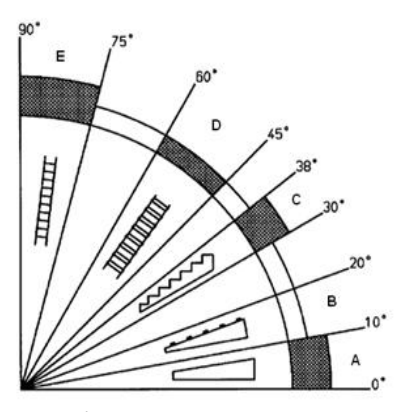

**Anexo II, linha 1** {#anexo2_lin1} Legenda:

**Anexo II, linha 2** {#anexo2_lin2} A: rampa

**Anexo II, linha 3** {#anexo2_lin3} B: rampa com peças transversais para evitar o escorregamento

**Anexo II, linha 4** {#anexo2_lin4} C: escada com espelho

**Anexo II, linha 5** {#anexo2_lin5} D: escada sem espelho

**Anexo II, linha 6** {#anexo2_lin6} E: escada do tipo marinheiro

**Anexo II, linha 7** {#anexo2_lin7} Fonte: ISO 14122 - Segurança de Máquinas - Meios de acesso permanentes às máquinas.

**Anexo II, Figura 2** {#anexo2_fig2} Figura 2: Exemplo de escada sem espelho 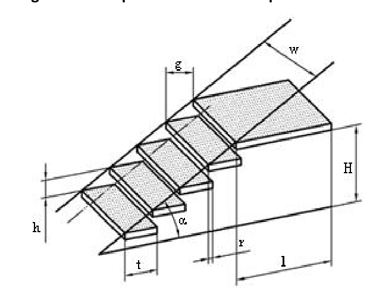

**Anexo II, linha 8** {#anexo2_lin8} Legenda: w: largura da escada h: altura entre degraus r: projeção entre degraus g: profundidade livre do degrau α: inclinação da escada - ângulo de lance l: comprimento da plataforma de descanso

**Anexo II, linha 9** {#anexo2_lin9} H: altura da escada t: profundidade total do degrau

**Anexo II, Figura 3** {#anexo2_fig3} Figura 3: Exemplo de escada fixa do tipo marinheiro 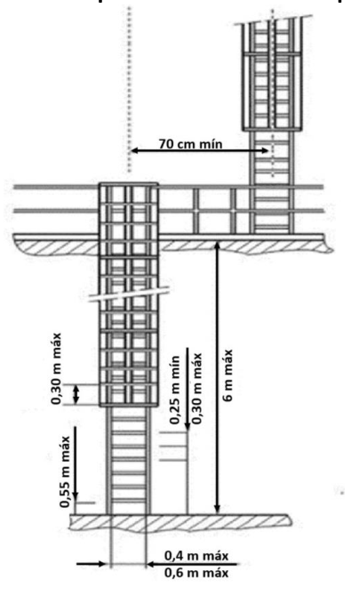

**Anexo II, Figura 4** {#anexo2_fig4} Figuras 4A, B e C: Exemplo de detalhes da gaiola da escada fixa do tipo marinheiro. 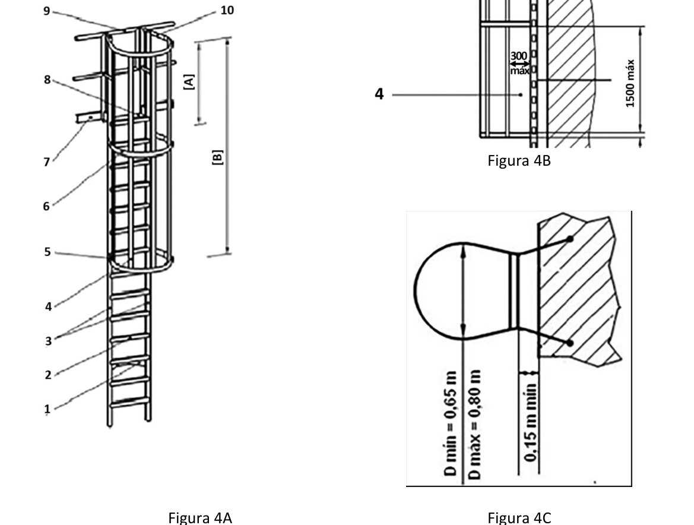

**Anexo II, Figura 5** {#anexo2_fig5} Figura 5: Sistema de proteção contra quedas em plataforma (dimensões em milímetros) (Retificada pela Portaria MTP nº 698, de 04 de abril de 2022) 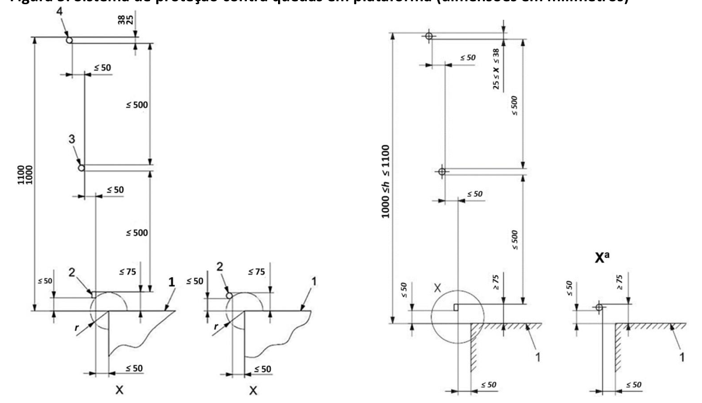 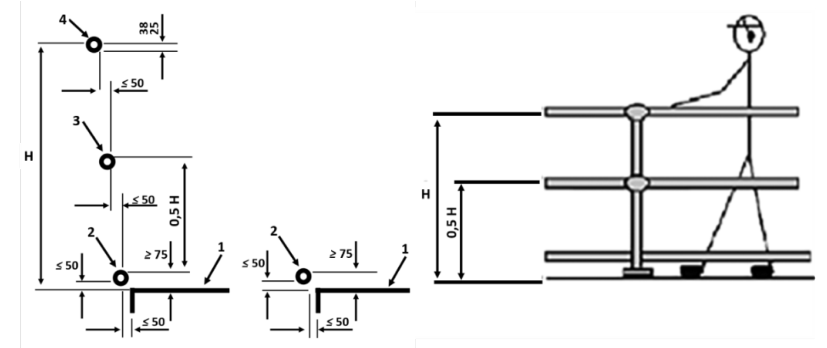

**Anexo II, linha 10** {#anexo2_lin10} Legenda:

**Anexo II, linha 11** {#anexo2_lin11} H: altura barra superior, entre 1000 mm (um mil milímetros) e 1100 mm (um mil e cem milímetros)

**Anexo II, linha 12** {#anexo2_lin12} 1: plataforma

**Anexo II, linha 13** {#anexo2_lin13} 2: barra-rodapé

**Anexo II, linha 14** {#anexo2_lin14} 3: barra intermediária

**Anexo II, linha 15** {#anexo2_lin15} 4: barra superior corrimão

**Anexo II, Figura 6** {#anexo2_fig6} Figura 6 - Cobertura de proteção da Tomada de Potência - TDP para tratores agrícolas (Retificada pela Portaria MTP nº 698, de 04 de abril de 2022) 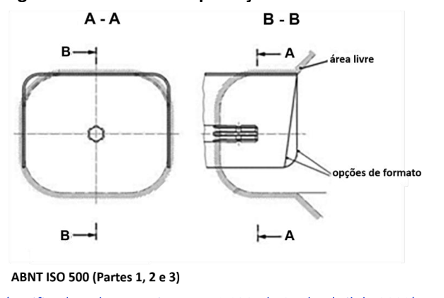

**Anexo II, Quadro 1** {#anexo2_tab1} Quadro 1 - Máquinas a que se aplicam as exclusões de dispositivos referidos nos subitens 31.12.28, 31.12.37, 31.12.38

- **Anexo II, Quadro 1, linha 1** {#anexo2_tab1_lin1} Tipo de máquina: Motocultivadores | Subitem 31.12.38 Estrutura de proteção na capotagem EPC: X | Subitem 31.12.38 Cinto de segurança: X | Subitem 31.12.28 Proteção contra projeção do material em processamento: X | Subitem 31.12.37 Sinal sonoro de ré acoplados ao sistema de transmissão e espelho retrovisor: X | Subitem 31.12.37 Faróis, buzina e lanternas traseiras de posição: X
- **Anexo II, Quadro 1, linha 2** {#anexo2_tab1_lin2} Tipo de máquina: Outros microtratores e cortadores de grama autopropelidos (peso bruto total abaixo de 600kg) | Subitem 31.12.38 Estrutura de proteção na capotagem EPC: X | Subitem 31.12.38 Cinto de segurança: X | Subitem 31.12.28 Proteção contra projeção do material em processamento: X | Subitem 31.12.37 Sinal sonoro de ré acoplados ao sistema de transmissão e espelho retrovisor: X | Subitem 31.12.37 Faróis, buzina e lanternas traseiras de posição: X
- **Anexo II, Quadro 1, linha 3** {#anexo2_tab1_lin3} Tipo de máquina: Pulverizadores autopropelidos | Subitem 31.12.38 Estrutura de proteção na capotagem EPC: X
- **Anexo II, Quadro 1, linha 4** {#anexo2_tab1_lin4} Tipo de máquina: Adubadoras autopropelidas e tracionadas | Subitem 31.12.38 Estrutura de proteção na capotagem EPC: X | Subitem 31.12.28 Proteção contra projeção do material em processamento: X
- **Anexo II, Quadro 1, linha 5** {#anexo2_tab1_lin5} Tipo de máquina: Colhedoras de grãos, cereais, forragem, café, cana-de-açúcar, algodão, laranja entre outras. | Subitem 31.12.38 Estrutura de proteção na capotagem EPC: X | Subitem 31.12.28 Proteção contra projeção do material em processamento: X
- **Anexo II, Quadro 1, linha 6** {#anexo2_tab1_lin6} Tipo de máquina: Escavadeiras Hidráulicas | Subitem 31.12.38 Estrutura de proteção na capotagem EPC: X
- **Anexo II, Quadro 1, linha 7** {#anexo2_tab1_lin7} Tipo de máquina: Plantadeiras tracionadas | Subitem 31.12.38 Estrutura de proteção na capotagem EPC: X | Subitem 31.12.38 Cinto de segurança: X | Subitem 31.12.28 Proteção contra projeção do material em processamento: X | Subitem 31.12.37 Sinal sonoro de ré acoplados ao sistema de transmissão e espelho retrovisor: X | Subitem 31.12.37 Faróis, buzina e lanternas traseiras de posição: X
- **Anexo II, Quadro 1, linha 8** {#anexo2_tab1_lin8} Tipo de máquina: Plataforma porta- implementos(acoplável ao motocultivador) | Subitem 31.12.38 Estrutura de proteção na capotagem EPC: X | Subitem 31.12.38 Cinto de segurança: X | Subitem 31.12.28 Proteção contra projeção do material em processamento: X | Subitem 31.12.37 Sinal sonoro de ré acoplados ao sistema de transmissão e espelho retrovisor: X | Subitem 31.12.37 Faróis, buzina e lanternas traseiras de posição: X

**Anexo II, Quadro 2** {#anexo2_tab2} Quadro 2 - Exclusões à proteção em partes móveis (subitens 31.12.16 e 31.12.24)

- **Anexo II, Quadro 2, linha 1** {#anexo2_tab2_lin1} Máquina/ implemento: Motocultivadores | Descrição da Exclusão: Área da parte ativa do implemento acoplado de acordo com a aplicação.
- **Anexo II, Quadro 2, linha 2** {#anexo2_tab2_lin2} Máquina/ implemento: Outros microtratores e cortadores de grama autopropelidos (peso bruto total abaixo de 600kg) | Descrição da Exclusão: Área do cortador de grama, embaixo da máquina, protegido por proteções laterais.
- **Anexo II, Quadro 2, linha 3** {#anexo2_tab2_lin3} Máquina/ implemento: Adubadoras tracionadas e autopropelidas | Descrição da Exclusão: Área distribuidora - área do distribuidor (disco ou tubo); Área de transporte e esteira helicoidal.
- **Anexo II, Quadro 2, linha 4** {#anexo2_tab2_lin4} Máquina/ implemento: Colhedoras de grãos ou cereais | Descrição da Exclusão: Área de corte e alimentação ou de captação (plataforma de corte/recolhimento); Área de expulsão e projeção de resíduos (espalhador de palha); Área de descarregamento (tubo descarregador de grãos).
- **Anexo II, Quadro 2, linha 5** {#anexo2_tab2_lin5} Máquina/ implemento: Colhedoras de cana-de- açúcar | Descrição da Exclusão: Área de corte ou recolhimento da cana-de-açúcar a ser processada (unidades de corte e recolhimento); Área de projeção/descarregamento do material (picador e transportador de material).
- **Anexo II, Quadro 2, linha 6** {#anexo2_tab2_lin6} Máquina/ implemento: Colhedoras de algodão | Descrição da Exclusão: Área de recolhimento da fibra do algodão; Área de descarregamento do fardo de algodão.
- **Anexo II, Quadro 2, linha 7** {#anexo2_tab2_lin7} Máquina/ implemento: Colhedoras de café | Descrição da Exclusão: Área de conjunto das hastes vibratórias, lâminas retráteis, transportadores e descarregamento.
- **Anexo II, Quadro 2, linha 8** {#anexo2_tab2_lin8} Máquina/ implemento: Colhedoras de laranja | Descrição da Exclusão: Área de conjunto das hastes vibratórias, lâminas retráteis, transportadores e descarregamento.
- **Anexo II, Quadro 2, linha 9** {#anexo2_tab2_lin9} Máquina/ implemento: Escavadeiras hidráulicas, feller bunchers e harvesters | Descrição da Exclusão: Área de corte, desgalhamento, processamento ou carregamento de toras.
- **Anexo II, Quadro 2, linha 10** {#anexo2_tab2_lin10} Máquina/ implemento: Forrageiras tracionadas e autopropelidas | Descrição da Exclusão: Área de corte ou recolhimento da planta a ser processada (plataforma de corte ou recolhimento); Área de descarregamento/projeção do material triturado.
- **Anexo II, Quadro 2, linha 11** {#anexo2_tab2_lin11} Máquina/ implemento: Plantadeiras tracionadas | Descrição da Exclusão: Linhas de corte da palha e seus componentes; Linhas de plantio e seus componentes; Área de distribuição de sementes e adubos.

**Anexo II, Quadro 3** {#anexo2_tab3} Quadro 3 - Disponibilidade técnica para implantação de EPC (subitem 31.12.39)

- **Anexo II, Quadro 3, linha 1** {#anexo2_tab3_lin1} Marca: Agrale | Modelo: 4100 | EPC Subitem 31.12.39 (a partir do mês / ano): Janeiro /2009 | Cinto de segurança Subitem 31.12.39 (a partir do mês / ano): Janeiro /2009
- **Anexo II, Quadro 3, linha 2** {#anexo2_tab3_lin2} Marca: Agrale | Modelo: 4100 gás | EPC Subitem 31.12.39 (a partir do mês / ano): Janeiro /2009 | Cinto de segurança Subitem 31.12.39 (a partir do mês / ano): Janeiro /2009
- **Anexo II, Quadro 3, linha 3** {#anexo2_tab3_lin3} Marca: Agrale | Modelo: 4118 | EPC Subitem 31.12.39 (a partir do mês / ano): Janeiro /2009 | Cinto de segurança Subitem 31.12.39 (a partir do mês / ano): Janeiro /2009
- **Anexo II, Quadro 3, linha 4** {#anexo2_tab3_lin4} Marca: Agrale | Modelo: 4230 | EPC Subitem 31.12.39 (a partir do mês / ano): Janeiro /2009 | Cinto de segurança Subitem 31.12.39 (a partir do mês / ano): Janeiro /2009
- **Anexo II, Quadro 3, linha 5** {#anexo2_tab3_lin5} Marca: Agrale | Modelo: 5075 | EPC Subitem 31.12.39 (a partir do mês / ano): Janeiro /2009 | Cinto de segurança Subitem 31.12.39 (a partir do mês / ano): Janeiro /2009
- **Anexo II, Quadro 3, linha 6** {#anexo2_tab3_lin6} Marca: Agrale | Modelo: 5085 | EPC Subitem 31.12.39 (a partir do mês / ano): Janeiro /2009 | Cinto de segurança Subitem 31.12.39 (a partir do mês / ano): Janeiro /2009
- **Anexo II, Quadro 3, linha 7** {#anexo2_tab3_lin7} Marca: Agrale | Modelo: 6110 | EPC Subitem 31.12.39 (a partir do mês / ano): Janeiro /2009 | Cinto de segurança Subitem 31.12.39 (a partir do mês / ano): Janeiro /2009
- **Anexo II, Quadro 3, linha 8** {#anexo2_tab3_lin8} Marca: Agrale | Modelo: 6150 | EPC Subitem 31.12.39 (a partir do mês / ano): Janeiro /2009 | Cinto de segurança Subitem 31.12.39 (a partir do mês / ano): Janeiro /2009
- **Anexo II, Quadro 3, linha 9** {#anexo2_tab3_lin9} Marca: Agrale | Modelo: 6180 | EPC Subitem 31.12.39 (a partir do mês / ano): Janeiro /2009 | Cinto de segurança Subitem 31.12.39 (a partir do mês / ano): Janeiro /2009
- **Anexo II, Quadro 3, linha 10** {#anexo2_tab3_lin10} Marca: Agritech | Modelo: 1030-h | EPC Subitem 31.12.39 (a partir do mês / ano): Janeiro /2009 | Cinto de segurança Subitem 31.12.39 (a partir do mês / ano): Janeiro /2009
- **Anexo II, Quadro 3, linha 11** {#anexo2_tab3_lin11} Marca: Agritech | Modelo: 1030-dt | EPC Subitem 31.12.39 (a partir do mês / ano): Janeiro /2009 | Cinto de segurança Subitem 31.12.39 (a partir do mês / ano): Janeiro /2009
- **Anexo II, Quadro 3, linha 12** {#anexo2_tab3_lin12} Marca: Agritech | Modelo: 1045-h | EPC Subitem 31.12.39 (a partir do mês / ano): Janeiro /2009 | Cinto de segurança Subitem 31.12.39 (a partir do mês / ano): Janeiro /2009
- **Anexo II, Quadro 3, linha 13** {#anexo2_tab3_lin13} Marca: Agritech | Modelo: 1045-dt | EPC Subitem 31.12.39 (a partir do mês / ano): Janeiro /2009 | Cinto de segurança Subitem 31.12.39 (a partir do mês / ano): Janeiro /2009
- **Anexo II, Quadro 3, linha 14** {#anexo2_tab3_lin14} Marca: Agritech | Modelo: 1055-dt | EPC Subitem 31.12.39 (a partir do mês / ano): Janeiro /2009 | Cinto de segurança Subitem 31.12.39 (a partir do mês / ano): Janeiro /2009
- **Anexo II, Quadro 3, linha 15** {#anexo2_tab3_lin15} Marca: Agritech | Modelo: 1145 | EPC Subitem 31.12.39 (a partir do mês / ano): Janeiro /2009 | Cinto de segurança Subitem 31.12.39 (a partir do mês / ano): Janeiro /2009
- **Anexo II, Quadro 3, linha 16** {#anexo2_tab3_lin16} Marca: Agritech | Modelo: 1145.4 | EPC Subitem 31.12.39 (a partir do mês / ano): Janeiro /2009 | Cinto de segurança Subitem 31.12.39 (a partir do mês / ano): Janeiro /2009
- **Anexo II, Quadro 3, linha 17** {#anexo2_tab3_lin17} Marca: Agritech | Modelo: 1155.4 | EPC Subitem 31.12.39 (a partir do mês / ano): Janeiro /2009 | Cinto de segurança Subitem 31.12.39 (a partir do mês / ano): Janeiro /2009
- **Anexo II, Quadro 3, linha 18** {#anexo2_tab3_lin18} Marca: Agritech | Modelo: 1175.4 | EPC Subitem 31.12.39 (a partir do mês / ano): Janeiro /2009 | Cinto de segurança Subitem 31.12.39 (a partir do mês / ano): Janeiro /2009
- **Anexo II, Quadro 3, linha 19** {#anexo2_tab3_lin19} Marca: Agritech ou yanmar | Modelo: 2060-xt | EPC Subitem 31.12.39 (a partir do mês / ano): Janeiro /2008 | Cinto de segurança Subitem 31.12.39 (a partir do mês / ano): Janeiro /2008
- **Anexo II, Quadro 3, linha 20** {#anexo2_tab3_lin20} Marca: Agritech ou yanmar | Modelo: Ke-40 | EPC Subitem 31.12.39 (a partir do mês / ano): Janeiro /2008 | Cinto de segurança Subitem 31.12.39 (a partir do mês / ano): Janeiro /2008
- **Anexo II, Quadro 3, linha 21** {#anexo2_tab3_lin21} Marca: Agritech ou yanmar | Modelo: F-28 | EPC Subitem 31.12.39 (a partir do mês / ano): Janeiro /2008 | Cinto de segurança Subitem 31.12.39 (a partir do mês / ano): Janeiro /2008
- **Anexo II, Quadro 3, linha 22** {#anexo2_tab3_lin22} Marca: Agritech ou yanmar | Modelo: 1040 | EPC Subitem 31.12.39 (a partir do mês / ano): Janeiro /2008 | Cinto de segurança Subitem 31.12.39 (a partir do mês / ano): Janeiro /2008
- **Anexo II, Quadro 3, linha 23** {#anexo2_tab3_lin23} Marca: Case ih | Modelo: Maxxum 135 | EPC Subitem 31.12.39 (a partir do mês / ano): Janeiro /2008 | Cinto de segurança Subitem 31.12.39 (a partir do mês / ano): Janeiro /2008
- **Anexo II, Quadro 3, linha 24** {#anexo2_tab3_lin24} Marca: Case ih | Modelo: Maxxum 150 | EPC Subitem 31.12.39 (a partir do mês / ano): Janeiro /2008 | Cinto de segurança Subitem 31.12.39 (a partir do mês / ano): Janeiro /2008
- **Anexo II, Quadro 3, linha 25** {#anexo2_tab3_lin25} Marca: Case ih | Modelo: Maxxum 150 | EPC Subitem 31.12.39 (a partir do mês / ano): Janeiro /2008 | Cinto de segurança Subitem 31.12.39 (a partir do mês / ano): Janeiro /2008
- **Anexo II, Quadro 3, linha 26** {#anexo2_tab3_lin26} Marca: Case ih | Modelo: Maxxum 180 | EPC Subitem 31.12.39 (a partir do mês / ano): Janeiro /2008 | Cinto de segurança Subitem 31.12.39 (a partir do mês / ano): Janeiro /2008
- **Anexo II, Quadro 3, linha 27** {#anexo2_tab3_lin27} Marca: Case ih | Modelo: Magnum 220 | EPC Subitem 31.12.39 (a partir do mês / ano): Janeiro /2008 | Cinto de segurança Subitem 31.12.39 (a partir do mês / ano): Janeiro /2008
- **Anexo II, Quadro 3, linha 28** {#anexo2_tab3_lin28} Marca: Case ih | Modelo: Magnum 240 | EPC Subitem 31.12.39 (a partir do mês / ano): Janeiro /2008 | Cinto de segurança Subitem 31.12.39 (a partir do mês / ano): Janeiro /2008
- **Anexo II, Quadro 3, linha 29** {#anexo2_tab3_lin29} Marca: Case ih | Modelo: Magnum 270 | EPC Subitem 31.12.39 (a partir do mês / ano): Janeiro /2008 | Cinto de segurança Subitem 31.12.39 (a partir do mês / ano): Janeiro /2008
- **Anexo II, Quadro 3, linha 30** {#anexo2_tab3_lin30} Marca: Case ih | Modelo: Magnum 305 | EPC Subitem 31.12.39 (a partir do mês / ano): Janeiro /2008 | Cinto de segurança Subitem 31.12.39 (a partir do mês / ano): Janeiro /2008
- **Anexo II, Quadro 3, linha 31** {#anexo2_tab3_lin31} Marca: John deere | Modelo: 5303 | EPC Subitem 31.12.39 (a partir do mês / ano): Janeiro /2008 | Cinto de segurança Subitem 31.12.39 (a partir do mês / ano): Janeiro /2008
- **Anexo II, Quadro 3, linha 32** {#anexo2_tab3_lin32} Marca: John deere | Modelo: 5403 | EPC Subitem 31.12.39 (a partir do mês / ano): Janeiro /2008 | Cinto de segurança Subitem 31.12.39 (a partir do mês / ano): Janeiro /2008
- **Anexo II, Quadro 3, linha 33** {#anexo2_tab3_lin33} Marca: John deere | Modelo: 5603 | EPC Subitem 31.12.39 (a partir do mês / ano): Janeiro /2008 | Cinto de segurança Subitem 31.12.39 (a partir do mês / ano): Janeiro /2008
- **Anexo II, Quadro 3, linha 34** {#anexo2_tab3_lin34} Marca: John deere | Modelo: 5605 | EPC Subitem 31.12.39 (a partir do mês / ano): Janeiro /2008 | Cinto de segurança Subitem 31.12.39 (a partir do mês / ano): Janeiro /2008
- **Anexo II, Quadro 3, linha 35** {#anexo2_tab3_lin35} Marca: John deere | Modelo: 5705 | EPC Subitem 31.12.39 (a partir do mês / ano): Janeiro /2008 | Cinto de segurança Subitem 31.12.39 (a partir do mês / ano): Janeiro /2008
- **Anexo II, Quadro 3, linha 36** {#anexo2_tab3_lin36} Marca: John deere | Modelo: 6405 | EPC Subitem 31.12.39 (a partir do mês / ano): Janeiro /2008 | Cinto de segurança Subitem 31.12.39 (a partir do mês / ano): Janeiro /2008
- **Anexo II, Quadro 3, linha 37** {#anexo2_tab3_lin37} Marca: John deere | Modelo: 6415 | EPC Subitem 31.12.39 (a partir do mês / ano): Janeiro /2008 | Cinto de segurança Subitem 31.12.39 (a partir do mês / ano): Janeiro /2008
- **Anexo II, Quadro 3, linha 38** {#anexo2_tab3_lin38} Marca: John deere | Modelo: 6605 | EPC Subitem 31.12.39 (a partir do mês / ano): Janeiro /2008 | Cinto de segurança Subitem 31.12.39 (a partir do mês / ano): Janeiro /2008
- **Anexo II, Quadro 3, linha 39** {#anexo2_tab3_lin39} Marca: John deere | Modelo: 6615 | EPC Subitem 31.12.39 (a partir do mês / ano): Janeiro /2008 | Cinto de segurança Subitem 31.12.39 (a partir do mês / ano): Janeiro /2008
- **Anexo II, Quadro 3, linha 40** {#anexo2_tab3_lin40} Marca: John deere | Modelo: 6415 classic | EPC Subitem 31.12.39 (a partir do mês / ano): Janeiro /2008 | Cinto de segurança Subitem 31.12.39 (a partir do mês / ano): Janeiro /2008
- **Anexo II, Quadro 3, linha 41** {#anexo2_tab3_lin41} Marca: John deere | Modelo: 6615 classic | EPC Subitem 31.12.39 (a partir do mês / ano): Janeiro /2008 | Cinto de segurança Subitem 31.12.39 (a partir do mês / ano): Janeiro /2008
- **Anexo II, Quadro 3, linha 42** {#anexo2_tab3_lin42} Marca: John deere | Modelo: 6110j | EPC Subitem 31.12.39 (a partir do mês / ano): Janeiro /2008 | Cinto de segurança Subitem 31.12.39 (a partir do mês / ano): Janeiro /2008
- **Anexo II, Quadro 3, linha 43** {#anexo2_tab3_lin43} Marca: John deere | Modelo: 6125j | EPC Subitem 31.12.39 (a partir do mês / ano): Janeiro /2008 | Cinto de segurança Subitem 31.12.39 (a partir do mês / ano): Janeiro /2008
- **Anexo II, Quadro 3, linha 44** {#anexo2_tab3_lin44} Marca: John deere | Modelo: 6145j | EPC Subitem 31.12.39 (a partir do mês / ano): Janeiro /2008 | Cinto de segurança Subitem 31.12.39 (a partir do mês / ano): Janeiro /2008
- **Anexo II, Quadro 3, linha 45** {#anexo2_tab3_lin45} Marca: John deere | Modelo: 6165j | EPC Subitem 31.12.39 (a partir do mês / ano): Janeiro /2008 | Cinto de segurança Subitem 31.12.39 (a partir do mês / ano): Janeiro /2008
- **Anexo II, Quadro 3, linha 46** {#anexo2_tab3_lin46} Marca: John deere | Modelo: 7505 | EPC Subitem 31.12.39 (a partir do mês / ano): Janeiro /2008 | Cinto de segurança Subitem 31.12.39 (a partir do mês / ano): Janeiro /2008
- **Anexo II, Quadro 3, linha 47** {#anexo2_tab3_lin47} Marca: John deere | Modelo: 7515 | EPC Subitem 31.12.39 (a partir do mês / ano): Janeiro /2008 | Cinto de segurança Subitem 31.12.39 (a partir do mês / ano): Janeiro /2008
- **Anexo II, Quadro 3, linha 48** {#anexo2_tab3_lin48} Marca: John deere | Modelo: 7715 | EPC Subitem 31.12.39 (a partir do mês / ano): Janeiro /2008 | Cinto de segurança Subitem 31.12.39 (a partir do mês / ano): Janeiro /2008
- **Anexo II, Quadro 3, linha 49** {#anexo2_tab3_lin49} Marca: John deere | Modelo: 7815 | EPC Subitem 31.12.39 (a partir do mês / ano): Janeiro /2008 | Cinto de segurança Subitem 31.12.39 (a partir do mês / ano): Janeiro /2008
- **Anexo II, Quadro 3, linha 50** {#anexo2_tab3_lin50} Marca: Landini | Modelo: Technofarm | EPC Subitem 31.12.39 (a partir do mês / ano): Janeiro /2008 | Cinto de segurança Subitem 31.12.39 (a partir do mês / ano): Janeiro /2008
- **Anexo II, Quadro 3, linha 51** {#anexo2_tab3_lin51} Marca: Landini | Modelo: Globalfarm | EPC Subitem 31.12.39 (a partir do mês / ano): Janeiro /2008 | Cinto de segurança Subitem 31.12.39 (a partir do mês / ano): Janeiro /2008
- **Anexo II, Quadro 3, linha 52** {#anexo2_tab3_lin52} Marca: Landini | Modelo: Rex | EPC Subitem 31.12.39 (a partir do mês / ano): Janeiro /2008 | Cinto de segurança Subitem 31.12.39 (a partir do mês / ano): Janeiro /2008
- **Anexo II, Quadro 3, linha 53** {#anexo2_tab3_lin53} Marca: Landini | Modelo: Mistral | EPC Subitem 31.12.39 (a partir do mês / ano): Janeiro /2008 | Cinto de segurança Subitem 31.12.39 (a partir do mês / ano): Janeiro /2008
- **Anexo II, Quadro 3, linha 54** {#anexo2_tab3_lin54} Marca: Landini | Modelo: Rex | EPC Subitem 31.12.39 (a partir do mês / ano): Janeiro /2008 | Cinto de segurança Subitem 31.12.39 (a partir do mês / ano): Janeiro /2008
- **Anexo II, Quadro 3, linha 55** {#anexo2_tab3_lin55} Marca: Landini | Modelo: Landpower | EPC Subitem 31.12.39 (a partir do mês / ano): Janeiro /2008 | Cinto de segurança Subitem 31.12.39 (a partir do mês / ano): Janeiro /2008
- **Anexo II, Quadro 3, linha 56** {#anexo2_tab3_lin56} Marca: Landini | Modelo: Montana 30/40/45/50/60 | EPC Subitem 31.12.39 (a partir do mês / ano): Janeiro /2008 | Cinto de segurança Subitem 31.12.39 (a partir do mês / ano): Janeiro /2008
- **Anexo II, Quadro 3, linha 57** {#anexo2_tab3_lin57} Marca: Maxion | Modelo: Maxion 750 | EPC Subitem 31.12.39 (a partir do mês / ano): Janeiro /2011 | Cinto de segurança Subitem 31.12.39 (a partir do mês / ano): Janeiro /2011
- **Anexo II, Quadro 3, linha 58** {#anexo2_tab3_lin58} Marca: Massey ferguson | Modelo: Mf250 | EPC Subitem 31.12.39 (a partir do mês / ano): Janeiro /2008 | Cinto de segurança Subitem 31.12.39 (a partir do mês / ano): Janeiro /2008
- **Anexo II, Quadro 3, linha 59** {#anexo2_tab3_lin59} Marca: Massey ferguson | Modelo: Mf255 | EPC Subitem 31.12.39 (a partir do mês / ano): Janeiro /2008 | Cinto de segurança Subitem 31.12.39 (a partir do mês / ano): Janeiro /2008
- **Anexo II, Quadro 3, linha 60** {#anexo2_tab3_lin60} Marca: Massey ferguson | Modelo: Mf250 f | EPC Subitem 31.12.39 (a partir do mês / ano): Janeiro /2008 | Cinto de segurança Subitem 31.12.39 (a partir do mês / ano): Janeiro /2008
- **Anexo II, Quadro 3, linha 61** {#anexo2_tab3_lin61} Marca: Massey ferguson | Modelo: Mf255 f | EPC Subitem 31.12.39 (a partir do mês / ano): Janeiro /2008 | Cinto de segurança Subitem 31.12.39 (a partir do mês / ano): Janeiro /2008
- **Anexo II, Quadro 3, linha 62** {#anexo2_tab3_lin62} Marca: Massey ferguson | Modelo: Mf265 f | EPC Subitem 31.12.39 (a partir do mês / ano): Janeiro /2008 | Cinto de segurança Subitem 31.12.39 (a partir do mês / ano): Janeiro /2008
- **Anexo II, Quadro 3, linha 63** {#anexo2_tab3_lin63} Marca: Massey ferguson | Modelo: Mf275 f | EPC Subitem 31.12.39 (a partir do mês / ano): Janeiro /2008 | Cinto de segurança Subitem 31.12.39 (a partir do mês / ano): Janeiro /2008
- **Anexo II, Quadro 3, linha 64** {#anexo2_tab3_lin64} Marca: Massey ferguson | Modelo: Mf283 f | EPC Subitem 31.12.39 (a partir do mês / ano): Janeiro /2008 | Cinto de segurança Subitem 31.12.39 (a partir do mês / ano): Janeiro /2008
- **Anexo II, Quadro 3, linha 65** {#anexo2_tab3_lin65} Marca: Massey ferguson | Modelo: Mf4265 | EPC Subitem 31.12.39 (a partir do mês / ano): Março /2010 | Cinto de segurança Subitem 31.12.39 (a partir do mês / ano): Março /2010
- **Anexo II, Quadro 3, linha 66** {#anexo2_tab3_lin66} Marca: Massey ferguson | Modelo: Mf4275 | EPC Subitem 31.12.39 (a partir do mês / ano): Março /2010 | Cinto de segurança Subitem 31.12.39 (a partir do mês / ano): Março /2010
- **Anexo II, Quadro 3, linha 67** {#anexo2_tab3_lin67} Marca: Massey ferguson | Modelo: Mf4283 | EPC Subitem 31.12.39 (a partir do mês / ano): Março /2010 | Cinto de segurança Subitem 31.12.39 (a partir do mês / ano): Março /2010
- **Anexo II, Quadro 3, linha 68** {#anexo2_tab3_lin68} Marca: Massey ferguson | Modelo: Mf4290 | EPC Subitem 31.12.39 (a partir do mês / ano): Março /2010 | Cinto de segurança Subitem 31.12.39 (a partir do mês / ano): Março /2010
- **Anexo II, Quadro 3, linha 69** {#anexo2_tab3_lin69} Marca: Massey ferguson | Modelo: Mf4291 | EPC Subitem 31.12.39 (a partir do mês / ano): Março /2010 | Cinto de segurança Subitem 31.12.39 (a partir do mês / ano): Março /2010
- **Anexo II, Quadro 3, linha 70** {#anexo2_tab3_lin70} Marca: Massey ferguson | Modelo: Mf4292 | EPC Subitem 31.12.39 (a partir do mês / ano): Março /2010 | Cinto de segurança Subitem 31.12.39 (a partir do mês / ano): Março /2010
- **Anexo II, Quadro 3, linha 71** {#anexo2_tab3_lin71} Marca: Massey ferguson | Modelo: Mf4297 | EPC Subitem 31.12.39 (a partir do mês / ano): Março /2010 | Cinto de segurança Subitem 31.12.39 (a partir do mês / ano): Março /2010
- **Anexo II, Quadro 3, linha 72** {#anexo2_tab3_lin72} Marca: Massey ferguson | Modelo: Mf4299 | EPC Subitem 31.12.39 (a partir do mês / ano): Março /2010 | Cinto de segurança Subitem 31.12.39 (a partir do mês / ano): Março /2010
- **Anexo II, Quadro 3, linha 73** {#anexo2_tab3_lin73} Marca: Massey ferguson | Modelo: Mf6350 | EPC Subitem 31.12.39 (a partir do mês / ano): Janeiro /2008 | Cinto de segurança Subitem 31.12.39 (a partir do mês / ano): Janeiro /2008
- **Anexo II, Quadro 3, linha 74** {#anexo2_tab3_lin74} Marca: Massey ferguson | Modelo: Mf6360 | EPC Subitem 31.12.39 (a partir do mês / ano): Janeiro /2008 | Cinto de segurança Subitem 31.12.39 (a partir do mês / ano): Janeiro /2008
- **Anexo II, Quadro 3, linha 75** {#anexo2_tab3_lin75} Marca: Massey ferguson | Modelo: Mf7140 | EPC Subitem 31.12.39 (a partir do mês / ano): Janeiro /2009 | Cinto de segurança Subitem 31.12.39 (a partir do mês / ano): Janeiro /2009
- **Anexo II, Quadro 3, linha 76** {#anexo2_tab3_lin76} Marca: Massey ferguson | Modelo: Mf7150 | EPC Subitem 31.12.39 (a partir do mês / ano): Janeiro /2009 | Cinto de segurança Subitem 31.12.39 (a partir do mês / ano): Janeiro /2009
- **Anexo II, Quadro 3, linha 77** {#anexo2_tab3_lin77} Marca: Massey ferguson | Modelo: Mf7170 | EPC Subitem 31.12.39 (a partir do mês / ano): Janeiro /2009 | Cinto de segurança Subitem 31.12.39 (a partir do mês / ano): Janeiro /2009
- **Anexo II, Quadro 3, linha 78** {#anexo2_tab3_lin78} Marca: Massey ferguson | Modelo: Mf7180 | EPC Subitem 31.12.39 (a partir do mês / ano): Janeiro /2009 | Cinto de segurança Subitem 31.12.39 (a partir do mês / ano): Janeiro /2009
- **Anexo II, Quadro 3, linha 79** {#anexo2_tab3_lin79} Marca: Massey ferguson | Modelo: Mf7350 | EPC Subitem 31.12.39 (a partir do mês / ano): Janeiro /2010 | Cinto de segurança Subitem 31.12.39 (a partir do mês / ano): Janeiro /2010
- **Anexo II, Quadro 3, linha 80** {#anexo2_tab3_lin80} Marca: Massey ferguson | Modelo: Mf7370 | EPC Subitem 31.12.39 (a partir do mês / ano): Janeiro /2010 | Cinto de segurança Subitem 31.12.39 (a partir do mês / ano): Janeiro /2010
- **Anexo II, Quadro 3, linha 81** {#anexo2_tab3_lin81} Marca: Massey ferguson | Modelo: Mf7390 | EPC Subitem 31.12.39 (a partir do mês / ano): Janeiro /2010 | Cinto de segurança Subitem 31.12.39 (a partir do mês / ano): Janeiro /2010
- **Anexo II, Quadro 3, linha 82** {#anexo2_tab3_lin82} Marca: Massey ferguson | Modelo: Mf7415 | EPC Subitem 31.12.39 (a partir do mês / ano): Janeiro /2010 | Cinto de segurança Subitem 31.12.39 (a partir do mês / ano): Janeiro /2010
- **Anexo II, Quadro 3, linha 83** {#anexo2_tab3_lin83} Marca: Massey ferguson | Modelo: Mf86 | EPC Subitem 31.12.39 (a partir do mês / ano): Janeiro /2011 | Cinto de segurança Subitem 31.12.39 (a partir do mês / ano): Janeiro /2011
- **Anexo II, Quadro 3, linha 84** {#anexo2_tab3_lin84} Marca: Massey ferguson | Modelo: Mf96 | EPC Subitem 31.12.39 (a partir do mês / ano): Janeiro /2011 | Cinto de segurança Subitem 31.12.39 (a partir do mês / ano): Janeiro /2011
- **Anexo II, Quadro 3, linha 85** {#anexo2_tab3_lin85} Marca: Massey ferguson | Modelo: Mf265 | EPC Subitem 31.12.39 (a partir do mês / ano): Janeiro /2008 | Cinto de segurança Subitem 31.12.39 (a partir do mês / ano): Janeiro /2008
- **Anexo II, Quadro 3, linha 86** {#anexo2_tab3_lin86} Marca: Massey ferguson | Modelo: Mf275 | EPC Subitem 31.12.39 (a partir do mês / ano): Janeiro /2008 | Cinto de segurança Subitem 31.12.39 (a partir do mês / ano): Janeiro /2008
- **Anexo II, Quadro 3, linha 87** {#anexo2_tab3_lin87} Marca: Massey ferguson | Modelo: Mf283 | EPC Subitem 31.12.39 (a partir do mês / ano): Janeiro /2008 | Cinto de segurança Subitem 31.12.39 (a partir do mês / ano): Janeiro /2008
- **Anexo II, Quadro 3, linha 88** {#anexo2_tab3_lin88} Marca: Massey ferguson | Modelo: Mf290 | EPC Subitem 31.12.39 (a partir do mês / ano): Janeiro /2008 | Cinto de segurança Subitem 31.12.39 (a partir do mês / ano): Janeiro /2008
- **Anexo II, Quadro 3, linha 89** {#anexo2_tab3_lin89} Marca: Massey ferguson | Modelo: Mf291 | EPC Subitem 31.12.39 (a partir do mês / ano): Janeiro /2008 | Cinto de segurança Subitem 31.12.39 (a partir do mês / ano): Janeiro /2008
- **Anexo II, Quadro 3, linha 90** {#anexo2_tab3_lin90} Marca: Massey ferguson | Modelo: Mf292 | EPC Subitem 31.12.39 (a partir do mês / ano): Janeiro /2008 | Cinto de segurança Subitem 31.12.39 (a partir do mês / ano): Janeiro /2008
- **Anexo II, Quadro 3, linha 91** {#anexo2_tab3_lin91} Marca: Massey ferguson | Modelo: Mf297 | EPC Subitem 31.12.39 (a partir do mês / ano): Janeiro /2008 | Cinto de segurança Subitem 31.12.39 (a partir do mês / ano): Janeiro /2008
- **Anexo II, Quadro 3, linha 92** {#anexo2_tab3_lin92} Marca: Massey ferguson | Modelo: Mf298 | EPC Subitem 31.12.39 (a partir do mês / ano): Janeiro /2008 | Cinto de segurança Subitem 31.12.39 (a partir do mês / ano): Janeiro /2008
- **Anexo II, Quadro 3, linha 93** {#anexo2_tab3_lin93} Marca: Massey ferguson | Modelo: Mf299 | EPC Subitem 31.12.39 (a partir do mês / ano): Janeiro /2008 | Cinto de segurança Subitem 31.12.39 (a partir do mês / ano): Janeiro /2008
- **Anexo II, Quadro 3, linha 94** {#anexo2_tab3_lin94} Marca: Massey ferguson | Modelo: Mf630 | EPC Subitem 31.12.39 (a partir do mês / ano): Janeiro /2008 | Cinto de segurança Subitem 31.12.39 (a partir do mês / ano): Janeiro /2008
- **Anexo II, Quadro 3, linha 95** {#anexo2_tab3_lin95} Marca: Massey ferguson | Modelo: Mf640 | EPC Subitem 31.12.39 (a partir do mês / ano): Janeiro /2008 | Cinto de segurança Subitem 31.12.39 (a partir do mês / ano): Janeiro /2008
- **Anexo II, Quadro 3, linha 96** {#anexo2_tab3_lin96} Marca: Massey ferguson | Modelo: Mf650 | EPC Subitem 31.12.39 (a partir do mês / ano): Janeiro /2008 | Cinto de segurança Subitem 31.12.39 (a partir do mês / ano): Janeiro /2008
- **Anexo II, Quadro 3, linha 97** {#anexo2_tab3_lin97} Marca: Massey ferguson | Modelo: Mf660 | EPC Subitem 31.12.39 (a partir do mês / ano): Janeiro /2008 | Cinto de segurança Subitem 31.12.39 (a partir do mês / ano): Janeiro /2008
- **Anexo II, Quadro 3, linha 98** {#anexo2_tab3_lin98} Marca: Massey ferguson | Modelo: Mf680 | EPC Subitem 31.12.39 (a partir do mês / ano): Janeiro /2008 | Cinto de segurança Subitem 31.12.39 (a partir do mês / ano): Janeiro /2008
- **Anexo II, Quadro 3, linha 99** {#anexo2_tab3_lin99} Marca: New holland | Modelo: Tl 60e | EPC Subitem 31.12.39 (a partir do mês / ano): Janeiro /2008 | Cinto de segurança Subitem 31.12.39 (a partir do mês / ano): Janeiro /2008
- **Anexo II, Quadro 3, linha 100** {#anexo2_tab3_lin100} Marca: New holland | Modelo: Tl 75e | EPC Subitem 31.12.39 (a partir do mês / ano): Janeiro /2008 | Cinto de segurança Subitem 31.12.39 (a partir do mês / ano): Janeiro /2008
- **Anexo II, Quadro 3, linha 101** {#anexo2_tab3_lin101} Marca: New holland | Modelo: Tl 85e | EPC Subitem 31.12.39 (a partir do mês / ano): Janeiro /2008 | Cinto de segurança Subitem 31.12.39 (a partir do mês / ano): Janeiro /2008
- **Anexo II, Quadro 3, linha 102** {#anexo2_tab3_lin102} Marca: New holland | Modelo: Tl 95e | EPC Subitem 31.12.39 (a partir do mês / ano): Janeiro /2008 | Cinto de segurança Subitem 31.12.39 (a partir do mês / ano): Janeiro /2008
- **Anexo II, Quadro 3, linha 103** {#anexo2_tab3_lin103} Marca: New holland | Modelo: Tt 3840 | EPC Subitem 31.12.39 (a partir do mês / ano): Janeiro /2008 | Cinto de segurança Subitem 31.12.39 (a partir do mês / ano): Janeiro /2008
- **Anexo II, Quadro 3, linha 104** {#anexo2_tab3_lin104} Marca: New holland | Modelo: Tt 4030 | EPC Subitem 31.12.39 (a partir do mês / ano): Janeiro /2008 | Cinto de segurança Subitem 31.12.39 (a partir do mês / ano): Janeiro /2008
- **Anexo II, Quadro 3, linha 105** {#anexo2_tab3_lin105} Marca: New holland | Modelo: Ts 6000 | EPC Subitem 31.12.39 (a partir do mês / ano): Janeiro /2008 | Cinto de segurança Subitem 31.12.39 (a partir do mês / ano): Janeiro /2008
- **Anexo II, Quadro 3, linha 106** {#anexo2_tab3_lin106} Marca: New holland | Modelo: Ts 6020 | EPC Subitem 31.12.39 (a partir do mês / ano): Janeiro /2008 | Cinto de segurança Subitem 31.12.39 (a partir do mês / ano): Janeiro /2008
- **Anexo II, Quadro 3, linha 107** {#anexo2_tab3_lin107} Marca: New holland | Modelo: Ts 6030 | EPC Subitem 31.12.39 (a partir do mês / ano): Janeiro /2008 | Cinto de segurança Subitem 31.12.39 (a partir do mês / ano): Janeiro /2008
- **Anexo II, Quadro 3, linha 108** {#anexo2_tab3_lin108} Marca: New holland | Modelo: Ts 6040 | EPC Subitem 31.12.39 (a partir do mês / ano): Janeiro /2008 | Cinto de segurança Subitem 31.12.39 (a partir do mês / ano): Janeiro /2008
- **Anexo II, Quadro 3, linha 109** {#anexo2_tab3_lin109} Marca: New holland | Modelo: Tm 7010 | EPC Subitem 31.12.39 (a partir do mês / ano): Janeiro /2008 | Cinto de segurança Subitem 31.12.39 (a partir do mês / ano): Janeiro /2008
- **Anexo II, Quadro 3, linha 110** {#anexo2_tab3_lin110} Marca: New holland | Modelo: Tm 7020 | EPC Subitem 31.12.39 (a partir do mês / ano): Janeiro /2008 | Cinto de segurança Subitem 31.12.39 (a partir do mês / ano): Janeiro /2008
- **Anexo II, Quadro 3, linha 111** {#anexo2_tab3_lin111} Marca: New holland | Modelo: Tm 7030 | EPC Subitem 31.12.39 (a partir do mês / ano): Janeiro /2008 | Cinto de segurança Subitem 31.12.39 (a partir do mês / ano): Janeiro /2008
- **Anexo II, Quadro 3, linha 112** {#anexo2_tab3_lin112} Marca: New holland | Modelo: Tm 7040 | EPC Subitem 31.12.39 (a partir do mês / ano): Janeiro /2008 | Cinto de segurança Subitem 31.12.39 (a partir do mês / ano): Janeiro /2008
- **Anexo II, Quadro 3, linha 113** {#anexo2_tab3_lin113} Marca: New holland | Modelo: 7630 | EPC Subitem 31.12.39 (a partir do mês / ano): Janeiro /2008 | Cinto de segurança Subitem 31.12.39 (a partir do mês / ano): Janeiro /2008
- **Anexo II, Quadro 3, linha 114** {#anexo2_tab3_lin114} Marca: New holland | Modelo: 8030 | EPC Subitem 31.12.39 (a partir do mês / ano): Janeiro /2008 | Cinto de segurança Subitem 31.12.39 (a partir do mês / ano): Janeiro /2008
- **Anexo II, Quadro 3, linha 115** {#anexo2_tab3_lin115} Marca: Valtra | Modelo: Bf65 | EPC Subitem 31.12.39 (a partir do mês / ano): Janeiro /2008 | Cinto de segurança Subitem 31.12.39 (a partir do mês / ano): Janeiro /2008
- **Anexo II, Quadro 3, linha 116** {#anexo2_tab3_lin116} Marca: Valtra | Modelo: Bf75 | EPC Subitem 31.12.39 (a partir do mês / ano): Janeiro /2008 | Cinto de segurança Subitem 31.12.39 (a partir do mês / ano): Janeiro /2008
- **Anexo II, Quadro 3, linha 117** {#anexo2_tab3_lin117} Marca: Valtra | Modelo: A650 | EPC Subitem 31.12.39 (a partir do mês / ano): Março /2010 | Cinto de segurança Subitem 31.12.39 (a partir do mês / ano): Março / 2010
- **Anexo II, Quadro 3, linha 118** {#anexo2_tab3_lin118} Marca: Valtra | Modelo: A750 | EPC Subitem 31.12.39 (a partir do mês / ano): Julho /2009 | Cinto de segurança Subitem 31.12.39 (a partir do mês / ano): Julho /2009
- **Anexo II, Quadro 3, linha 119** {#anexo2_tab3_lin119} Marca: Valtra | Modelo: A850 | EPC Subitem 31.12.39 (a partir do mês / ano): Julho /2009 | Cinto de segurança Subitem 31.12.39 (a partir do mês / ano): Julho /2009
- **Anexo II, Quadro 3, linha 120** {#anexo2_tab3_lin120} Marca: Valtra | Modelo: A950 | EPC Subitem 31.12.39 (a partir do mês / ano): Agosto /2009 | Cinto de segurança Subitem 31.12.39 (a partir do mês / ano): Agosto /2009
- **Anexo II, Quadro 3, linha 121** {#anexo2_tab3_lin121} Marca: Valtra | Modelo: Bm100 | EPC Subitem 31.12.39 (a partir do mês / ano): Janeiro /2008 | Cinto de segurança Subitem 31.12.39 (a partir do mês / ano): Janeiro /2008
- **Anexo II, Quadro 3, linha 122** {#anexo2_tab3_lin122} Marca: Valtra | Modelo: Bm110 | EPC Subitem 31.12.39 (a partir do mês / ano): Janeiro /2008 | Cinto de segurança Subitem 31.12.39 (a partir do mês / ano): Janeiro /2008
- **Anexo II, Quadro 3, linha 123** {#anexo2_tab3_lin123} Marca: Valtra | Modelo: Bm125i | EPC Subitem 31.12.39 (a partir do mês / ano): Janeiro /2008 | Cinto de segurança Subitem 31.12.39 (a partir do mês / ano): Janeiro /2008
- **Anexo II, Quadro 3, linha 124** {#anexo2_tab3_lin124} Marca: Valtra | Modelo: Bh145 | EPC Subitem 31.12.39 (a partir do mês / ano): Janeiro /2008 | Cinto de segurança Subitem 31.12.39 (a partir do mês / ano): Janeiro /2008
- **Anexo II, Quadro 3, linha 125** {#anexo2_tab3_lin125} Marca: Valtra | Modelo: Bh165 | EPC Subitem 31.12.39 (a partir do mês / ano): Janeiro /2008 | Cinto de segurança Subitem 31.12.39 (a partir do mês / ano): Janeiro /2008
- **Anexo II, Quadro 3, linha 126** {#anexo2_tab3_lin126} Marca: Valtra | Modelo: Bh180 | EPC Subitem 31.12.39 (a partir do mês / ano): Janeiro /2008 | Cinto de segurança Subitem 31.12.39 (a partir do mês / ano): Janeiro /2008
- **Anexo II, Quadro 3, linha 127** {#anexo2_tab3_lin127} Marca: Valtra | Modelo: Bh185i | EPC Subitem 31.12.39 (a partir do mês / ano): Janeiro /2008 | Cinto de segurança Subitem 31.12.39 (a partir do mês / ano): Janeiro /2008
- **Anexo II, Quadro 3, linha 128** {#anexo2_tab3_lin128} Marca: Valtra | Modelo: Bh205i | EPC Subitem 31.12.39 (a partir do mês / ano): Agosto /2008 | Cinto de segurança Subitem 31.12.39 (a partir do mês / ano): Agosto /2008
- **Anexo II, Quadro 3, linha 129** {#anexo2_tab3_lin129} Marca: Valtra | Modelo: Bt150 | EPC Subitem 31.12.39 (a partir do mês / ano): Setembro /2010 | Cinto de segurança Subitem 31.12.39 (a partir do mês / ano): Setembro /2010
- **Anexo II, Quadro 3, linha 130** {#anexo2_tab3_lin130} Marca: Valtra | Modelo: Bt170 | EPC Subitem 31.12.39 (a partir do mês / ano): Setembro /2010 | Cinto de segurança Subitem 31.12.39 (a partir do mês / ano): Setembro /2010
- **Anexo II, Quadro 3, linha 131** {#anexo2_tab3_lin131} Marca: Valtra | Modelo: Bt190 | EPC Subitem 31.12.39 (a partir do mês / ano): Setembro /2010 | Cinto de segurança Subitem 31.12.39 (a partir do mês / ano): Setembro /2010
- **Anexo II, Quadro 3, linha 132** {#anexo2_tab3_lin132} Marca: Valtra | Modelo: Bt210 | EPC Subitem 31.12.39 (a partir do mês / ano): Setembro /2010 | Cinto de segurança Subitem 31.12.39 (a partir do mês / ano): Setembro /2010
- **Anexo II, Quadro 3, linha 133** {#anexo2_tab3_lin133} Marca: Valtra | Modelo: Bf65 | EPC Subitem 31.12.39 (a partir do mês / ano): Janeiro /2008 | Cinto de segurança Subitem 31.12.39 (a partir do mês / ano): Janeiro /2008
- **Anexo II, Quadro 3, linha 134** {#anexo2_tab3_lin134} Marca: Valtra | Modelo: Bf75 | EPC Subitem 31.12.39 (a partir do mês / ano): Janeiro /2008 | Cinto de segurança Subitem 31.12.39 (a partir do mês / ano): Janeiro /2008
- **Anexo II, Quadro 3, linha 135** {#anexo2_tab3_lin135} Marca: Valtra | Modelo: 585 | EPC Subitem 31.12.39 (a partir do mês / ano): Janeiro /2008 | Cinto de segurança Subitem 31.12.39 (a partir do mês / ano): Janeiro /2008
- **Anexo II, Quadro 3, linha 136** {#anexo2_tab3_lin136} Marca: Valtra | Modelo: 685ats | EPC Subitem 31.12.39 (a partir do mês / ano): Janeiro /2008 | Cinto de segurança Subitem 31.12.39 (a partir do mês / ano): Janeiro /2008
- **Anexo II, Quadro 3, linha 137** {#anexo2_tab3_lin137} Marca: Valtra | Modelo: 685 | EPC Subitem 31.12.39 (a partir do mês / ano): Janeiro /2008 | Cinto de segurança Subitem 31.12.39 (a partir do mês / ano): Janeiro /2008
- **Anexo II, Quadro 3, linha 138** {#anexo2_tab3_lin138} Marca: Valtra | Modelo: 785 | EPC Subitem 31.12.39 (a partir do mês / ano): Janeiro /2008 | Cinto de segurança Subitem 31.12.39 (a partir do mês / ano): Janeiro /2008
- **Anexo II, Quadro 3, linha 139** {#anexo2_tab3_lin139} Marca: Case | Modelo: Pá carregadeira - 521d toldo | EPC Subitem 31.12.39 (a partir do mês / ano): Janeiro /2008 | Cinto de segurança Subitem 31.12.39 (a partir do mês / ano): Janeiro /2008
- **Anexo II, Quadro 3, linha 140** {#anexo2_tab3_lin140} Marca: Case | Modelo: Pá carregadeira - 621d toldo | EPC Subitem 31.12.39 (a partir do mês / ano): Janeiro /2008 | Cinto de segurança Subitem 31.12.39 (a partir do mês / ano): Janeiro /2008
- **Anexo II, Quadro 3, linha 141** {#anexo2_tab3_lin141} Marca: Case | Modelo: Pá carregadeira - w20e cabine | EPC Subitem 31.12.39 (a partir do mês / ano): Janeiro /2008 | Cinto de segurança Subitem 31.12.39 (a partir do mês / ano): Janeiro /2008
- **Anexo II, Quadro 3, linha 142** {#anexo2_tab3_lin142} Marca: Caterpillar | Modelo: Motoniveladora 120h/ 120k | EPC Subitem 31.12.39 (a partir do mês / ano): Janeiro /2008 | Cinto de segurança Subitem 31.12.39 (a partir do mês / ano): Janeiro /2008
- **Anexo II, Quadro 3, linha 143** {#anexo2_tab3_lin143} Marca: Caterpillar | Modelo: Motoniveladora 140h/ 140k | EPC Subitem 31.12.39 (a partir do mês / ano): Janeiro /2008 | Cinto de segurança Subitem 31.12.39 (a partir do mês / ano): Janeiro /2008
- **Anexo II, Quadro 3, linha 144** {#anexo2_tab3_lin144} Marca: Caterpillar | Modelo: Motoniveladora 160h/ 160k | EPC Subitem 31.12.39 (a partir do mês / ano): Janeiro /2008 | Cinto de segurança Subitem 31.12.39 (a partir do mês / ano): Janeiro /2008
- **Anexo II, Quadro 3, linha 145** {#anexo2_tab3_lin145} Marca: Caterpillar | Modelo: Motoniveladora 12h/12k | EPC Subitem 31.12.39 (a partir do mês / ano): Janeiro /2008 | Cinto de segurança Subitem 31.12.39 (a partir do mês / ano): Janeiro /2008
- **Anexo II, Quadro 3, linha 146** {#anexo2_tab3_lin146} Marca: Caterpillar | Modelo: Motoniveladora 135h | EPC Subitem 31.12.39 (a partir do mês / ano): Janeiro /2008 | Cinto de segurança Subitem 31.12.39 (a partir do mês / ano): Janeiro /2008
- **Anexo II, Quadro 3, linha 147** {#anexo2_tab3_lin147} Marca: Ciber | Modelo: Rolo hamm 3410/11 | EPC Subitem 31.12.39 (a partir do mês / ano): Janeiro /2008 | Cinto de segurança Subitem 31.12.39 (a partir do mês / ano): Janeiro /2008
- **Anexo II, Quadro 3, linha 148** {#anexo2_tab3_lin148} Marca: New holland | Modelo: Pá carregadeira - w130 toldo | EPC Subitem 31.12.39 (a partir do mês / ano): Janeiro /2008 | Cinto de segurança Subitem 31.12.39 (a partir do mês / ano): Janeiro /2008
- **Anexo II, Quadro 3, linha 149** {#anexo2_tab3_lin149} Marca: New holland | Modelo: Trator de esteira - d170 | EPC Subitem 31.12.39 (a partir do mês / ano): Janeiro /2008 | Cinto de segurança Subitem 31.12.39 (a partir do mês / ano): Janeiro /2008

**Anexo II, Quadro 4** {#anexo2_tab4} Quadro 4 - Distâncias de segurança para impedir o acesso a zonas de perigo pelos membros superiores (dimensões em milímetros) 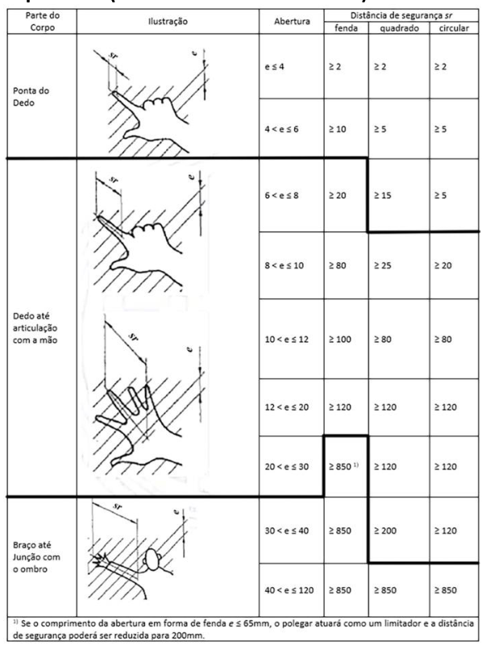

**Anexo II, linha 16** {#anexo2_lin16} Fonte: ABNT NBR NM ISO 13852 - Segurança de Máquinas - Distâncias de segurança para impedir o acesso a zonas de perigo pelos membros superiores

**Anexo II, Figura 7** {#anexo2_fig7} Figura 7 - Alcance sobre estruturas de proteção (Para utilização do Quadro 5 observar a legenda da figura a seguir) 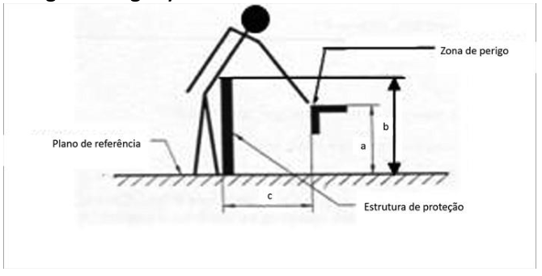

**Anexo II, linha 17** {#anexo2_lin17} Legenda: a: altura da zona de perigo b: altura da estrutura de proteção c: distância horizontal à zona de perigo

**Anexo II, Quadro 5** {#anexo2_tab5} Quadro 5 - Alcance sobre estruturas de proteção - Alto risco (dimensões em milímetros)

- **Anexo II, Quadro 5, linha 1** {#anexo2_tab5_lin1} Altura da zona de perigo a: 2700³ | Altura da estrutura de proteção b¹ – 1000 – Distância horizontal à zona de perigo “c”: - | Altura da estrutura de proteção b¹ – 1200 – Distância horizontal à zona de perigo “c”: - | Altura da estrutura de proteção b¹ – 1400² – Distância horizontal à zona de perigo “c”: - | Altura da estrutura de proteção b¹ – 1600 – Distância horizontal à zona de perigo “c”: - | Altura da estrutura de proteção b¹ – 1800 – Distância horizontal à zona de perigo “c”: - | Altura da estrutura de proteção b¹ – 2000 – Distância horizontal à zona de perigo “c”: - | Altura da estrutura de proteção b¹ – 2200 – Distância horizontal à zona de perigo “c”: - | Altura da estrutura de proteção b¹ – 2400 – Distância horizontal à zona de perigo “c”: - | Altura da estrutura de proteção b¹ – 2500 – Distância horizontal à zona de perigo “c”: - | Altura da estrutura de proteção b¹ – 2700 – Distância horizontal à zona de perigo “c”: -
- **Anexo II, Quadro 5, linha 2** {#anexo2_tab5_lin2} Altura da zona de perigo a: 2600 | Altura da estrutura de proteção b¹ – 1000 – Distância horizontal à zona de perigo “c”: 900 | Altura da estrutura de proteção b¹ – 1200 – Distância horizontal à zona de perigo “c”: 800 | Altura da estrutura de proteção b¹ – 1400² – Distância horizontal à zona de perigo “c”: 700 | Altura da estrutura de proteção b¹ – 1600 – Distância horizontal à zona de perigo “c”: 600 | Altura da estrutura de proteção b¹ – 1800 – Distância horizontal à zona de perigo “c”: 600 | Altura da estrutura de proteção b¹ – 2000 – Distância horizontal à zona de perigo “c”: 500 | Altura da estrutura de proteção b¹ – 2200 – Distância horizontal à zona de perigo “c”: 400 | Altura da estrutura de proteção b¹ – 2400 – Distância horizontal à zona de perigo “c”: 300 | Altura da estrutura de proteção b¹ – 2500 – Distância horizontal à zona de perigo “c”: 100 | Altura da estrutura de proteção b¹ – 2700 – Distância horizontal à zona de perigo “c”: -
- **Anexo II, Quadro 5, linha 3** {#anexo2_tab5_lin3} Altura da zona de perigo a: 2400 | Altura da estrutura de proteção b¹ – 1000 – Distância horizontal à zona de perigo “c”: 1100 | Altura da estrutura de proteção b¹ – 1200 – Distância horizontal à zona de perigo “c”: 1100 | Altura da estrutura de proteção b¹ – 1400² – Distância horizontal à zona de perigo “c”: 900 | Altura da estrutura de proteção b¹ – 1600 – Distância horizontal à zona de perigo “c”: 800 | Altura da estrutura de proteção b¹ – 1800 – Distância horizontal à zona de perigo “c”: 700 | Altura da estrutura de proteção b¹ – 2000 – Distância horizontal à zona de perigo “c”: 600 | Altura da estrutura de proteção b¹ – 2200 – Distância horizontal à zona de perigo “c”: 400 | Altura da estrutura de proteção b¹ – 2400 – Distância horizontal à zona de perigo “c”: 300 | Altura da estrutura de proteção b¹ – 2500 – Distância horizontal à zona de perigo “c”: 100 | Altura da estrutura de proteção b¹ – 2700 – Distância horizontal à zona de perigo “c”: -
- **Anexo II, Quadro 5, linha 4** {#anexo2_tab5_lin4} Altura da zona de perigo a: 2200 | Altura da estrutura de proteção b¹ – 1000 – Distância horizontal à zona de perigo “c”: 1300 | Altura da estrutura de proteção b¹ – 1200 – Distância horizontal à zona de perigo “c”: 1200 | Altura da estrutura de proteção b¹ – 1400² – Distância horizontal à zona de perigo “c”: 1000 | Altura da estrutura de proteção b¹ – 1600 – Distância horizontal à zona de perigo “c”: 900 | Altura da estrutura de proteção b¹ – 1800 – Distância horizontal à zona de perigo “c”: 800 | Altura da estrutura de proteção b¹ – 2000 – Distância horizontal à zona de perigo “c”: 600 | Altura da estrutura de proteção b¹ – 2200 – Distância horizontal à zona de perigo “c”: 400 | Altura da estrutura de proteção b¹ – 2400 – Distância horizontal à zona de perigo “c”: 300 | Altura da estrutura de proteção b¹ – 2500 – Distância horizontal à zona de perigo “c”: - | Altura da estrutura de proteção b¹ – 2700 – Distância horizontal à zona de perigo “c”: -
- **Anexo II, Quadro 5, linha 5** {#anexo2_tab5_lin5} Altura da zona de perigo a: 2000 | Altura da estrutura de proteção b¹ – 1000 – Distância horizontal à zona de perigo “c”: 1400 | Altura da estrutura de proteção b¹ – 1200 – Distância horizontal à zona de perigo “c”: 1300 | Altura da estrutura de proteção b¹ – 1400² – Distância horizontal à zona de perigo “c”: 1100 | Altura da estrutura de proteção b¹ – 1600 – Distância horizontal à zona de perigo “c”: 900 | Altura da estrutura de proteção b¹ – 1800 – Distância horizontal à zona de perigo “c”: 800 | Altura da estrutura de proteção b¹ – 2000 – Distância horizontal à zona de perigo “c”: 600 | Altura da estrutura de proteção b¹ – 2200 – Distância horizontal à zona de perigo “c”: 400 | Altura da estrutura de proteção b¹ – 2400 – Distância horizontal à zona de perigo “c”: - | Altura da estrutura de proteção b¹ – 2500 – Distância horizontal à zona de perigo “c”: - | Altura da estrutura de proteção b¹ – 2700 – Distância horizontal à zona de perigo “c”: -
- **Anexo II, Quadro 5, linha 6** {#anexo2_tab5_lin6} Altura da zona de perigo a: 1800 | Altura da estrutura de proteção b¹ – 1000 – Distância horizontal à zona de perigo “c”: 1500 | Altura da estrutura de proteção b¹ – 1200 – Distância horizontal à zona de perigo “c”: 1400 | Altura da estrutura de proteção b¹ – 1400² – Distância horizontal à zona de perigo “c”: 1100 | Altura da estrutura de proteção b¹ – 1600 – Distância horizontal à zona de perigo “c”: 900 | Altura da estrutura de proteção b¹ – 1800 – Distância horizontal à zona de perigo “c”: 800 | Altura da estrutura de proteção b¹ – 2000 – Distância horizontal à zona de perigo “c”: 600 | Altura da estrutura de proteção b¹ – 2200 – Distância horizontal à zona de perigo “c”: - | Altura da estrutura de proteção b¹ – 2400 – Distância horizontal à zona de perigo “c”: - | Altura da estrutura de proteção b¹ – 2500 – Distância horizontal à zona de perigo “c”: - | Altura da estrutura de proteção b¹ – 2700 – Distância horizontal à zona de perigo “c”: -
- **Anexo II, Quadro 5, linha 7** {#anexo2_tab5_lin7} Altura da zona de perigo a: 1600 | Altura da estrutura de proteção b¹ – 1000 – Distância horizontal à zona de perigo “c”: 1500 | Altura da estrutura de proteção b¹ – 1200 – Distância horizontal à zona de perigo “c”: 1400 | Altura da estrutura de proteção b¹ – 1400² – Distância horizontal à zona de perigo “c”: 1100 | Altura da estrutura de proteção b¹ – 1600 – Distância horizontal à zona de perigo “c”: 900 | Altura da estrutura de proteção b¹ – 1800 – Distância horizontal à zona de perigo “c”: 800 | Altura da estrutura de proteção b¹ – 2000 – Distância horizontal à zona de perigo “c”: 500 | Altura da estrutura de proteção b¹ – 2200 – Distância horizontal à zona de perigo “c”: - | Altura da estrutura de proteção b¹ – 2400 – Distância horizontal à zona de perigo “c”: - | Altura da estrutura de proteção b¹ – 2500 – Distância horizontal à zona de perigo “c”: - | Altura da estrutura de proteção b¹ – 2700 – Distância horizontal à zona de perigo “c”: -
- **Anexo II, Quadro 5, linha 8** {#anexo2_tab5_lin8} Altura da zona de perigo a: 1400 | Altura da estrutura de proteção b¹ – 1000 – Distância horizontal à zona de perigo “c”: 1500 | Altura da estrutura de proteção b¹ – 1200 – Distância horizontal à zona de perigo “c”: 1400 | Altura da estrutura de proteção b¹ – 1400² – Distância horizontal à zona de perigo “c”: 1100 | Altura da estrutura de proteção b¹ – 1600 – Distância horizontal à zona de perigo “c”: 900 | Altura da estrutura de proteção b¹ – 1800 – Distância horizontal à zona de perigo “c”: 800 | Altura da estrutura de proteção b¹ – 2000 – Distância horizontal à zona de perigo “c”: - | Altura da estrutura de proteção b¹ – 2200 – Distância horizontal à zona de perigo “c”: - | Altura da estrutura de proteção b¹ – 2400 – Distância horizontal à zona de perigo “c”: - | Altura da estrutura de proteção b¹ – 2500 – Distância horizontal à zona de perigo “c”: - | Altura da estrutura de proteção b¹ – 2700 – Distância horizontal à zona de perigo “c”: -
- **Anexo II, Quadro 5, linha 9** {#anexo2_tab5_lin9} Altura da zona de perigo a: 1200 | Altura da estrutura de proteção b¹ – 1000 – Distância horizontal à zona de perigo “c”: 1500 | Altura da estrutura de proteção b¹ – 1200 – Distância horizontal à zona de perigo “c”: 1400 | Altura da estrutura de proteção b¹ – 1400² – Distância horizontal à zona de perigo “c”: 1100 | Altura da estrutura de proteção b¹ – 1600 – Distância horizontal à zona de perigo “c”: 900 | Altura da estrutura de proteção b¹ – 1800 – Distância horizontal à zona de perigo “c”: 700 | Altura da estrutura de proteção b¹ – 2000 – Distância horizontal à zona de perigo “c”: - | Altura da estrutura de proteção b¹ – 2200 – Distância horizontal à zona de perigo “c”: - | Altura da estrutura de proteção b¹ – 2400 – Distância horizontal à zona de perigo “c”: - | Altura da estrutura de proteção b¹ – 2500 – Distância horizontal à zona de perigo “c”: - | Altura da estrutura de proteção b¹ – 2700 – Distância horizontal à zona de perigo “c”: -
- **Anexo II, Quadro 5, linha 10** {#anexo2_tab5_lin10} Altura da zona de perigo a: 1000 | Altura da estrutura de proteção b¹ – 1000 – Distância horizontal à zona de perigo “c”: 1500 | Altura da estrutura de proteção b¹ – 1200 – Distância horizontal à zona de perigo “c”: 1400 | Altura da estrutura de proteção b¹ – 1400² – Distância horizontal à zona de perigo “c”: 1100 | Altura da estrutura de proteção b¹ – 1600 – Distância horizontal à zona de perigo “c”: 800 | Altura da estrutura de proteção b¹ – 1800 – Distância horizontal à zona de perigo “c”: - | Altura da estrutura de proteção b¹ – 2000 – Distância horizontal à zona de perigo “c”: - | Altura da estrutura de proteção b¹ – 2200 – Distância horizontal à zona de perigo “c”: - | Altura da estrutura de proteção b¹ – 2400 – Distância horizontal à zona de perigo “c”: - | Altura da estrutura de proteção b¹ – 2500 – Distância horizontal à zona de perigo “c”: - | Altura da estrutura de proteção b¹ – 2700 – Distância horizontal à zona de perigo “c”: -
- **Anexo II, Quadro 5, linha 11** {#anexo2_tab5_lin11} Altura da zona de perigo a: 800 | Altura da estrutura de proteção b¹ – 1000 – Distância horizontal à zona de perigo “c”: 1500 | Altura da estrutura de proteção b¹ – 1200 – Distância horizontal à zona de perigo “c”: 1300 | Altura da estrutura de proteção b¹ – 1400² – Distância horizontal à zona de perigo “c”: 900 | Altura da estrutura de proteção b¹ – 1600 – Distância horizontal à zona de perigo “c”: 600 | Altura da estrutura de proteção b¹ – 1800 – Distância horizontal à zona de perigo “c”: - | Altura da estrutura de proteção b¹ – 2000 – Distância horizontal à zona de perigo “c”: - | Altura da estrutura de proteção b¹ – 2200 – Distância horizontal à zona de perigo “c”: - | Altura da estrutura de proteção b¹ – 2400 – Distância horizontal à zona de perigo “c”: - | Altura da estrutura de proteção b¹ – 2500 – Distância horizontal à zona de perigo “c”: - | Altura da estrutura de proteção b¹ – 2700 – Distância horizontal à zona de perigo “c”: -
- **Anexo II, Quadro 5, linha 12** {#anexo2_tab5_lin12} Altura da zona de perigo a: 600 | Altura da estrutura de proteção b¹ – 1000 – Distância horizontal à zona de perigo “c”: 1400 | Altura da estrutura de proteção b¹ – 1200 – Distância horizontal à zona de perigo “c”: 1300 | Altura da estrutura de proteção b¹ – 1400² – Distância horizontal à zona de perigo “c”: 800 | Altura da estrutura de proteção b¹ – 1600 – Distância horizontal à zona de perigo “c”: - | Altura da estrutura de proteção b¹ – 1800 – Distância horizontal à zona de perigo “c”: - | Altura da estrutura de proteção b¹ – 2000 – Distância horizontal à zona de perigo “c”: - | Altura da estrutura de proteção b¹ – 2200 – Distância horizontal à zona de perigo “c”: - | Altura da estrutura de proteção b¹ – 2400 – Distância horizontal à zona de perigo “c”: - | Altura da estrutura de proteção b¹ – 2500 – Distância horizontal à zona de perigo “c”: - | Altura da estrutura de proteção b¹ – 2700 – Distância horizontal à zona de perigo “c”: -
- **Anexo II, Quadro 5, linha 13** {#anexo2_tab5_lin13} Altura da zona de perigo a: 400 | Altura da estrutura de proteção b¹ – 1000 – Distância horizontal à zona de perigo “c”: 1400 | Altura da estrutura de proteção b¹ – 1200 – Distância horizontal à zona de perigo “c”: 1200 | Altura da estrutura de proteção b¹ – 1400² – Distância horizontal à zona de perigo “c”: 400 | Altura da estrutura de proteção b¹ – 1600 – Distância horizontal à zona de perigo “c”: - | Altura da estrutura de proteção b¹ – 1800 – Distância horizontal à zona de perigo “c”: - | Altura da estrutura de proteção b¹ – 2000 – Distância horizontal à zona de perigo “c”: - | Altura da estrutura de proteção b¹ – 2200 – Distância horizontal à zona de perigo “c”: - | Altura da estrutura de proteção b¹ – 2400 – Distância horizontal à zona de perigo “c”: - | Altura da estrutura de proteção b¹ – 2500 – Distância horizontal à zona de perigo “c”: - | Altura da estrutura de proteção b¹ – 2700 – Distância horizontal à zona de perigo “c”: -
- **Anexo II, Quadro 5, linha 14** {#anexo2_tab5_lin14} Altura da zona de perigo a: 200 | Altura da estrutura de proteção b¹ – 1000 – Distância horizontal à zona de perigo “c”: 1200 | Altura da estrutura de proteção b¹ – 1200 – Distância horizontal à zona de perigo “c”: 900 | Altura da estrutura de proteção b¹ – 1400² – Distância horizontal à zona de perigo “c”: - | Altura da estrutura de proteção b¹ – 1600 – Distância horizontal à zona de perigo “c”: - | Altura da estrutura de proteção b¹ – 1800 – Distância horizontal à zona de perigo “c”: - | Altura da estrutura de proteção b¹ – 2000 – Distância horizontal à zona de perigo “c”: - | Altura da estrutura de proteção b¹ – 2200 – Distância horizontal à zona de perigo “c”: - | Altura da estrutura de proteção b¹ – 2400 – Distância horizontal à zona de perigo “c”: - | Altura da estrutura de proteção b¹ – 2500 – Distância horizontal à zona de perigo “c”: - | Altura da estrutura de proteção b¹ – 2700 – Distância horizontal à zona de perigo “c”: -
- **Anexo II, Quadro 5, linha 15** {#anexo2_tab5_lin15} Altura da zona de perigo a: 0 | Altura da estrutura de proteção b¹ – 1000 – Distância horizontal à zona de perigo “c”: 1100 | Altura da estrutura de proteção b¹ – 1200 – Distância horizontal à zona de perigo “c”: 500 | Altura da estrutura de proteção b¹ – 1400² – Distância horizontal à zona de perigo “c”: - | Altura da estrutura de proteção b¹ – 1600 – Distância horizontal à zona de perigo “c”: - | Altura da estrutura de proteção b¹ – 1800 – Distância horizontal à zona de perigo “c”: - | Altura da estrutura de proteção b¹ – 2000 – Distância horizontal à zona de perigo “c”: - | Altura da estrutura de proteção b¹ – 2200 – Distância horizontal à zona de perigo “c”: - | Altura da estrutura de proteção b¹ – 2400 – Distância horizontal à zona de perigo “c”: - | Altura da estrutura de proteção b¹ – 2500 – Distância horizontal à zona de perigo “c”: - | Altura da estrutura de proteção b¹ – 2700 – Distância horizontal à zona de perigo “c”: -
- **Anexo II, Quadro 5, notas** {#anexo2_tab5_notas} 1) Estruturas de proteção com altura inferior que 1000 mm (mil milímetros) não estão incluídas por não restringirem suficientemente o acesso do corpo. 2) Estruturas de proteção com altura menor que 1400 mm (um mil e quatrocentos milímetros) não devem ser usadas sem medidas adicionais de segurança. 3) Para zonas de perigo com altura superior a 2700 mm (dois mil e setecentos milímetros), ver Figura 8. Não devem ser feitas interpolações dos valores deste quadro; consequentemente, quando os valores conhecidos de “a”, “b” ou “c” estiverem entre dois valores do quadro, os valores a serem utilizados serão os que propiciarem maior segurança

**Anexo II, linha 18** {#anexo2_lin18} Fonte: ABNT NBR NM ISO 13852:2003 - Segurança de Máquinas - Distâncias de segurança para impedir o acesso a zonas de perigo pelos membros superiores

**Anexo II, Figura 8** {#anexo2_fig8} Figura 8 - Alcance das zonas de perigo superiores 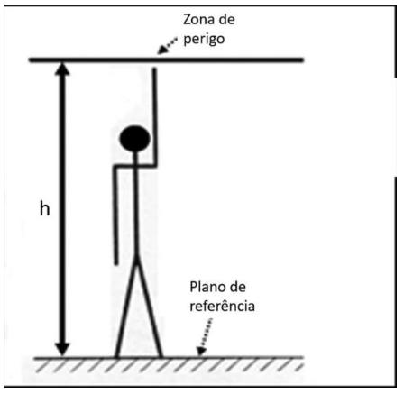

**Anexo II, linha 19** {#anexo2_lin19} Legenda: h: a altura da zona de perigo

**Anexo II, linha 20** {#anexo2_lin20} Se a zona de perigo oferece baixo risco, deve-se situar a uma altura “h” igual ou superior a 2500 mm (dois mil e quinhentos milímetros), para que não necessite proteções.

**Anexo II, linha 21** {#anexo2_lin21} Se existe um alto risco na zona de perigo:

**Anexo II, linha 22** {#anexo2_lin22} - a altura “h” da zona de perigo deve ser, no mínimo, de 2700 mm (dois mil e setecentos milímetros), ou

**Anexo II, linha 23** {#anexo2_lin23} - devem ser utilizadas outras medidas de segurança.

**Anexo II, linha 24** {#anexo2_lin24} Fonte: ABNT NBR NM ISO 13852:2003 - Segurança de Máquinas - Distâncias de segurança para impedir o acesso a zonas de perigo pelos membros superiores.

**Anexo II, Quadro 6** {#anexo2_tab6} Quadro 6 - Alcance ao redor - movimentos fundamentais (dimensões em milímetros) 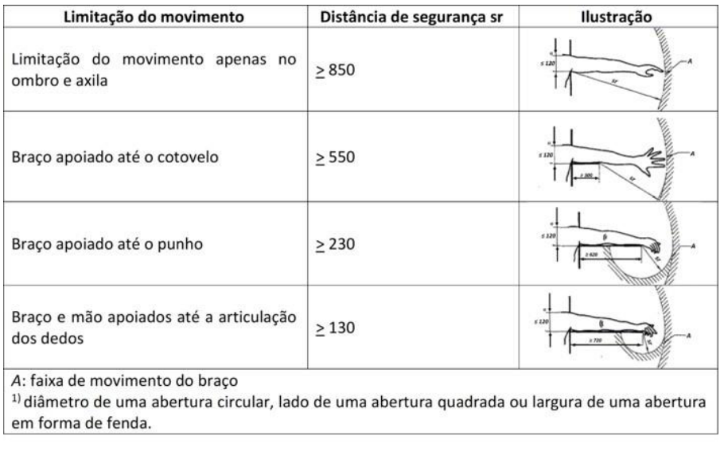

**Anexo II, linha 25** {#anexo2_lin25} Fonte: ABNT NBR NM ISO 13852 - Segurança de Máquinas - Distâncias de segurança para impedir o acesso a zonas de perigo pelos membros superiores.

## Glossário {#glossario}
Tags: #definicao

**Glossário, linha 1** {#glossario_lin1} Abrigo fixo: toda e qualquer instalação fixada de forma permanente para resguardo dos trabalhadores.

**Glossário, linha 2** {#glossario_lin2} Abrigo móvel: toda e qualquer instalação que pode ser migrada de local para resguardo dos trabalhadores.

**Glossário, linha 3** {#glossario_lin3} Ação positiva: quando um componente mecânico móvel inevitavelmente move outro componente consigo, por contato direto ou através de elementos rígidos, o segundo componente é dito como atuado em modo positivo, ou positivamente, pelo primeiro.

**Glossário, linha 4** {#glossario_lin4} Aditivo: substância ou produto adicionado a agrotóxicos, componentes e afins para melhorar a sua ação, função, durabilidade, estabilidade e detecção ou para facilitar o processo de produção.

**Glossário, linha 5** {#glossario_lin5} Adjuvante: produto utilizado em mistura com produtos formulados para melhorar a sua aplicação.

**Glossário, linha 6** {#glossario_lin6} Adubadora automotriz: máquina destinada à aplicação de fertilizante sólido granulado e desenvolvida para o setor canavieiro.

**Glossário, linha 7** {#glossario_lin7} Adubadora tracionada: implemento agrícola que, quando acoplado a um trator agrícola, pode realizar a operação de aplicar fertilizantes sólidos granulados ou em pó.

**Glossário, linha 8** {#glossario_lin8} Agentes patogênicos: organismos capazes de provocar doenças infecciosas em seus hospedeiros sempre que se encontrem em condições favoráveis.

**Glossário, linha 9** {#glossario_lin9} Agrotóxicos e afins: produtos químicos com propriedades tóxicas utilizados na agricultura para controlar pragas, doenças ou plantas daninhas que causam danos às plantações. Afins são produtos com características ou funções semelhantes aos agrotóxicos.

**Glossário, linha 10** {#glossario_lin10} Água potável: água destinada à ingestão, preparação e produção de alimentos, que atenda ao padrão de potabilidade estabelecido pelas normas governamentais.

**Glossário, linha 11** {#glossario_lin11} Análise de Risco: combinação da especificação dos limites da máquina, identificação de perigos e estimativa de riscos (ABNT NBR ISO 12100).

**Glossário, linha 12** {#glossario_lin12} Ângulo de lance: ângulo formado entre a inclinação do meio de acesso e o plano horizontal.

**Glossário, linha 13** {#glossario_lin13} AOPD (Active Opto-electronic Protective Device): dispositivo com função de detectar interrupção da emissão óptica por um objeto opaco presente na zona de detecção especificada, como cortina de luz, detector de presença laser múltiplos feixes, monitor de área a laser, fotocélulas de segurança para controle de acesso. Sua função é realizada por elementos sensores e receptores optoeletrônicos.

**Glossário, linha 14** {#glossario_lin14} Apreciação de Risco: Processo completo que compreende a análise de risco e a avaliação de risco (ABNT NBR ISO 12100).

**Glossário, linha 15** {#glossario_lin15} Área tratada: área que foi submetida à aplicação de agrotóxicos e/ou produtos afins.

**Glossário, linha 16** {#glossario_lin16} Assento instrucional: assento de máquina autopropelida projetado para fins exclusivamente instrucionais.

**Glossário, linha 17** {#glossario_lin17} Assentos em número suficiente: quantidade mínima de assentos que deve atender o número de trabalhadores, observada a escala de intervalos para refeição.

**Glossário, linha 18** {#glossario_lin18} Atividade itinerante: aquela realizada em contínuo deslocamento, de lugar em lugar, no exercício de uma função, e que não utilize um ponto de apoio para sua realização.

**Glossário, linha 19** {#glossario_lin19} Atomizador mecanizado tracionado: implemento agrícola que, quando acoplado a um trator agrícola, realiza a operação de pulverização de agrotóxicos, afins e nutrientes, por força de uma corrente de ar de grande velocidade.

**Glossário, linha 20** {#glossario_lin20} Autoteste: teste funcional executado automaticamente pelo próprio dispositivo, na inicialização do sistema e durante determinados períodos, para verificação de falhas e defeitos, levando o dispositivo para uma condição segura.

**Glossário, linha 21** {#glossario_lin21} Avaliação de Risco: julgamento com base na análise de risco, do quanto os objetivos de redução de risco foram atingidos. (ABNT NBR ISO 12100)

**Glossário, linha 22** {#glossario_lin22} Baixa velocidade ou velocidade reduzida: velocidade inferior à de operação, compatível com o trabalho seguro.

**Glossário, linha 23** {#glossario_lin23} Burla: ato de anular de maneira simples o funcionamento normal e seguro de dispositivos ou sistemas da máquina, utilizando para acionamento quaisquer objetos disponíveis, tais como, parafusos, agulhas, peças em chapa de metal, objetos de uso diário, como chaves e moedas ou ferramentas necessárias à utilização normal da máquina.

**Glossário, linha 24** {#glossario_lin24} Cabine Fechada: parte da máquina que envolve completamente o posto de trabalho do operador, fechada, dotada de sistema de climatização e onde a entrada de ar ocorre exclusivamente através de um sistema de purificação de ar. *(Alterado pela Portaria MTP nº 4.371, de 28 de dezembro de 2022)*

**Glossário, linha 25** {#glossario_lin25} Categoria: classificação das partes de um sistema de comando relacionadas à segurança, com respeito à sua resistência a defeitos e seu subsequente comportamento na condição de defeito, e que é alcançada pela combinação e interligação das partes e/ou por sua confiabilidade. O desempenho com relação à ocorrência de defeitos de uma parte de um sistema de comando, relacionado à segurança, é dividido em cinco categorias (B, 1, 2, 3 e 4), segundo a norma técnica ABNT NBR 14153 - Segurança de máquinas - Partes de sistemas de comando relacionadas à segurança - Princípios gerais para projeto, equivalente à norma técnica europeia EN 954-1 - Safety of machinery. Safety related parts of control systems. General principles for design, que leva em conta princípios qualitativos para sua seleção. A norma europeia EN 954 foi substituída pela norma internacional ISO 13849, após um período de adaptação e convivência, a qual foi traduzida no Brasil pela Associação Brasileira de Normas Técnicas - ABNT, por meio da publicação da norma técnica ABNT NBR ISO 13849 partes 1 e 2, atualizada em 2019. A norma ISO 13849-1 prevê requisitos para a concepção e integração de componentes relacionadas com a segurança dos sistemas de controle, incluindo alguns aspectos do software, expressos por nível de performance (PL), que é classificado de “a” até “e”. O conceito de categoria é mantido, mas existem requisitos adicionais a serem preenchidos para que um nível de performance possa ser reivindicado por um sistema ou componente, sendo fundamental a confiabilidade dos dados que serão empregados em uma análise quantitativa do sistema de segurança. Máquinas importadas e componentes que já utilizam o conceito de PL não devem ser consideradas, apenas por esta razão, em desacordo com a [[norma-regulamentadora-federal-12-1978|NR-12]], pois existe uma correlação, embora não linear, entre o os conceitos de PL e categoria *(vide Nota Técnica DSST/SIT n.º 48/2016)*.

**Glossário, linha 26** {#glossario_lin26} Categoria B: caracterizada principalmente pela seleção de componentes. A ocorrência de um defeito pode levar à perda da função de segurança. *(Retificado pela Portaria MTP nº 698, de 04 de abril de 2022)*

**Glossário, linha 27** {#glossario_lin27} Categoria 1: a ocorrência de um defeito pode levar à perda da função de segurança, porém, a probabilidade de sua ocorrência é menor que para a categoria B.

**Glossário, linha 28** {#glossario_lin28} Categoria 2: a função de segurança é verificada em intervalos pelo sistema: a) a ocorrência de um defeito pode levar à perda da função de segurança entre as verificações; e b) a perda da função de segurança é detectada pela verificação.

**Glossário, linha 29** {#glossario_lin29} Categoria 3: quando o comportamento de sistema permite que: a) quando ocorrer o defeito isolado, a função de segurança sempre seja cumprida; b) alguns, mas não todos, defeitos sejam detectados; e c) o acúmulo de defeitos não detectados leve à perda da função de segurança.

**Glossário, linha 30** {#glossario_lin30} Categoria 4: quando as partes dos sistemas de comando relacionadas à segurança devem ser projetadas de tal forma que: a) uma falha isolada em qualquer dessas partes relacionadas à segurança não leve à perda das funções de segurança; e b) a falha isolada seja detectada antes ou durante a próxima atuação sobre a função de segurança, como, por exemplo, imediatamente, ao ligar o comando, ao final do ciclo de operação da máquina. Se essa detecção não for possível, o acúmulo de defeitos não deve levar à perda das funções de segurança.

**Glossário, linha 31** {#glossario_lin31} Chave de partida: combinação de todos os dispositivos de manobra necessários para partir e parar um motor.

**Glossário, linha 32** {#glossario_lin32} Circuito elétrico de comando: circuito responsável por levar o sinal gerado pelos controles da máquina ou equipamento até os dispositivos e componentes, cuja função é comandar o acionamento das máquinas e equipamentos, tais como interfaces de segurança, relés, contatores, entre outros, geralmente localizados em painéis elétricos ou protegidos pela estrutura ou carenagem das máquinas e equipamentos.

**Glossário, linha 33** {#glossario_lin33} Classificação toxicológica: agrupamento dos agrotóxicos em classes de acordo com sua toxicidade.

**Glossário, linha 34** {#glossario_lin34} Colhedora de algodão: possui um sistema de fusos giratórios que retiram a fibra do algodão sem prejudicar a parte vegetativa da planta, ou seja, caules e folhas. Determinados modelos têm como característica a separação da fibra e do caroço, concomitante à operação de colheita.

**Glossário, linha 35** {#glossario_lin35} Colhedora de café: equipamento agrícola automotriz que efetua a derriçagem e a colheita de café.

**Glossário, linha 36** {#glossario_lin36} Colhedora de cana-de-açúcar: equipamento que permite a colheita de cana de modo uniforme, gerando maior produtividade, por possuir sistema de corte de base capaz de cortar a cana-de-açúcar acompanhando o perfil do solo, reduzindo a quantidade de impurezas e palha no produto final. Possui um sistema de elevador que desloca a cana cortada até a unidade de transbordo.

**Glossário, linha 37** {#glossario_lin37} Colhedora de forragem ou forrageira autopropelida: equipamento agrícola automotriz apropriado para colheita e forragem de milho, sorgo, girassol e outros. Oferece corte preciso da planta, sendo capaz de colher ou recolher, triturar e recolher a cultura cortada em contentores ou veículos separados de transbordo.

**Glossário, linha 38** {#glossario_lin38} Colhedora de grãos: máquina destinada à colheita de grãos, como trigo, soja, milho, arroz, feijão etc. O produto é recolhido por meio de uma plataforma de corte e conduzido para a área de trilha e separação, onde o grão é separado da palha, que é expelida, enquanto o grão é transportado ao tanque graneleiro.

**Glossário, linha 39** {#glossario_lin39} Colhedora de laranja: máquina agrícola autopropelida que efetua a colheita da laranja e outros cítricos similares.

**Glossário, linha 40** {#glossario_lin40} Comandos elétricos ou interfaces de segurança: dispositivos responsáveis por realizar monitoramento e que verificam a interligação, posição e funcionamento de outros dispositivos do sistema. Impedem a ocorrência de falha que provoque a perda da função de segurança, como relés de segurança, controladores configuráveis de segurança e controlador lógico programável de segurança.

**Glossário, linha 41** {#glossario_lin41} Compartimento estanque: compartimento com características de vedação e isolamento impermeáveis, projetado para evitar o vazamento de produtos.

**Glossário, linha 42** {#glossario_lin42} Compostagem de dejetos de origem animal: processo biológico que acelera a decomposição e permite a reciclagem da matéria orgânica contida em restos de origem animal.

**Glossário, linha 43** {#glossario_lin43} Condições climáticas extremas: intempéries.

**Glossário, linha 44** {#glossario_lin44} Controlador Configurável de Segurança - CCS: equipamento eletrônico computadorizado -hardware, que utiliza memória configurável para armazenar e executar internamente intertravamentos de funções específicas de programa - software, tais como sequenciamento, temporização, contagem e blocos de segurança, controlando e monitorando por meio de entradas e saídas de segurança vários tipos de máquinas ou processos. Deve ter três princípios básicos de funcionamento: redundância, diversidade e autoteste. O programa instalado deve garantir sua eficácia de forma a reduzir ao mínimo a possibilidade de erros provenientes de falha humana no projeto, a fim de evitar o comprometimento de qualquer função relativa à segurança, bem como não permitir alteração dos blocos de função de segurança específicos.

**Glossário, linha 45** {#glossario_lin45} Contatos espelho: um contato auxiliar normalmente fechado (NF) que não pode estar na posição fechada ao mesmo tempo que um dos contatos principais (de força ou potência) no mesmo contator. Assim, contatos espelho é uma característica que diz respeito à ligação mecânica entre os contatos auxiliares e os contatos principais de um contator.

**Glossário, linha 46** {#glossario_lin46} Contatos mecanicamente ligados: uma combinação de contatos normalmente abertos (NA) e contatos normalmente fechados (NF) projetada de modo que os contatos não possam estar simultaneamente na posição fechada (ou aberta). Aplica-se a contatos auxiliares de dispositivos de comando onde a força de atuação é provida internamente, tais como: contatores.

**Glossário, linha 47** {#glossario_lin47} Controlador Lógico Programável - CLP de segurança: equipamento eletrônico computadorizado -hardware, que utiliza memória programável para armazenar e executar internamente instruções e funções específicas de programa - software, tais como lógica, sequenciamento, temporização, contagem, aritmética e blocos de segurança, controlando e monitorando por meio de entradas e saídas de segurança vários tipos de máquinas ou processos. O CLP de segurança deve ter três princípios básicos de funcionamento: redundância, diversidade e autoteste. O programa instalado deve garantir sua eficácia de forma a reduzir ao mínimo a possibilidade de erros provenientes de falha humana no projeto, a fim de evitar o comprometimento de qualquer função relativa à segurança, bem como não permitir alteração dos blocos de função de segurança específicos.

**Glossário, linha 48** {#glossario_lin48} Controles: dispositivos que compõem a interface de operação entre homem e máquina, incluídos os dispositivos de partida, acionamento e parada, tais como botões, pedais, alavancas, joysticks, telas sensíveis ao toque (touch screen), entre outros, geralmente visíveis. Os controles geram os sinais de comando da máquina ou equipamento.

**Glossário, linha 49** {#glossario_lin49} Cultivo protegido: consiste em uma técnica que possibilita certo controle de variáveis climáticas como temperatura, umidade do ar, radiação solar e vento. O mais conhecido é aquele realizado em estufas.

**Glossário, linha 50** {#glossario_lin50} Deriva: fração dos ingredientes ativos de agrotóxicos e afins que não atinge o alvo.

**Glossário, linha 51** {#glossario_lin51} Derriçadeira: aparelho mecânico manejado manualmente e acionado por motor lateral ou costal, que fazem vibrar as varetas em suas extremidades promovendo a derriçagem dos frutos.

**Glossário, linha 52** {#glossario_lin52} Descarga elétrica atmosférica: descarga elétrica natural proveniente da natureza por meio de raio.

**Glossário, linha 53** {#glossario_lin53} Descontaminação: remoção de um contaminante químico, físico ou biológico.

**Glossário, linha 54** {#glossario_lin54} Dispositivo de ação continuada (também conhecido como dispositivo de comando sem retenção): dispositivo de acionamento manual que inicia e mantém em operação elementos da máquina ou equipamento apenas enquanto estiver atuado. Dispositivo de acionamento bimanual (também conhecido como dispositivo de comando bimanual): dispositivo que exige, ao menos, a atuação simultânea pela utilização das duas mãos, com o objetivo de iniciar e manter as mãos do operador nos dispositivos de atuação (geralmente botões) enquanto existir uma condição de perigo, propiciando uma medida de proteção apenas para a pessoa que o atua. Distâncias requeridas entre os dispositivos de atuação e outras informações podem ser obtidas nas normas técnicas ISO 13851 - Safety of machinery — Two-hand control devices - Principles for design and selection e ANBT NBR 14152 - Segurança de máquinas -Dispositivos de comando bimanuais - Aspectos funcionais e princípios para projeto. Dispositivo de acionamento por movimento limitado passo a passo (também conhecido como dispositivo de comando limitador de movimento): dispositivo cujo acionamento permite apenas um deslocamento limitado de um elemento de uma máquina ou equipamento, reduzindo assim o risco tanto quanto possível, ficando excluído qualquer movimento posterior até que o dispositivo de atuação seja desativado e acionado novamente.

**Glossário, linha 55** {#glossario_lin55} Dispositivo de intertravamento: dispositivo associado a uma proteção, cujo propósito é prevenir o funcionamento de funções perigosas da máquina sob condições específicas (geralmente enquanto a proteção não está fechada), com atuação mecânica (com contato físico), como os dispositivos mecânicos de intertravamento, ou sem atuação mecânica (sem contato físico), como os dispositivos de intertravamento indutivos, magnéticos, capacitivos, ultrassônicos, óticos, e por rádio frequência. Podem ou não ser codificados, a depender da aplicação, e sua instalação deve dificultar a burla por meios simples, como chaves de fenda, pregos, arames, fitas, imãs comuns, objetos metálicos etc. (ISO 14119 - Safety of machinery — Interlocking devices associated with guards — Principles for design and selection).

**Glossário, linha 56** {#glossario_lin56} Dispositivo de obstrução: qualquer obstáculo físico (barreira, trilho etc.) que, sem impedir totalmente o acesso a uma zona perigosa, reduz a probabilidade do acesso a esta zona, oferecendo uma obstrução ao acesso livre.

**Glossário, linha 57** {#glossario_lin57} Dispositivo de restrição mecânica: dispositivo que tem por função inserir em um mecanismo um obstáculo mecânico, como cunha, veio, fuso, escora, calço etc., capaz de se opor pela sua própria resistência a qualquer movimento perigoso, por exemplo, queda de uma corrediça, no caso de falha do sistema de retenção normal.

**Glossário, linha 58** {#glossario_lin58} Dispositivo inibidor ou defletor: obstáculo físico que, sem impedir totalmente o acesso a uma zona perigosa, reduz sua probabilidade, restringindo as possibilidades de acesso.

**Glossário, linha 59** {#glossario_lin59} Dispositivo limitador: dispositivo que previne uma máquina, ou as condições perigosas de uma máquina, de ultrapassar um limite determinado (por exemplo, limitador de espaço, limitador de pressão, limitador de torque etc.).

**Glossário, linha 60** {#glossario_lin60} Dispositivo mecânico: dispositivo de retenção, restrição, obstrução, limitadores, separadores, empurradores, inibidores/defletores, retráteis, ajustáveis ou com autofechamento.

**Glossário, linha 61** {#glossario_lin61} Dispositivo mecânico de intertravamento: dispositivo cujo funcionamento se dá pela inserção/remoção de um atuador externo no corpo do dispositivo, ou pela ação mecânica direta (ou positiva) de partes da máquina ou equipamento, geralmente proteções móveis, sobre elementos mecânicos do dispositivo. É passível de desgaste, devendo ser utilizado de forma redundante e diversa quando a apreciação de riscos assim exigir, para evitar que uma falha mecânica, como a quebra do atuador ou de outros elementos, leve à perda da função de segurança. Quando exigidos em redundância (dois dispositivos), pode-se aplicar um deles com ação direta de abertura de um elemento de contato normalmente fechado (NF), e o outro com ação não direta de abertura (por ação de mola) de um elemento de contato normalmente aberto (NA), gerando os sinais de parada, dentre outras configurações possíveis. A depender também da interface de segurança utilizada, que pode operar com sinais iguais ou invertidos (ISO 14119 - Safety of machinery — Interlocking devices associated with guards — Principles for design and selection).

**Glossário, linha 62** {#glossario_lin62} Distância de segurança: distância que protege as pessoas do alcance das zonas de perigo, sob condições específicas, para diferentes situações de acesso. Quando utilizadas proteções, ou seja, barreiras físicas que restringem o acesso do corpo ou parte dele, devem ser observadas as distâncias mínimas constantes dos Quadros 4, 5 e 6 e Figuras 7 e 8 do Anexo II desta Norma, que apresenta os principais quadros e tabelas da ABNT NBR NM ISO 13852 - Segurança de Máquinas -Distâncias de segurança, para impedir o acesso a zonas de perigo pelos membros superiores. As distâncias de segurança para impedir o acesso dos membros inferiores são determinadas pela ABNT NBR NM ISO 13853 - Segurança de máquinas - Distâncias de segurança para impedir o acesso a zonas de perigo pelos membros inferiores, e devem ser utilizadas quando há risco apenas para os membros inferiores, pois, quando houver risco para membros superiores e inferiores, as distâncias de segurança previstas na norma para membros superiores devem ser atendidas. As disposições das normas técnicas ABNT NBR NM ISO 13852 e ABNT NBR NM ISO 13853 encontram-se reunidas em uma única norma, a EN ISO 13857 - Safety of machinery - Safety distances to prevent hazard zones being reached by upper and lower limbs, ainda sem tradução no Brasil.

**Glossário, linha 63** {#glossario_lin63} Diversidade: aplicação de componentes, dispositivos ou sistemas com diferentes princípios ou tipos, podendo reduzir a probabilidade de existir uma condição perigosa.

**Glossário, linha 64** {#glossario_lin64} Empregador rural ou equiparado: pessoa física ou jurídica, proprietário ou não, que explore atividade agroeconômica, em caráter permanente ou temporário, diretamente ou através de prepostos e com auxílio de empregados. Equipara-se ao empregador rural, a pessoa física ou jurídica que, habitualmente, em caráter profissional, e por conta de terceiros, execute serviços de natureza agrária, mediante utilização do trabalho de outrem.

**Glossário, linha 65** {#glossario_lin65} Equipamento tracionado: equipamento que desenvolve a atividade para a qual foi projetado, deslocando-se por meio do sistema de propulsão de outra máquina que o conduz.

**Glossário, linha 66** {#glossario_lin66} Escada de degraus com espelho: meio de acesso permanente com um ângulo de lance de 20° (vinte graus) a 45° (quarenta e cinco graus), cujos elementos horizontais são degraus com espelho.

**Glossário, linha 67** {#glossario_lin67} Escada de degraus sem espelho: meio de acesso permanente com um ângulo de lance de 45° (quarenta e cinco graus) a 75° (setenta e cinco graus), cujos elementos horizontais são degraus sem espelho.

**Glossário, linha 68** {#glossario_lin68} Escada do tipo marinheiro: meio de acesso permanente com um ângulo de lance de 75° (setenta e cinco graus) a 90° (noventa graus), cujos elementos horizontais são barras ou travessas.

**Glossário, linha 69** {#glossario_lin69} Escavadeira hidráulica em aplicação florestal: escavadeira projetada para executar trabalhos de construção, que pode ser utilizada em aplicação florestal, por meio da instalação de dispositivos especiais que permitam o corte, desgalhamento, processamento ou carregamento de toras.

**Glossário, linha 70** {#glossario_lin70} Espaço confinado: qualquer área não projetada para ocupação humana contínua, a qual tenha meios limitados de entrada e saída ou uma configuração interna que possa causar aprisionamento ou asfixia de trabalhador, e na qual a ventilação seja inexistente ou insuficiente para remover contaminantes perigosos e/ou deficiência/enriquecimento de oxigênio que possam existir ou se desenvolver, ou que contenha um material com potencial para engolfar/afogar um trabalhador que entre no espaço.

**Glossário, linha 71** {#glossario_lin71} Especificação e limitação técnica: informações detalhadas na máquina ou manual, tais como: capacidade, velocidade de rotação, dimensões máximas de ferramentas, massa de partes desmontáveis, dados de regulagem, necessidade de utilização de EPI, frequência de inspeções e manutenções, etc.

**Glossário, linha 72** {#glossario_lin72} ESPS (Electro-sensitive Protective Systems): sistema composto por dispositivos ou componentes que operam conjuntamente, com objetivo de proteção e sensoriamento da presença humana, compreendendo no mínimo: dispositivo de sensoriamento, dispositivo de monitoração ou controle e dispositivo de chaveamento do sinal de saída.

**Glossário, linha 73** {#glossario_lin73} Estabelecimento rural: propriedade ou extensão de terra, situada fora ou dentro dos limites urbanos, que se destina à exploração de atividade agroeconômica, agricultura, pecuária, silvicultura, exploração florestal e aquicultura, em caráter temporário ou permanente, diretamente ou através de prepostos e com auxílio de trabalhadores, considerando-se as frentes de trabalho como extensão daquela.

**Glossário, linha 74** {#glossario_lin74} Estrados: estruturas planas inseridas acima do nível do chão, formando um piso mais elevado para pôr em destaque coisa ou objeto.

**Glossário, linha 75** {#glossario_lin75} Faixa de segurança: área necessária à implantação, operação e manutenção da Linha de Distribuição Rural. A faixa de segurança é de um modo geral de 10 m (dez metros) de largura, ou seja, 5 m (cinco metros) de cada lado do eixo da linha.

**Glossário, linha 76** {#glossario_lin76} Falha segura: o princípio de falha segura requer que um sistema entre em estado seguro, quando ocorrer falha de um componente relevante à segurança. A principal pré-condição para a aplicação desse princípio é a existência de um estado seguro em que o sistema pode ser projetado para entrar nesse estado quando ocorrerem falhas. O exemplo típico é o sistema de proteção de trens (estado seguro = trem parado). Um sistema pode não ter um estado seguro como, por exemplo, um avião. Nesse caso, deve ser usado o princípio de vida segura, que requer a aplicação de redundância e de componentes de alta confiabilidade para se ter a certeza de que o sistema sempre funcione.

**Glossário, linha 77** {#glossario_lin77} Fase de utilização: fase que compreende todas as etapas de construção, transporte, montagem, instalação, ajuste, operação, limpeza, manutenção, inspeção, desativação e desmonte.

**Glossário, linha 78** {#glossario_lin78} Feller buncher: trator florestal cortador-enfeixador de troncos para abate de árvores inteiras, por meio do uso de implemento de corte com disco ou serra circular e garras para segurar e enfeixar vários troncos simultaneamente.

**Glossário, linha 79** {#glossario_lin79} Ferramenta: utensílio com finalidade operacional e que é indispensável para o desempenho de algumas atividades do trabalho rural.

**Glossário, linha 80** {#glossario_lin80} Forrageira tracionada: implemento agrícola que, quando acoplado a um trator agrícola, pode realizar a operação de colheita ou recolhimento e trituração da planta forrageira, sendo o material triturado, como forragem, depositado em contentores ou veículos separados de transbordo.

**Glossário, linha 81** {#glossario_lin81} Fossa seca: escavação, com ou sem revestimento interno, feita no terreno para receber os dejetos de instalação sanitária.

**Glossário, linha 82** {#glossario_lin82} Fossa séptica: unidade de tratamento primário de esgoto doméstico na qual é feita a separação e a transformação físico-química da matéria sólida contida no esgoto.

**Glossário, linha 83** {#glossario_lin83} Harvester: trator florestal cortador de troncos para abate de árvores, utilizando cabeçote processador que corta troncos, um por vez, e que tem capacidade de processar a limpeza dos galhos e corte subsequente em toras de tamanho padronizado.

**Glossário, linha 84** {#glossario_lin84} Hermeticamente fechado: fechado de modo a impedir a entrada do ar ou o vazamento de produtos.

**Glossário, linha 85** {#glossario_lin85} Impedimento do devassamento: medida que tem por finalidade evitar a exposição da intimidade do trabalhador durante a realização das atividades fisiológicas e/ou banho.

**Glossário, linha 86** {#glossario_lin86} Implemento agrícola e florestal: dispositivo sem força motriz própria que é conectado a uma máquina e que, quando puxado, arrastado ou operado, permite a execução de operações específicas voltadas para a agricultura, pecuária e trato florestal, como preparo do solo, tratos culturais, plantio, colheita, abertura de valas para irrigação e drenagem, transporte, distribuição de ração ou adubos, poda e abate de árvores, etc.

**Glossário, linha 87** {#glossario_lin87} Informação ou símbolo indelével: aquele aplicado diretamente sobre a máquina, que deve ser conservado de forma íntegra e legível durante todo o tempo de utilização máquina.

**Glossário, linha 88** {#glossario_lin88} Instalações elétricas blindadas: aquelas onde há proteção de forma a isolar as partes condutoras do contato elétrico.

**Glossário, linha 89** {#glossario_lin89} Interface de segurança: dispositivo responsável por realizar o monitoramento, verificando a interligação, posição e funcionamento de outros dispositivos do sistema, impedindo a ocorrência de falha que provoque a perda da função de segurança, como relés de segurança, controladores configuráveis de segurança e CLP de segurança.

**Glossário, linha 90** {#glossario_lin90} Intertravamento com bloqueio: proteção associada a um dispositivo de intertravamento com dispositivo de bloqueio, de tal forma que: a) as funções perigosas cobertas pela proteção não possam operar enquanto a máquina não estiver fechada e bloqueada; b) a proteção permanece bloqueada na posição fechada até que tenha cessado o risco de acidente devido às funções perigosas da máquina; e c) quando a proteção estiver bloqueada na posição fechada, as funções perigosas da máquina possam operar, mas o fechamento e o bloqueio da proteção não iniciem por si próprios a operação dessas funções. Geralmente, apresenta-se sob a forma de chave de segurança eletromecânica de duas partes: corpo e atuador-lingueta.

**Glossário, linha 91** {#glossario_lin91} Intervalo de reentrada: intervalo de tempo entre a aplicação de agrotóxicos ou produtos afins e a entrada de pessoas na área tratada sem a necessidade de uso de EPI.

**Glossário, linha 92** {#glossario_lin92} Intoxicação: conjunto de sinais e sintomas causados pela exposição a substâncias químicas nocivas ao organismo.

**Glossário, linha 93** {#glossario_lin93} Lanterna traseira de posição: dispositivo designado para emitir um sinal de luz para indicar a presença de uma máquina.

**Glossário, linha 94** {#glossario_lin94} Limiar de queimaduras: temperatura superficial que define o limite entre a ausência de queimaduras e uma queimadura de espessura parcial superficial, causada pelo contato da pele com uma superfície aquecida, para um período específico de contato.

**Glossário, linha 95** {#glossario_lin95} Manípulo ou pega-mão: dispositivo auxiliar, incorporado à estrutura da máquina ou nela afixado, que tem a finalidade de permitir o acesso.

**Glossário, linha 96** {#glossario_lin96} Manopla: acessório utilizado nos carrinhos de mão para “pega” pelo trabalhador, auxiliando na proteção e na aderência das mãos.

**Glossário, linha 97** {#glossario_lin97} Máquina: conjunto de mecanismos combinados para receber uma forma definida de energia, transformá-la e restituí-la sob forma mais apropriada, ou para produzir determinado efeito ou executar determinada função. Como por exemplo: um trator agrícola cujo motor alimentado com combustível produz uma força que pode puxar ou arrastar implementos e ainda, através da Tomada de Potência - TDP, fornecer energia para funcionamento destes.

**Glossário, linha 98** {#glossario_lin98} Máquina agrícola e florestal autopropelida ou automotriz: máquina destinada a atividades agrícolas e florestais que se desloca sobre meio terrestre com sistema de propulsão próprio.

**Glossário, linha 99** {#glossario_lin99} Máquina automotriz ou autopropelida: máquina que desloca sobre meio terrestre com sistema de propulsão próprio, tais como: tratores, colhedoras e pulverizadores.

**Glossário, linha 100** {#glossario_lin100} Máquina de construção em aplicação agroflorestal: máquina originalmente concebida para realização de trabalhos relacionados à construção e movimentação de solo e que recebe dispositivos específicos para realização de trabalhos ligados a atividades agroflorestais.

**Glossário, linha 101** {#glossario_lin101} Máquina estacionária: aquela que se mantém fixa em um posto de trabalho, ou seja, transportável para uso em bancada ou em outra superfície estável em que possa ser fixada.

**Glossário, linha 102** {#glossario_lin102} Máquina ou equipamento manual: máquina ou equipamento portátil guiado à mão.

**Glossário, linha 103** {#glossario_lin103} Máquina ou implemento projetado: todo equipamento ou dispositivo desenhado, calculado, dimensionado e construído por profissional legalmente habilitado, para o uso adequado e seguro.

**Glossário, linha 104** {#glossario_lin104} Materiais: aqueles cuja finalidade é de apoio e suporte aos trabalhadores durante a permanência nas frentes de trabalho. Esses materiais podem ser transportados no interior do veículo desde que devidamente acondicionados de forma a não se deslocarem durante o transporte, não acarretando riscos à saúde e segurança dos trabalhadores.

**Glossário, linha 105** {#glossario_lin105} Materiais de uso pessoal: aqueles cujo uso visa suprir uma necessidade básica do trabalhador com alimentação, saúde, higiene, conforto e lazer.

**Glossário, linha 106** {#glossario_lin106} Microtrator e cortador de grama autopropelido: máquina de pequeno porte destinada à execução de serviços gerais e de conservação de jardins residenciais ou comerciais. Seu peso bruto total sem implementos não ultrapassa 600 kg (seiscentos quilogramas).

**Glossário, linha 107** {#glossario_lin107} Monitoramento: função intrínseca do projeto do componente ou realizada por interface de segurança que garante a funcionalidade de um sistema de segurança quando um componente ou um dispositivo tiver sua função reduzida ou limitada, ou quando houver situações de perigo devido a alterações nas condições do processo.

**Glossário, linha 108** {#glossario_lin108} Motocultivador - trator de rabiças, “mula mecânica” ou microtrator: equipamento motorizado de duas rodas utilizado para tracionar implementos diversos, desde preparo de solo até colheita. Caracteriza-se pelo fato de o operador caminhar atrás do equipamento durante o trabalho.

**Glossário, linha 109** {#glossario_lin109} Motopoda: máquina similar à motosserra, dotada de cabo extensor para maior alcance nas operações de poda.

**Glossário, linha 110** {#glossario_lin110} Motorista habilitado para condução de veículo de transporte coletivo de trabalhadores: aquele que possui habilitação categoria “D” ou superior e curso para condutor de veículo de transporte coletivo de passageiros.

**Glossário, linha 111** {#glossario_lin111} Motosserra: serra motorizada de empunhadura manual utilizada principalmente para corte e poda de árvores.

**Glossário, linha 112** {#glossario_lin112} Muting: desabilitação automática e temporária de uma função de segurança por meio de componentes de segurança ou circuitos de comando responsáveis pela segurança, durante o funcionamento normal da máquina.

**Glossário, linha 113** {#glossario_lin113} Opcional: dispositivo ou sistema não obrigatório, como faróis auxiliares.

**Glossário, linha 114** {#glossario_lin114} Pausas para descanso: interrupções da jornada de trabalho determinada pelo empregador, com o objetivo de o trabalhador recuperar-se da fadiga acumulada durante a execução das atividades laborais realizadas em pé e/ou nas atividades que exijam sobrecarga muscular estática ou dinâmica.

**Glossário, linha 115** {#glossario_lin115} Perigo: fonte com potencial para causar lesão ou problema de saúde.

**Glossário, linha 116** {#glossario_lin116} Permissão de trabalho - ordem de serviço: documento escrito, específico e auditável, que contenha, no mínimo, a descrição do serviço, a data, o local, o nome e a função dos trabalhadores e dos responsáveis pelo serviço e por sua emissão e os procedimentos de trabalho e segurança.

**Glossário, linha 117** {#glossario_lin117} Plantadeira tracionada: implemento agrícola que, quando acoplado a um trator agrícola, pode realizar a operação de plantio de culturas, como sementes, mudas, tubérculos ou outros. Plataforma ou escada externa para máquina autopropelida agrícola, florestal e de construção em aplicações agroflorestais: dispositivo de apoio não fixado de forma permanente na máquina.

**Glossário, linha 118** {#glossario_lin118} Poeira orgânica: poeiras de origem vegetal, animal ou microbiológica.

**Glossário, linha 119** {#glossario_lin119} Posto de operação: local da máquina ou equipamento de onde o trabalhador opera a máquina.

**Glossário, linha 120** {#glossario_lin120} Posto de trabalho: qualquer local de máquinas, equipamentos e implementos em que seja requerida a intervenção do trabalhador.

**Glossário, linha 121** {#glossario_lin121} Prevenção: conjunto das disposições ou medidas tomadas ou previstas em todas as fases das atividades, visando evitar, eliminar, minimizar ou controlar os riscos ocupacionais.

**Glossário, linha 122** {#glossario_lin122} Profissional habilitado para a supervisão da capacitação: profissional que comprove conclusão de curso específico na área de atuação, compatível com o curso a ser ministrado, com registro no competente conselho de classe, se necessário.

**Glossário, linha 123** {#glossario_lin123} Profissional legalmente habilitado: trabalhador previamente qualificado e com registro no competente conselho de classe, se necessário.

**Glossário, linha 124** {#glossario_lin124} Profissional ou trabalhador capacitado: aquele que recebeu capacitação sob orientação e responsabilidade de profissional habilitado.

**Glossário, linha 125** {#glossario_lin125} Profissional ou trabalhador qualificado: aquele que comprove conclusão de curso específico na sua área de atuação e reconhecido pelo sistema oficial de ensino.

**Glossário, linha 126** {#glossario_lin126} Proteção coletiva: dispositivo, sistema ou meio, fixo ou móvel, de abrangência coletiva, destinado a preservar a integridade física e a saúde dos trabalhadores e terceiros.

**Glossário, linha 127** {#glossario_lin127} Proteção fixa distante: proteção que não cobre completamente a zona de perigo, mas que impede ou reduz o acesso em razão de suas dimensões e sua distância em relação à zona de perigo, como, por exemplo, grade de perímetro ou proteção em túnel.

**Glossário, linha 128** {#glossario_lin128} Pulverizador autopropelido: instrumento ou máquina utilizada na agricultura no combate às pragas da lavoura, infestação de plantas daninha e insetos. Tem como principal característica a condição de cobrir grandes áreas, com altíssima produtividade e preciso controle da dosagem dos produtos aplicados. Sua maior função é permitir o controle da dosagem na aplicação de defensivos ou fertilizantes sobre determinada área.

**Glossário, linha 129** {#glossario_lin129} Pulverizador tracionado: implemento agrícola que, quando acoplado a um trator agrícola, pode realizar a operação de aplicar agrotóxicos.

**Glossário, linha 130** {#glossario_lin130} Queimadura de espessura parcial superficial: queimadura em que a epiderme é completamente destruída, mas os folículos pilosos e glândulas sebáceas, bem como as glândulas sudoríparas, são poupados.

**Glossário, linha 131** {#glossario_lin131} Rampa: meio de acesso permanente inclinado e contínuo em ângulo de lance de 0° (zero grau) a 20° (vinte graus).

**Glossário, linha 132** {#glossario_lin132} Redução de riscos: ações para reduzir a probabilidade da ocorrência de danos para a integridade física e saúde do trabalhador.

**Glossário, linha 133** {#glossario_lin133} Redundância: aplicação de mais de um componente, dispositivo ou sistema, a fim de assegurar que, havendo uma falha em um deles na execução de sua função, o outro estará disponível para executar esta função.

**Glossário, linha 134** {#glossario_lin134} Relé de segurança: componente com redundância e circuito eletrônico dedicado para acionar e supervisionar funções específicas de segurança, tais como chaves de segurança, sensores, circuitos de parada de emergência, ESPE, válvulas e contatores, garantido que, em caso de falha ou defeito desses ou em sua função, a máquina interrompa o funcionamento e não permita a inicialização de um novo ciclo, até o defeito ser sanado. Deve ter três princípios básicos de funcionamento: redundância, diversidade e autoteste.

**Glossário, linha 135** {#glossario_lin135} Resíduos: sobras do processo produtivo em estado sólido ou líquido.

**Glossário, linha 136** {#glossario_lin136} Risco: probabilidade da ocorrência de danos para a integridade física e saúde do trabalhador.

**Glossário, linha 137** {#glossario_lin137} Risco mecânico: qualquer risco dentro da atividade executada que possa gerar uma lesão corporal imediata ou não ao trabalhador.

**Glossário, linha 138** {#glossario_lin138} Roçadeira costal motorizada: equipamento mecânico, manejado manualmente e acionado por motor, utilizado para cortar gramíneas e outros tipos de vegetação.

**Glossário, linha 139** {#glossario_lin139} Roupa de cama: jogo de cama composto por fronha, lençol de baixo, lençol e cobertor, este último conforme a necessidade e de acordo com as condições climáticas da região.

**Glossário, linha 140** {#glossario_lin140} Ruptura positiva - operação de abertura positiva de um elemento de contato: efetivação da separação de um contato como resultado direto de um movimento específico do atuador da chave do interruptor, por meio de partes não resilientes, ou seja, não dependentes da ação de molas.

**Glossário, linha 141** {#glossario_lin141} Salpicos: respingos de qualquer líquido.

**Glossário, linha 142** {#glossario_lin142} Secadores: equipamento destinado à secagem artificial de produtos agrícolas através de ventilação forçada com utilização de ar aquecido ou não, não incluindo estufas.

**Glossário, linha 143** {#glossario_lin143} Seletor - chave seletora, dispositivo de validação: chave seletora ou seletora de modo de comando com acesso restrito ou senha de tal forma que: a) possa ser bloqueada em cada posição, impedindo a mudança de posição por trabalhadores não autorizados; b) cada posição corresponda a um único modo de comando ou de funcionamento; c) o modo de comando selecionado tenha prioridade sobre todos os outros sistemas de comando, com exceção da parada de emergência; e d) torne a seleção visível, clara e facilmente identificável.

**Glossário, linha 144** {#glossario_lin144} Símbolo - pictograma: desenho esquemático normatizado, destinado a significar certas indicações simples.

**Glossário, linha 145** {#glossario_lin145} Sistema de proteção contra quedas: estrutura fixada à máquina ou equipamento, projetada para impedir a queda de pessoas, materiais ou objetos.

**Glossário, linha 146** {#glossario_lin146} Sistema de Proteção Coletiva contra Quedas (SPCQ): sistema coletivo destinado a eliminar o risco de queda dos trabalhadores ou a minimizar as consequências da queda.

**Glossário, linha 147** {#glossario_lin147} Sistema de Proteção Individual contra Quedas (SPIQ): sistema individual destinado a eliminar o risco de queda dos trabalhadores ou a minimizar as consequências da queda.

**Glossário, linha 148** {#glossario_lin148} Talão: parte mais rígida reforçada do pneu, que entra em contato com o aro, garantindo sua fixação.

**Glossário, linha 149** {#glossario_lin149} Terreno alagadiço: porção de terra coberta de água de forma permanente ou sazonal.

**Glossário, linha 150** {#glossario_lin150} Transporte coletivo de trabalhadores: aquele realizado em veículos normalizados, com autorização emitida pela autoridade de trânsito competente, que exceda a oito passageiros, excluído o motorista.

**Glossário, linha 151** {#glossario_lin151} Trator acavalado: trator agrícola em que, devido às dimensões reduzidas, a plataforma de operação consiste apenas de um piso pequeno nas laterais para o apoio dos pés e operação.

**Glossário, linha 152** {#glossario_lin152} Trator agrícola: máquina autopropelida de médio a grande porte, destinada a puxar ou arrastar implementos agrícolas. Possui uma ampla gama de aplicações na agricultura e pecuária e é caracterizado por possuir no mínimo dois eixos para pneus ou esteiras e peso, sem lastro ou implementos, maior que 600 kg (seiscentos quilogramas) e bitola mínima entre pneus traseiros, com o maior pneu especificado, maior que 1280 mm (um mil duzentos e oitenta milímetros).

**Glossário, linha 153** {#glossario_lin153} Trator agrícola estreito: trator de pequeno porte destinado à produção de frutas, café e outras aplicações nas quais o espaço é restrito e utilizado para implementos de pequeno porte. Possui bitola mínima entre pneus traseiros, com o maior pneu especificado, menor ou igual a 1280 mm (um mil duzentos e oitenta milímetros) e peso bruto total acima de 600 kg (seiscentos quilogramas).

**Glossário, linha 154** {#glossario_lin154} Válvula e bloco de segurança: componente conectado à máquina ou equipamento com a finalidade de permitir ou bloquear, quando acionado, a passagem de fluidos líquidos ou gasosos, como ar comprimido e fluidos hidráulicos, de modo a iniciar ou cessar as funções da máquina ou equipamento. Deve possuir monitoramento para a verificação de sua interligação, posição e funcionamento, impedindo a ocorrência de falha que provoque a perda da função de segurança.

**Glossário, linha 155** {#glossario_lin155} Vaso sanitário: peça de uso sanitário constituída de louça cerâmica, metal ou outros materiais de características equivalentes, possuindo tampa de metal, madeira, plástico ou outros materiais de características equivalentes.

**Glossário, linha 156** {#glossario_lin156} Veículos adaptados: veículos que sofreram adequações em suas características originais, para alterar a sua finalidade para o transporte de passageiros.

**Glossário, linha 157** {#glossario_lin157} Vestimenta de trabalho: roupa adequada para a atividade desenvolvida pelo trabalhador no manuseio de agrotóxicos, aditivos, adjuvantes e produtos afins, compatível com o uso associado ao EPI contra agrotóxicos e que não se confunde com as roupas de uso pessoal.

**Glossário, linha 158** {#glossario_lin158} Vias internas: vias dentro do estabelecimento rural utilizada para circulação de veículos.

**Glossário, linha 159** {#glossario_lin159} Zona perigosa: qualquer zona dentro ou ao redor de uma máquina ou equipamento, onde uma pessoa possa ficar exposta a risco de lesão ou dano à saúde.

## Histórico de alterações {#historico-alteracoes}

| Norma | DOU | Alteração |
|---|---|---|
| [[portaria-mte-86-2005|Portaria MTE n.º 86, de 03 de março de 2005]] | 04/03/05 | Aprovação da NR |
| [[portaria-mte-2546-2011|Portaria MTE n.º 2.546, de 14 de dezembro de 2011]] | 16/12/11 | Alteração (ver anotações nos dispositivos) |
| [[portaria-mtb-1896-2013|Portaria MTb n.º 1.896, de 09 de dezembro de 2013]] | 11/12/13 | Alteração (ver anotações nos dispositivos) |
| [[portaria-mtb-1086-2018|Portaria MTb n.º 1.086, de 18 de dezembro de 2018]] | 19/12/18 | Alteração (ver anotações nos dispositivos) |
| [[portaria-seprt-22677-2020|Portaria SEPRT n.º 22.677, de 22 de outubro de 2020]] | 27/10/20 | Alteração (ver anotações nos dispositivos) |
| [[portaria-mtp-698-2022|Portaria MTP n.º 698, de 04 de abril de 2022]] | Retif. 14/04/22 | Alteração (ver anotações nos dispositivos) |
| [[portaria-mtp-4219-2022|Portaria MTP n.º 4.219, de 20 de dezembro de 2022]] | 22/12/22 | Alteração (ver anotações nos dispositivos) |
| [[portaria-mtp-4223-2022|Portaria MTP n.º 4.223, de 20 de dezembro de 2022]] | 22/12/22 | Alteração (ver anotações nos dispositivos) |
| [[portaria-mtp-4371-2022|Portaria MTP n.º 4.371, de 28 de dezembro de 2022]] | 29/12/22 | Alteração (ver anotações nos dispositivos) |
| [[portaria-mte-342-2024|Portaria MTE n.º 342, de 21 de março de 2024]] | 22/03/24 | Alteração (ver anotações nos dispositivos) |

Convenção: só o texto em vigor é transcrito (decisão de Leo, 06/10/2026). As anotações entre parênteses e em itálico, no fim de cada dispositivo, são as do texto oficial e apontam a portaria alteradora; os dispositivos revogados mantêm rótulo, ID, `#revogado` e a anotação.

## Relação com normas superiores {#relacao-normas-superiores}

Observação do conversor (não é texto normativo):

- A NR tem base na Consolidação das Leis do Trabalho, Título II, Capítulo V (Segurança e Medicina do Trabalho), e foi aprovada pela [[portaria-mte-86-2005|Portaria MTE n.º 86, de 03 de março de 2005]], que consta apenas como link pendente (a Portaria MTb 3.214/1978 ainda não está na base).

## Notas de transcrição {#notas-transcricao}

Fonte: PDF do Ministério do Trabalho e Emprego, texto atualizado em 2024, 81 páginas, enviado por Leo. O texto foi mantido como publicado; os pontos abaixo são do original ou decisões de conversão.

- **Nome do arquivo (proposta a confirmar):** `norma-regulamentadora-federal-31-2005`, com `tipo: norma-regulamentadora`. A base ainda não tinha NRs; o ano é o da primeira Portaria (MTE 86/2005).
- **Vigência diferida (conferir):** o item 31.7.4 (aplicação de agrotóxicos com atomizador mecanizado, só em máquina com cabine fechada) traz a anotação "vide prazos de implementação no art. 3º" da Portaria MTP 4.223/2022. Os prazos estão nessa Portaria, que não consta da base nem do PDF; não foram verificados.
- **Datas históricas no texto:** o item 31.12.37 trata de máquinas fabricadas a partir de maio de 2008, sob a redação da Portaria MTE 86/2005; o Quadro 3 do Anexo II lista, por marca e modelo de trator, os meses/anos a partir dos quais o EPC e o cinto de segurança passam a ser exigidos (todos de 2008 e 2009, já vencidos).
- **Portaria 698/2022:** a lista inicial do PDF indica "Retif. 14/04/22"; as anotações "(Retificada pela Portaria MTP nº 698...)" não recebem `#redacao-alterada`.
- **Quadros 1 e 2 do corpo:** transcritos como linhas de tabela (`ite31-4-27_tab1_linN` e `ite31-5-3_tab2_linN`); as observações do Quadro 1 (asteriscos) ficaram em `ite31-4-27_tab1_notas`.
- **Anexo II (quadros e figuras auxiliares):** os Quadros 1, 2, 3 e 5 foram lidos como tabela (8, 11, 149 e 15 linhas). Os Quadros 4 e 6 e as Figuras 1 a 8 são imagens no PDF e foram salvos como PNG em `normas/anexos/imagens/` (prefixo `norma-regulamentadora-federal-31-2005-anexo2-`), com o título e as legendas em texto. A Figura 4 (4A, 4B e 4C) é uma imagem só; a Figura 5 tem duas imagens (`fig5a` na página 59 e `fig5b` na página 60 do PDF). Os Quadros 4 e 6 vêm da norma ABNT NBR NM ISO 13852 e não foram transcritos em texto; é preciso ler a imagem para obter os valores.
- **Quadro 5:** o "3" de "2700³" (nota de rodapé do quadro) aparecia colado ao número ("27003") na extração; foi restaurado o sobrescrito. A linha de nota do quadro ficou em `anexo2_tab5_notas`.
- **Glossário:** 159 verbetes, um por linha (`glossario_linN`).
- Rodapé e cabeçalho institucional não foram transcritos.
