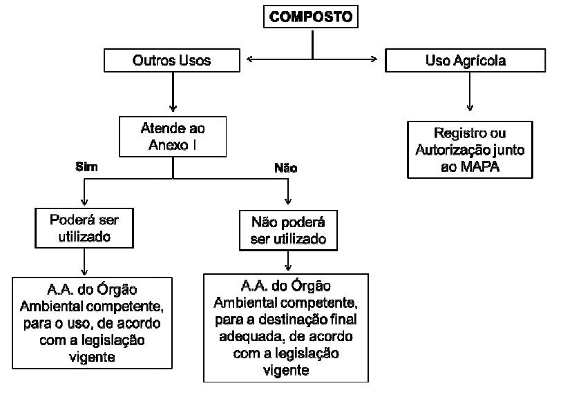

# Resolução CEMA nº 90, de 3 de dezembro de 2013 {#resolucao-cema-90-2013}

> **Ementa:** Estabelece condições, critérios e dá outras providências, para empreendimentos de compostagem de resíduos sólidos de origem urbana e de grandes geradores e para o uso do composto gerado.

**Preâmbulo** {#preambulo} O Presidente do Conselho Estadual do Meio Ambiente, no uso das suas atribuições conferidas pela [[lei-estadual-7978-1984|Lei Estadual nº 7.978, de 30 de novembro de 1984]], alterada pelas leis nº [[lei-estadual-8289-1986|8.289, de 07 de maio de 1986]] e [[lei-estadual-8485-1987|8.485, de 03 de junho de 1987]] e [[lei-estadual-11352-1996|11.352, de 13 de fevereiro de 1.996]], pelo disposto no [[decreto-estadual-4447-2001|Decreto nº 4.447, de 12 de julho de 2.001]]; após deliberação no Plenário da 88ª Reunião Ordinária, realizada em 03 de dezembro de 2013, além das demais normas pertinentes e considerando, O disposto na [[lei-estadual-7109-1979|Lei Estadual nº 7.109, de 17 de janeiro de 1979]] e no seu Regulamento baixado pelo [[decreto-estadual-857-1979|Decreto Estadual nº 857, de 10 de julho de 1979]], na [[lei-estadual-11054-1995|Lei Estadual nº 11.054, de 11 de agosto de 1995]] e ainda, o contido na [[lei-estadual-10233-1992|Lei Estadual nº 10.233, de 28 de dezembro de 1992]], bem como o disposto, na [[lei-federal-4771-1965|Lei Federal nº 4.771, de 15 de setembro de 1965]], na [[lei-federal-6938-1981|Lei Federal nº 6.938, de 31 de agosto de 1981]] e no seu Regulamento baixado pelo [[decreto-federal-99274-1990|Decreto Federal nº 99.274, de 06 de junho de 1990]], e demais normas pertinentes, em especial, as Resoluções do Conselho Nacional do Meio Ambiente - CONAMA sob [[resolucao-conama-1-1986|n° 001, de 23 de janeiro de 1986]], [[resolucao-conama-9-1987|n° 009, de 03 de dezembro de 1987]], e [[resolucao-conama-237-1997|n° 237, de 19 de dezembro de 1997]]; As atribuições e competências do Conselho Estadual do Meio Ambiente, estabelecida pelo [[decreto-estadual-4447-2001|Decreto Estadual nº 4.447 de 12 de Julho de 2001]]; Os objetivos institucionais do Instituto Ambiental do Paraná – Órgão Ambiental Competente - estabelecidos na [[lei-estadual-10066-1992|Lei Estadual nº 10.066, de 27 de julho de 1992]] (com as alterações da [[lei-estadual-11352-1996|Lei Estadual nº 11.352, de 13 de fevereiro de 1996]]); A necessidade de dar efetividade aos princípios estabelecidos no [[lei-federal-6938-1981#art2|Artigo 2º, incisos I, IV e IX, da Lei Federal n.º 6938/81]], que dispõe sobre a Política Nacional do Meio Ambiente e na Declaração do Rio de Janeiro de 1992 (Princípio n.º 15); A [[resolucao-sema-31-1998|Resolução SEMA n° 031, de 24 de agosto de 1998]], que dispõe sobre o licenciamento ambiental, autorização ambiental, autorização florestal e anuência prévia para desmembramento e parcelamento de gleba rural; A [[lei-estadual-12493-1999|Lei Estadual nº 12.493, 22 de janeiro de 1999]], que estabelece princípios, procedimentos, normas e critérios referentes à geração, acondicionamento, armazenamento, coleta, transporte, tratamento e destinação final dos resíduos sólidos no Estado do Paraná, visando controle da poluição, da contaminação e a minimização de seus impactos ambientais; A [[lei-federal-11445-2007|Lei Federal nº 11.445, de 05 de janeiro de2007]], que estabelece as diretrizes nacionais para o saneamento básico e inclui em seu [[lei-federal-11445-2007#art7_cpt_inc2|Artigo 7º, inciso II]], a compostagem como uma das atividades do serviço público de limpeza urbana e de manejo de resíduos sólidos urbanos; A [[resolucao-cema-65-2008|Resolução CEMA nº 065, de 01 de julho de 2008]], a qual dispõe sobre o licenciamento ambiental, estabelece critérios e procedimentos a serem adotados para as atividades poluidoras, degradadoras e/ou modificadoras do meio ambiente e adota outras providências;A [[lei-federal-12305-2010|Lei Federal nº 12.305, de 02 de Agosto de 2010]], que institui a Política Nacional de Resíduos Sólidos, e que, em seu [[lei-federal-12305-2010#art9|Artigo 9º]] estabelece como ordem de prioridade para a gestão e gerenciamento de resíduos sólidos a não geração, a redução, a reutilização, a reciclagem, o tratamento dos resíduos sólidos e a disposição final ambientalmente adequada dos rejeitos; O [[decreto-federal-7404-2010|Decreto Federal 7.404, de 23 de dezembro de 2010]], que regulamenta a [[lei-federal-12305-2010|Lei nº 12.305, de 2 de agosto de 2010]], que institui a Política Nacional de Resíduos Sólidos, cria o Comitê Interministerial da Política Nacional de Resíduos Sólidos e o Comitê Orientador para a Implantação dos Sistemas de Logística Reversa, e dá outras providências; O [[decreto-federal-4954-2004|Decreto Federal nº 4954, 14 de janeiro de 2004]], que regulamenta a [[lei-federal-6894-1980|Lei Federal nº 6894, de 16 de dezembro de 1980]], e estabelece os procedimentos junto ao Ministério da Agricultura, Pecuária e Abastecimento – MAPA; A [[resolucao-cema-88-2013|Resolução CEMA nº 088, 27 de agosto de 2013]], que estabelece critérios, procedimentos e tipologias para o licenciamento ambiental municipal de atividades, obras e empreendimentos que causem ou possam causar impacto de âmbito local e determina outras providências.

RESOLVE:

###### Art. 1º {#art1}

**Art. 1º, caput** {#art1_cpt} Esta Resolução estabelece os critérios técnicos, legais e operacionais para o processo de compostagem de resíduos sólidos urbanos compostáveis e para o uso do composto no âmbito do estado do Paraná.

###### Art. 2º {#art2}

**Art. 2º, caput** {#art2_cpt} Para os efeitos desta Resolução definem-se:
- **Art. 2º, caput, item 1** {#art2_cpt_ite1} Área de Processamento da Compostagem - inclui os locais de recepção e armazenamento temporário dos resíduos in natura e o local de compostagem propriamente dito.
- **Art. 2º, caput, item 2** {#art2_cpt_ite2} Chorume - líquido resultante da infiltração de águas pluviais no maciço de resíduos, da umidade dos resíduos e da água de constituição de resíduos orgânicos liberada durante sua decomposição, também denominado lixiviado ou percolado.
- **Art. 2º, caput, item 3** {#art2_cpt_ite3} Composto de Resíduos Sólidos - produto obtido pela separação da parte orgânica dos resíduos sólidos e sua compostagem, podendo ser caracterizado como fertilizante orgânico e condicionador de solo para o uso agrícola ou para outros usos.
- **Art. 2º, caput, item 4** {#art2_cpt_ite4} Grandes Geradores - estabelecimentos cuja geração diária de resíduos sólidos urbanos compostáveis é superior ao limite estabelecido pelo município para atendimento de coleta pública.
- **Art. 2º, caput, item 5** {#art2_cpt_ite5} Núcleo Populacional - localidade sem a categoria de sede administrativa, mas com moradias, geralmente em torno de igreja ou capela, com pequeno comércio.
- **Art. 2º, caput, item 6** {#art2_cpt_ite6} Processo de Compostagem - é a decomposição biológica da fração orgânica biodegradável dos resíduos, efetuado por uma população diversificada de organismos, em condições aeróbias controladas, desenvolvido em duas etapas distintas, uma de degradação ativa e outra de maturação.
- **Art. 2º, caput, item 7** {#art2_cpt_ite7} Rejeitos - resíduos sólidos que, depois de esgotadas todas as possibilidades de tratamento e recuperação por processos tecnológicos disponíveis e economicamente viáveis, não apresentem outra possibilidade que não a disposição final ambientalmente adequada.
- **Art. 2º, caput, item 8** {#art2_cpt_ite8} Resíduos Sólidos Urbanos Compostáveis - são aqueles representados pela fração orgânica provenientes de domicílios, serviços de limpeza urbana, pequenos estabelecimentos comerciais, industriais e de prestação de serviços, os resíduos de poda, jardinagem, exceto rejeitos, contemplados pelo serviço de coleta pública.
- **Art. 2º, caput, item 9** {#art2_cpt_ite9} Sistema de Impermeabilização - elemento de proteção ambiental destinado a isolar os resíduos do solo natural de maneira a evitar a infiltração de águas pluviais e chorume.
- **Art. 2º, caput, item 10** {#art2_cpt_ite10} Sistema de Isolamento Físico - dispositivos que têm por objetivo controlar o acesso de pessoas não autorizadas e animais à unidade, bem como diminuir ruídos, poeira e odores no entorno do empreendimento.
- **Art. 2º, caput, item 11** {#art2_cpt_ite11} Uso agrícola - uso do composto em áreas destinadas à agricultura, inclusive silvicultura.

###### Art. 3º {#art3}

**Art. 3º, caput** {#art3_cpt} Para a finalidade desta Resolução são considerados empreendimentos de compostagem todos aqueles que em sua produção utilizarem qualquer quantidade de matéria-prima oriunda de resíduos sólidos compostáveis de origem urbana e de grandes geradores, resultando em um composto de utilização segura.

**Art. 3º, § 1º** {#art3_par1} Para a compostagem os resíduos deverão ser previamente separados na origem em, no mínimo, três frações: fração reciclável, fração orgânica e rejeitos; sendo obrigatória a existência de programa municipal de coleta seletiva que contemple metas progressivas para a separação.

**Art. 3º, § 2º** {#art3_par2} Para a melhoria do processo de compostagem poderão ser utilizados materiais orgânicos como restos vegetais da agricultura, estercos e camas, bem como, materiais fornecedores de nutrientes minerais.

###### Art. 4º {#art4}

**Art. 4º, caput** {#art4_cpt} Os geradores de resíduos sólidos deverão prever, em seus Planos de Gerenciamento de Resíduos Sólidos, a destinação da fração orgânica compostável para unidades de compostagem ou outras tecnologias de tratamento para a reciclagem da fração orgânica.

**Art. 4º, parágrafo único** {#art4_par1u} É vedada a destinação integral da fração orgânica compostável para aterros, a partir do mês de agosto do ano de 2014 no estado do Paraná.

###### Art. 5º {#art5}

**Art. 5º, caput** {#art5_cpt} Os Resíduos Classe I, de acordo com [[abnt-nbr-10004|NBR 10.004/04]] ou outra que venha a substituí-la, que porventura estiverem misturados aos resíduos orgânicos, deverão ser previamente separados e devolvidos aos fabricantes, importadores, distribuidores, comerciantes ou, ainda, destinados a empresas devidamente licenciadas de acordo com o sistema de logística reversa.

**Art. 5º, parágrafo único** {#art5_par1u} Caso seja identificada a contaminação da massa de resíduos orgânicos, esta deverá ser descartada do processo de compostagem e destinada adequadamente.

###### Art. 6º {#art6}

**Art. 6º, caput** {#art6_cpt} A área de processamento da compostagem deverá:
- **Art. 6º, caput, inciso I** {#art6_cpt_inc1} Contemplar todas as medidas técnicas necessárias para evitar incômodos à vizinhança, proliferação de vetores, contaminação do solo, subsolo, águas sub-superficiais e outras medidas constantes nos projetos apresentados.
- **Art. 6º, caput, inciso II** {#art6_cpt_inc2} Possuir sistema de coleta, contenção e tratamento dos efluentes eventualmente gerados, bem como a drenagem das águas pluviais.
- **Art. 6º, caput, inciso III** {#art6_cpt_inc3} Possuir impermeabilização de base com piso de concreto, geomembrana ou sistemas similares.
- **Art. 6º, caput, inciso IV** {#art6_cpt_inc4} Possuir sistema que proteja das intempéries os resíduos in natura, o material em compostagem e o composto.
- **Art. 6º, caput, inciso V** {#art6_cpt_inc5} Ser devidamente isolada, inclusive com barreira vegetal, e sinalizada, sendo proibido o acesso de pessoas não autorizadas e animais.
- **Art. 6º, caput, inciso VI** {#art6_cpt_inc6} Manter vias de acesso que permitam a circulação de veículos pesados, mesmo em situações climáticas adversas.
- **Art. 6º, caput, inciso VII** {#art6_cpt_inc7} Estar localizada no mínimo a 200 metros de distância de residências isoladas e vias de domínio público e a 400 metros de núcleos populacionais.

**Art. 6º, parágrafo único** {#art6_par1u} Em casos de empreendimentos já implantados, o Órgão Ambiental competente avaliará a necessidade de realocação do empreendimento ou adoção de medidas mitigadoras, conforme o caso, mediante as devidas justificativas técnicas.

###### Art. 7º {#art7}

**Art. 7º, caput** {#art7_cpt} É proibido o lançamento de efluentes líquidos in natura, inclusive chorume, em corpos hídricos, bem como sua infiltração no solo.

###### Art. 8º {#art8}

**Art. 8º, caput** {#art8_cpt} Na unidade de compostagem, o empreendedor deverá, periodicamente, monitorar e manter os registros dos parâmetros mínimos de controle operacional do processo: pH, temperatura, umidade e relação carbono/nitrogênio (C/N).

**Art. 8º, § 1º** {#art8_par1} Caso seja verificado, por meio dos resultados das análises laboratoriais, que uma determinada amostra de composto orgânico não atenda aos parâmetros mínimos de qualidade exigidos, a unidade geradora deverá empreender os procedimentos necessários à correção dos problemas detectados.

**Art. 8º, § 2º** {#art8_par2} Uma vez efetuada a correção, nova amostragem e análises deverão ser realizadas, de forma a determinar se o composto está em condições de ser utilizado.

###### Art. 9º {#art9}

**Art. 9º, caput** {#art9_cpt} O período máximo de armazenamento dos resíduos sólidos in natura deverá ser controlado pelo empreendedor, visando a não geração de odores, de chorume, presença de vetores e incômodos à comunidade.

###### Art. 10 {#art10}

**Art. 10, caput** {#art10_cpt} As emissões atmosféricas, tais como odores, deverão atender os critérios da legislação vigente.

###### Art. 11 {#art11}

**Art. 11, caput** {#art11_cpt} Para a sua utilização o composto deverá seguir os critérios abaixo:

**Art. 11, § 1º** {#art11_par1} Para uso agrícola, o composto deverá atender ao [[decreto-federal-4954-2004|Decreto Federal nº 4954/2004]], que regulamenta a [[lei-federal-6894-1980|Lei Federal nº 6894/1980]], e atos normativos complementares federais e estaduais em vigência.

**Art. 11, § 2º** {#art11_par2} Para outros usos, que não o agrícola:
- **Art. 11, § 2º, inciso I** {#art11_par2_inc1} Caso atendido o [[#anexo1|Anexo I]], deverá ser requerida Autorização Ambiental ao Órgão Ambiental competente, para utilização do composto, de acordo com a legislação ambiental vigente.
- **Art. 11, § 2º, inciso II** {#art11_par2_inc2} Caso não atendido o [[#anexo1|Anexo I]], o composto deverá ter disposição final adequada, devendo ser requerida Autorização Ambiental ao Órgão Ambiental competente, para essa disposição, de acordo com a legislação ambiental vigente.

    II – Caso não atendido o [[#anexo1|Anexo I]], o composto deverá ter disposição final adequada, devendo ser requerida Autorização Ambiental ao Órgão Ambiental competente, para essa disposição, de acordo com a legislação ambiental vigente.

**Art. 11, § 3º** {#art11_par3} Os critérios definidos neste artigo são apresentados esquematicamente no [[#anexo4|Anexo IV]].

###### Art. 12 {#art12}

**Art. 12, caput** {#art12_cpt} É proibida a utilização de composto de resíduos sólidos urbanos no cultivo de olerícolas, tubérculos e raízes, plantas medicinais e culturas inundadas, bem como nas demais culturas cuja parte comestível entre em contato com o solo.

**Art. 12, parágrafo único** {#art12_par1u} Este composto poderá ser utilizado em formação de pastagem, desde que incorporado ao solo.

###### Art. 13 {#art13}

**Art. 13, caput** {#art13_cpt} São de responsabilidade do empreendedor o gerenciamento e monitoramento da qualidade do composto produzido.

###### Art. 14 {#art14}

**Art. 14, caput** {#art14_cpt} As unidades de compostagem deverão ser licenciadas conforme as modalidades estabelecidas no [[#art14_tab1|Quadro I]] e os processos de licenciamento deverão ser instruídos de acordo com a documentação listada no [[#anexo2|Anexo II]].

As unidades de compostagem deverão ser licenciadas conforme as modalidades estabelecidas no [[#art14_tab1|Quadro I]] e os processos de licenciamento deverão ser instruídos de acordo com a documentação listada no [[#anexo2|Anexo II]].

**Art. 14, Quadro 1** {#art14_tab1} QUADRO 1: Modalidades de licenciamento de empreendimentos de compostagem de acordo com o porte.
- **Art. 14, Quadro 1, linha 1** {#art14_tab1_lin1} TON/DIA: Até 10 | PORTE: Micro | MODALIDADE LICENÇA: LAS
- **Art. 14, Quadro 1, linha 2** {#art14_tab1_lin2} TON/DIA: Superior a 10 até 20 | PORTE: Pequeno | MODALIDADE LICENÇA: LP, LI, LO
- **Art. 14, Quadro 1, linha 3** {#art14_tab1_lin3} TON/DIA: Superior a 20 até 30 | PORTE: Médio | MODALIDADE LICENÇA: LP, LI, LO
- **Art. 14, Quadro 1, linha 4** {#art14_tab1_lin4} TON/DIA: Superior a 31 até 40 | PORTE: Grande | MODALIDADE LICENÇA: LP, LI, LO
- **Art. 14, Quadro 1, linha 5** {#art14_tab1_lin5} TON/DIA: Superior a 40 | PORTE: Excepcional | MODALIDADE LICENÇA: LP, LI, LO
- **Art. 14, Quadro 1, observação** {#art14_tab1_obs} Legenda: LAS: licença ambiental simplificada; LP: Licença prévia; LI: Licença de Instalação; LO: Licença de Operação; EIA: Estudo de Impacto Ambiental; RIMA: Relatório de Impacto Ambiental.

**Art. 14, § 1º** {#art14_par1} O Licenciamento Prévio dos empreendimentos de porte excepcional está sujeito à apresentação de EIA/RIMA.

**Art. 14, § 2º** {#art14_par2} Na renovação da LO e da LAS, deverá ser apresentado Relatório de Automonitoramento, conforme [[#anexo3|Anexo III]].

###### Art. 15 {#art15}

**Art. 15, caput** {#art15_cpt} Em caso de necessidade, o Órgão Ambiental poderá solicitar outros documentos e/ou informações complementares do requerente ou de outras instituições envolvidas no licenciamento ambiental em questão.

###### Art. 16 {#art16}

**Art. 16, caput** {#art16_cpt} O prazo de validade da Licença de Operação, bem como sua renovação será de, no máximo, quatro anos.

###### Art. 17 {#art17}

**Art. 17, caput** {#art17_cpt} O Órgão Ambiental licenciador deverá fiscalizar o cumprimento desta Resolução.

###### Art. 18 {#art18}

**Art. 18, caput** {#art18_cpt} Esta Resolução entra em vigor na data de sua publicação e revoga as disposições em contrário.

**Fecho** {#fecho} Curitiba, 03 de dezembro de 2013.

**Assinaturas** {#assinaturas} Luiz Eduardo Cheida – Secretário de Estado do Meio Ambiente e Recursos Hídricos; Luiz Eduardo Cheida – Presidente do Conselho Estadual do Meio Ambiente

## ANEXOS

> Tipos conforme as regras de anexos do README: **tipo 3** (Anexos I, II e IV: conteúdo normativo) e **tipo 1** (Anexo III: modelo). Não há anexo do tipo 2.

### ANEXO I – LIMITES MÁXIMOS DE CONTAMINANTES ADMITIDOS NO COMPOSTO FINAL {#anexo1}

*(Tipo 3: conteúdo normativo. Citado em: [[#art11_par2_inc1|Art. 11, § 2º, inciso I]], [[#art11_par2_inc2|Art. 11, § 2º, inciso II]].)*

**Anexo I, Tabela 1 (sem título no original)** {#anexo1_tab1}
- **Anexo I, Tabela 1, linha 1** {#anexo1_tab1_lin1} Contaminantes Inorgânicos: Arsênio (mg/kg) | Valor Máx. Permitido — (*): 20,0 | Valor Máx. Permitido — (#): 20,0
- **Anexo I, Tabela 1, linha 2** {#anexo1_tab1_lin2} Contaminantes Inorgânicos: Cádmio (mg/kg) | Valor Máx. Permitido — (*): 8,0 | Valor Máx. Permitido — (#): 3,0
- **Anexo I, Tabela 1, linha 3** {#anexo1_tab1_lin3} Contaminantes Inorgânicos: Chumbo (mg/kg) | Valor Máx. Permitido — (*): 300,0 | Valor Máx. Permitido — (#): 150,0
- **Anexo I, Tabela 1, linha 4** {#anexo1_tab1_lin4} Contaminantes Inorgânicos: Cromo (mg/kg) | Valor Máx. Permitido — (*): 500,0 | Valor Máx. Permitido — (#): 200,0
- **Anexo I, Tabela 1, linha 5** {#anexo1_tab1_lin5} Contaminantes Inorgânicos: Mercúrio (mg/kg) | Valor Máx. Permitido — (*): 2,5 | Valor Máx. Permitido — (#): 1,0
- **Anexo I, Tabela 1, linha 6** {#anexo1_tab1_lin6} Contaminantes Inorgânicos: Níquel (mg/kg) | Valor Máx. Permitido — (*): 175,0 | Valor Máx. Permitido — (#): 70,0
- **Anexo I, Tabela 1, linha 7** {#anexo1_tab1_lin7} Contaminantes Inorgânicos: Selênio (mg/kg) | Valor Máx. Permitido — (*): 80 | Valor Máx. Permitido — (#): 80,0
- **Anexo I, Tabela 1, linha 8** {#anexo1_tab1_lin8} Agentes Patogênicos: Coliformes Termotolerantes (NMP/gMS) (*) (#) | Valor Máx. Permitido — (*): <1000 | Valor Máx. Permitido — (#): <1000
- **Anexo I, Tabela 1, linha 9** {#anexo1_tab1_lin9} Agentes Patogênicos: Salmonellasp (*) (#) | Valor Máx. Permitido — (*): Ausência em 10g MS | Valor Máx. Permitido — (#): Ausência em 10g MS
- **Anexo I, Tabela 1, linha 10** {#anexo1_tab1_lin10} Agentes Patogênicos: Ovos Viáveis de Helmintos (ovos viáveis/4gST (*) (#) | Valor Máx. Permitido — (*): <1,0 | Valor Máx. Permitido — (#): <1,0
- **Anexo I, Tabela 1, observação** {#anexo1_tab1_obs} Notas: MS =massa seca; (*) limites máximos de contaminantes admitidos em substrato para plantas e condicionadores de solo; (#) limites máximos de contaminantes admitidos em fertilizantes orgânicos.

### ANEXO II – RELAÇÃO DE DOCUMENTOS PARA O LICENCIAMENTO AMBIENTAL {#anexo2}

#anexo-pendente

*(Tipo 3: conteúdo normativo. Citado em: [[#art14_cpt|Art. 14, caput]]. O PDF enviado traz apenas as páginas 1 e 5 do anexo; ver Notas de transcrição.)*

- **Anexo II, linha 1** {#anexo2_lin1} Os requerimentos de Licenciamento Ambiental (Licença Ambiental Simplificada, Licença Prévia, Licença de Instalação e Licença de Operação) dirigidos ao Diretor Presidente do órgão ambiental competente serão protocolados, desde que instruídos na forma prevista abaixo:
- **Anexo II, linha 2** {#anexo2_lin2} I. LICENÇA AMBIENTAL SIMPLIFICADA – LAS
- **Anexo II, linha 3** {#anexo2_lin3} a) Requerimento de Licenciamento Ambiental;
- **Anexo II, linha 4** {#anexo2_lin4} b) Cadastro Ambiental para Unidades de Compostagem de Resíduos;
- **Anexo II, linha 5** {#anexo2_lin5} c) Certidão do Município, quanto ao uso e ocupação do solo, conforme Anexo I da [[resolucao-cema-65-2008|Resolução CEMA nº 065 de 01 de julho de 2008]];
- **Anexo II, linha 6** {#anexo2_lin6} d) Matrícula ou Transcrição do Cartório de Registro de Imóveis em nome do requerente, e em caso de imóvel locado no nome do locador junto com o contrato de locação, no máximo de 90 (noventa) dias, ou Documento de propriedade ou justa posse rural ou conforme exigências constantes da Seção VI, art.46 a 57 da [[resolucao-cema-65-2008|Resolução CEMA 065 de 01 de julho de 2008]];
- **Anexo II, linha 7** {#anexo2_lin7} Observação: Nos casos devidamente justificados em que não seja possível a apresentação dos documentos especificados no item “d”, os mesmos deverão ser apresentados antes do inicio da operação da atividade ou empreendimento sob pena de cancelamento da licença Ambiental;
- **Anexo II, linha 8** {#anexo2_lin8} e) Quando o imóvel objeto deste licenciamento estiver localizado em área rural, deverá ser registrado no Sistema de Cadastro Ambiental Rural - SICAR-PR, de acordo com artigo 1º do [[decreto-estadual-8680-2013#art1|Decreto Estadual nº 8680/13]] e [[lei-federal-12651-2012#art29_par3|parágrafo 3º do artigo 29 da Lei Federal nº 12.651/12]];
- **Anexo II, linha 9** {#anexo2_lin9} f) Cópia do Ato Constitutivo ou do Contrato Social (com última alteração);
- **Anexo II, linha 10** {#anexo2_lin10} g) Publicação de súmula do pedido de Licença Ambiental Simplificada em jornal de circulação regional e no Diário Oficial do Estado;
- **Anexo II, linha 11** {#anexo2_lin11} h) Comprovante de recolhimento da Taxa Ambiental (Ficha de Compensação Bancária);
- **Anexo II, linha 12** {#anexo2_lin12} i) Plano de Controle Ambiental da Unidade de Compostagem – PCA;
- **Anexo II, linha 13** {#anexo2_lin13} d) Publicação de recebimento de Licença de Operação em jornal de circulação regional e no Diário Oficial do Estado;
- **Anexo II, linha 14** {#anexo2_lin14} e) Publicação de pedido de Renovação de Licença de Operação em jornal de circulação regional e no Diário Oficial do Estado;
- **Anexo II, linha 15** {#anexo2_lin15} f) Comprovante de recolhimento da Taxa Ambiental (Ficha de Compensação Bancária);
- **Anexo II, linha 16** {#anexo2_lin16} g) Relatório de automonitoramento, [[#anexo3|conforme anexo III]];
- **Anexo II, linha 17** {#anexo2_lin17} i) Relatório de situação atual de coleta seletiva, quando se tratar de resíduos sólidos da coleta municipal, de acordo com o Plano Municipal de Gestão Integrada de Resíduos Sólidos e programa de coleta seletiva;
- **Anexo II, linha 18** {#anexo2_lin18} j) Anotação de Responsabilidade Técnica referente à operação da Unidade.

### ANEXO III – RELATÓRIO DE AUTOMONITORAMENTO {#anexo3}

Modelo de relatório de automonitoramento. *(Tipo 1: modelo, conteúdo não transcrito. Exigido em: [[#art14_par2|Art. 14, § 2º]]; [[#anexo2_lin16|Anexo II, linha 16]] (item g).)*

### ANEXO IV – DIAGRAMA ESQUEMÁTICO PARA A UTILIZAÇÃO DO COMPOSTO DE RESÍDUOS SÓLIDOS URBANOS {#anexo4}

*(Tipo 3: conteúdo normativo, em forma de fluxograma. Citado em: [[#art11_par3|Art. 11, § 3º]].)*

**Anexo IV, Figura 1** {#anexo4_fig1} Diagrama esquemático para a utilização do composto de resíduos sólidos urbanos 
- **Anexo IV, linha 1** {#anexo4_lin1} *[Fluxograma: a caixa "COMPOSTO" se divide em duas: "Outros Usos" e "Uso Agrícola".]*
- **Anexo IV, linha 2** {#anexo4_lin2} Uso Agrícola: Registro ou Autorização junto ao MAPA
- **Anexo IV, linha 3** {#anexo4_lin3} Outros Usos: pergunta "Atende ao Anexo I?"
- **Anexo IV, linha 4** {#anexo4_lin4} Atende ao Anexo I? Sim: Poderá ser utilizado; A.A. do Órgão Ambiental competente, para o uso, de acordo com a legislação vigente
- **Anexo IV, linha 5** {#anexo4_lin5} Atende ao Anexo I? Não: Não poderá ser utilizado; A.A. do Órgão Ambiental competente, para a destinação final adequada, de acordo com a legislação vigente

## Relação com outras normas {#relacao-outras-normas}

Observação do conversor (não é texto normativo):

- Revogada pelo [[decreto-estadual-9541-2025#art175_cpt_inc1_alic|Decreto Estadual nº 9.541/2025, art. 175, inciso I, alínea "c"]]. O arquivo foi mantido como texto histórico (`situacao: revogada`), porque o texto antigo ainda pode reger processos protocolados antes da mudança.
- O [[#art18|art. 18]] revoga "as disposições em contrário" sem indicar normas (possível revogação tácita, a conferir pelo usuário).
- O preâmbulo e o [[#anexo2|Anexo II]] citam a [[resolucao-cema-65-2008|Resolução CEMA nº 65/2008]], que não está na base; a [[resolucao-sema-31-1998|Resolução SEMA nº 31/1998]] também foi revogada pelo [[decreto-estadual-9541-2025#art175_cpt_inc2_alia|Decreto nº 9.541/2025, art. 175, inciso II, alínea "a"]].
- O [[#art11|art. 11, § 1º]] remete ao Decreto Federal nº 4.954/2004 (regulamento da Lei nº 6.894/1980, fertilizantes), que não está na base.

## Notas de transcrição {#notas-transcricao}

Fonte: PDF do corpo da resolução (portal do IAT/CEMA, com o cabeçalho "Resolução CEMA nº 090 - 03 de Dezembro de 2013") e quatro PDFs de anexos, enviados por Leo. O corpo foi comparado palavra por palavra com o texto extraído do PDF.

- Rótulos: o PDF imprime "Art. 1º." e "§ 1º." com ponto, e traz os incisos com "I." ou "I –"; os rótulos desta base seguem o padrão e não alteram o texto.
- Art. 2º: o caput traz onze definições sem numeração (Área de Processamento da Compostagem a Uso agrícola). Foram numeradas como itens (`art2_cpt_ite1` a `art2_cpt_ite11`) só para dar ID; o texto de cada definição está como no original.
- Art. 11, § 2º: o original repete o inciso II (primeiro dentro da lista, depois em parágrafo solto, com o mesmo texto). A repetição foi mantida como parágrafo de continuação, sem ID próprio.
- Art. 14: o original repete o texto do caput (a frase "As unidades de compostagem deverão ser licenciadas ..." aparece duas vezes seguidas). A repetição foi mantida como parágrafo de continuação, sem ID.
- Art. 14, Quadro 1: o caput remete a "Quadro I", mas o quadro se intitula "QUADRO 1"; a remissão aponta para o quadro. A faixa do porte Grande começa em "Superior a 31", enquanto o porte Médio termina em "até 30" (lacuna entre 30 e 31 t/dia, no original).
- Art. 14: a coluna "TON/DIA" e as demais colunas do quadro foram desdobradas em linhas (`art14_tab1_lin1` a `lin5`); a legenda do quadro está em `art14_tab1_obs`.
- Anexo I: o quadro não tem título no original. A célula de cabeçalho "Valor Máx. Permitido" foi desdobrada em duas colunas, "(*)" e "(#)", conforme as notas do próprio anexo. O valor do selênio em (*) está "80" no original, e "80,0" em (#).
- Anexo II (**incompleto**): o PDF enviado traz apenas as páginas 1 e 5 do anexo. As linhas 1 a 12 vêm da página 1 (itens da Licença Ambiental Simplificada, a) a i)); as linhas 13 a 18 vêm da página 5 (alíneas d), e), f), g), i) e j) de uma lista de renovação ou operação cujo título está nas páginas ausentes). As páginas 2 a 4 não foram enviadas; por isso o anexo recebeu `#anexo-pendente`.
- Anexo III: modelo de relatório de automonitoramento (tipo 1). Só o nome foi registrado.
- Anexo IV: diagrama (fluxograma). A figura está em `anexos/imagens/resolucao-cema-90-2013-anexo4-fig1.png`, e as linhas `anexo4_lin1` a `lin5` descrevem seu conteúdo (descrição do conversor).
- Preâmbulo: "de2007" (Lei Federal nº 11.445) e "providências;A Lei Federal" (falta espaço) estão como no original.
