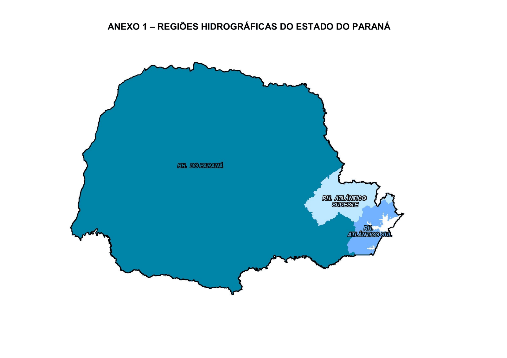
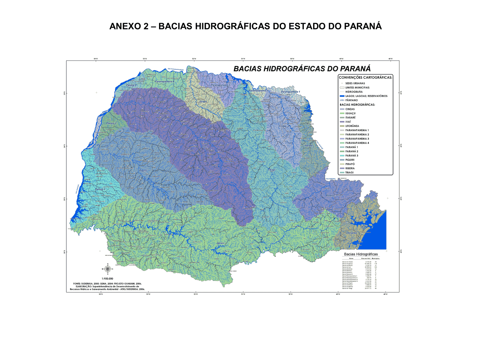
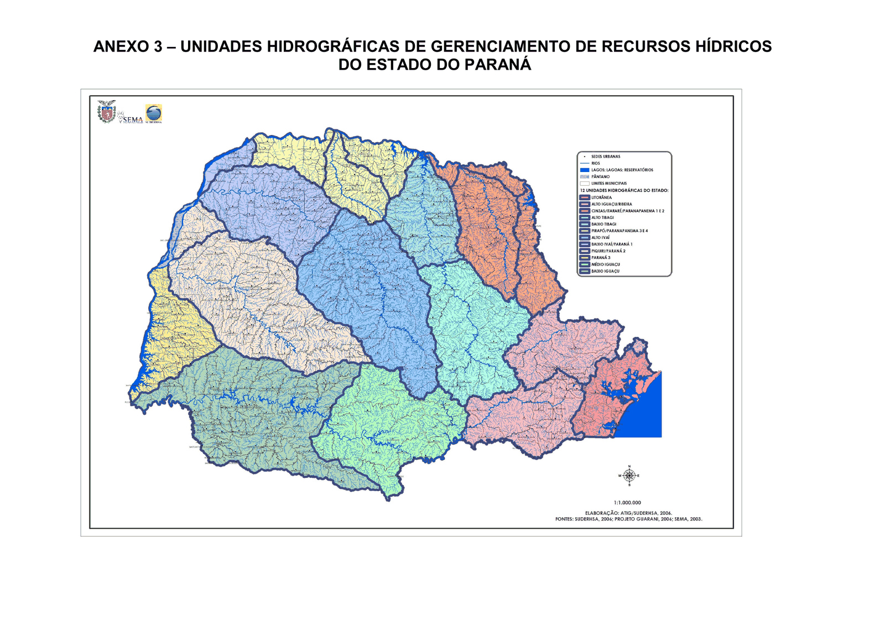

# Resolução CERH/PR nº 49, de 20 de dezembro de 2006 {#resolucao-cerh-49-2006}

> **Ementa:** Dispõe sobre a instituição de Regiões Hidrográficas, Bacias Hidrográficas e Unidades Hidrográficas de Gerenciamento de Recursos Hídricos do Estado do Paraná

**Preâmbulo** {#preambulo} O CONSELHO ESTADUAL DE RECURSOS HÍDRICOS – CERH/PR, no uso das competências que lhe são conferidas pelo [[lei-estadual-12726-1999#art38|Art. 38, inciso I e XII da Lei Estadual nº 12.726, de 26 de novembro de 1999]] e pelo disposto no [[decreto-estadual-2314-2000#art1|Art. 1º do Decreto Estadual nº 2.314 de 17 de julho de 2000]], e

Considerando a necessidade de se estabelecer uma base organizacional que contemple unidades hidrográficas de gerenciamento de recursos hídricos para a implementação da Política Estadual de Recursos Hídricos e do Sistema Estadual de Gerenciamento de Recursos Hídricos;

Considerando a necessidade de facilitar a implementação de base de dados referenciada por bacia, no âmbito estadual e, visando a integração das informações em recursos hídricos e gestão ambiental;

Considerando que a área de implementação da Política Estadual de Recursos Hídricos é a bacia hidrográfica em sua totalidade, conjunto de bacias hidrográficas ou porções de uma determinada bacia hidrográfica;

Considerando as regiões hidrográficas brasileiras estabelecidas mediante a [[resolucao-cnrh-32-2003|Resolução 032 de 15 de outubro de 2003 do Conselho Nacional de Recursos Hídricos]]; e

Considerando as avaliações efetuadas pela Câmara Técnica instituída pela [[resolucao-cerh-43-2005|Resolução Nº 43 CERH/PR de 03 de novembro de 2005]] para estabelecer proposta da área de atuação dos Comitês de Bacia Hidrográfica, utilizando como base os estudos preliminares do Plano Estadual de Recursos Hídricos,

resolve:

###### Art. 1º {#art1}

**Art. 1º, caput** {#art1_cpt} Adotar para o Estado do Paraná a divisão em regiões hidrográficas brasileiras estabelecida na [[resolucao-cnrh-32-2003|Resolução nº 32, de 15 de outubro de 2003, do Conselho Nacional de Recursos Hídricos]] com a finalidade de promover a articulação do planejamento de recursos hídricos do Estado com o planejamento nacional.

**Art. 1º, § 1º** {#art1_par1} O Estado fica dividido em três Regiões Hidrográficas ([[#anexo1|anexo 1]]):
- **Art. 1º, § 1º, item 1** {#art1_par1_ite1} REGIÃO HIDROGRÁFICA DO ATLÂNTICO SUL. Compreende a totalidade do conjunto das bacias hidrográficas da Bacia Litorânea, que drena para o oceano atlântico.
- **Art. 1º, § 1º, item 2** {#art1_par1_ite2} REGIÃO HIDROGRÁFICA DO ATLÂNTICO SUDESTE. Compreende a Bacia do Rio Ribeira em território paranaense.
- **Art. 1º, § 1º, item 3** {#art1_par1_ite3} REGIÃO HIDROGRÁFICA DO PARANÁ - Compreende as bacias do Rio Itararé e do Rio Iguaçu em território paranaense, as bacias dos Rios Cinzas, Tibagi, Pirapó, Ivaí, Piquiri, os afluentes em território paranaense do Rio Paranapanema que conformam as Bacias de referencia Paranapanema 1, 2, 3 e 4, e do Rio Paraná que conformam as Bacias de referencia Paraná 1, 2 e 3.

**Art. 1º, § 2º** {#art1_par2} As regiões hidrográficas compreendem a área total ou parcial das 16 bacias hidrográficas paranaenses listadas abaixo e ilustradas no mapa ([[#anexo2|anexo 2]]):

    Bacia do Rio das Cinzas, Bacia do Rio Iguaçu, Bacia do Rio Itararé, Bacia do Rio Ivaí, Bacia Litorânea, Bacia do Paraná 1, Bacia do Paraná 2, Bacia do Paraná 3, Bacia do Paranapanema 1, Bacia do Paranapanema 2, Bacia do Paranapanema 3, Bacia do Paranapanema 4, Bacia do Rio Piquiri, Bacia do Rio Pirapó, Bacia do Rio Ribeira e Bacia do Rio Tibagi.

###### Art. 2º {#art2}

**Art. 2º, caput** {#art2_cpt} Para efeito de gerenciamento dos recursos hídricos e conformação dos comitês de bacias hidrográficas, serão adotadas uma ou mais Unidades Hidrográficas, conforme relacionadas abaixo e ilustradas no [[#anexo3|anexo 3]].

**Art. 2º, parágrafo único** {#art2_par1u} Define-se Unidade Hidrográfica para fins desta Resolução a área cuja abrangência pode ser a bacia hidrográfica na sua totalidade, conjunto de bacias hidrográficas ou parte de bacias hidrográficas.

- **Art. 2º, caput, item 1** {#art2_cpt_ite1} UNIDADE HIDROGRÁFICA LITORÂNEA Compreende a totalidade da Bacia Litorânea
- **Art. 2º, caput, item 2** {#art2_cpt_ite2} UNIDADE HIDROGRÁFICA DO ALTO IGUAÇU, AFLUENTES DO RIO NEGRO E AFLUENTES DO RIO RIBEIRA. Compreende toda a Bacia do Ribeira em território paranaense e a Bacia do Rio Iguaçu até imediatamente à jusante da confluência com o Rio Negro, no município de São Mateus do Sul.
- **Art. 2º, caput, item 3** {#art2_cpt_ite3} UNIDADE HIDROGRÁFICA DO ITARARÉ, DO CINZAS, DO PARANAPANEMA 1 E DO PARANAPANEMA 2 Compreende a totalidade das Bacias do Cinzas, Itararé em território parananense, Paranapanema 1 e Paranapanema 2
- **Art. 2º, caput, item 4** {#art2_cpt_ite4} UNIDADE HIDROGRÁFICA DO ALTO TIBAGI Compreende a Bacia do Alto Tibagi das nascentes do Rio Tibagi até imediatamente a jusante da foz do Ribeirão das Antas, no Município de Curiúva.
- **Art. 2º, caput, item 5** {#art2_cpt_ite5} UNIDADE HIDROGRÁFICA DO BAIXO TIBAGI Compreende a Bacia do Baixo Tibagi, à jusante da foz do Ribeirão das Antas no Município de Curiúva.
- **Art. 2º, caput, item 6** {#art2_cpt_ite6} UNIDADE HIDROGRÁFICA DO PIRAPÓ, DO PARANAPANEMA 3 E DO PARANAPANEMA 4 Compreende a totalidade das Bacias do Pirapó, Paranapanema 3 e Paranapanema 4
- **Art. 2º, caput, item 7** {#art2_cpt_ite7} UNIDADE HIDROGRÁFICA DO ALTO IVAÍ Compreende a Bacia do Alto Ivaí desde as nascentes do Rio Ivaí até imediatamente à jusante da foz do Ribeirão Marialva, município de Floresta.
- **Art. 2º, caput, item 8** {#art2_cpt_ite8} UNIDADE HIDROGRÁFICA DO BAIXO IVAÍ E DO PARANÁ 1 Compreende a Bacia do Baixo Ivaí à jusante da foz do Ribeirão Marialva, Município de Floresta e a totalidade da Bacia do Paraná 1.
- **Art. 2º, caput, item 9** {#art2_cpt_ite9} UNIDADE HIDROGRÁFICA DA BACIA DO PIQUIRI E DO PARANÁ 2 Compreende a totalidade das Bacias Hidrográficas do Rio Piquiri e do Paraná 2
- **Art. 2º, caput, item 10** {#art2_cpt_ite10} UNIDADE HIDROGRÁFICA DO PARANÁ 3 Compreende a totalidade da Bacia do Paraná 3
- **Art. 2º, caput, item 11** {#art2_cpt_ite11} UNIDADE HIDROGRÁFICA DOS AFLUENTES DO MÉDIO IGUAÇU Compreende a Bacia do Rio Iguaçu no trecho à jusante da confluência do Rio Iguaçu e Rio Negro, no município de São Mateus do Sul, até imediatamente à jusante da foz do Rio Jordão, no município de Foz do Jordão.
- **Art. 2º, caput, item 12** {#art2_cpt_ite12} UNIDADE HIDROGRÁFICA DOS AFLUENTES DO BAIXO IGUAÇU Compreende a Bacia do Rio Iguaçu no trecho à jusante da foz do Rio Jordão, até a sua foz no Rio Paraná.

**Art. 2º, parágrafo único (segundo)** {#art2_par2u} Qualquer alteração nas Unidades Hidrográficas estabelecidas nesta Resolução dependerá de prévia aprovação do Conselho Estadual de Recursos Hídricos.

###### Art. 3º {#art3}

**Art. 3º, caput** {#art3_cpt} O Comitê das Bacias do Alto Iguaçu e Afluentes do Alto Ribeira, instituído pelo [[decreto-estadual-5878-2005|Decreto nº 5.878 de 13 de dezembro de 2005]], deverá se adequar à área de abrangência prevista para a Unidade Hidrográfica 2 num prazo de até quatro anos.

###### Art. 4º {#art4}

**Art. 4º, caput** {#art4_cpt} O Comitê da Bacia do Rio Jordão, instituído pelo [[decreto-estadual-5791-2002|Decreto nº 5.791 de 13 de junho de 2002]], deverá se adequar à área de abrangência prevista para a Unidade Hidrográfica 11 num prazo de até quatro anos.

###### Art. 5º {#art5}

**Art. 5º, caput** {#art5_cpt} As solicitações de instalação de Mesas Diretoras Provisórias e de Comitês de Bacia Hidrográfica sem Decreto de instituição, encaminhadas ao Conselho Estadual de Recursos Hídricos, devem ser adequadas de acordo com as Unidades Hidrográficas propostas.

###### Art. 6º {#art6}

**Art. 6º, caput** {#art6_cpt} Nas Unidades Hidrográficas do Itararé, do Cinzas, do Paranapanema 1 e do Paranapanema 2; do Alto Tibagi; do Baixo Tibagi e do Pirapó, do Paranapanema 3 e do Paranapanema 4, deverão ser implementadas ações conjuntas com a Agência Nacional de Águas – ANA e com as instituições estaduais de gerenciamento dos recursos hídricos do Estado de São Paulo, com o objetivo promover a gestão compartilhada da bacia do Paranapanema.

###### Art. 7º {#art7}

**Art. 7º, caput** {#art7_cpt} Nas Unidades Hidrográficas do Alto Iguaçu, Afluentes do Rio Negro e Afluentes do Rio Ribeira; do Médio Iguaçu e do Baixo Iguaçu deverão ser implementadas ações conjuntas com a Agência Nacional de Águas – ANA e com as instituições estaduais de gerenciamento dos recursos hídricos do Estado de Santa Catarina, com o objetivo promover a gestão compartilhada da bacia do Iguaçu.

###### Art. 8º {#art8}

**Art. 8º, caput** {#art8_cpt} Esta Resolução entrará em vigor na data da sua publicação, revogadas todas as disposições em contrário.

**Fecho** {#fecho} Curitiba, 20 de dezembro de 2006.

**Assinaturas** {#assinaturas} Lindsley da Silva Rasca Rodrigues – Secretário de Estado do Meio Ambiente e Recursos Hídricos; Presidente do Conselho Estadual de Recursos Hídricos

## ANEXOS

> Os três anexos são mapas (tipo 3, conteúdo normativo ilustrado). Cada um traz a figura, a legenda transcrita e, no Anexo 2, o quadro de bacias.

### ANEXO 1 – REGIÕES HIDROGRÁFICAS DO ESTADO DO PARANÁ {#anexo1}

*(Citado em: [[#art1_par1|Art. 1º, § 1º]].)*

**Anexo 1, Figura 1** {#anexo1_fig1} Mapa das Regiões Hidrográficas do Estado do Paraná 
- **Anexo 1, linha 1** {#anexo1_lin1} Rótulos do mapa: RH. DO PARANÁ; RH. ATLÂNTICO SUDESTE; RH. ATLÂNTICO SUL (descrição do conversor).

### ANEXO 2 – BACIAS HIDROGRÁFICAS DO ESTADO DO PARANÁ {#anexo2}

*(Citado em: [[#art1_par2|Art. 1º, § 2º]].)*

**Anexo 2, Figura 1** {#anexo2_fig1} Mapa Bacias Hidrográficas do Paraná, escala 1:950.000 
- **Anexo 2, linha 1** {#anexo2_lin1} Convenções cartográficas: SEDES URBANAS
- **Anexo 2, linha 2** {#anexo2_lin2} Convenções cartográficas: LIMITES MUNICIPAIS
- **Anexo 2, linha 3** {#anexo2_lin3} Convenções cartográficas: HIDROGRAFIA
- **Anexo 2, linha 4** {#anexo2_lin4} Convenções cartográficas: LAGOS; LAGOAS; RESERVATÓRIOS
- **Anexo 2, linha 5** {#anexo2_lin5} Convenções cartográficas: PÂNTANO
- **Anexo 2, linha 6** {#anexo2_lin6} Convenções cartográficas, Bacias hidrográficas: CINZAS
- **Anexo 2, linha 7** {#anexo2_lin7} Convenções cartográficas, Bacias hidrográficas: IGUAÇU
- **Anexo 2, linha 8** {#anexo2_lin8} Convenções cartográficas, Bacias hidrográficas: ITARARÉ
- **Anexo 2, linha 9** {#anexo2_lin9} Convenções cartográficas, Bacias hidrográficas: IVAÍ
- **Anexo 2, linha 10** {#anexo2_lin10} Convenções cartográficas, Bacias hidrográficas: LITORÂNEA
- **Anexo 2, linha 11** {#anexo2_lin11} Convenções cartográficas, Bacias hidrográficas: PARANAPANEMA 1
- **Anexo 2, linha 12** {#anexo2_lin12} Convenções cartográficas, Bacias hidrográficas: PARANAPANEMA 2
- **Anexo 2, linha 13** {#anexo2_lin13} Convenções cartográficas, Bacias hidrográficas: PARANAPANEMA 3
- **Anexo 2, linha 14** {#anexo2_lin14} Convenções cartográficas, Bacias hidrográficas: PARANAPANEMA 4
- **Anexo 2, linha 15** {#anexo2_lin15} Convenções cartográficas, Bacias hidrográficas: PARANÁ 1
- **Anexo 2, linha 16** {#anexo2_lin16} Convenções cartográficas, Bacias hidrográficas: PARANÁ 2
- **Anexo 2, linha 17** {#anexo2_lin17} Convenções cartográficas, Bacias hidrográficas: PARANÁ 3
- **Anexo 2, linha 18** {#anexo2_lin18} Convenções cartográficas, Bacias hidrográficas: PIQUIRI
- **Anexo 2, linha 19** {#anexo2_lin19} Convenções cartográficas, Bacias hidrográficas: PIRAPÓ
- **Anexo 2, linha 20** {#anexo2_lin20} Convenções cartográficas, Bacias hidrográficas: RIBEIRA
- **Anexo 2, linha 21** {#anexo2_lin21} Convenções cartográficas, Bacias hidrográficas: TIBAGI
- **Anexo 2, linha 22** {#anexo2_lin22} Fonte: SUDERHSA, 2000; SEMA, 2004; PROJETO GUARANI, 2006. Elaboração: Superintendência de Desenvolvimento de Recursos Hídricos e Saneamento Ambiental - ATIG/SUDERHSA, 2006.

**Anexo 2, Tabela 1 – Bacias Hidrográficas** {#anexo2_tab1}
- **Anexo 2, Tabela 1, linha 1** {#anexo2_tab1_lin1} Nome: Bacia do Cinzas | Área em Km2: 9.738,40 | Municípios: 34
- **Anexo 2, Tabela 1, linha 2** {#anexo2_tab1_lin2} Nome: Bacia do Iguaçu | Área em Km2: 55.506,25 | Municípios: 114
- **Anexo 2, Tabela 1, linha 3** {#anexo2_tab1_lin3} Nome: Bacia do Itararé | Área em Km2: 5.230,18 | Municípios: 11
- **Anexo 2, Tabela 1, linha 4** {#anexo2_tab1_lin4} Nome: Bacia do Ivaí | Área em Km2: 36.898,63 | Municípios: 103
- **Anexo 2, Tabela 1, linha 5** {#anexo2_tab1_lin5} Nome: Bacia Litorânea | Área em Km2: 5.814,00 | Municípios: 12
- **Anexo 2, Tabela 1, linha 6** {#anexo2_tab1_lin6} Nome: Bacia Paraná I | Área em Km2: 1.342,08 | Municípios: 6
- **Anexo 2, Tabela 1, linha 7** {#anexo2_tab1_lin7} Nome: Bacia Paraná II | Área em Km2: 2.848,52 | Municípios: 9
- **Anexo 2, Tabela 1, linha 8** {#anexo2_tab1_lin8} Nome: Bacia Paraná III | Área em Km2: 8.458,84 | Municípios: 27
- **Anexo 2, Tabela 1, linha 9** {#anexo2_tab1_lin9} Nome: Bacia Paranapanema I | Área em Km2: 1.256,37 | Municípios: 5
- **Anexo 2, Tabela 1, linha 10** {#anexo2_tab1_lin10} Nome: Bacia Paranapanema II | Área em Km2: 700,79 | Municípios: 4
- **Anexo 2, Tabela 1, linha 11** {#anexo2_tab1_lin11} Nome: Bacia Paranapanema III | Área em Km2: 3.776,18 | Municípios: 20
- **Anexo 2, Tabela 1, linha 12** {#anexo2_tab1_lin12} Nome: Bacia Paranapanema IV | Área em Km2: 4.183,54 | Municípios: 17
- **Anexo 2, Tabela 1, linha 13** {#anexo2_tab1_lin13} Nome: Bacia do Piquiri | Área em Km2: 24.936,88 | Municípios: 70
- **Anexo 2, Tabela 1, linha 14** {#anexo2_tab1_lin14} Nome: Bacia do Pirapó | Área em Km2: 5.066,83 | Municípios: 33
- **Anexo 2, Tabela 1, linha 15** {#anexo2_tab1_lin15} Nome: Bacia do Ribeira | Área em Km2: 9.205,00 | Municípios: 17
- **Anexo 2, Tabela 1, linha 16** {#anexo2_tab1_lin16} Nome: Bacia do Tibagi | Área em Km2: 24.917,72 | Municípios: 49

### ANEXO 3 – UNIDADES HIDROGRÁFICAS DE GERENCIAMENTO DE RECURSOS HÍDRICOS DO ESTADO DO PARANÁ {#anexo3}

*(Citado em: [[#art2_cpt|Art. 2º, caput]].)*

**Anexo 3, Figura 1** {#anexo3_fig1} Mapa das Unidades Hidrográficas de Gerenciamento de Recursos Hídricos do Estado do Paraná, escala 1:1.000.000 
- **Anexo 3, linha 1** {#anexo3_lin1} Legenda: SEDES URBANAS
- **Anexo 3, linha 2** {#anexo3_lin2} Legenda: RIOS
- **Anexo 3, linha 3** {#anexo3_lin3} Legenda: LAGOS; LAGOAS; RESERVATÓRIOS
- **Anexo 3, linha 4** {#anexo3_lin4} Legenda: PÂNTANO
- **Anexo 3, linha 5** {#anexo3_lin5} Legenda: LIMITES MUNICIPAIS
- **Anexo 3, linha 6** {#anexo3_lin6} Legenda, 12 unidades hidrográficas do Estado: LITORÂNEA
- **Anexo 3, linha 7** {#anexo3_lin7} Legenda, 12 unidades hidrográficas do Estado: ALTO IGUAÇU/RIBEIRA
- **Anexo 3, linha 8** {#anexo3_lin8} Legenda, 12 unidades hidrográficas do Estado: CINZAS/ITARARÉ/PARANAPANEMA 1 E 2
- **Anexo 3, linha 9** {#anexo3_lin9} Legenda, 12 unidades hidrográficas do Estado: ALTO TIBAGI
- **Anexo 3, linha 10** {#anexo3_lin10} Legenda, 12 unidades hidrográficas do Estado: BAIXO TIBAGI
- **Anexo 3, linha 11** {#anexo3_lin11} Legenda, 12 unidades hidrográficas do Estado: PIRAPÓ/PARANAPANEMA 3 E 4
- **Anexo 3, linha 12** {#anexo3_lin12} Legenda, 12 unidades hidrográficas do Estado: ALTO IVAÍ
- **Anexo 3, linha 13** {#anexo3_lin13} Legenda, 12 unidades hidrográficas do Estado: BAIXO IVAÍ/PARANÁ 1
- **Anexo 3, linha 14** {#anexo3_lin14} Legenda, 12 unidades hidrográficas do Estado: PIQUIRI/PARANÁ 2
- **Anexo 3, linha 15** {#anexo3_lin15} Legenda, 12 unidades hidrográficas do Estado: PARANÁ 3
- **Anexo 3, linha 16** {#anexo3_lin16} Legenda, 12 unidades hidrográficas do Estado: MÉDIO IGUAÇU
- **Anexo 3, linha 17** {#anexo3_lin17} Legenda, 12 unidades hidrográficas do Estado: BAIXO IGUAÇU
- **Anexo 3, linha 18** {#anexo3_lin18} Elaboração: ATIG/SUDERHSA, 2006. Fontes: SUDERHSA, 2006; PROJETO GUARANI, 2006; SEMA, 2003.

## Relação com outras normas {#relacao-outras-normas}

Observação do conversor (não é texto normativo):

- O [[#art8|art. 8º]] revoga "todas as disposições em contrário" sem indicar normas (possível revogação tácita, a conferir pelo usuário).
- A [[resolucao-cerh-43-2005|Resolução CERH/PR nº 43/2005]], o [[decreto-estadual-5878-2005|Decreto nº 5.878/2005]], o [[decreto-estadual-5791-2002|Decreto nº 5.791/2002]], o [[decreto-estadual-2314-2000|Decreto nº 2.314/2000]] e a [[resolucao-cnrh-32-2003|Resolução CNRH nº 32/2003]] não estão na base.

## Notas de transcrição {#notas-transcricao}

Fonte: PDF do corpo da resolução (3 páginas, timbre da SEMA/CERH) e três PDFs de anexos (mapas), enviados por Leo. O PDF não traz data nem edição da publicação no Diário Oficial.

- Rótulos: o original imprime "Art. 1º." com ponto e "Parágrafo 1º."; os rótulos desta base seguem o padrão e não alteram o texto.
- Art. 1º, § 1º: as três regiões hidrográficas vêm numeradas "1", "2", "3" e em título próprio; foram registradas como itens (`art1_par1_ite1` a `ite3`), com o título e o texto na mesma linha.
- Art. 1º, § 2º: a lista das 16 bacias vem em parágrafo solto, mantido como parágrafo de continuação, sem ID.
- Art. 2º: o caput diz "conforme relacionadas abaixo", mas as 12 unidades hidrográficas vêm depois do parágrafo único; foram registradas como itens do caput (`art2_cpt_ite1` a `ite12`), sem alterar a ordem. O original tem dois "Parágrafo único" no art. 2º (o segundo vem depois da lista): IDs `art2_par1u` e `art2_par2u`; o rótulo "(segundo)" é do conversor.
- Art. 2º, itens: a unidade 3 traz "parananense" (sic) no original.
- Art. 4º: o original imprime "Art.4º." sem espaço.
- Anexos: o PDF de cada anexo é só um mapa; a imagem foi reduzida (1600 px de largura). A legenda e o quadro de bacias do Anexo 2 foram transcritos da imagem, e as linhas descrevem a legenda do mapa (descrição do conversor). Na legenda do Anexo 3 a unidade "Alto Iguaçu/Ribeira" aparece assim no mapa, enquanto o art. 2º a chama "Alto Iguaçu, Afluentes do Rio Negro e Afluentes do Rio Ribeira".
- Anexo 2, quadro: os nomes das bacias seguem o mapa ("Bacia do Cinzas", "Bacia Paraná I"), diferentes das formas do art. 1º, § 2º ("Bacia do Rio das Cinzas", "Bacia do Paraná 1").
