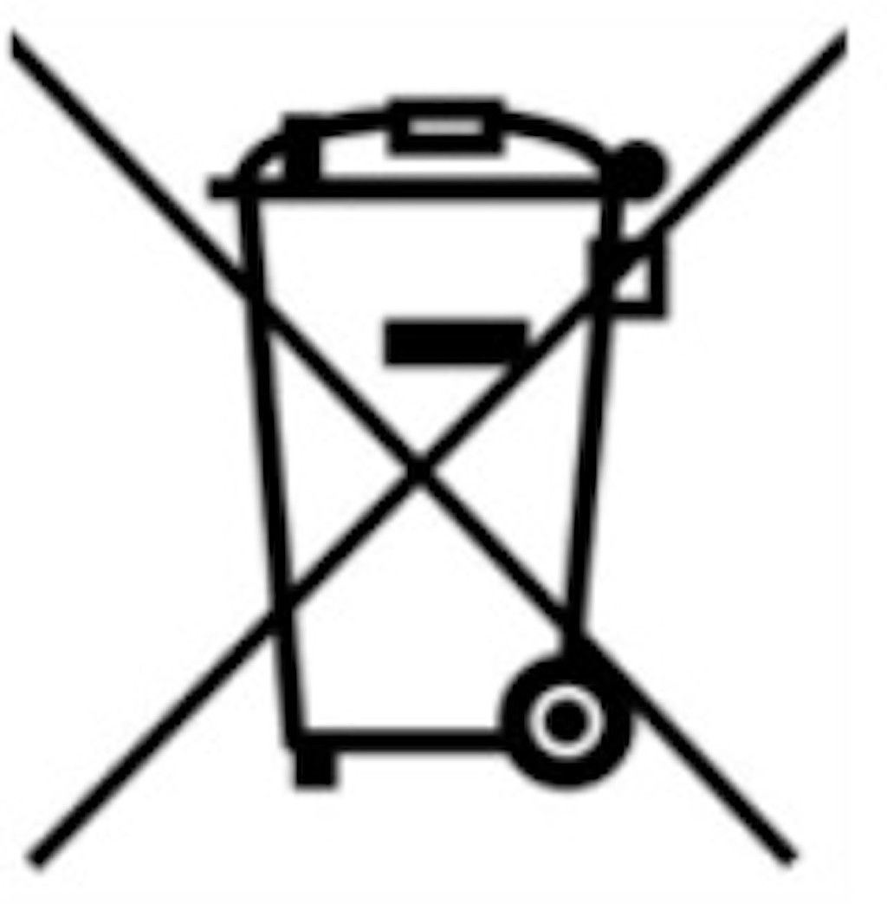

# Resolução CONAMA nº 516, de 8 de julho de 2026 {#resolucao-conama-516-2026}

> **Ementa:** Estabelece restrições ao uso de determinadas substâncias perigosas em equipamentos eletroeletrônicos comercializados no território nacional.

**Preâmbulo** {#preambulo} O CONSELHO NACIONAL DO MEIO AMBIENTE, no uso das atribuições que lhe conferem os [[lei-federal-6938-1981#art6_cpt_inc2|arts. 6º, inciso II]], e [[lei-federal-6938-1981#art8_cpt_inc7|8º, inciso VII]], da [[lei-federal-6938-1981|Lei nº 6.938, de 31 de agosto de 1981]], tendo em vista o disposto em seu Regimento Interno, assim como nos [[lei-federal-12305-2010#art2|art. 2º]], [[lei-federal-12305-2010#art6_cpt_inc1|art. 6º, inciso I]], [[lei-federal-12305-2010#art30|art. 30]] e [[lei-federal-12305-2010#art31_cpt|art. 31, incisos I e II]], da [[lei-federal-12305-2010|Lei nº 12.305, de 2 de agosto de 2010]], bem como o que consta do Processo Administrativo nº 02000.002604/2025-82, resolve:

## CAPÍTULO I – DISPOSIÇÕES GERAIS {#cap1}

###### Art. 1º {#art1}

**Art. 1º, caput** {#art1_cpt} Esta Resolução estabelece restrições ao uso de determinadas substâncias perigosas em equipamentos eletroeletrônicos comercializados no território nacional, com o objetivo de contribuir para a destinação final ambientalmente adequada, bem como para a proteção da saúde humana e do meio ambiente.

**Art. 1º, parágrafo único** {#art1_par1u} A aplicação desta Resolução não prejudica a observância dos tratados internacionais dos quais o Brasil seja signatário, bem como as normas brasileiras que regulam as relações de consumo.

###### Art. 2º {#art2}

**Art. 2º, caput** {#art2_cpt} Para efeitos desta Resolução, adotam-se as seguintes definições:
- **Art. 2º, caput, inciso I** {#art2_cpt_inc1} comerciante: pessoa física ou jurídica distinta do fabricante, do importador ou do distribuidor, que oferte ou permita que terceiros que ofertem ou comercializem equipamento eletroeletrônico para consumidor, a título oneroso ou gratuito, inclusive plataformas de comércio eletrônico;
- **Art. 2º, caput, inciso II** {#art2_cpt_inc2} consumidor: pessoa física ou jurídica que adquire ou utiliza equipamento eletroeletrônico;
- **Art. 2º, caput, inciso III** {#art2_cpt_inc3} descontinuação: medida, planejada pelo fabricante ou pelo importador, de retirada do produto da cadeia de suprimentos em razão de defasagem tecnológica ou exigências legais, na qual os fabricantes ou importadores não aceitarão pedidos de produtos descontinuados a partir da data de descontinuação informada pelos fabricantes;
- **Art. 2º, caput, inciso IV** {#art2_cpt_inc4} dispositivo médico: qualquer instrumento, aparelho, equipamento, implante, dispositivo médico para diagnóstico in vitro, software, material ou outro artigo, destinado pelo fabricante a ser usado, isolado ou conjuntamente, em seres humanos, para algum dos seguintes propósitos médicos específicos, e cuja principal ação pretendida não seja alcançada por meios farmacológicos, imunológicos ou metabólicos no corpo humano, mas que pode ser auxiliado na sua ação pretendida por tais meios:
  - **Art. 2º, caput, inciso IV, alínea "a"** {#art2_cpt_inc4_alia} diagnóstico, prevenção, monitoramento, tratamento (ou alívio) de doença;
  - **Art. 2º, caput, inciso IV, alínea "b"** {#art2_cpt_inc4_alib} diagnóstico, monitoramento, tratamento ou reparação de lesão ou deficiência;
  - **Art. 2º, caput, inciso IV, alínea "c"** {#art2_cpt_inc4_alic} investigação, substituição, alteração da anatomia ou de processo ou de estado fisiológico ou patológico;
  - **Art. 2º, caput, inciso IV, alínea "d"** {#art2_cpt_inc4_alid} suporte ou manutenção da vida;
  - **Art. 2º, caput, inciso IV, alínea "e"** {#art2_cpt_inc4_alie} controle ou apoio à concepção; ou
  - **Art. 2º, caput, inciso IV, alínea "f"** {#art2_cpt_inc4_alif} fornecimento de informações por meio de exame in vitro de amostras provenientes do corpo humano, incluindo doações de órgãos e tecidos;
- **Art. 2º, caput, inciso V** {#art2_cpt_inc5} dispositivo médico eletroeletrônico: qualquer dispositivo médico eletroeletrônico cujo funcionamento dependa de fonte de energia elétrica;
- **Art. 2º, caput, inciso VI** {#art2_cpt_inc6} dispositivo médico implantável eletroeletrônico: qualquer dispositivo eletroeletrônico destinado a ser introduzido totalmente no corpo humano mediante intervenção clínica e a nele permanecer após a intervenção, ou destinado a ser introduzido parcialmente no corpo humano mediante intervenção clínica e a nele permanecer por período de, pelo menos, trinta dias;
- **Art. 2º, caput, inciso VII** {#art2_cpt_inc7} dispositivo para diagnóstico in vitro: reagentes, calibradores, padrões, controles, coletores de amostra, softwares, instrumentos ou outros artigos, usados individualmente ou em combinação, com intenção de uso determinada pelo fabricante, para a análise in vitro de amostras derivadas do corpo humano, exclusivamente ou principalmente, para fornecer informações para fins de diagnóstico, auxílio ao diagnóstico, monitoramento, compatibilidade, triagem, predisposição, prognóstico, predição ou determinação do estado fisiológico;
- **Art. 2º, caput, inciso VIII** {#art2_cpt_inc8} dispositivo veterinário eletroeletrônico: qualquer dispositivo elétrico e eletrônico para ser utilizado em animais, destinado à prevenção, diagnóstico, tratamento, reabilitação ou anticoncepção e que não utiliza meio farmacológico, imunológico ou metabólico, podendo, entretanto, ser auxiliado em suas funções por tais meios, cujo funcionamento dependa de fonte de energia elétrica ou qualquer outra fonte de potência distinta da gravidade ou gerada pelo corpo animal e que funcione pela conversão desta energia;
- **Art. 2º, caput, inciso IX** {#art2_cpt_inc9} distribuidor: pessoa física ou jurídica, distinta do fabricante ou do importador, que oferte ou distribua equipamento eletroeletrônico ao comerciante;
- **Art. 2º, caput, inciso X** {#art2_cpt_inc10} equipamentos eletroeletrônicos: equipamentos cujo funcionamento adequado depende de correntes elétricas ou de campos eletromagnéticos para cumprir pelo menos uma função prevista, bem como os equipamentos para geração, transmissão, transferência e medição dessas correntes e campos, com tensão nominal não superior a 1000 V em corrente alternada e 1500 V em corrente contínua, incluindo partes e peças, por exemplo, eletrodomésticos, equipamentos de informática e telecomunicações, equipamentos de iluminação, equipamentos de consumo, módulos fotovoltaicos, ferramentas eletroeletrônicas, brinquedos e equipamentos de esporte e lazer, dispositivos médicos eletroeletrônicos, instrumentos eletroeletrônicos para diagnóstico in vitro, dispositivos veterinários eletrônicos, instrumentos de monitoração e controle, e dispensadores automáticos;
- **Art. 2º, caput, inciso XI** {#art2_cpt_inc11} equipamentos industriais fixos de grandes dimensões: grande conjunto de máquinas, de equipamentos ou de componentes que funcionam conjuntamente para aplicação específica, instaladas de forma permanente, cujo uso, manutenção e desmontagem devem ser feitas por profissionais, além de ser utilizadas em instalações industriais ou unidades de pesquisa e de desenvolvimento;
- **Art. 2º, caput, inciso XII** {#art2_cpt_inc12} fabricante: pessoa física ou jurídica que fabrique, transforme, produza, crie ou monte equipamento eletroeletrônico, ou mande fabricar ou montar equipamento eletroeletrônico comercializado sob seu nome ou sua marca;
- **Art. 2º, caput, inciso XIII** {#art2_cpt_inc13} fios e cabos: todos os fios e cabos de tensão nominal inferior a 250 V que servem como ligação ou extensão e permitem ligar equipamento eletroeletrônico ao ponto de alimentação elétrica ou a dois ou mais equipamentos eletroeletrônicos entre si;
- **Art. 2º, caput, inciso XIV** {#art2_cpt_inc14} importador: pessoa física ou jurídica que promova a entrada de equipamentos eletroeletrônicos no território aduaneiro do Brasil para fins de distribuição ou de comercialização;
- **Art. 2º, caput, inciso XV** {#art2_cpt_inc15} instalação fixa de grande dimensão: combinação de grandes dimensões de diversos tipos de aparelhos e, em certos casos, de outros dispositivos, que são montados, instalados e desmontados por profissionais, destinados a ser permanentemente utilizados em local predefinido;
- **Art. 2º, caput, inciso XVI** {#art2_cpt_inc16} instrumento eletroeletrônico para diagnóstico in vitro: equipamento ou aparato eletroeletrônico desenvolvido pelo fabricante com a intenção de ser usado como dispositivo médico para diagnóstico in vitro;
- **Art. 2º, caput, inciso XVII** {#art2_cpt_inc17} instrumentos industriais de monitoração e controle: instrumentos de monitoração e controle concebidos para utilização exclusivamente industrial ou profissional;
- **Art. 2º, caput, inciso XVIII** {#art2_cpt_inc18} máquina móvel fora de estrada de uso pretendido profissional: qualquer máquina móvel, seus implementos e acessórios, equipamento industrial transportável ou veículo com ou sem carroçaria, não destinado a ser utilizado para o transporte rodoviário de passageiros ou de mercadorias, tracionada ou com propulsão própria através de motor(es) de combustão interna ou elétrico(s), este(s) último(s) sendo alimentado(s) por baterias ou alimentação de energia externa;
- **Art. 2º, caput, inciso XIX** {#art2_cpt_inc19} material homogêneo: material de composição uniforme, ou material que consista em combinação de materiais que não possam ser separados ou fragmentados em materiais diferentes por meios mecânicos como cortar, esmagar, moer, ou por processos abrasivos;
- **Art. 2º, caput, inciso XX** {#art2_cpt_inc20} família de produto: agrupamento de modelos de produto com mesma finalidade, possuidores de uma ou mais características em comum, a saber: memorial descritivo, projeto, dimensões, massa, matéria-prima, configuração, de um mesmo fabricante;
- **Art. 2º, caput, inciso XXI** {#art2_cpt_inc21} módulo fotovoltaico: equipamento composto por conjunto de células solares fotovoltaicas interligadas eletricamente e encapsuladas, que realiza a conversão direta da radiação solar em energia elétrica, por meio do efeito fotovoltaico; e
- **Art. 2º, caput, inciso XXII** {#art2_cpt_inc22} peça e parte de reposição: componente, parte ou peça, reprocessado ou não, passível de substituição em equipamento eletroeletrônico, cuja presença é imprescindível para o funcionamento do equipamento conforme especificação de fábrica, sendo a substituição necessária para restaurar ou aprimorar a funcionalidade do equipamento eletroeletrônico.

###### Art. 3º {#art3}

**Art. 3º, caput** {#art3_cpt} Esta Resolução não se aplica a:
- **Art. 3º, caput, inciso I** {#art3_cpt_inc1} equipamentos eletroeletrônicos necessários à defesa e segurança do Estado, incluindo armas, munições e materiais bélicos destinados para fins especificamente militares ou de segurança interna;
- **Art. 3º, caput, inciso II** {#art3_cpt_inc2} equipamentos eletroeletrônicos concebidos para serem enviados ao espaço, bem como os equipamentos de solo necessários à operação de satélites e sistemas espaciais;
- **Art. 3º, caput, inciso III** {#art3_cpt_inc3} equipamentos eletroeletrônicos projetados e instalados especificamente como partes integrantes de outros tipos de equipamentos não abrangidos por esta Resolução, cuja funcionalidade dependa da integração a esses equipamentos, e que só podem ser substituídos por componentes idênticos, desenvolvidos exclusivamente para esse mesmo fim;
- **Art. 3º, caput, inciso IV** {#art3_cpt_inc4} equipamentos industriais fixos de grandes dimensões;
- **Art. 3º, caput, inciso V** {#art3_cpt_inc5} instalações fixas de grandes dimensões;
- **Art. 3º, caput, inciso VI** {#art3_cpt_inc6} meios de transporte de pessoas e mercadorias, excluindo os equipamentos de mobilidade individual autopropelidos;
- **Art. 3º, caput, inciso VII** {#art3_cpt_inc7} máquinas móveis fora de estrada, de uso pretendido profissional;
- **Art. 3º, caput, inciso VIII** {#art3_cpt_inc8} dispositivos médicos implantáveis eletroeletrônicos;
- **Art. 3º, caput, inciso IX** {#art3_cpt_inc9} módulos fotovoltaicos utilizados em sistema solar fotovoltaico, projetado e instalado por profissionais, para uso permanente em local definido, com o objetivo de produzir energia elétrica a partir da radiação solar;
- **Art. 3º, caput, inciso X** {#art3_cpt_inc10} pilhas e baterias; e
- **Art. 3º, caput, inciso XI** {#art3_cpt_inc11} equipamentos eletroeletrônicos concebidos especificamente para fins de pesquisa e desenvolvimento e disponibilizados exclusivamente no contexto entre empresas ou instituições.

**Art. 3º, parágrafo único** {#art3_par1u} O Ministério da Defesa estabelecerá, por ato normativo próprio, os critérios e procedimentos para caracterização e enquadramento dos equipamentos eletroeletrônicos destinados à defesa nacional para fins da exclusão prevista no [[#art3_cpt_inc1|inciso I do caput]], incluindo os equipamentos de uso dual ou com especificações técnicas equivalentes a produtos civis.

## CAPÍTULO II – DAS RESTRIÇÕES E ISENÇÕES {#cap2}

###### Art. 4º {#art4}

**Art. 4º, caput** {#art4_cpt} Os equipamentos eletroeletrônicos, incluindo os fios, os cabos e as peças de reposição para reparação, reutilização, atualização das funcionalidades ou melhoria da capacidade, somente podem ser fabricados, importados, distribuídos e comercializados no território nacional caso não contenham as substâncias listadas abaixo, em concentrações superiores aos limites máximos permitidos por massa de material homogêneo:
- **Art. 4º, caput, inciso I** {#art4_cpt_inc1} bifenilas polibromadas (PBB) - 0,1% (um décimo por cento);
- **Art. 4º, caput, inciso II** {#art4_cpt_inc2} éteres difenílicos polibromados (PBDE) - 0,1% (um décimo por cento);
- **Art. 4º, caput, inciso III** {#art4_cpt_inc3} mercúrio (Hg) - 0,1% (um décimo por cento);
- **Art. 4º, caput, inciso IV** {#art4_cpt_inc4} cádmio (Cd) - 0,01% (um centésimo por cento);
- **Art. 4º, caput, inciso V** {#art4_cpt_inc5} cromo hexavalente (Cr-VI) - 0,1% (um décimo por cento);
- **Art. 4º, caput, inciso VI** {#art4_cpt_inc6} chumbo (Pb) - 0,1% (um décimo por cento);
- **Art. 4º, caput, inciso VII** {#art4_cpt_inc7} ftalato de di (2-etil-hexila) (DEHP) - 0,1% (um décimo por cento);
- **Art. 4º, caput, inciso VIII** {#art4_cpt_inc8} ftalato de benzila e butila (BBP) - 0,1% (um décimo por cento);
- **Art. 4º, caput, inciso IX** {#art4_cpt_inc9} ftalato de dibutila (DBP) - 0,1% (um décimo por cento); e
- **Art. 4º, caput, inciso X** {#art4_cpt_inc10} ftalato de di-isobutila (DIBP) - 0,1% (um décimo por cento).

**Art. 4º, § 1º** {#art4_par1} Os fabricantes e os importadores devem observar os seguintes prazos para adequar os seus produtos aos valores máximos de concentração estabelecidos nos [[#art4_cpt|incisos I a X do caput]]:
- **Art. 4º, § 1º, inciso I** {#art4_par1_inc1} a partir da entrada em vigor desta Resolução para as substâncias dos [[#art4_cpt|incisos I e II do caput]];
- **Art. 4º, § 1º, inciso II** {#art4_par1_inc2} cento e oitenta dias, a contar da entrada em vigor desta Resolução, para a substância do [[#art4_cpt_inc3|inciso III do caput]];
- **Art. 4º, § 1º, inciso III** {#art4_par1_inc3} três anos, a contar da data da publicação desta Resolução, para as substâncias dos [[#art4_cpt|incisos IV a VI do caput]];
- **Art. 4º, § 1º, inciso IV** {#art4_par1_inc4} quatro anos, a contar da publicação desta Resolução, para as substâncias dos [[#art4_cpt|incisos VII a X do caput]].

**Art. 4º, § 2º** {#art4_par2} O disposto no caput não se aplica:
- **Art. 4º, § 2º, inciso I** {#art4_par2_inc1} aos equipamentos eletroeletrônicos, fios, cabos ou às peças de reposição para reparo ou reúso de equipamentos eletroeletrônicos colocados no mercado que tenham sido projetados e fabricados antes dos prazos estabelecidos no [[#art4_par1|§ 1º]]; e
- **Art. 4º, § 2º, inciso II** {#art4_par2_inc2} aos equipamentos eletroeletrônicos que se beneficiem de alguma isenção temporária nos termos do [[#art5|art. 5º]].

**Art. 4º, § 3º** {#art4_par3} No caso do [[#art4_cpt_inc3|inciso III do caput]], os fabricantes e os importadores devem observar as concentrações e restrições estabelecidas pelo [[decreto-federal-9470-2018|Decreto nº 9.470, de 14 de agosto de 2018]], adotando a norma mais restritiva para a implementação desta Resolução.

**Art. 4º, § 4º** {#art4_par4} Os equipamentos eletroeletrônicos distribuídos e comercializados no território nacional que já tenham alguma das substâncias previstas no caput regulamentadas por outras normas devem cumprir as previsões mais restritivas, mantida a obrigação de observar o estabelecido por esta Resolução para as demais substâncias.

###### Art. 5º {#art5}

**Art. 5º, caput** {#art5_cpt} Poderão ser concedidas isenções temporárias ao cumprimento do disposto no [[#art4|art. 4º]] para aplicações específicas de equipamentos eletroeletrônicos, desde que seja atendida pelo menos uma das seguintes condições:
- **Art. 5º, caput, inciso I** {#art5_cpt_inc1} impossibilidade técnica ou científica de eliminar ou substituir, no equipamento eletroeletrônico, quaisquer das substâncias listadas no [[#art4|art. 4º]];
- **Art. 5º, caput, inciso II** {#art5_cpt_inc2} inexistência de garantia quanto à confiabilidade do uso de substância alternativa no equipamento eletroeletrônico; e
- **Art. 5º, caput, inciso III** {#art5_cpt_inc3} a eliminação ou a substituição da substância química do equipamento eletroeletrônico resultar, considerando o ciclo de vida do produto, em impactos ambientais, à saúde ou à segurança humana que superam os benefícios esperados da substituição.

**Art. 5º, § 1º** {#art5_par1} O Ministério do Meio Ambiente e Mudança do Clima decidirá sobre a inclusão, alteração, renovação ou revogação de materiais e componentes dos equipamentos eletroeletrônicos na lista das isenções.

**Art. 5º, § 2º** {#art5_par2} Os pedidos de concessão, de alteração, de renovação ou de revogação de isenções podem ser apresentados, a qualquer momento, por fabricantes e por importadores, observando os períodos estipulados no § 1º.

**Art. 5º, § 3º** {#art5_par3} O Ministério do Meio Ambiente e Mudança do Clima deverá dar publicidade a todos os pedidos de concessão, alteração, renovação e revogação de isenções temporárias.

###### Art. 6º {#art6}

**Art. 6º, caput** {#art6_cpt} O Ministério do Meio Ambiente e Mudança do Clima poderá definir procedimentos diferenciados para requerimento e análise dos pedidos de concessão, alteração, renovação e revogação de isenções temporárias, observando os princípios e as regras constitucionais, tais como transparência, publicidade, participação, contraditório e informação.

**Art. 6º, § 1º** {#art6_par1} O Ministério do Meio Ambiente e Mudança do Clima, ao analisar os pedidos de concessão, alteração, renovação e revogação de isenções temporárias e ao definir os prazos de isenção, também considerará a disponibilidade e a acessibilidade às alternativas no mercado, bem como eventuais isenções vigentes em outros países que possuam mecanismos de controle de substâncias perigosas em equipamentos eletroeletrônicos tão ou mais restritivos que esta Resolução.

**Art. 6º, § 2º** {#art6_par2} Para a definição dos prazos de isenção, será considerada a harmonização com os melhores prazos praticados em outros países que possuam legislação de restrição de substâncias em equipamentos eletroeletrônicos, a fim de garantir previsibilidade às cadeias globais de abastecimento.

**Art. 6º, § 3º** {#art6_par3} O pedido de renovação da isenção deverá ser apresentado até dezoito meses antes da data de vencimento.

**Art. 6º, § 4º** {#art6_par4} Até que o pedido de renovação seja julgado, a isenção vigente não expirará.

**Art. 6º, § 5º** {#art6_par5} No caso de o pedido de renovação de isenção ser indeferido ou de a isenção ser revogada, a isenção expirará no prazo mínimo de doze meses e no prazo máximo de dezoito meses, a contar da data da publicação da decisão.

## CAPÍTULO III – DO CADASTRO E DA AUTODECLARAÇÃO DE CONFORMIDADE {#cap3}

###### Art. 7º {#art7}

**Art. 7º, caput** {#art7_cpt} Fica criado o Cadastro Nacional de Equipamentos Eletroeletrônicos com Restrições de Substâncias Perigosas, que será instituído e regulamentado pelo Ministério do Meio Ambiente e Mudança do Clima para coleta, integração, sistematização, disponibilização e atualização de dados dos equipamentos eletroeletrônicos sujeitos às restrições desta Resolução.

**Art. 7º, § 1º** {#art7_par1} Para efetivar o cadastro de que trata o caput, o fabricante ou o importador, pessoa física ou jurídica, deverá declarar que atende às restrições ou às isenções desta Resolução, respondendo administrativa e criminalmente pela veracidade das informações prestadas.

**Art. 7º, § 2º** {#art7_par2} O representante legal ou procurador do fabricante ou importador que prestar a declaração de que trata o [[#art7_par1|§ 1º]] também responderá, administrativa e criminalmente, pela veracidade das informações prestadas.

**Art. 7º, § 3º** {#art7_par3} O cadastro de que trata o caput é obrigatório e prévio à fabricação ou à importação em território nacional dos equipamentos eletroeletrônicos com restrição das substâncias perigosas, observado o [[#art11|art. 11]].

###### Art. 8º {#art8}

**Art. 8º, caput** {#art8_cpt} Cada equipamento eletroeletrônico, modelo ou família de produto produzido, importado ou comercializado no território nacional, deverá ser cadastrado individualmente e gerará autodeclaração de conformidade, também individualizada, que será vinculada ao fabricante ou importador, pessoa física ou jurídica, responsável pelo cadastramento.

###### Art. 9º {#art9}

**Art. 9º, caput** {#art9_cpt} Para emissão da autodeclaração de conformidade, deverão ser fornecidas as seguintes informações:
- **Art. 9º, caput, inciso I** {#art9_cpt_inc1} dados de identificação do fabricante, quando se tratar de equipamento produzido em território nacional;
- **Art. 9º, caput, inciso II** {#art9_cpt_inc2} informações do responsável pelo registro;
- **Art. 9º, caput, inciso III** {#art9_cpt_inc3} dados de identificação do fabricante estrangeiro e do importador, quando se tratar de produto importado;
- **Art. 9º, caput, inciso IV** {#art9_cpt_inc4} objeto de identificação do equipamento eletroeletrônico, do modelo ou da família de produto, incluindo os códigos e demais elementos necessários à sua identificação, de modo a permitir seu rastreamento;
- **Art. 9º, caput, inciso V** {#art9_cpt_inc5} a indicação do cumprimento das restrições relativas às substâncias perigosas, conforme previsto no [[#art4|art. 4]]º, nas diferentes partes dos equipamentos em que essas substâncias possam estar presentes, quando aplicável;
- **Art. 9º, caput, inciso VI** {#art9_cpt_inc6} o enquadramento do equipamento eletroeletrônico em caso de isenção previsto no [[#art5|art. 5º]]; e
- **Art. 9º, caput, inciso VII** {#art9_cpt_inc7} termo de responsabilidade pela veracidade das informações cadastradas.

**Art. 9º, § 1º** {#art9_par1} O Ministério do Meio Ambiente e Mudança do Clima poderá exigir informações complementares em regulamento.

**Art. 9º, § 2º** {#art9_par2} O cadastro e a documentação técnica serão protegidos por sigilo, assegurada a confidencialidade das informações sensíveis, ressalvada a publicidade dos registros de autodeclaração destinados ao consumidor.

###### Art. 10 {#art10}

**Art. 10, caput** {#art10_cpt} Realizado o cadastro, será disponibilizada a opção de emissão de autodeclaração de conformidade aos fabricantes e importadores que prestem declaração de que o equipamento eletroeletrônico cadastrado atende aos requisitos especificados no [[#cap2|Capítulo II]].

**Art. 10, § 1º** {#art10_par1} A emissão da autodeclaração de conformidade ficará disponível para os equipamentos eletrônicos que:
- **Art. 10, § 1º, inciso I** {#art10_par1_inc1} declarem atender aos requisitos de restrição de substância do [[#art4_cpt|art. 4º, caput]]; ou
- **Art. 10, § 1º, inciso II** {#art10_par1_inc2} embora não atendam aos requisitos de restrição de substância estabelecidos no [[#art4_cpt|art. 4º, caput]], sejam importados ou fabricados antes do fim do prazo de adequação fixado no mesmo dispositivo; e
- **Art. 10, § 1º, inciso III** {#art10_par1_inc3} usufruam do prazo de isenção temporária.

**Art. 10, § 2º** {#art10_par2} A autodeclaração de conformidade deverá acompanhar o produto fabricado ou importado em sua embalagem, na íntegra ou por meio de ferramenta de redirecionamento que facilmente direcione o consumidor para o seu acesso, além de ser disponibilizada na rede mundial de computadores.

**Art. 10, § 3º** {#art10_par3} Caso a autodeclaração não possa constar da embalagem do produto na forma do [[#art10_par2|§ 2º]], sempre que solicitado, o fabricante ou o importador do equipamento eletroeletrônico deverá fornecer a autodeclaração ao solicitante no prazo máximo de cinco dias úteis.

###### Art. 11 {#art11}

**Art. 11, caput** {#art11_cpt} O prazo para a inclusão de informações no Cadastro Nacional de Equipamentos Eletroeletrônicos com Restrições de Substâncias Perigosas e emissão da autodeclaração de conformidade no sistema será de um ano, contado da disponibilização do sistema.

**Art. 11, parágrafo único** {#art11_par1u} Ao término dos prazos de adequação fixados no [[#art4_par1|art. 4º, § 1º, incisos II, III e IV]], ou dos prazos de isenção aprovados, os fabricantes e os importadores deverão atualizar as informações no cadastro e emitir autodeclaração de conformidade atualizada.

## CAPÍTULO IV – DAS OBRIGAÇÕES DOS FABRICANTES, IMPORTADORES, DISTRIBUIDORES E COMERCIANTES {#cap4}

###### Art. 12 {#art12}

**Art. 12, caput** {#art12_cpt} São obrigações dos fabricantes relativamente aos equipamentos eletroeletrônicos que fabricam:
- **Art. 12, caput, inciso I** {#art12_cpt_inc1} assegurar que os equipamentos eletroeletrônicos a serem projetados e fabricados no território nacional atendam aos requisitos e prazos previstos no [[#art4|art. 4]]º, inclusive nas produções em série;
- **Art. 12, caput, inciso II** {#art12_cpt_inc2} cadastrar e manter atualizado o cadastro individual dos equipamentos eletroeletrônicos, modelo ou família de produto no Cadastro Nacional de Equipamentos Eletroeletrônicos com restrições de substâncias perigosas, nos termos do [[#art7|art. 7º]];
- **Art. 12, caput, inciso III** {#art12_cpt_inc3} emitir a autodeclaração de conformidade de restrição de substâncias para cada equipamento eletroeletrônico, modelo ou família de produto, e disponibilizá-lo nos termos do disposto no [[#cap3|Capítulo III]];
- **Art. 12, caput, inciso IV** {#art12_cpt_inc4} manter, no idioma português, a documentação técnica mínima definida em ato do Ministério do Meio Ambiente e Mudança do Clima, necessária para demonstrar a regularidade da autodeclaração de conformidade;
- **Art. 12, caput, inciso V** {#art12_cpt_inc5} manter a autodeclaração de conformidade e a documentação técnica durante o prazo de cinco anos, contados a partir da descontinuação do equipamento eletroeletrônico no mercado;
- **Art. 12, caput, inciso VI** {#art12_cpt_inc6} fornecer à autoridade federal competente pela fiscalização ambiental, quando solicitado, toda informação e documentação necessária, no idioma português, para demonstrar a conformidade do equipamento eletroeletrônico com o disposto nesta Resolução;
- **Art. 12, caput, inciso VII** {#art12_cpt_inc7} disponibilizar, quando solicitado, aos distribuidores e comerciantes a autodeclaração a que se refere o [[#art12_cpt_inc3|inciso III, do caput]];
- **Art. 12, caput, inciso VIII** {#art12_cpt_inc8} manter registro dos equipamentos eletroeletrônicos considerados não conformes, nos casos do [[#art17|art. 17]]; e
- **Art. 12, caput, inciso IX** {#art12_cpt_inc9} efetuar registros necessários para garantir a rastreabilidade dos equipamentos eletroeletrônicos comercializados, mantendo-os à disposição das autoridades competentes por período de cinco anos após a fabricação.

###### Art. 13 {#art13}

**Art. 13, caput** {#art13_cpt} São obrigações dos importadores relativamente aos equipamentos eletroeletrônicos que importam:
- **Art. 13, caput, inciso I** {#art13_cpt_inc1} assegurar que os equipamentos eletroeletrônicos a serem colocados no mercado nacional tenham sido projetados e fabricados de acordo com os requisitos e os prazos previstos no [[#art4|art. 4]]º, inclusive nas produções em série;
- **Art. 13, caput, inciso II** {#art13_cpt_inc2} cadastrar e manter atualizado o cadastro individual dos equipamentos eletroeletrônicos, modelo, ou família de produto no Cadastro Nacional de Equipamentos Eletroeletrônicos com restrições de substâncias perigosas, nos termos do [[#art7|art. 7º]];
- **Art. 13, caput, inciso III** {#art13_cpt_inc3} emitir a autodeclaração de conformidade de restrição de substâncias para cada equipamento eletroeletrônico, modelo, ou família de produto, e disponibilizá-la nos termos do disposto no [[#cap3|Capítulo III]];
- **Art. 13, caput, inciso IV** {#art13_cpt_inc4} exigir do fabricante estrangeiro e manter, no idioma português, a documentação técnica mínima definida em ato do Ministério do Meio Ambiente e Mudança do Clima, necessária para demonstrar a regularidade da autodeclaração de conformidade;
- **Art. 13, caput, inciso V** {#art13_cpt_inc5} manter a autodeclaração de conformidade e a documentação técnica durante o prazo de cinco anos, contados a partir da descontinuação do equipamento eletroeletrônico no mercado;
- **Art. 13, caput, inciso VI** {#art13_cpt_inc6} fornecer à autoridade federal competente pela fiscalização ambiental, quando por ela solicitado, todas as informações e documentação necessárias, no idioma português, para demonstrar a conformidade do equipamento eletroeletrônico com o disposto nesta Resolução;
- **Art. 13, caput, inciso VII** {#art13_cpt_inc7} disponibilizar, quando solicitado, aos distribuidores e comerciantes a autodeclaração a que se refere o [[#art13_cpt_inc3|inciso III do caput]];
- **Art. 13, caput, inciso VIII** {#art13_cpt_inc8} manter registro dos equipamentos eletroeletrônicos considerados não conformes, nos casos do [[#art17|art. 17]]; e
- **Art. 13, caput, inciso IX** {#art13_cpt_inc9} efetuar registros necessários para garantir a rastreabilidade dos equipamentos eletroeletrônicos comercializados, mantendo-os à disposição das autoridades competentes por período de cinco anos após a importação.

###### Art. 14 {#art14}

**Art. 14, caput** {#art14_cpt} Os fabricantes e os importadores deverão assegurar a conformidade dos equipamentos eletroeletrônicos nas hipóteses de alterações no projeto ou nas características do produto, bem como nas normas técnicas utilizadas para atestar a veracidade da autodeclaração de conformidade.

**Art. 14, parágrafo único** {#art14_par1u} Sempre que alterações no projeto do produto resultarem em mudanças na documentação técnica mencionada no caput, a documentação deverá ser atualizada, assim como a autodeclaração de conformidade no sistema previsto no [[#art11_par1u|art. 11, parágrafo único]].

###### Art. 15 {#art15}

**Art. 15, caput** {#art15_cpt} São obrigações dos distribuidores e dos comerciantes relativamente aos equipamentos eletroeletrônicos que distribuem e comercializam:
- **Art. 15, caput, inciso I** {#art15_cpt_inc1} exigir dos fabricantes e dos importadores, como requisito para comercialização e distribuição dos equipamentos eletroeletrônicos, a disponibilização da autodeclaração a que se referem o [[#art12_cpt_inc3|art. 12, inciso III]], e o [[#art13_cpt_inc3|art. 13, inciso III]]; e
- **Art. 15, caput, inciso II** {#art15_cpt_inc2} fornecer à autoridade federal competente pela fiscalização, quando solicitado, a autodeclaração de conformidade.

###### Art. 16 {#art16}

**Art. 16, caput** {#art16_cpt} Os importadores, distribuidores e comerciantes equiparam-se aos fabricantes para efeitos desta Resolução, assumindo as obrigações previstas nos arts. [[#art12|12]], [[#art13|13]] e [[#art17|17]], sempre que:
- **Art. 16, caput, inciso I** {#art16_cpt_inc1} colocarem equipamentos eletroeletrônicos no mercado com o seu nome ou sua marca comercial;
- **Art. 16, caput, inciso II** {#art16_cpt_inc2} alterarem os equipamentos eletroeletrônicos fabricados de forma que o cumprimento do disposto no [[#art4|art. 4º]] possa ser afetado; e
- **Art. 16, caput, inciso III** {#art16_cpt_inc3} quando não cumprirem a obrigação prevista no [[#art15_cpt_inc1|art. 15, inciso I]].

###### Art. 17 {#art17}

**Art. 17, caput** {#art17_cpt} Os fabricantes e os importadores de equipamentos eletroeletrônicos que, posteriormente à sua comercialização aos distribuidores, comerciantes ou consumidores, tiverem conhecimento da não conformidade dos equipamentos com o disposto no [[#art4|art. 4º]] deverão, imediatamente:
- **Art. 17, caput, inciso I** {#art17_cpt_inc1} informar à autoridade ambiental federal e o órgão ambiental responsável pelo licenciamento ambiental, caso sejam órgãos diferentes;
- **Art. 17, caput, inciso II** {#art17_cpt_inc2} informar aos distribuidores e comerciantes para que cessem a comercialização dos equipamentos eletroeletrônicos aos consumidores;
- **Art. 17, caput, inciso III** {#art17_cpt_inc3} adequar o seu processo produtivo para assegurar a conformidade dos equipamentos eletroeletrônicos fabricados, ou promover adequações para garantir a conformidade dos equipamentos importados; e
- **Art. 17, caput, inciso IV** {#art17_cpt_inc4} recolher os produtos já comercializados e, quando for tecnicamente possível e viável, sanar a desconformidade, de acordo com os mecanismos e prazos previstos na legislação vigente.

**Art. 17, § 1º** {#art17_par1} Na aplicação do [[#art17_cpt_inc4|inciso IV do caput]], os consumidores devem ser informados das medidas corretivas a serem adotadas mediante anúncios publicitários veiculados em imprensa, rádio, televisão ou mídias digitais, às expensas dos fabricantes ou importadores, conforme o caso.

**Art. 17, § 2º** {#art17_par2} Na impossibilidade de sanar a não conformidade, aos equipamentos eletroeletrônicos, às peças ou às partes deverá ser dada a destinação final ambientalmente adequada, nos termos da [[lei-federal-12305-2010|Lei nº 12.305, de 2 de agosto de 2010]], assegurado o direito à informação, inclusive aos trabalhadores da cadeia de reciclagem.

## CAPÍTULO V – DA INFORMAÇÃO E COMUNICAÇÃO {#cap5}

###### Art. 18 {#art18}

**Art. 18, caput** {#art18_cpt} Do corpo dos equipamentos eletroeletrônicos deverão constar informações que permitam a identificação e a rastreabilidade do equipamento, em língua portuguesa, de forma clara e objetiva, mediante a utilização de marcação ou etiquetas duráveis, legíveis e com resistência mecânica suficiente para suportar o manuseio e intempéries, visando assim preservar as informações nelas contidas durante toda a vida útil do equipamento eletroeletrônico:
- **Art. 18, caput, inciso I** {#art18_cpt_inc1} o modelo, o número do lote ou da série, ou quaisquer outros elementos que permitam a respectiva identificação do produto;
- **Art. 18, caput, inciso II** {#art18_cpt_inc2} nome comercial registrado ou marca registrada, em um único endereço de contato no Brasil; e
- **Art. 18, caput, inciso III** {#art18_cpt_inc3} nos produtos nacionais, a identificação do fabricante e, nos produtos importados, a identificação do importador.

**Art. 18, parágrafo único** {#art18_par1u} As informações exigidas no caput podem ser disponibilizadas por meio de ferramenta de redirecionamento que permita a identificação e a rastreabilidade do equipamento.

###### Art. 19 {#art19}

**Art. 19, caput** {#art19_cpt} No corpo dos equipamentos eletroeletrônicos sujeitos à logística reversa, deverá constar, de forma clara e visível, simbologia indicativa de descarte seletivo, nos termos do [[#anexo1|Anexo]], salvo se outra simbologia para a mesma finalidade for prevista em legislação específica.

###### Art. 20 {#art20}

**Art. 20, caput** {#art20_cpt} Na impossibilidade ou inviabilidade técnica de incluir as informações referidas no [[#art18|art. 18]] ou a simbologia mencionada no [[#art19|art. 19]] diretamente no corpo do equipamento eletroeletrônico, essas deverão constar na embalagem do produto, em documento que o acompanhe ou por meio de ferramenta de redirecionamento prevista no [[#art10|art. 10]].

## CAPÍTULO VI – DA FISCALIZAÇÃO {#cap6}

###### Art. 21 {#art21}

**Art. 21, caput** {#art21_cpt} A autoridade ambiental federal competente pela fiscalização poderá requisitar amostra de lotes de equipamento eletroeletrônico, de quaisquer tipos, fabricados ou importados para comercialização no país, a seu critério, para fins de comprovação do atendimento às exigências desta Resolução.

**Art. 21, § 1º** {#art21_par1} A autoridade ambiental federal, mencionada no caput, poderá providenciar a realização de ensaios para verificação dos teores das substâncias referidas no [[#art4|art. 4º]].

**Art. 21, § 2º** {#art21_par2} Quando verificados os indícios de irregularidade por meio da análise de documentação técnica de que tratam os arts. [[#art12|12]] e [[#art13|13]], bem como de outros elementos relevantes, a autoridade federal competente poderá determinar a realização de ensaios pelo importador ou fabricante, para verificação dos teores das substâncias referidas no [[#art4|art. 4]]º, justificando tecnicamente a solicitação de cada ensaio em cada produto.

**Art. 21, § 3º** {#art21_par3} Os ensaios deverão ser realizados em laboratórios acreditados por órgãos competentes para este fim, signatários dos acordos do International Laboratory Accreditation Cooperation - ILAC e do InterAmerican Accreditation Cooperation - IAAC.

**Art. 21, § 4º** {#art21_par4} A autoridade ambiental federal, quando da fiscalização nos distribuidores e comerciantes, poderá apreender as amostras de equipamentos eletroeletrônicos.

**Art. 21, § 5º** {#art21_par5} A autoridade ambiental federal poderá solicitar aos fabricantes ou importadores, ou a estes equiparados, informações sobre as amostras ou lotes dos equipamentos eletroeletrônicos apreendidos.

**Art. 21, § 6º** {#art21_par6} Constatada a infração, o responsável arcará com todas as despesas decorrentes das medidas determinadas pela autoridade federal competente, incluindo ensaios, apreensão, armazenamento e destruição dos equipamentos eletroeletrônicos.

###### Art. 22 {#art22}

**Art. 22, caput** {#art22_cpt} A autoridade ambiental federal competente pela fiscalização poderá, em consonância com a documentação técnica, adotar procedimentos complementares relativos ao controle, à fiscalização, aos laudos e às análises físico-químicas, necessários à verificação do cumprimento do disposto nesta Resolução.

###### Art. 23 {#art23}

**Art. 23, caput** {#art23_cpt} O não cumprimento das obrigações previstas nesta Resolução sujeitará os infratores às penalidades previstas na legislação em vigor, sem prejuízo das obrigações previstas no [[#art17|art. 17]].

###### Art. 24 {#art24}

**Art. 24, caput** {#art24_cpt} A lista de substâncias restritas na composição de equipamentos eletroeletrônicos, prevista no [[#art4|art. 4]]º, poderá ser atualizada com base em novas evidências científicas, na disponibilidade de alternativas seguras e no princípio da precaução.

**Art. 24, parágrafo único** {#art24_par1u} O Ministério do Meio Ambiente e Mudança do Clima deverá verificar a necessidade de revisão da lista de substâncias restritas no mínimo a cada cinco anos.

###### Art. 25 {#art25}

**Art. 25, caput** {#art25_cpt} Sem prejuízo do quanto estabelecido no [[decreto-federal-7746-2012|Decreto nº 7.746, de 5 de junho de 2012]], e na [[instrucao-normativa-mpog-1-2010|Instrução Normativa nº 1, de 19 de janeiro de 2010, do Ministério do Planejamento, Orçamento e Gestão]], os órgãos e entidades da administração pública federal direta, autárquica, fundacional e as empresas estatais dependentes, quando da aquisição de equipamentos eletroeletrônicos, poderão exigir que não contenham substâncias perigosas em concentração acima da recomendada no [[#art4|art. 4]]º, sem necessidade de aguardar o decurso dos prazos nele previstos, a menos que enquadrado em hipótese de isenção temporária.

## CAPÍTULO VII – DISPOSIÇÕES TRANSITÓRIAS E FINAIS {#cap7}

###### Art. 26 {#art26}

**Art. 26, caput** {#art26_cpt} As obrigações relativas a:
- **Art. 26, caput, inciso I** {#art26_cpt_inc1} documentação técnica, prevista no [[#cap4|Capítulo IV]], são exigíveis a partir da emissão da autodeclaração de conformidade;
- **Art. 26, caput, inciso II** {#art26_cpt_inc2} informação prevista no [[#art18|art. 18]] será exigível a partir da emissão da autodeclaração de conformidade; e
- **Art. 26, caput, inciso III** {#art26_cpt_inc3} informação e comunicação previstas no [[#art19|art. 19]] serão exigíveis dois anos a partir da emissão da autodeclaração de conformidade.

###### Art. 27 {#art27}

**Art. 27, caput** {#art27_cpt} O Ministério do Meio Ambiente e Mudança do Clima publicará, em até cento e oitenta dias, contados da publicação desta Resolução, listagem inicial dos equipamentos eletroeletrônicos e das respectivas aplicações que estarão isentos do cumprimento do [[#art4|art. 4]]º, bem como, quando aplicável, os prazos de validade das isenções, renováveis mediante requerimento dos fabricantes ou dos importadores.

###### Art. 28 {#art28}

**Art. 28, caput** {#art28_cpt} O Ministério do Meio Ambiente e Mudança do Clima publicará, em até cento e oitenta dias contados da publicação desta Resolução, os procedimentos e os critérios para o requerimento e a análise dos pedidos de concessão, alteração, renovação ou revogação de isenções.

###### Art. 29 {#art29}

**Art. 29, caput** {#art29_cpt} O Ministério do Meio Ambiente e Mudança do Clima estabelecerá, em até cento e oitenta dias, contados da publicação desta Resolução, por meio de ato normativo, a documentação técnica mencionada no [[#art12_cpt_inc4|art. 12, inciso IV]].

###### Art. 30 {#art30}

**Art. 30, caput** {#art30_cpt} O disposto nesta Resolução não prejudica o exercício das competências do Comitê Deliberativo de Substâncias Químicas, de que trata a [[lei-federal-15022-2024|Lei nº 15.022, de 13 de novembro de 2024]].

###### Art. 31 {#art31}

**Art. 31, caput** {#art31_cpt} Esta resolução entra em vigor na data de sua publicação.

**Assinatura** {#assinatura} JOÃO PAULO RIBEIRO CAPOBIANCO – Presidente do Conselho

## Anexos

### ANEXO {#anexo1}

- **Anexo, linha 1** {#anexo1_lin1} SIMBOLOGIA DE DESTINAÇÃO FINAL ADEQUADA
- **Anexo, linha 2** {#anexo1_lin2} O SÍMBOLO QUE INDICA A NECESSIDADE DE O EQUIPAMENTO ELETROELETRÔNICO SER DESCARTADO DE FORMA SELETIVA É CONSTITUÍDO POR CONTENTOR DE RESÍDUOS RISCADO COM XIS.

**Anexo, Figura 1** {#anexo1_fig1} Símbolo de descarte seletivo: contentor de resíduos riscado com xis 

## Relação com outras normas {#relacao-outras-normas}

Observação do conversor (não é texto normativo):

- Esta Resolução não altera nem revoga outra norma. O [[#art30|art. 30]] preserva as competências do Comitê Deliberativo de Substâncias Químicas (Lei nº 15.022/2024).
- É norma de produto: obriga fabricantes, importadores, distribuidores e comerciantes de equipamentos eletroeletrônicos (cadastro, autodeclaração de conformidade e fiscalização da autoridade ambiental federal). Não cria exigência de licenciamento de atividade; o [[#art17_cpt_inc1|art. 17, I]] só manda informar o órgão responsável pelo licenciamento ambiental, quando for diferente da autoridade federal.
- Prazos do [[#art4_par1|art. 4º, § 1º]] (contagem simples do conversor, sem aplicar a LC 95/1998; confirmar): PBB e PBDE, desde 10/07/2026; mercúrio, 180 dias, em torno de 06/01/2027; cádmio, cromo hexavalente e chumbo, três anos da publicação, em 10/07/2029; ftalatos (DEHP, BBP, DBP e DIBP), quatro anos da publicação, em 10/07/2030. O inciso I usa "entrada em vigor" e os incisos III e IV, "publicação"; as duas datas coincidem ([[#art31|art. 31]]).
- Dependem de ato futuro do MMA: lista inicial de isenções ([[#art27|art. 27]]), procedimentos de pedido de isenção ([[#art28|art. 28]]) e documentação técnica mínima ([[#art29|art. 29]]), todos em até 180 dias da publicação (em torno de 06/01/2027), e o Cadastro Nacional ([[#art7|art. 7º]]), cujo prazo de um ano corre da disponibilização do sistema ([[#art11_cpt|art. 11]]). As obrigações dos [[#art26|arts. 26, I a III]] só são exigíveis a partir da autodeclaração.
- Remissão duvidosa: o [[#art5_par2|art. 5º, § 2º]] manda observar "os períodos estipulados no § 1º", mas o § 1º do art. 5º não fixa períodos; prazos de pedido e de vigência das isenções estão no [[#art6|art. 6º]], §§ 3º a 5º. O link ficou sem ligação por ser ambíguo.
- O [[#art19|art. 19]] exige o símbolo do [[#anexo1|Anexo]] só nos equipamentos "sujeitos à logística reversa", salvo outra simbologia prevista em legislação específica.
- O [[#art4_par3|art. 4º, § 3º]] remete ao Decreto nº 9.470/2018 para o mercúrio (inciso III do caput) e o [[#art25|art. 25]], ao Decreto nº 7.746/2012 e à IN MPOG nº 1/2010 (compras públicas). Esses atos e a Lei nº 15.022/2024 não estão na base; os links ficam pendentes.

## Notas de transcrição {#notas-transcricao}

O texto foi mantido exatamente como publicado. Os pontos abaixo são do original, não erros de transcrição:

- Art. 2º, I: "que oferte ou permita que terceiros que ofertem ou comercializem".
- Art. 2º, X: "dispositivos veterinários eletrônicos", enquanto o inciso VIII define "dispositivo veterinário eletroeletrônico".
- Art. 2º, XI: "devem ser feitas", "além de ser utilizadas" (concordância).
- Art. 10, § 1º: os incisos I e II terminam com "; ou" e "; e", e o inciso III vem depois, como terceira hipótese, sem o conector "ou" no inciso II.
- Art. 12, III: "disponibilizá-lo" (a autodeclaração, no feminino); o art. 13, III, traz "disponibilizá-la". Art. 12, VII: "inciso III, do caput" (vírgula).
- Art. 16, III: "III - quando não cumprirem" (o caput já traz "sempre que").
- Art. 17, I: "informar à autoridade ambiental federal e o órgão ambiental" (regência).
- Art. 5º, § 2º: "observando os períodos estipulados no § 1º" (ver "Relação com outras normas").

Correções de extração (pdftotext): foram removidos o cabeçalho e o rodapé do portal (URL, data e hora, número de página e o aviso "Este conteúdo não substitui o publicado na versão certificada") e foi refeita a ordem da assinatura, que a extração separou (o título "ANEXO" saiu entre o nome e o cargo do Presidente do Conselho). O PDF tem 11 páginas (DOU nº 128-A, de 10/07/2026, Seção 1 - Extra A, página 6); o texto foi conferido com o PDF por comparação automática.

**Anexo** (único; sem número no original): trata-se de um símbolo, não de um modelo, e o art. 19 o torna obrigatório (nos equipamentos sujeitos à logística reversa); por isso foi tratado como conteúdo normativo (tipo 3). As duas linhas de texto foram transcritas e a figura foi extraída da página 11 do PDF (1024 × 1043 px) para `anexos/imagens/resolucao-conama-516-2026-anexo1-simbolo.png`. A figura mostra um contentor de resíduos com rodas, riscado com um xis. Foi usado o ID `anexo1`, como nos demais anexos únicos da base.
